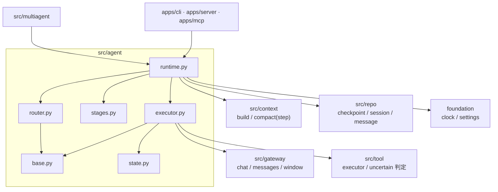
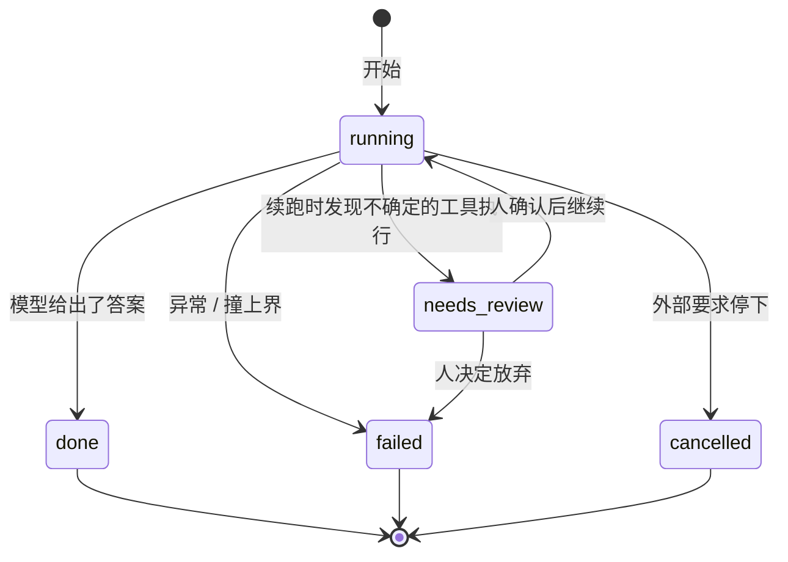
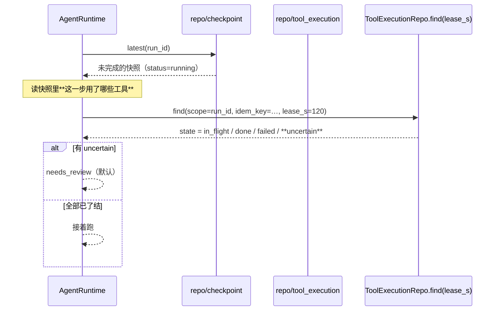
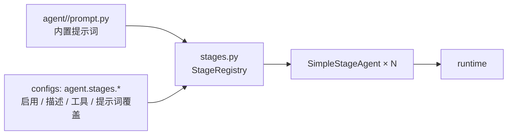
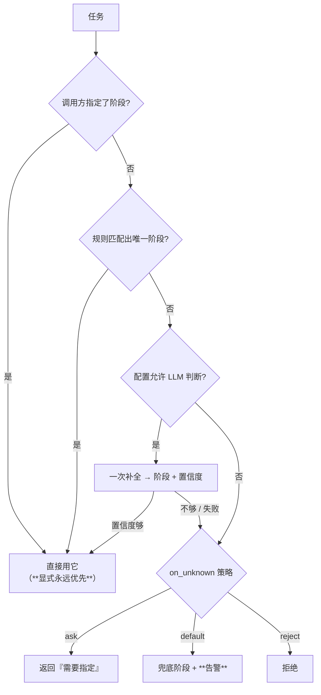
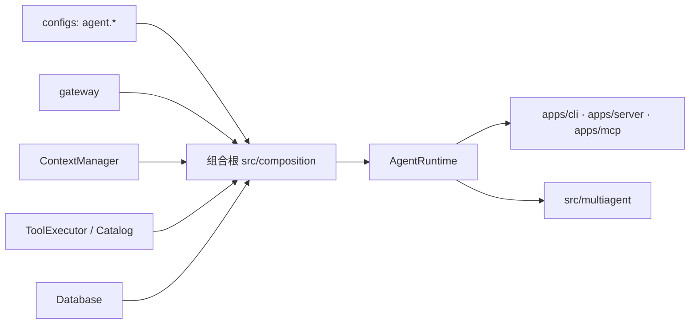
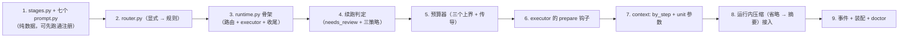

# `src/agent` 架构概要设计（单个 agent 的运行时层）

| 项 | 值 |
|---|---|
| 文档层级 | **架构层**（第二篇）。前置：《`src/agent` 需求说明书》 |
| 承接 | 需求说明书-agent 的全部 `FR-A-xx` / `NFR-A-xx` |
| 强耦合 | `docs/context/架构概要设计-context.md`（运行内压缩要复用的零件）；`docs/tool/架构概要设计-tool.md`（`uncertain` 的判定）；`docs/repo/架构概要设计-repo.md`（检查点与续跑） |
| 已实现 | `base.py` / `state.py` / `executor.py` |
| 本次新增 | `runtime.py` / `router.py` / `stages.py` + 七个阶段包的提示词 |
| 状态 | 待评审 |

---

## 0. 设计目标（一句话）

> 让「**一次任务跑到一半被打断**」成为一个**可判定、可决策、可解释**的状态 ——
> 而不是让它表现为「续跑之后莫名其妙多跑了一次」。

三句话展开：

- **可判定**：打断之后，系统能回答「现在是能接着跑、还是需要人看一眼、还是应该放弃」。
  今天 `executor` 只看检查点：有快照就接着跑 —— 它**没有问过工具层
  「上次那个 in_flight 的调用到底做完没有」**（工具层明明已经把这件事标出来了）。
- **可决策**：那个判定**不替上层赌**。三种处置（问 / 放弃 / 明确冒险）都是配置项，
  默认是最保守的那一个。
- **可解释**：这次运行为什么走到那个阶段、为什么在这一步压缩、为什么撞上上界 ——
  都能从事件还原。

**第二件事**（运行内的上下文）是本设计新提出的：一次运行内部的消息
**全部属于同一"轮"**，所以上下文层默认的按轮切分对它**一步都压不掉**。
而工具层的大结果单条上限 64KB ≈ 16K token —— 一个 8K 窗口的模型**一步都放不下**。

---

## 1. 结构总览

```
src/agent/
├── __init__.py      只导出运行时入口与契约
├── base.py          【已有】StageAgent / SimpleStageAgent / AgentResult
├── state.py         【已有】TaskRun / AgentStep / RunStatus
├── executor.py      【已有】想 → 调工具 → 再想（**保持纯循环**，本设计只给它开一个钩子）
├── stages.py        【新】阶段注册表：七份定义 → StageAgent（数据驱动）
├── router.py        【新】阶段路由：任务 → 阶段，带理由与置信度
├── runtime.py       【新】★ 一次运行的编排：准备 → 循环 → 收尾
├── requirement/     【新】七个阶段的提示词（`prompt.py`，纯数据）
├── test_design/
├── test_case/
├── environment/
├── execution/
├── analysis/
└── defect/

src/runtime/         ⚠ **已删除** —— 会话与消息的领域形态暂无独立模块（见 §6.3 与 §14）
src/multiagent/      把 AgentRuntime.run_one() 当零件用 —— 仍是空桩
```

**为什么 `runtime.py` 与 `executor.py` 要分开**（`DA-1`）：

| | `executor.py` | `runtime.py`（本次） |
|---|---|---|
| 是什么 | **一次循环**：给定消息就往下跑 | **一次运行**：准备、路由、预算、续跑、收尾 |
| 有状态吗 | 几乎没有（跑完就返回） | **有**：会话、运行、预算、事件 |
| 认识谁 | gateway / tool / checkpoint | **+ context / memory / 会话历史 / 路由** |
| 能单独测吗 | 能（喂假 gateway） | 能（喂假把式，见 §5.5） |

把编排塞进 `executor` 的后果，项目已经吃过一次 —— gateway 的顺序规则曾有过两个实现。
**一个循环只该有一个写法**，而它不该知道"这次运行总共能花多少钱"。

### 1.1 依赖图



**四条硬边界**：

1. **不 import `provider`** —— 已由 import-linter 机械强制（`NFR-A-01`）。
   消息一律经 `gateway.messages` 构造。
2. **不 import `apps`** —— 组合根注入一切（与 tool / memory / context 同构）。
3. **不 import `src/multiagent`** —— 依赖方向单向。是 multiagent 调单 agent，
   不是单 agent 知道自己被编排（`NFR-A-02`）。
4. **不直接调 `src/memory`** —— 长期记忆**只经 `context.settle()`**（`FR-A-11`）。
   理由是"记忆是对话的副产品"：让它成为 runtime 的第二个直接依赖，
   就会有人开始在 runtime 里做记忆的读写判定，而那是记忆层的活。

---

## 2. 核心机制一：一次运行的状态机



### 2.1 `needs_review` 的判定链

**这是本次设计里最有价值的一条**（`DA-5`）。工具层已经把"不知道"标出来了，
但**没有人消费它**：



**三个细节**：

- **判定的依据是工具层的 `find`**（它内部按租约把超时的 `in_flight` 判成 `uncertain`，
  见 `FR-T-08`）。本模块**不重新实现这个判定** —— 复制一份会让两处对"多久算超时"
  有不同的答案，而那正是最需要一致的地方；
- **要查的是"这一步用过的那些工具"**，不是全部。快照的 `AgentStep.tools_used`
  给了工具名 —— 但**幂等键还要从参数算**（`args_digest`）。所以检查点里
  **应当记下这一步的幂等键/参数指纹**，否则复现不出要查的那一行。
  ⚠ **这是对 `AgentStep` 的一个扩展**（`AQ-2`）；
- 三条处置**都只是策略**，判定结果与依据都进事件（`agent.resume.decided`）。

### 2.2 与检查点 `status` 的映射

| 运行时状态 | 写进检查点 | `CheckpointView.finished` | 能否被 `unfinished()` 查到 |
|---|---|---|---|
| `running` | `running` | 否 | ✅ |
| `done` | `done` | 是 | — |
| `failed` | `failed` | 是 | — |
| `cancelled` | `cancelled` | 是 | — |
| **`needs_review`** | `needs_review` | 否（不在 `finished` 集合里） | ❌ **当前查不到** |

⚠ **最后一行是一个要改的跨模块点**（`AQ-3`）：`CheckpointRepo.unfinished()`
现在只 `where(status == "running")`，于是**最需要人看的那一类运行恰恰不会出现在
"未完成的运行"里**。必须把它一起查出来。

> 另一侧是**对的、不用改**：`CheckpointView.finished` 是
> `status in {"done","failed","cancelled"}` —— `needs_review` 天然不在里面，
> 所以它不会被当成"已完成"。这是"用错的集合"与"用对的集合"的差别。

### 2.3 预算：三个上界，一个剩余量

```
本轮剩余 = min(
    deadline_s − 已耗时,
    max_cost − 已花费,        （可选）
)
每次 gateway.chat 的 deadline_s = min(单次上限, 本轮剩余)
```

- **为什么必须传导**：`gateway.chat(deadline_s=...)` 是**单次调用**的预算。
  只给单次 → "每次都不超时，合起来一小时"；只给整轮 → 单次调用可能吃掉全部预算（`DA-8`）；
- **成本从哪来**：gateway 的 `GatewayResult` 带 `cost`（`FR-G-09`）。
  runtime 累加它，与 `max_cost` 比较；
- **撞上哪一个要说清**：错误信息必须写明"撞的是时间/成本/步数预算"（`CA-9` / `CA-12`），
  否则排障时只知道"停了"。

---

## 3. 核心机制二：运行内的上下文

### 3.1 为什么按「轮」切分在这里失效

上下文层的切分单位是**轮**（一条 `user` 消息起）。而一次运行内部的消息是：

```
[user(任务), assistant(工具调用), tool(结果), assistant(工具调用), tool(结果), …]
 └──────────────────── 按「轮」切：**只有一轮** ────────────────────┘
```

`by_turn` 会把它整个当成一轮 → 尾部保护把全部留在尾部 → **一步都压不掉**。

而体量是实打实的：`tool.spill_threshold_bytes = 65536` —— 单条工具结果大结果
落盘后仍保留摘要与路径，但**未超过阈值的结果原样进消息**，几条就是几万 token。
`max_steps = 20` 时，一次运行的消息可以轻松超过任何窗口。

### 3.2 切分单位改成「步」

```
一步 = 一次模型回复 + 它发起的**全部**工具结果
```


**这样定义，天然满足"不切断配对"**：工具调用与它的结果属于同一步，
不可能被切到两侧 —— 与上下文层「按轮切」是同一个思路，只是单位不同。

### 3.3 两级压缩，先做不花钱的那一级

| 级 | 做什么 | 代价 | 丢什么 | 为什么可以丢 |
|---|---|---|---|---|
| **① 步骤省略** | 把**最老的**工具结果替换成一行说明 | 零 | 全文 | 全文在 `tool_execution` 与落盘文件里 —— **可回捞**（`FR-T-16` 的同一条思路） |
| **② 步骤摘要** | 把最早若干步交给 LLM 压成"已完成的操作与结论" | 一次补全 | 细节 | 同上，且账本记了范围 |

省略留下的那一行必须**说明丢的是什么、去哪找**：

```
[tool read] 结果已省略（3.2KB）—— 全文见 tool_execution（run=abc123）或落盘文件
```

**不是空白**：空白会让模型以为那个工具什么都没返回。

### 3.4 接入点：给 `executor` 开一个钩子，而不是让它认识 context

`executor` 现有一行是：

```python
result = await self.gateway.chat(self.alias, messages, tools=specs or None, …)
```

设计上给它插一个**可选钩子**（注入，不是 import）：

```python
@dataclass
class AgentExecutor:
    ...
    #: 每次调模型**之前**的准备。None 时行为与今天完全一致。
    prepare: PrepareHook | None = None      # async (messages, *, step, deadline_s) -> messages
```

**为什么是钩子而不是让 executor 调 context**：

- executor 就**不该认识** context（那是运行时层的事）。让它 import context 会把
  "循环"与"编排"重新搅在一起 —— 正是 `DA-1` 要避免的；
- 注入是可测的：单测给一个记录调用次数的假钩子即可；
- **`prepare=None` 时行为与今天一模一样** —— 这条改动是加法，不是替换。

### 3.5 复用 `compact/`：需要给上下文层加一种切分单位

运行内压缩的级联、缓存、账本、摘要器**都已经有了**（`src/context/compact/`）。
要复用它，只需要让切分单位可配：

```python
# src/context/compact/boundaries.py  （新增）
def by_step(messages) -> tuple[tuple[ContextMessage, ...], ...]: ...

# src/context/compact/levels.py
async def compact(self, messages, *, target_tokens, keep_recent=…, unit: Literal["turn","step"]="turn", …)
```

**为什么不是 agent 自己写一套**（`DA-4`）：那会让阈值、切分点、标记格式在两处漂移 ——
而"两处各写一份、慢慢漂移"正是上下文层把压缩做成独立文件夹的理由（`MC-15`）。

⚠ 这是**对上下文层的一处扩展**，需要两个模块一起改（`AQ-1`）。

---

## 4. 核心机制三：阶段注册与路由

### 4.1 七个阶段是**数据**，不是七个类



- **新增一个阶段 = 加一个包 + 一条配置**，不改 `runtime` / `router` 一行代码（`FR-A-01`）；
- `stage` 的取值同时是**工具类别**（`FR-T-13`）与**包名** —— 三者共用一个字符串，
  改一处要改三处的设计不要；所以这里**用同一个名字**，并把它作为注册表的键；
- **重名硬失败**（与 `FR-T-02` 同一条纪律）。

### 4.2 路由：显式 → 规则 → LLM，且**每步都可解释**



**规则怎么定**：每个阶段的定义可以带 `keywords`，匹配任务是**打分**不是布尔：

```
score(stage) = |命中关键词| / |该阶段关键词| ；
唯一最高分且 ≥ 阈值 → 选中；并列或都低于阈值 → 交给下一层
```

规则是**可解释、零成本、可测**的，所以它排在 LLM 前面（与压缩的 L1 排在 L2 前同一个思路）。

**LLM 判断永远不是必需品**：它是可选的（`routing.use_llm`），
失败或低置信度都会**退到 `on_unknown` 策略**，而不是抛错。

### 4.3 路由结果要能被回答

```python
@dataclass(frozen=True)
class RoutingDecision:
    stage: str
    reason: str                 # 「命中关键词 X / Y」或「显式指定」
    confidence: float           # 0..1；显式指定 = 1.0
    candidates: tuple[str, ...] = ()   # 没选中的那些，供排障
    needs_input: bool = False         # on_unknown=ask 时为真
```

**没有理由的路由在排障时等于没有信息** —— 「它怎么跑到那个阶段去了」是最常见的问题之一。

---

## 5. 各文件设计

### 5.1 `stages.py` —— 阶段注册表

```python
class StageRegistry:
    def register(self, agent: StageAgent) -> None      # 重名 → ValueError
    def get(self, stage: str) -> StageAgent            # 未知 → 报错并**列出全部阶段名**
    def names(self) -> tuple[str, ...]
    def enabled(self) -> tuple[StageAgent, ...]

def build_stages(cfg: Mapping[str, Any] | None) -> StageRegistry
```

- 未知阶段名的错误**必须列出全部可用名**（与 `FR-G-02` 的逻辑名寻址同一条纪律：
  拼错是最常见的错误，只说"未知"会让人去翻文档）；
- `cfg` 来自 `agent.stages.*`；`prompt` 非空时**覆盖**内置提示词。

### 5.2 `router.py` —— 阶段路由

```python
class StageRouter:
    async def route(self, task: str, *, stage: str | None = None,
                    hint: str = "") -> RoutingDecision
```

- `stage` 非空 → 直接返回（`confidence=1.0`，`reason="显式指定"`）；
- 规则打分 → 唯一最高分且 ≥ 阈值 → 返回；
- 可选的 LLM 判断：**走 `gateway.chat`**（不认识 provider），
  用 `json_schema` 要结构化输出，失败 → 退到 `on_unknown`；
- `on_unknown="ask"` 时返回 `needs_input=True`，**不抛异常** ——
  "需要人指定"是一种正常结果，不是错误。

### 5.3 `runtime.py` —— 编排（本设计的核心文件）

```python
@dataclass
class AgentRuntime:
    gateway: Gateway
    executor: AgentExecutor
    stages: StageRegistry
    router: StageRouter
    context: ContextManager | None = None      # 无则退回 executor 的原始行为
    repo: Any | None = None                    # 会话/消息（未实现 → 进程内）
    checkpoint: Any | None = None              # 经 repo
    clock: Clock = SystemClock()
    events: EventSink | None = None

    async def run_one(self, task, *, stage=None, session_id=None, caller=None,
                      resume=False, run_id="") -> RunOutcome
    async def run_turn(self, session_id, user_input, *, stage=None, caller=None) -> RunOutcome
    def cancel(self, run_id) -> None
```

**`run_one` 的骨架**（顺序即约束）：

```
① 预算器初始化（三个上界、剩余量）
② 路由（拿 stage，拿不到按策略）
③ 续跑判定（有 resume 时）
   └─ 有 uncertain → needs_review（默认）
④ 准备消息：
   context.build()（跨轮历史 + 当前任务）—— 没有 context 时退回 [system, user]
⑤ 交 executor.run(...)，并把 prepare 钩子挂上（运行内压缩）
⑥ 收尾（四件旁路事，见 §5.4）
```

**`run_one` 必须能被 multiagent 当零件调**（`NFR-A-02`）：它不知道自己在单跑还是被编排，
返回的 `RunOutcome` 是自足的（含 run_id、状态、答案、步数、工具次数、耗时、成本）。

### 5.4 收尾：四件旁路事

| 动作 | 失败时 | 为什么是旁路 |
|---|---|---|
| 写会话消息（repo） | 告警 + 事件 | 消息是给人回看的，不影响这次任务 |
| `context.settle()`（沉淀记忆） | 告警 | 记忆是增益（`NFR-M-07`） |
| 写最终检查点 | 告警 | **最要紧的一条**：写不上就意味着下次续跑从头来（但不会重复副作用 —— 那由幂等层兜底） |
| 发事件 | 静默 | 事件出口不该影响主流程 |

**四条都不得让 `run_one` 失败**（`NFR-A-03`），但**每一条都必须有可见的结果**（`NFR-A-09`）。

### 5.5 `executor.py` 的改动 —— **只加一个钩子**

```python
PrepareHook = Callable[[Sequence[Message], int, float | None], Awaitable[Sequence[Message]]]
#                            messages        step  剩余预算
```

在 `gateway.chat(...)` 之前插入：

```python
if self.prepare is not None:
    messages = list(await self.prepare(messages, step, remaining_deadline))
```

**改动是加法**：`prepare=None` 时逐字保持今天的行为，既有测试全绿。

> ⚠ **钩子不得改变"配对"**：它换掉的是消息列表，但**不得**切断
> `assistant(tool_calls)` 与 `tool(...)` 的配对 —— 这正是运行内压缩必须按**步**切的原因。

---

## 6. 与相邻模块的接缝

### 6.1 与 `src/context`

| 方向 | 内容 |
|---|---|
| agent 用 | `build()` —— 跨轮历史 + 当前任务 → 可发的消息序列（含长期记忆注入与去重） |
| agent 用 | `compact(unit="step")` —— **运行内**压缩（本次要给 context 加 `by_step`，`AQ-1`） |
| agent 用 | `settle()` —— 收尾沉淀（agent **不直接**调 memory） |
| context 不知道 | 什么是"步"的**业务含义**；它只知道"这是一种切分单位" |

### 6.2 与 `src/tool`

| 方向 | 内容 |
|---|---|
| agent 调 | `ToolExecutor.invoke()`（经 executor） |
| agent 消费 | **`uncertain`**：续跑判定的唯一依据（`FR-A-10`） |
| agent 提供 | `scope=run_id`（幂等的作用域，`executor` 已有） |
| 边界 | 工具报告"这一次调用"，agent 报告"这一步/这次运行" |

### 6.3 与 `repo`（以及已删除的 `src/runtime`）

| 方向 | 内容 |
|---|---|
| agent 用 | `CheckpointRepo.latest/history`（`unfinished` 已含 `needs_review`，`AQ-3`） |
| agent 用 | 会话与消息（**未实现**）→ 退到进程内 + 显式提示（`FR-A-07`） |
| 边界 | ⚠ `src/runtime` **已删除**：会话/消息的领域形态**现在没有归属**。agent 暂时借用 `context.ContextMessage`（`_exchange`，代码里标了「临时借用」）。这条债记在 `FR-A-07` 与 §14 |

---

## 7. 装配



**装配点**：`Runtime` 增加一个字段（与 `tools` / `memory` / `context` 并列）：

```python
@dataclass
class Runtime:
    ...
    agent: AgentRuntime | None = None
```

**启动期校验**：

- `agent.stages.*` 里出现的工具名必须在注册表里 → 否则**告警**（`FR-A-03` / `C-A-5`）；
- `routing.on_unknown` 必须显式配（`C-A-1`）—— 没有默认值；
- `limits` 三项都必须有值（`C-A-4`）—— **没有"不限"这个选项**；
- `repo` 不可用 → **日志与 `doctor` 显示"会话历史只活在进程里"**（`NFR-A-09`）。

**`apps/cli` 的入口**：现在的 `besa runtime "…"` 直接调 `gateway.chat`（不走 agent）。
设计上应**保留它**（它是"provider/gateway 契约够不够用"的试金石，见该文件 docstring），
**另加一个走 agent 的命令**（如 `besa run "…"`）—— 把试金石换成 agent 会掩盖下层的问题。

---

## 8. 事件

出口统一在 `AgentRuntime`（每个模块只有一个事件出口）。

| 事件名 | 何时 | 关键载荷 |
|---|---|---|
| `agent.run.started` | 开始 | `run_id` / `session_id` / `resume` |
| `agent.stage.routed` | 路由完成 | `stage` / `reason` / `confidence` / 候选 |
| `agent.resume.decided` | 续跑判定 | `decision`（resume/needs_review/abort/retry）/ **依据** |
| `agent.step.completed` | 每一步 | `step` / `tools` |
| `agent.context.compacted` | 运行内压缩 | `level`（omit/summarize）/ `saved_tokens` / 覆盖的步 |
| `agent.budget.exhausted` | 撞上界 | **哪一个**上界（steps / time / cost） |
| `agent.run.finished` | 结束 | 终态 / 步数 / 工具次数 / 耗时 / 成本 |

**为什么 `agent.resume.decided` 必须带依据**：`needs_review` 是个"停下等人"的决定 ——
如果事件里只写"需要人工介入"，人来了还得自己去翻是哪次工具调用不确定。

---

## 9. 关键设计决策

| 编号 | 决策 | 选择 | 理由 |
|---|---|---|---|
| `MA-1` | 编排放哪 | **`runtime.py`**，`executor` 保持纯循环 | 塞进 executor 会让"循环"与"编排"再次搅在一起（`DA-1`） |
| `MA-2` | 运行内压缩的切分 | **按「步」** | 运行内全部消息属于同一"轮"，按轮切一步都压不掉（§3.1） |
| `MA-3` | 压缩接入方式 | **给 executor 注入钩子**（`run()` 的**参数**，不是实例字段） | 保持 executor 不依赖 context；`prepare=None` 时行为不变（加法改动）。⚠ **必须是参数** —— 挂实例上会在并发时互相覆盖（§14） |
| `MA-4` | 压缩零件 | **复用 `context/compact/`**，给 boundaries 加 `by_step` | 两套实现必然在阈值/切分/标记格式上漂移（`DA-4`） |
| `MA-5` | 运行内压缩的级次 | **先省略（零成本）→ 再摘要** | 与 `context` 的 L1→L2 同一条纪律 |
| `MA-6` | 续跑遇不确定的默认 | **✅ `needs_review`**（已实现） | 重跑会重复副作用，放弃会丢已完成的步；**停下问一句最便宜**（`DA-5`） |
| `MA-7` | `needs_review` 的地位 | **独立终态**，不塞进 `failed` | 它不是失败，是"这里需要人看一眼"；混进去会让该告警被淹没 |
| `MA-8` | 时间预算粒度 | **整轮 + 单次两层，取 min** | 只给单次 → "每次不超时、合起来超时"（`DA-8`） |
| `MA-9` | 阶段定义 | **数据驱动**（配置 + 内置提示词） | 新增阶段不该改代码（`DA-7`） |
| `MA-10` | 路由顺序 | **显式 → 规则 → LLM** | 规则零成本可解释；显式永远优先 |
| `MA-11` | 路由推断不出 | **可配、无默认值** | 交互式可以问、批处理必须拒绝 —— 不替配置者决定（`DA-6`） |
| `MA-12` | 记忆怎么用 | **只经 `context.settle()`** | 让 memory 成为第二个直接依赖，就会有人在 runtime 里做记忆判定 |
| `MA-13` | 收尾失败 | **四件全部旁路**，但每件都有可见结果 | 收尾不该影响任务成败；但"没做"必须能被看见 |
| `MA-14` | multiagent 复用 | `run_one()` **自足且无协作假设** | 单 agent 是被编排的零件，不该知道自己被编排 |
| `MA-15` | CLI 入口 | **保留**现有的直连 gateway 命令，**另加**走 agent 的命令 | 前者是"契约够不够用"的试金石，换掉它会掩盖下层问题 |

---

## 10. 待确认（**已拍板**，见下表结论）

| 编号 | 待确认 | 备选 | 倾向 |
|---|---|---|---|
| `AQ-1` | **运行内压缩要不要放进 context**（`MA-4`） | (a) context 的 `boundaries` 加 `by_step` + `compact(unit=…)`；(b) agent 自建一套；(c) agent 把步包装成轮 | **(a)**。跨两个模块，但只加一个切分函数与一个参数；(c) 是 hack，会把"步"伪装成"轮"，而这个隐喻迟早会破 |
| `AQ-2` | **`AgentStep` 要不要记幂等键**（§2.1） | (a) 加 `idem_keys`；(b) 只记工具名，续跑时按工具名查最近的 | **(a)**。只记工具名的话，续跑时**复现不出要查哪一行**（幂等键含参数指纹）—— 而"查不出"会让整个判定退化成"全都算不确定" |
| `AQ-3` | **`CheckpointRepo.unfinished()` 要不要含 `needs_review`** | (a) 含；(b) 不含 | **(a)**。不含的话，**最需要人看的那一类运行恰恰不会出现在"未完成的运行"里** |
| `AQ-4` | 成本上界要不要做 | (a) 一期就做；(b) 二期 | **(a)**。它能拦住"模型在注定失败的循环里烧钱"，而那个场景是真实存在的 |
| `AQ-5` | 取消怎么暴露 | (a) `AgentRuntime.cancel(run_id)`（进程内注册表）；(b) 上抛 `CancelledError` 让调用方自己取消 task | **两者都要**。进程内的 `cancel()` 面向"另一个协程要求停"，`CancelledError` 面向"外层取消"；两者最终走同一个收尾 |
| `AQ-6` | 会话历史不落库时的可见性 | (a) 只在启动日志；(b) 日志 + doctor + 每次 `run_turn` 一次告警 | **(b)**。这条降级的症状是"重启后 agent 变笨了"，离原因很远 |
| `AQ-7` | ~~`src/runtime` 与 `src/agent` 的边界要不要写成契约~~ | — | ⚠ **已作废**：`src/runtime` 被删除（§14），没有边界可钉。**若该包回来**，它的名字要同时补进 `pyproject.toml` 的 `root_packages` 与各条契约的 source_modules —— 现在它不在任何一条约束里 |

---

## 11. 实施顺序



**为什么把运行内压缩（7、8）排这么后**：它依赖 context 的改动（`AQ-1`），
而**没有它运行时也是可用的**（退回 executor 今天的行为）——
先把"一次运行"跑通，再补"运行内也会超"这一层。

**每步的验收点**（对应 §13 的 `CA-*`）：
S1→`CA-5/6`；S2→`CA-1/2/3/4`；S3→`CA-7/25/26`；S4→`CA-19..24`；
S5→`CA-8/9/12`；S6→（既有测试全绿）；S7→`CA-18`；S8→`CA-13..17`；S9→`CA-27/28`。

---

## 12. 风险

| 风险 | 触发条件 | 缓解 |
|---|---|---|
| **续跑静默重复副作用** | 只看检查点，不问工具层 | `MA-6` + `CA-21`；工具层的幂等是第二道保险（`MA-1` 里那句话） |
| **`needs_review` 永远没人看** | `unfinished()` 查不到它 | `AQ-3`；否则"卡住的运行"会一直卡着 |
| **判定退化成"全都算不确定"** | 快照没记幂等键 | `AQ-2` —— 复现不出要查的那一行 |
| **运行内消息撑爆窗口** | 按轮切分（压不掉） | `MA-2` / `CA-13` / `CA-18` |
| **压缩切断工具配对** | 按条数切 | 按步切（`MA-2`）；配对校验在 context 的 `boundaries` 里已有 |
| **"每次不超时、合起来超时"** | 只给 gateway 单次预算 | `MA-8`：整轮预算传导到每次调用 |
| **取消被吞掉** | 在收尾里 catch 了 `CancelledError` | `NFR-A-07`：必须继续传播；收尾写在 `finally` 里但不吞 |
| **用错阶段白烧一轮** | 路由瞎猜 | `MA-11`：无默认值，必须显式配策略 |
| **CLI 直连 gateway 被顺手换掉** | 有人觉得"应该统一走 agent" | `MA-15`：保留它，它是下层契约的试金石 |

---

## 13. 需求追溯

| 需求 | 落点 |
|---|---|
| `FR-A-01 阶段注册表` | `stages.py` + 七个 `prompt.py` |
| `FR-A-02 路由` | `router.py`（§4.2） |
| `FR-A-03 阶段与工具类别` | `stages.py` × `executor._specs` |
| `FR-A-04 生命周期` | `runtime.py` + `RunStatus`（§2） |
| `FR-A-05 预算` | `runtime.py`（§2.3） |
| `FR-A-06 取消` | `runtime.py`（`AQ-5`） |
| `FR-A-07 会话与历史` | `runtime.py` × `repo`（领域形态暂无归属，见 §6.3 与 §14） |
| `FR-A-08 运行内上下文` | 钩子（§3.4）+ `context.compact(unit="step")` |
| `FR-A-09 两级压缩` | §3.3 |
| `FR-A-10 续跑判定` | §2.1 |
| `FR-A-11 收尾旁路` | §5.4 |
| `FR-A-12 可观测` | §8 |
| `NFR-A-01 依赖单向` | §1.1 四条硬边界 |
| `NFR-A-02 可被 multiagent 复用` | `run_one()` 自足（`MA-14`） |
| `NFR-A-03 不放大故障` | §5.4 |
| `NFR-A-04 不确定可见` | `MA-7` + `AQ-3` |
| `NFR-A-05 上界存在` | `C-A-4`（没有"不限"） |
| `NFR-A-06 可测试` | 钩子注入 + 假时钟 + 假 gateway（§5.5） |
| `NFR-A-07 取消可传播` | `runtime.py` 的收尾结构 |
| `NFR-A-08 可观测` | §8 |
| `NFR-A-09 降级要说出来` | 启动校验 + `doctor`（§7） |

---

## 14. 实现期回填的修订

**第一批：接起来才发现的**

| 项 | 现象 | 结论 |
|---|---|---|
| **`build_tools` 的 `executor` 不是 agent 的 executor** | 传进 `AgentRuntime` 之后，`self.executor.remaining_s = …` 抛 `FrozenInstanceError` | 两者**同名不同物**：`ToolsBundle.executor` 是**工具**执行器（执行一次调用），`AgentExecutor` 跑**一次 agent 循环**。组合根必须自己构造后者 —— 名字撞车在这里是有代价的，所以代码里补了一行注释指出来 |
| **成本与工具次数上界永远不会触发** | 测试里跑满 `max_steps` 也没撞上成本上界 | 执行器自己记账，而运行时层的 `_Budget` **从来没被更新过**。要让上界生效，循环必须**回报进度** —— 于是有了 `on_progress(花费, 累计工具次数)`。**"上界永远不触发"与"从来没超支过"长得一模一样**，这正是它危险的地方 |
| **钩子不能挂在执行器实例上** | 实现时把 `prepare` / `remaining_s` / `stop_reason` 写成了 `AgentExecutor` 的字段 | `AgentExecutor` 是**长生命周期**对象（组合根建一次、处处复用），而 multiagent 会**并发**跑好几个单 agent —— 两个并发运行会互相覆盖对方的钩子与预算，表现是「A 的运行用了 B 的预算」，**偶尔**发生、极难复现。改成 `run()` 的**参数**（每次调用一份） |
| **`RunOutcome.__str__` 会炸掉 CLI** | `print(outcome)` 抛 `UnicodeEncodeError: 'gbk' codec can't encode character '✓'` | 中文 Windows 的控制台是 GBK，编不出 `✓` / `⚠`。**一行状态输出就能让一次运行在演示时崩掉**。改用 ASCII 标记；状态的区分交给方括号里那个词 |

**第二批：写测试时发现的设计问题**

| 项 | 现象 | 结论 |
|---|---|---|
| **路由打分的分母会惩罚"关键词写得细"的阶段** | `test_case` 有 6 个关键词，命中了「用例」「测试用例」两个，只拿到 `2/6 = 0.33`，**过不了 0.5 的线**，于是「帮我为登录接口写测试用例」路由失败 | 分母从**关键词总数**改成**固定的饱和数**（命中 2 个即满分）。用总数会得到一个荒谬的激励：把关键词写全一点，反而更选不中 |
| **`C-A-1` 的"没有默认值"站不住** | 每个手工构造最小配置的测试都起不来 | 它与 `idempotency.on_unavailable` **不是一类**：那一条选错了会**静默地不设防**，而这里三个选项**都是安全的**（问 / 兜底 / 拒绝），差别只在体验。为一个不影响安全的取舍让最小配置起不来，代价与收益不成比例 —— 改成**默认 `ask`（最保守）+ 告警** |

**第三批：设计期间外部发生的变化**

| 项 | 变化 | 结论 |
|---|---|---|
| **`src/runtime` 被删除** | 设计时它存在（`session` / `message` / `history` / `context` 四个空桩），`DA-2` 的边界就建立在它上面 | 它被删除后，`DA-2` **作废**、`AQ-7` **作废**、`§6.3` 的边界改写。**会话消息的领域形态现在没有归属** —— agent 的 `_exchange` 借用了 `context.ContextMessage`，代码里标成「临时借用」（`FR-A-07`）。<br>⚠ 连带影响：`pyproject.toml` 的 `root_packages` 里还留着 `"runtime"`，`lint-imports` 会直接报「找不到包」——已一并移除（该包的名字也从三条契约的 source_modules 里移除了；**若它回来，这几处都要补回去**，否则它会是唯一不受依赖方向约束的顶层模块） |

**第四批：接口上的一处泛化**

| 项 | 结论 |
|---|---|
| `compact(keep_recent_turns=…)` 在按「步」切时名字就不准了 | 改名 `keep_recent`（单位数，轮或步由 `unit` 决定）。**名字说的是"单位"，不是"轮"** —— 否则第一个按步调用它的人会以为要传轮数 |
