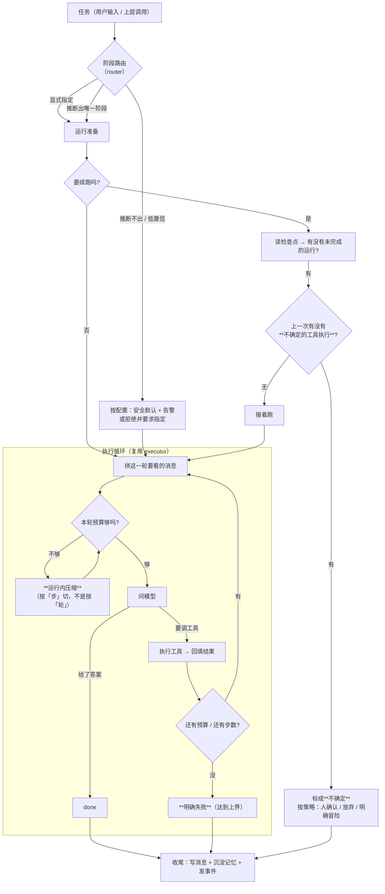
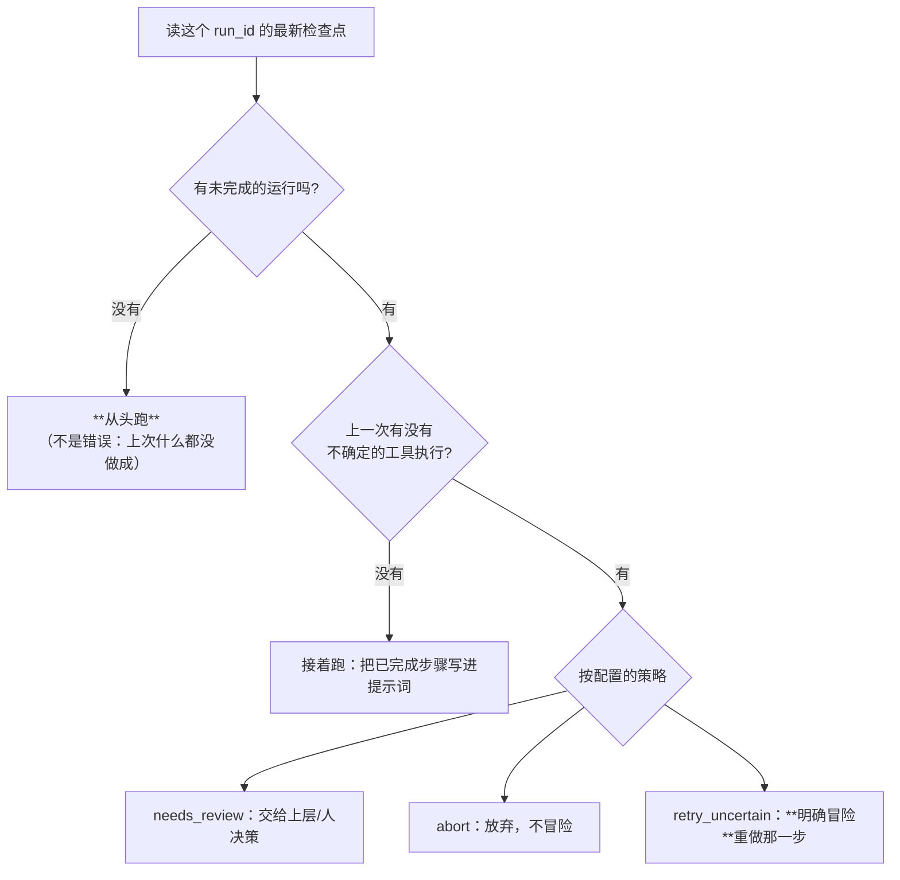

# `src/agent` 需求说明书（单个 agent 的运行时层）

| 项 | 值 |
|---|---|
| 文档层级 | **需求层**（第一篇）。后续：《`src/agent` 架构概要设计》 |
| 覆盖范围 | **单 agent 的运行时层**：`src/agent/runtime.py`、`src/agent/router.py`，以及它们与 `base.py` / `state.py` / `executor.py` / 七个阶段包的关系 |
| 上游依赖 | `foundation`（配置 / 时钟 / 日志）、`src/gateway`（对话与窗口）、`src/context`（这次给模型看什么）、`src/tool`（动作）、`src/memory`（长期记忆）、`src/repo`（会话 / 消息 / 检查点） |
| 下游消费 | `apps/cli`、`apps/server`、`apps/mcp`；`src/multiagent`（它把单 agent 当**零件**用） |
| 已实现的部分 | `base.py`（阶段契约）、`state.py`（运行状态）、`executor.py`（想→调工具→再想 的循环） |
| 待实现的部分 | `runtime.py`（本次设计的主体）、`router.py`（阶段路由）、七个阶段包（提示词） |
| 状态 | 待评审 |

---

## 1. 这份文档回答什么

只回答**要解决什么问题**、**必须提供哪些能力**、**什么算合格**。

**本文不回答**：循环怎么写（`executor.py` 已经有了）、提示词怎么写、
阶段之间怎么协作（那是 `src/multiagent`）。

**前置阅读**：`docs/tool/需求说明书-tool.md` §2.2（副作用不能重来）、
`docs/context/需求说明书-context.md` §2.2（压缩不可逆）、
`docs/repo/需求说明书-repo.md` `FR-R-05`（断点与续跑）。

---

## 2. 背景与定位

### 2.1 为什么还需要一个「运行时层」

`executor.py` 已经能把「想 → 调工具 → 再想」跑起来了。它缺的不是循环，缺的是**循环之外的那些事**：

| 已经有 | 还缺 |
|---|---|
| 一次循环（`AgentExecutor.run`） | **这次该由哪个阶段来跑**（七选一） |
| 「想几步就调几次模型」 | **这次运行总共能花多少**（步数之外还有时间与钱） |
| 手工拼 `[system, user]` 两个消息 | **这次给模型看什么**（历史 + 工具结果会一路涨） |
| 写检查点 | **续跑之前要判断"上次那个工具调用到底做完没有"** |
| 一个 `AgentResult` | **会话**：这一轮说完了，下一轮还要接着说 |

一句话：**`executor` 管「一次循环」，`runtime` 管「一次运行」**。
这不是为了分层而分层 —— 前者是纯函数式的（给定了消息就往下跑），
后者才有状态、有归属、有生命周期。

### 2.2 本模块真正难的地方：**「跑到一半」是一个必须被显式对待的状态**

工具层的难点是「副作用不能重来」，上下文层是「压缩不可逆」。这一层是第三种：

> **agent 的一次运行是「有过程」的，而那个过程正是最容易丢的东西。**

一次运行可能有二十步、调十几次工具、花几分钟。它会在任何一步被打断：
用户关掉终端、进程被杀、模型超时、上游限流。而「打断」留下的**不是一个干净的状态**：

```
        ┌──────────── 已经完成的步骤（可重放，但重复做要花钱）────────────┐
任务 ───┤                                                              ├──→ 结果
        └─ 第 N 步：模型说「调 read」→ **工具执行了** → 结果还没回填 ←─┘
                                              ↑ 崩在这里：**副作用发生了，但没人知道**
```

中间那一步是关键的：**工具可能已经产生了副作用，而运行没有记下结果**。
工具层已经把这件事标出来了（`in_flight` 超租约 → `uncertain`，
见 `docs/tool/架构概要设计-tool.md` §2.3），而工具层的文档明确写着：

> 「上层据此可以：人工确认、报警、或按策略冒险重试（**那是上层的决定**，不是工具层的）。」

**这个"上层"就是本模块，而它目前不存在。** 现在 `executor.py` 的续跑逻辑只看检查点：
有快照就接着跑 —— 它**没有问过工具层"上次那个调用到底做完没有"**。
于是「重复写一份用例文件」这种事会在续跑时安静地发生。

所以本模块的第一目标不是「能跑完」，而是：

> **把「跑到一半」变成一个可判定、可决策、可解释的状态** ——
> 而不是让它表现为「续跑之后莫名其妙多跑了一次」。

### 2.3 第二个难点：**一次运行内的上下文也会超**

上下文层解决了「跨轮的历史怎么给模型看」，但它默认的切分单位是**轮**（一条 user 消息起）。

而一次运行内部的消息是：

```
[user(任务), assistant(工具调用), tool(结果), assistant(工具调用), tool(结果), …]
 └────────────────────── 按「轮」切，这全部是**同一轮** ──────────────────────┘
```

**按轮切对运行中的消息完全无效**（只有一轮，什么也压不掉）。
而工具结果的体量是实打实的：工具层的大结果**落盘上限是 64KB**
（`tool.spill_threshold_bytes`），那一条就约 16K token —— 一个 8K 窗口的模型
**一步都放不下**。二十步就更不必说。

结论：**运行内需要另一套切分单位（「步」）与另一套压缩策略**，
而这件事不能塞进 `executor`，因为它需要知道预算、需要 LLM、需要记账 ——
那些都是运行时层的事。

### 2.4 这个目标做不到 100%，必须说清楚做到哪

| 做不到 | 能做到 |
|---|---|
| 保证任务成功 | 保证**失败是明确的**（`failed` 而不是静默的空结果） |
| 保证模型不绕圈 | 给一个**可读的上界**（步数 / 时间 / 成本），到顶就明确失败 |
| 消除打断 | 让打断后的状态**可判定**：能续 / 不能续 / 需要人确认 |
| 保证续跑不重复花钱 | 保证**不重复产生副作用**（那由幂等层兜底）；重复想的钱允许花 |
| 知道工具到底做完没有 | 把「不知道」**标成不知道**，交给上层决策而不是替它赌 |

**最后一条是本模块的立场**：不确定就是不确定，不做「大概率没事，接着跑吧」这种判断。

---

## 3. 范围

### 3.1 本模块负责

| 职责 | 落点 |
|---|---|
| **一次运行的编排**（准备 → 循环 → 收尾） | `runtime.py` |
| **阶段路由**（任务 → 七个阶段之一） | `router.py` |
| **会话与历史**（这一轮属于哪次会话、历史从哪来） | `runtime.py` + `repo`（会话与消息的**领域形态暂无独立模块**，见 §3.3） |
| **运行内的上下文**（每轮调模型前裁剪/压缩消息序列） | `runtime.py` × `src/context` |
| **续跑前的判定**（可续 / 不确定 / 不可续） | `runtime.py` × `src/tool` |
| **预算**（步数 + 时间 + 成本的整轮上界） | `runtime.py` |
| **取消**（外部要求停下） | `runtime.py` |
| **收尾**（沉淀进记忆、写会话消息、发事件） | `runtime.py` |
| 七个阶段的**定义与提示词** | `agent/<stage>/`（数据驱动，见 §5.1） |
| 循环本身 | `executor.py`（**已有**，本模块主要是**重用它**） |

### 3.2 本模块明确不负责

| 不做的事 | 归属 |
|---|---|
| 「想 → 调工具 → 再想」的循环 | `executor.py`（已有） |
| 工具怎么执行、幂等、权限 | `src/tool` |
| 模型怎么选、重试、降级、计量 | `src/gateway` |
| 历史怎么压缩、预算怎么切 | `src/context` |
| 长期记忆的写入判定与衰减 | `src/memory` |
| 会话 / 消息 / 检查点的**落库** | `src/repo` |
| 多个 agent 怎么协作（辩论 / 编排） | `src/multiagent` |
| 会话与消息的**领域模型定义** | **暂无独立模块** —— 原先预留给 `src/runtime`，该包已在实现期删除（见 §3.3 与 `DA-2`） |

### 3.3 与 `src/multiagent`、`src/tool` 的分工，以及 `src/runtime` 的删除

**① 「会话领域模型」那一层现在没有独立模块。**

初稿设计时，目录里有一个 `src/runtime/`（`session` / `message` / `history` / `context` 四个空桩），
本设计的边界是「`src/runtime` 管**对话是什么**，`src/agent/runtime` 管**这次任务怎么跑**」。

**实现期该包被删除了。**于是边界随之调整：

| | 原 `src/runtime/` | **`src/agent/runtime.py`（本模块）** |
|---|---|---|
| 管什么 | 会话与消息的领域形态与生命周期 | **一次任务怎么跑完**：路由、循环、预算、续跑、收尾 |
| 现在归谁 | **暂无归属** —— 见下面的"已知债" | 不变 |

⚠ **已知债**：会话消息的领域形态现在**借用了上下文层的 `ContextMessage`**
（见 `agent/runtime.py` 的 `_exchange`，代码里标了这条借用）。两者形状接近但**不是一回事** ——
前者是「说过什么」，后者是「这次给模型看什么」。会话落库落地时应当把它换掉。
这条债在 `FR-A-07` 与 `DA-2` 里都记着。

**② 与 `src/multiagent` 的关系：单 agent 是**零件****

多 agent 的三种策略（辩论 / 编排 / 并行）**都在跑单个 agent**，
差别只在「谁来跑、跑几个、结果怎么合」。所以：

- `AgentRuntime` 必须提供一个**干净的「跑一个 agent 到完成」的入口**，供 multiagent 调用；
- 它**不得**内置任何"我是被谁调的"的假设（不知道自己在单跑还是被编排）；
- 反过来，multiagent 的协作逻辑**不得**下沉到这里 —— 那会让单 agent 被迫理解"评委""轮次"。

**③ 与 `src/tool` 的分工**：工具报告「**这一次调用**」，agent 报告「**这一步 / 这次运行**」。
**谁拥有这个信息，谁记录它** —— 所以检查点由本模块写，工具只管自己的 `tool_execution`。

---

## 4. 一次任务的责任链



**三个"必须显式"的地方**（都不允许静默处理）：

| 位置 | 静默处理的后果 |
|---|---|
| 阶段推断不出 | 用错阶段跑 → 用错工具集 → 白烧一轮甚至做错事 |
| 续跑遇到不确定的工具执行 | **重复产生副作用**（工具层已经拦住"同一个键"，但那次执行到底做完没有只有上层能决策） |
| 撞上预算上界 | 返回一个像是成功的空结果 → 上层以为任务完成了 |

---

## 5. 功能需求

编号 `FR-A-xx`。

### 5.1 阶段路由

#### FR-A-01 — 七个阶段是一个**注册表**，不是七个 `if`

**要求**：

- 七个阶段各自是 `StageAgent`（`base.py` 已有契约），由**注册表**按 `stage` 名索引；
- 七份提示词是**数据**（配置可覆盖），代码只提供契约与缺省 ——
  与 `src/skill` 的定位一致：**能执行的代码归 tool，可配置的定义归数据**；
- 新增一个阶段 = **加一份定义**，不改 `runtime` / `router` 的任何代码；
- 注册时**重名硬失败**（与 `FR-T-02` 同一条纪律：静默覆盖会让一个阶段悄悄失效）。

**验收点**：在配置里加一个新阶段，不改一行 Python，路由能选中它。

#### FR-A-02 — 路由：显式优先，推断兜底，**推断不出要说出来**

**要求**：

- **显式指定永远优先**（调用方说跑哪个阶段就跑哪个，哪怕任务描述看起来像别的阶段）；
- 没有显式指定时按**规则**推断（阶段提示词里的关键词 / 调用方给的提示）；
  规则不确定时才用 LLM 判断；
- 任何一次路由都要给出：**选中的阶段、理由、置信度、候选集** ——
  没有理由的路由在排障时等于没有信息；
- **推断不出来时不许瞎猜**：按配置
  `agent.routing.on_unknown: ask | default | reject`
  （`ask` = 返回"需要指定"给上层；`default` = 用配置的兜底阶段 + **告警**；`reject` = 直接拒绝）；
- 路由结果**必须写进事件**（否则「它怎么跑到那个阶段去了」无从回答）。

**验收点**：任务「帮我写个登录接口的用例」→ 路由到 `test_case` 且理由可读；
给一句无法判断的话 → 按配置行为处理，**且事件里能看到"没判断出来"**。

#### FR-A-03 — 阶段决定「能用哪些工具」，但也仅仅是"意图"

**要求**：

- 阶段声明 `tools`（名单）与 `tool_categories()`（默认 `(stage, "infra")`），
  真正给模型看哪些由 `catalog.select` 决定（`executor._specs` 已实现）；
- **声明得宽不等于授权**：授权在 `src/tool` 的权限层。阶段声明应当**宁窄勿宽**；
- 阶段声明里出现**未注册的工具名**时，启动期**告警**（配置错误要在启动时暴露）。

**验收点**：把 stage 的 `tools` 设成一个不存在的名字 → 启动期告警，运行不受影响。

### 5.2 一次运行的编排

#### FR-A-04 — 运行的生命周期

**要求**：一次运行有明确的状态机，且**每个终态都可区分**：

```
created ──→ running ──┬──→ done          （模型给出了答案）
                      ├──→ failed        （异常 / 达到上界）
                      ├──→ cancelled     （外部要求停下）
                      └──→ needs_review  （续跑时发现不确定的工具执行，需人决策）
```

- `needs_review` **必须是独立状态**，不能塞进 `failed` ——
  它不是失败，是"**这里需要一个人看一眼**"；
- 每个终态都要落进检查点与会话消息，让下一次运行时能读到。

**验收点**：四种终态各构造一次 → 检查点里的 `status` 能一一区分。

#### FR-A-05 — 预算：步数、时间、成本**都要有上界**

**要求**：

- **步数上界**已有（`max_steps`），保留；
- **时间上界**：整轮运行有一个总预算，**并且要传导到每次模型调用** ——
  `gateway.chat(deadline_s=...)` 是**单次调用**的预算，而本模块要传的是
  「整轮还剩多少」。**每次调用取 `min(单次上限, 本轮剩余)`**；
  否则「单次都不超时、合起来超了一小时」是常态（`FR-G-12` 的总预算贯通是同一个思路）；
- **成本上界**（可选）：超过配置的金额就停 —— 它能拦住"模型在一个注定失败的循环里烧钱"；
- 撞上任何一个上界都是 **`failed`**，且错误信息要说清**撞的是哪一个**。

**验收点**：把总预算设为 3 秒、任务需要 10 次调用 → 运行在预算内停止，
且错误信息说"撞的是时间预算"，而不是笼统的"超时"。

#### FR-A-06 — 取消

**要求**：

- 外部取消（`asyncio.CancelledError` / 显式 `cancel()`）→ 状态是 `cancelled`，
  **并且留下一条快照**（取消不是崩溃，它必须可续跑）；
- 取消**不吞掉** `CancelledError`：本模块要保证它继续向上传播（
  吞掉它会让"停止"这个语义在某些框架里彻底失效）；
- 取消发生在工具执行中途时，与"崩溃"是**同一类不确定** —— 走 `FR-A-08` 的判定。

**验收点**：在第二步取消 → 状态是 `cancelled`，快照存在，且能续跑。

### 5.3 会话与历史

#### FR-A-07 — 会话是历史的归属；没有库时不假装有

**要求**：

- 每次运行归属一个 `session_id`（缺省由本模块生成），历史按会话取；
- 会话与消息的**落库归 `src/repo`**（`FR-R-02`）；本模块只负责**取与写**；
- ⚠ **`repo/session.py` 与 `repo/message.py` 目前是空的**：
  没有它们时本模块**退到进程内历史**，并且**必须在启动日志与 `doctor` 里显示**
  「历史只活在进程里」——
  表现是「重启后 agent 忘了刚才聊过什么」，而**那看起来像模型变笨了**；
- 历史有**条数/字节上界**：取历史时不能无界（它要进上下文预算）。

**验收点**：`repo` 不可用时启动日志明确显示"会话历史不落库"；重启后 agent 确实不知道之前聊过什么，
**且这件事在 doctor 里可见**。

### 5.4 运行中的上下文

#### FR-A-08 — 每轮调模型前，消息序列必须过上下文层

**要求**：

- `executor` 现在把工具结果**一路 append**，从不裁剪 —— 一次二十步的运行会撑爆窗口
  （工具层单条大结果落盘上限 64KB ≈ 16K token）；
- 因此**每次调模型之前**，当前消息序列要交给上下文层裁剪/压缩；
- **切分单位是「步」而不是「轮」**：一次运行内部的所有消息属于**同一轮**
  （见 §2.3），按轮切什么也压不掉。切分点必须落在**完整的步**上
  （一步 = 一次模型回复 + 它发起的全部工具结果）；
- **当前步永远完整可见**：模型必须能看到自己刚调了什么、拿到了什么；
- 被压缩掉的内容**必须能回捞**：工具结果的全文在 `tool_execution` 与落盘文件里，
  所以"丢掉"是安全的 —— **但要在上下文里说清"这里省略了什么"**，
  而不是留一段空。

**验收点**：一次 20 步、每步工具结果 8KB 的运行 → 不超窗口，且模型仍能正确回答最后一步的问题；
被省略的步骤在账本里可查。

#### FR-A-09 — 运行内压缩用两级，优先用不花钱的那一级

**要求**：

| 级 | 做什么 | 代价 | 丢什么 |
|---|---|---|---|
| **步骤省略（先做）** | 把**最老的**工具结果替换成一行说明（工具名 + 大小 + "全文在 tool_execution / 落盘文件"） | 零 | 全文（**可回捞**） |
| **步骤摘要（后做）** | 把最早若干步交给 LLM 压成一段"已完成的操作与结论" | 一次补全 | 细节（可回捞） |

- **先做零成本的那一级**，够用就绝不动模型（与 `context` 的 L1→L2 是同一条纪律）；
- 省略与摘要**都要记账**（省了多少、丢了哪一步、回捞到哪去）；
- **不得省略当前步**，也不得省略"最近 K 步"。

**验收点**：预算差一点时只做省略（**零次 LLM 调用**）；差很多时才做摘要。

### 5.5 续跑

#### FR-A-10 — 续跑前先判定「上次停在哪、安不安全」

**要求**：`resume=True` 时按顺序判定：



- 「不确定」的**判定依据在工具层**：`ToolExecutionRepo.find(..., lease_s=)` 把超租约的
  `in_flight` 判成 `uncertain`（`FR-T-08`）。本模块**不重新实现这个判定**，只消费它；
- 默认策略是 **`needs_review`**（宁可停下问一句，不可默默再写一次文件）；
- **`retry_uncertain` 必须显式配置**，且要有告警 —— 它是"我知道可能重复，但我接受"；
- 「已完成的不续跑」（`executor` 已有该行为）要保留：那不叫续跑，叫重跑一个做完的任务。

**验收点**：构造一条「登记了 in_flight 之后进程消失」的运行 → 默认走 `needs_review` 而不是直接重跑；
把 `lease_s` 调小让它不再算超租约 → 骨架能续跑。

### 5.6 收尾

#### FR-A-11 — 收尾是旁路，但每一件都要有结果可见

**要求**：运行结束后依次做四件事，**任何一件失败都不得让运行本身失败**，
但**每一件都要有可见的结果**：

| 收尾动作 | 失败时的表现 |
|---|---|
| 写会话消息（`repo`） | 告警 + 事件；运行结果照常返回 |
| 沉淀进长期记忆（`context.settle`） | 告警；记忆是增益不是依赖 |
| 写最终检查点 | 告警（**这条最要紧**：写不上就意味着下次续跑会从头来） |
| 发事件 | 静默忽略（事件出口不该影响主流程） |

**验收点**：把数据库断开跑一次 → 运行**照常返回 done**，且日志里四条降级信息都在。

### 5.7 可观测

#### FR-A-12 — 一次运行的过程必须能被还原

**要求**：事件至少覆盖

| 事件 | 何时 |
|---|---|
| `agent.run.started` / `agent.run.finished` | 开始 / 结束（带终态、步数、耗时） |
| `agent.stage.routed` | 路由完成（阶段、理由、置信度） |
| `agent.step.completed` | 每一步（第几步、用了哪些工具） |
| `agent.context.compacted` | 运行内压缩（哪一级、省了多少） |
| `agent.resume.decided` | 续跑判定（可续 / 不确定 / 放弃，以及**依据**） |
| `agent.budget.exhausted` | 撞上哪一个上界 |

**验收点**：拿一个 `run_id` → 能把这次运行的完整过程还原出来（路由 → 每一步 → 压缩 → 收尾）。

---

## 6. 非功能需求

| 编号 | 需求 | 说明 |
|---|---|---|
| `NFR-A-01` | **依赖方向单向** | agent → context / memory / tool / gateway / repo / foundation。**不得** import `provider`（已由 import-linter 机械强制）；**不得** import `apps` |
| `NFR-A-02` | **可被 multiagent 当零件复用** | `run_one()` 不得有任何"我正在被编排"的假设；也不得内含协作逻辑 |
| `NFR-A-03` | **不放大故障** | 收尾、记忆、事件、历史写入四项都是**旁路**；模型或工具失败**不得**让进程崩 |
| `NFR-A-04` | **不确定必须可见** | 不允许把 `needs_review` 降级成 `failed` 或 `done`（`FR-A-04` / `FR-A-10`） |
| `NFR-A-05` | **上界必须存在** | 步数、时间、成本三者都要有可配的上界；**没有"不限"这个选项** |
| `NFR-A-06` | **可测试** | 路由、续跑判定、预算耗尽、运行内压缩都要能用**假时钟 + 假模型 + 内存检查点**测 |
| `NFR-A-07` | **取消要真的能停** | `CancelledError` 必须继续传播；工具执行中途取消要落到 `uncertain` 判定上 |
| `NFR-A-08` | **可观测** | `FR-A-12` 的事件必须发；「为什么这次跑成这样」要能从事件还原 |
| `NFR-A-09` | **降级要说出来** | 「历史不落库」「记忆未启用」「检查点写不上」都必须在启动日志或 doctor 里可见 —— **不许静默降级** |

---

## 7. 配置需求

```yaml
agent:
  # 对话用的逻辑名。**阶段不各配一个** —— 换模型是改配置的事
  alias: runtime.default

  limits:
    max_steps: 20                 # 步数上界（已有）
    deadline_s: 600               # **整轮**运行的时间预算（不是单次调用）
    max_cost: 5.0                 # 成本上界（可选，null = 不限）；防空转烧钱
    max_tool_calls: 100           # 整轮工具调用次数上界（工具层还有一层，这里是顶层兜底）

  # 运行内的上下文（FR-A-08 / FR-A-09）
  context:
    enabled: true                 # 关掉 = 退回 executor 的"一路 append"
    keep_recent_steps: 4          # 最近几步**不参与压缩**
    omit_tool_output_chars: 200   # 省略一级留下的说明长度
    summarize: true               # 允许升到摘要那一级（需要 LLM）
    target_ratio: 0.6             # 每轮把消息压到"可用输入"的这个比例以内

  routing:
    # 推断不出阶段时怎么办。**没有默认值是刻意的** —— 逼配置者做决定
    on_unknown: ask               # ask | default | reject
    default_stage: requirement    # on_unknown=default 时用哪个
    use_llm: false                # 规则不确定时要不要再用一次 LLM 判断
    llm_alias: runtime.default

  # 续跑（FR-A-10）
  resume:
    # 发现"不确定的工具执行"时怎么办。**默认最保守**
    on_uncertain: needs_review    # needs_review | abort | retry_uncertain
    lease_s: 120                  # 传给工具层判"超租约"的阈值（与 idempotency.lease_s 对齐）

  # 七个阶段的定义（FR-A-01）。数据驱动：新增阶段只加这里
  stages:
    requirement:
      enabled: true
      description: "需求分析"
      tools: []                   # 空 = 用 tool_categories()
      prompt: ""                  # 空 = 用内置缺省提示词
    test_design: { enabled: true, description: "测试设计" }
    test_case: { enabled: true, description: "用例编写" }
    environment: { enabled: true, description: "环境准备" }
    execution: { enabled: true, description: "执行" }
    analysis: { enabled: true, description: "结果分析" }
    defect: { enabled: true, description: "缺陷管理" }

  emit_events: true               # FR-A-12
```

**要求**：

- `C-A-1` `routing.on_unknown` **必须在配置里显式写出来**（base 里已经写了）；
  缺省时按最保守的 `ask` 处理并**告警**。
  ⚠ **初稿写的是"没有默认值、缺了就报错"，实现时改掉了** —— 理由见架构文档 §14：
  这三个选项**都是安全的**，与 `idempotency.on_unavailable`（选错了会静默不设防）**不是一类**；
- `C-A-2` `resume.on_uncertain` **默认 `needs_review`**：宁可停下问一句，不可默默重做；
- `C-A-3` `limits.deadline_s` 是**整轮**预算，不是单次调用的 ——
  单次调用的预算归 gateway（`gateway.*`），两者不是一个概念，配置里必须分开写；
- `C-A-4` `limits` 里**没有"不限"这个选项**：三项上界都必须有值（可以调大，不能不写）；
- `C-A-5` `stages.*` 里出现的工具名必须在注册表里，否则**启动期告警**（`FR-A-03`）；
- `C-A-6` 所有别名只写逻辑名，不写厂商模型名（与 `C-M-5` / `C-C-2` 同一条纪律）。

---

## 8. 验收标准（场景化）

**路由（§5.1）**

| # | 场景 | 期望 |
|---|---|---|
| `CA-1` | 显式指定阶段，但任务描述像另一个阶段 | **按显式指定的跑**（显式优先） |
| `CA-2` | 「帮我写登录接口的用例」 | 路由到 `test_case`，事件里带理由与置信度 |
| `CA-3` | 一句话无法判断阶段，`on_unknown=ask` | 返回"需要指定"，**不瞎猜** |
| `CA-4` | 同上但 `on_unknown=default` | 用兜底阶段跑，**且告警 + 事件** |
| `CA-5` | 配置里加一个新阶段 | 不改代码即可被路由到 |
| `CA-6` | 阶段的 `tools` 里写了个不存在的工具 | 启动期告警 |

**运行（§5.2）**

| # | 场景 | 期望 |
|---|---|---|
| `CA-7` | 任务正常完成 | `done`，步数与工具次数分别可读 |
| `CA-8` | 模型一直要调工具，跑满 `max_steps` | `failed`，错误信息说清撞的是步数上界 |
| `CA-9` | 总时间预算 3 秒、任务需要 10 次调用 | 在预算内停止，错误信息说清撞的是**时间**预算 |
| `CA-10` | 第二步取消 | `cancelled`，有快照，能续跑 |
| `CA-11` | 工具执行中途取消 | 走"不确定"判定，**不假装成功** |
| `CA-12` | 成本超过 `max_cost` | 停止并说明撞的是成本上界 |

**运行内上下文（§5.4）**

| # | 场景 | 期望 |
|---|---|---|
| `CA-13` | 20 步、每步工具结果 8KB | **不超窗口**，模型仍能正确回答最后一步 |
| `CA-14` | 预算差一点 | 只做"步骤省略"，**零次 LLM 调用** |
| `CA-15` | 预算差很多 | 升到"步骤摘要"，且记账 |
| `CA-16` | 任意一次压缩后 | **当前步完整可见**；最近 K 步未被动 |
| `CA-17` | 被省略的工具结果 | 上下文里有一行说明（工具名 + 大小 + 全文在哪），**不是空白** |
| `CA-18` | 一次运行内的消息 | 按**步**切分而不是按轮（按轮会一步都压不掉） |

**续跑（§5.5）**

| # | 场景 | 期望 |
|---|---|---|
| `CA-19` | 没有任何快照时 `resume=True` | **从头跑**，不是错误 |
| `CA-20` | 有快照、且无不确定的工具执行 | 接着跑，提示词里写清"已完成到第几步" |
| `CA-21` | 快照显示上一次停在"工具已执行、结果未回填" | 默认 `needs_review`，**不直接重跑** |
| `CA-22` | 同上但 `on_uncertain=abort` | 放弃并说明原因 |
| `CA-23` | 同上但 `on_uncertain=retry_uncertain` | 明确冒险重做，**且告警** |
| `CA-24` | 上一次运行已经 `done` | **不续跑**（那是重跑一个做完的任务） |

**收尾与可观测（§5.6 / §5.7）**

| # | 场景 | 期望 |
|---|---|---|
| `CA-25` | 数据库断开时跑完 | 运行**照常返回 done**，四条降级信息都在日志里 |
| `CA-26` | 记忆未启用 | 收尾跳过沉淀，**事件里说明"未启用"**（不是静默跳过） |
| `CA-27` | 拿一个 `run_id` 查事件 | 能还原：路由 → 每步 → 压缩 → 收尾 |
| `CA-28` | `repo` 不可用 | 启动日志与 doctor 显示"会话历史只活在进程里" |
| `CA-29` | 全仓库检索 | `src/agent/` 不 import `provider` / `apps` |

---

## 9. 决策点

> **已拍板**（评审通过，按下列结论实现）。实现期有改动的两处（`DA-6` 的默认值、
> 路由打分）记在架构文档 §14。

| 编号 | 决策点 | 备选 | 结论 |
|---|---|---|---|
| `DA-1` | 运行时的落点 | (a) `src/agent/runtime.py`；(b) 塞进 `executor.py`；(c) 另起一个模块 | **(a)**。`executor` 是纯循环（给定消息就往下跑），而运行时层有状态、有归属、有生命周期。塞进去会让"循环"与"编排"再次搅在一起 —— 项目已经吃过这个亏（gateway 的顺序规则有两个实现） |
| `DA-2` | 两个 `runtime` 的分工 | (a) `src/runtime` 管会话领域模型，`src/agent/runtime` 管单 agent 编排；(b) 合并 | ⚠ **已作废（实现期修订）**：`src/runtime` 被删除，只剩一个运行时。它原来的职责**现在没有归属** —— 会话消息暂时借用 `context.ContextMessage`（见 §3.3 的已知债） |
| `DA-3` | 运行内压缩的切分单位 | (a) 按「轮」；(b) 按「步」；(c) 按条数 | **✅ (b) 步**（已实现）。运行内所有消息属于**同一轮**，按轮切一步都压不掉（§2.3）；按条数切会切断工具调用与结果的配对 |
| `DA-4` | 运行内压缩放哪 | (a) 复用 `src/context` 的压缩零件，在 agent 里组装；(b) agent 自己写一套 | **(a) 复用** `compact/`。（b）会让阈值、切分点、标记格式在两处漂移 —— 而这正是 context 把压缩做成独立文件夹的理由 |
| `DA-5` | 续跑遇到「不确定」的默认行为 | (a) 直接重跑；(b) `needs_review`；(c) 放弃 | **✅ (b)**（已实现）。重跑会重复副作用；放弃会丢已完成的二十步。**停下问一句的成本最低** |
| `DA-6` | 路由推断不出时 | (a) 瞎猜一个；(b) 拒绝；(c) 可配 | **(c) 可配**。三种行为在不同场景下都是对的（CLI 交互可以问，批处理必须拒绝），所以不替配置者决定。⚠ 实现时把"无默认值"改成了"默认 ask + 告警" —— 见架构文档 §14 |
| `DA-7` | 七个阶段的定义放哪 | (a) 代码里的七个类；(b) 配置里的数据；(c) 都行 | **(b) 数据驱动**。与 `src/skill` 的定位一致；新增阶段不该改代码。代码只保留契约与缺省提示词 |
| `DA-8` | 时间预算的粒度 | (a) 只给 gateway 的每次调用；(b) 整轮一个总预算；(c) 两者都要 | **(c)**。只给单次 → "每次都不超时、合起来一小时"；只给整体 → 单次调用可能吃掉全部预算 |
| `DA-9` | 会话历史不落库时 | (a) 报错不启动；(b) 退到进程内 + 显式提示 | **(b)**。CLI 单次任务根本不需要落库；但**必须让人知道**重启后历史会丢（`NFR-A-09`） |
| `DA-10` | `needs_review` 是不是一个终态 | (a) 塞进 `failed`；(b) 独立状态 | **(b)**。它不是失败，是"这里需要一个人看一眼"；混进 `failed` 会让"需要人看"的告警被淹没在真实失败里 |

---

## 10. 与相邻模块的契约

| 相邻模块 | 契约 |
|---|---|
| `src/context` | 提供 `build()`（跨轮）与**运行内压缩**（按「步」）；agent 传消息与预算，拿回可发的序列 + 账本 |
| `src/memory` | 长期记忆经 `context.settle()` 间接使用；agent **不直接**调 memory |
| `src/tool` | `ToolExecutor.invoke()` 执行动作；**`uncertain` 的判定由工具层给**，agent 只消费 |
| `src/gateway` | `chat()` 对话、`context_window()` 取窗口；agent 不参与路由与重试 |
| `src/repo` | 会话 / 消息 / 检查点的落库；agent 只产生数据 |
| （原 `src/runtime`） | **已删除**。会话与消息的领域形态暂无独立模块；agent 暂时借用 `context.ContextMessage`（§3.3 的已知债） |
| `src/multiagent` | 把 `AgentRuntime.run_one()` 当零件；**不得**要求 agent 端内置协作逻辑 |
| `foundation` | `Clock`（可注入假时钟）、`Settings`（`agent.*`） |

---

## 11. 下一步

本文定稿后进入《`src/agent` 架构概要设计》，届时需要产出：

- **一次运行的状态机**（含 `needs_review`）与它和检查点 `status` 的映射；
- **续跑判定**的具体实现：怎么查工具层的 `uncertain`、三种策略各做什么；
- **运行内压缩**的接入点（执行循环的哪一处）、按「步」切分的算法、
  与 `compact/` 的复用方式（是否需要 context 新增 `by_step`）；
- **阶段注册表**的形态与配置加载（七个阶段的数据形状）；
- **路由**的规则与置信度怎么定、LLM 判断的提示词与失败降级；
- **预算器**：三个上界怎么共同作用、剩余预算怎么传给 `gateway.chat`；
- **事件清单**与 `subject` / `outcome` 的取值；
- **装配**：组合根里 `Runtime` 加什么字段、`apps/cli` 的入口怎么从"直接调 gateway"换成"跑 agent"；
- **会话与消息的落库**（`repo/session.py` / `message.py` 仍是空桩）：降级路径与可见性；
- **「会话消息的领域形态该由谁定义」这个问题仍然悬着** —— `src/runtime` 删除后没有归属，
  现在是借用上下文层的类型（§3.3 的已知债）。
