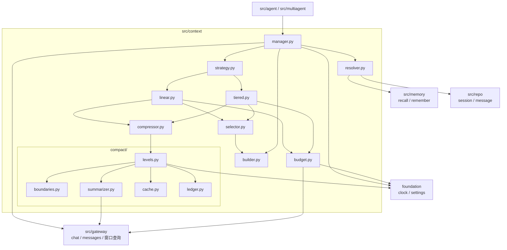
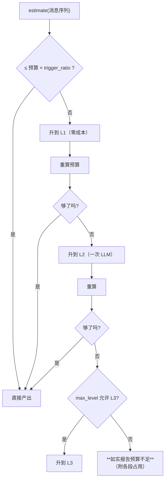
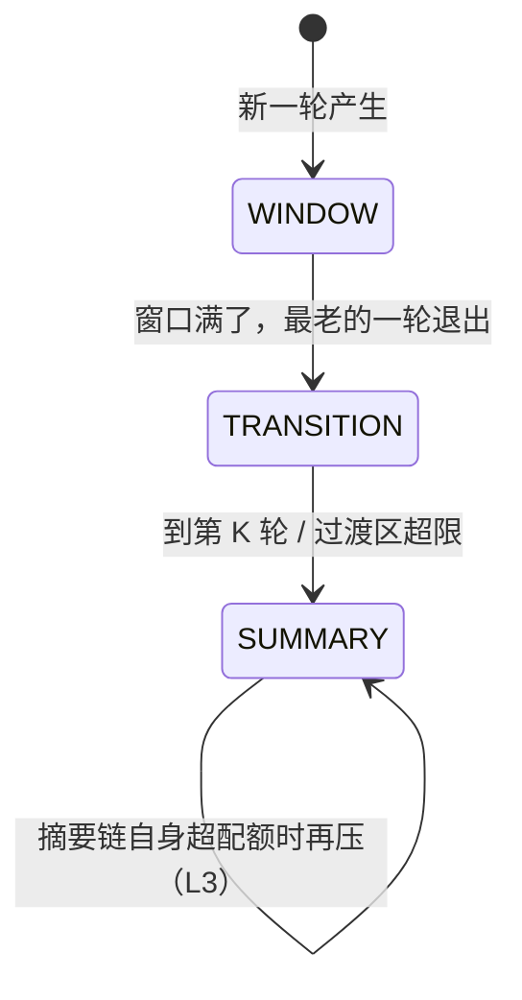
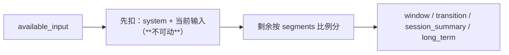
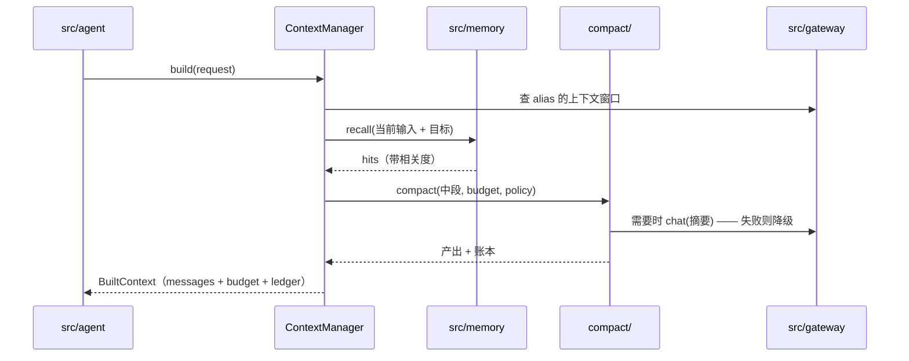
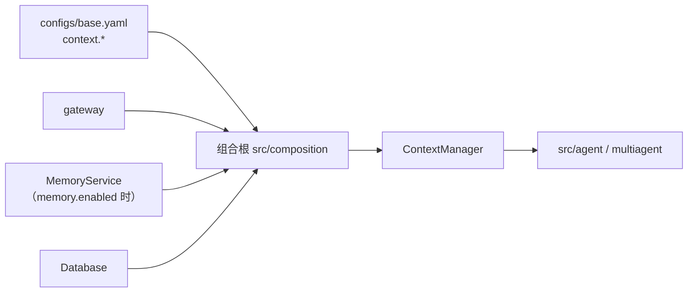

# `src/context` 架构概要设计

| 项 | 值 |
|---|---|
| 文档层级 | **架构层**（第二篇）。前置：《`src/context` 需求说明书》 |
| 承接 | 需求说明书-context 的全部 `FR-C-xx` / `NFR-C-xx` |
| 强耦合 | `docs/memory/架构概要设计-memory.md`（长期记忆的召回与沉淀）；`docs/gateway/架构概要设计-gateway.md`（LLM 入口与消息构造）；`docs/repo/架构概要设计-repo.md`（会话与消息） |
| 外部依赖 | 无。本模块是纯编排 —— 模型调用在 gateway，存储在 repo/memory |
| 状态 | 待评审 |

---

## 0. 设计目标（一句话）

> 让「模型看到的每一段历史，都是在**明确预算**下、按**明确优先级**、经过**可追溯的压缩**得到的」
> 成为默认 —— 而不是「能塞的都塞进去，塞不下就悄悄截断」。

第二句是本模块的存在理由。**截断和压缩的差别不在省了多少 token，而在"丢了什么"能不能被回答**：
截断丢的东西没有任何记录，而压缩会留下账本、级别、覆盖范围，以及一条**能回捞原文的钩子**。

**两条策略各管一类时间尺度**，共用同一批零件：

| 策略 | 组织方式 | 回答 |
|---|---|---|
| **一：线性 + 多级压缩** | 一条历史，**越早压得越狠** | 单任务长链路（一次跑几百轮） |
| **二：短期 / 会话 / 长期** | 按**时间尺度分层**，各层各机制 | 跨天、跨会话的长期陪伴型使用 |

**贯穿两条路线的一条纪律**：任何丢弃都要**有账可查**。
「看起来正常、只是少了点东西」是本模块最不能出现的一种失败（`NFR-C-08`）。

---

## 1. 结构总览

```
src/context/
├── __init__.py      只导出契约与管理器入口
├── types.py         契约：CompressionLevel / ContextBlock / Provenance / BudgetPlan / StrategyName
├── context.py       ContextRequest（输入）与 BuiltContext（产出物）
├── budget.py        模型窗口 → 各段配额；token 估算（复用 gateway 的口径）
├── strategy.py      ContextStrategy 协议 + 注册与选择（含按调用覆盖）
├── linear.py        策略一：线性 + 多级压缩
├── tiered.py        策略二：短期 / 会话 / 长期三层
├── selector.py      在预算内按优先级挑选要带的内容
├── resolver.py      与 memory 的接缝：召回 → 去重 → 注入
├── builder.py       组装成**合法**的消息序列（配对 / 角色 / 单 system）
├── compressor.py    压缩的门面（转发到 compact/，外部只认它）      ← 兼容既有桩名
├── manager.py       ★ 对外**唯一**入口：按策略编排、发事件、兜底降级
└── compact/         ★ **多级压缩**（独立文件夹，两条策略共用）
    ├── __init__.py
    ├── types.py        CompressionLevel / CompactUnit / CompactResult / LedgerEntry
    ├── policy.py       CompactPolicy.from_config
    ├── levels.py       各级的判定与产出（L0 → L3 的级联）
    ├── boundaries.py   切分点：按「轮」，不许切断配对
    ├── summarizer.py   调 LLM 产出**结构化**摘要（走 gateway）
    ├── cache.py        压缩结果缓存（按内容指纹）
    └── ledger.py       压缩账本
```

**`compact/` 为什么是一个独立文件夹**（需求 §4 的那条推论）：

> **多级压缩不是策略一的私有实现，而是两条策略共用的零件。**

策略二的「会话摘要链」自己会变长 —— 那时对它做的就是多级压缩的 L3。
把它们写成两份，等于把同一份逻辑维护两遍，而两份会在阈值、切分点、标记格式上**慢慢漂移**。

> **`compressor.py` 与既有的空桩**：`src/context/` 已预置了
> `budget / builder / compressor / context / manager / resolver / selector / types` 八个空文件。
> 本设计**保留这些名字**（`compressor.py` 作为 `compact/` 的门面），只新增
> `strategy.py` / `linear.py` / `tiered.py` 三个 —— 名字是契约的一部分，
> 换名会让「谁在哪」这件事重新变模糊。

### 1.1 依赖图



**四条硬边界**：

1. **不 import `provider`** —— 消息一律经 `gateway.messages` 构造。
   ✅ **已修**（`DC-3`）：`context` 已补进 import-linter 的 source 列表。
   同一次修改还顺带修好了那条契约的一个**长期误报** —— 见 §13。
2. **不 import `agent` / `multiagent`** —— 依赖方向单向（`NFR-C-01`）；是它们调上下文。
3. **不认识**具体模型（只认 alias）—— 压缩走哪个模型由 `context.linear.compact.summary_alias` 决定，
   与业务无关。
4. **不自己存消息** —— 会话与消息的持久化归 repo；本模块只读，以及经 repo 回捞原文。

---

## 2. 核心机制一：多级压缩（`compact/`）

### 2.1 为什么是级联，而不是"一段摘要打天下"

最朴素的做法是：超预算了就调 LLM 把老消息压成一段摘要。它有两个问题：

| 问题 | 后果 |
|---|---|
| **有成本就在热路径上** | 每轮都可能调一次 LLM，而成本**随轮数线性涨** |
| **一刀切** | 超一点点也用最狠的压缩，把还能保住的信息一起丢了 |

级联把这两件事都解决掉：**先用零成本的手段，不够再花钱，花钱也按梯次来**。

### 2.2 级别与状态


| 级 | 做什么 | 代价 | 损失 | 能不能回退 |
|---|---|---|---|---|
| **L0** | 不动 | 0 | 无 | — |
| **L1** | 合并重复、归一空白、**按上限截断工具输出** | **0（无 LLM）** | 近无损；截断处**必须标注** | 无（截断不可逆，但账本记了原长度） |
| **L2** | 把一段连续消息压成摘要 | 一次补全 | 有损（细节） | **可回捞**（带原始范围） |
| **L3** | 把若干段摘要再压成要点 | 一次补全 | 有损（**时间脉络**） | 可回捞（回到 L2 摘要） |

**L1 的地位被特意抬高**：它是唯一**零成本**的一级，也是唯一**不丢语义**的一级。
所以它**无条件先做** —— 很多"差一点点"的情况到 L1 就解决了，根本不需要调模型。

**L3 默认关闭**（`C-C-3`）：它丢的是"先做了什么、后做了什么"，而**调试与复现恰恰依赖这个顺序**。

### 2.3 触发与升级



三条约束：

1. **每次升级都重算预算**，而不是"一步到位升到顶"（`FR-C-04`）——
   省下的可能刚好够，多升一级就是白丢信息；
2. **升级次数有上界**（`max_llm_calls`）：压缩本身不能变成成本的第二个来源（`NFR-C-09`）；
3. **到顶仍不够就如实报告**，绝不静默截断当前输入（`FR-C-13`）。

### 2.4 切分点：压缩的永远是「中段」

这是本机制里**最容易做错、也最值得说清**的一处。

```
┌────────────┬──────────────────────────────────┬─────────────────┐
│  system    │          中段（压缩对象）          │ 最近若干轮原文   │
│  + 当前输入 │   L1 → L2 → L3 逐级压              │  **不动**        │
└────────────┴──────────────────────────────────┴─────────────────┘
     不可动              可压                        不可动
```

- **头部不可动**：system 提示与**当前用户输入**承载任务本身；
- **尾部不可动**：最近的若干轮是模型的"工作记忆"，压缩它等于让模型忘记自己正在做什么；
- **只压中段**：越靠中间、越早的内容，压得越狠。

这一条解决了"摘要把当前任务也压没了"这类事故 —— 因为**当前输入根本不在压缩范围内**。

**切分单位是「轮」**（`DC-5`）：

```python
# 一轮 = 一条 user 消息起，到下一个 user 消息之前（含中间所有 assistant / tool 消息）
# 这样定义，天然满足「tool_call 与 tool_result 不被切开」
```

`boundaries.py` 的职责就是把"随手切在第 K 条消息"换成"切在轮边界"。
按**条数**切是最自然的写法，也是**必然出错**的写法：一条工具调用与它的结果会被分到两侧，
而厂商的报错说的是「消息顺序不对」，指不到真正的问题。

### 2.5 账本与缓存

**账本**（`ledger.py`）—— 每一次压缩记一笔：

| 字段 | 为什么必须有 |
|---|---|
| `range` | 覆盖了哪些原始消息（**回捞的钩子**） |
| `level` | 是 L1 / L2 / L3 |
| `before_tokens` / `after_tokens` | 省了多少（`trigger_ratio` 调参的唯一依据） |
| `reason` | 为什么压（超预算 / 过渡区超限 / 摘要链超配额） |
| `summary_ref` | 产出在哪（缓存键） |

**缓存**（`cache.py`）—— 否则**每轮都重压一次**：

```python
cache_key = sha256(范围内容指纹 + level + prompt_version)
```

三个要点：

- **指纹取内容而不是消息 id**：同一条消息被编辑后应重新压；
- **`prompt_version` 必须进键**：提示词改了，旧摘要不能复用（否则会拿到"用旧标准压的"摘要）；
- **缓存是进程内的**，跨进程不稳——这是**刻意的**：压缩是优化，缓存丢了只是慢一点，
  而把它落库会引入"库里的摘要与代码里的 prompt 版本不一致"这类新问题。

### 2.6 摘要的标记与回捞

产出**必须带结构化标记**（`DC-6`）：

```
<<<compacted level=L2 range=m-1024..m-1180 这是早期对话的压缩摘要，可能丢失细节>>>
…摘要正文…
<<<compacted end>>>
```

两个理由：

1. **模型要知道自己在看摘要** —— 否则它会把自己摘要里"没提到"当成"当时没发生"；
2. **程序要能解析** —— 回捞（`FR-C-16`）靠 `range` 找回原文，靠字符串匹配是脆的。

> 这与记忆的**不可信标记**同源但**动机不同**：记忆怕被**注入**，摘要注意被当成**原文**。
> 两者都是「让模型知道这段内容的来源与性质」，而不是宣称"内容是干净的"。

---

## 3. 核心机制二：三层时间轴

### 3.1 每条消息在任一时刻属于三个集合之一



- **WINDOW**：最近 N 轮的**原文**（`FR-C-07`）；
- **TRANSITION**：已出窗口、**还没被压缩**（`FR-C-09`）；
- **SUMMARY**：已进会话摘要链。

**过渡区是被显式设计出来的一层，不是漏网之鱼。** 它是 N 与 K 不同步的必然产物：

```
N=5, K=10 时，跑到第 8 轮：
  WINDOW     = 第 4~8 轮（原文）
  TRANSITION = 第 1~3 轮（出了窗口，但还没到第 10 轮那次压缩）
  SUMMARY    = （空）
```

第 1~3 轮**既不在窗口里、也不在摘要里** —— 如果实现时只写了「窗口 + 摘要」，
这段就是**静默消失**的，而且没有任何东西会报错。这正是 §2.2 说的那种失败。

**过渡区必须有上限**（`transition_max_rounds`）：超了**强制压缩**，不等第 K 轮。
没有它，`K > N` 的配置会让过渡区无限增长，直到自己撑爆预算。

### 3.2 「一轮」的定义只有一处

`tiered.py` **不得**自己实现"什么算一轮" —— 它与 `compact/boundaries.py` **共用同一个函数**。
两处各写一份的后果是：窗口边界与压缩边界**不是同一套**，于是压缩可能切在一轮中间，
而那条消息随后又被窗口重复带上 —— 表现为"同一句话出现两次"，没人会想到是边界定义不一致。

### 3.3 摘要链的自压缩：两条策略在这里汇合

会话摘要链本身也会变长。超过配额时对它做 **L3** —— 用的正是 `compact/` 的实现。
这就是 §1 里"多级压缩是共用零件"的具体兑现，也是 `DC-4` 选 (b) 的理由。

### 3.4 去重：保守，且优先留更具体的一方

注入前对四类候选（window / transition / summary / long_term）做去重（`FR-C-11`）。

| 维度 | 做法 |
|---|---|
| **判据** | 内容指纹（完全相同）为主，高相似度为辅；**阈值保守** |
| **方向** | **漏去重是浪费（多占预算），错去重是丢信息（少一条且没人知道）** —— 与记忆的合并纪律同源，宁可少去 |
| **优先级** | 冲突时**保留更具体的一方**：记忆条目（结构化、带来源、可单独淘汰）> 摘要（一整块，删不掉其中一句） |
| **有界** | 只比对"这一批要注入的"，不做全量比对 |
| **留痕** | 去重掉什么记进账本 |

---

## 4. 预算分配

### 4.1 从模型窗口算起

```
available_input = model_window(alias) − reserve_output_tokens − safety_margin_tokens
```

- `model_window(alias)` **来自 gateway**（见 `DC-1`）——
  当前 `models.<key>` 里**只有 `max_tokens`（输出预留）而没有窗口**，
  这是一个必须补上的缺口。写在 `context.budget` 里会立刻与真实模型脱节；
- `reserve_output_tokens` 与 `models.<key>.max_tokens` 对齐；
- `safety_margin_tokens` 吸收估算误差与厂商差异。

### 4.2 两段"不可动"，其余按比例



**system 与当前输入先扣**，因为它们承载任务本身；
剩下的才按配置比例分给四段。这个顺序不能反 —— 反过来的结果是"预算紧时任务本身被砍"。

### 4.3 溢出：按固定优先级砍

```
long_term  →  session_summary  →  transition  →  window        （从后往前砍优先级）
```

砍到最低档仍不够 → **报 `budget_insufficient`**（附各段占用），
**不得**继续动当前输入或 system。

**每段有下限**：低于下限时**整段不注入**，而不是注入半截 ——
半截摘要比没有摘要更误导（模型会以为那就是全部）。

---

## 5. 各文件设计

### 5.1 `types.py` / `context.py` —— 契约与产出物

```python
CompressionLevel = Literal["L0", "L1", "L2", "L3"]
StrategyName     = Literal["linear", "tiered"]
Segment          = Literal["system", "current", "window", "transition", "session_summary", "long_term"]

@dataclass(frozen=True)
class Provenance:            # 一段内容的出处（账本与回捞都靠它）
    segment: Segment
    level: CompressionLevel = "L0"
    message_ids: tuple[str, ...] = ()      # 覆盖的原始消息（回捞钩子）
    confidence: float | None = None        # 长期记忆带过来的相关度
    note: str = ""

@dataclass(frozen=True)
class ContextBlock:          # 组装的最小单位
    content: str
    role: str
    provenance: Provenance

@dataclass(frozen=True)
class BudgetPlan:            # 一次请求的预算画像（可读，用于排障）
    model_window: int
    available_input: int
    allocated: Mapping[Segment, int]
    used: Mapping[Segment, int]
    dropped: Mapping[Segment, int]        # 被砍掉多少（**必须可见**）
    insufficient: bool = False

@dataclass(frozen=True)
class BuiltContext:          # 产出物
    messages: tuple[Any, ...]             # gateway.messages 造出来的消息
    budget: BudgetPlan
    ledger: tuple[LedgerEntry, ...]
    deduped: tuple[str, ...] = ()
```

### 5.2 `budget.py`

- `estimate_tokens(text) -> int`：**复用 gateway 的口径**（`DC-2`）；
- `plan(window, reserve_output, safety_margin, segments) -> BudgetPlan`；
- `allocate(blocks, plan) -> (kept, dropped)`：按 §4.3 的优先级砍，产出**可见的** dropped。

### 5.3 `strategy.py`

```python
class ContextStrategy(Protocol):
    name: StrategyName
    async def build(self, request: ContextRequest, budget: BudgetPlan) -> BuiltContext: ...

def resolve_strategy(name, *, registry) -> ContextStrategy   # 未知名字**硬失败**
```

未知策略名 → **报错并列出已知策略**（与 `FR-G-02` 的逻辑名寻址同一条纪律：
拼错是最常见的错误，只说"未知"会让人去翻文档）。

### 5.4 `linear.py` —— 策略一

```
历史 → L0
  ├─ estimate ≤ 预算 → 直接组装
  └─ 超预算 → 交给 compact/ 级联压中段 → 组装
```

关键：**只压中段**（§2.4），头部与尾部原样保留。

### 5.5 `tiered.py` —— 策略二

```
1. 把历史切成「轮」（boundaries.by_turn，与 compact 共用）
2. 分派：最近 N 轮 → WINDOW；窗口外未压 → TRANSITION；已压 → SUMMARY
3. TRANSITION 触发条件：累计轮数 ≥ K 或 轮数 > transition_max_rounds
4. 触发时：compact 压 TRANSITION → 追加到摘要链（并记账）
5. 摘要链超配额 → compact 做 L3
6. 组装：WINDOW 原文 + TRANSITION 原文 + SUMMARY + long_term（经 resolver）
```

### 5.6 `resolver.py` —— 与 memory 的接缝

- **召回**：`MemoryService.recall(query, ctx, kinds=...)` —— 查询由**当前输入 + 任务目标**构造；
- **去重**：§3.4；
- **注入**：转成 `ContextBlock`，`provenance.message_ids` 留空（它不是消息），
  `confidence` 带相关度；**回灌时保留不可信标记**（记忆侧已有 `to_model_text`）；
- **沉淀**（`FR-C-15`）：会话结束时把对话交给 `MemoryService.remember`，
  **失败只告警**（记忆是旁路）。

### 5.7 `compact/` 各文件

| 文件 | 职责 | 关键约束 |
|---|---|---|
| `types.py` | `CompactUnit`（一段待压内容）、`CompactResult`、`LedgerEntry`、`CompressionLevel` | 级别名是契约 |
| `policy.py` | `CompactPolicy.from_config` | `max_level` 默认 L2；`max_llm_calls` 有默认且有限 |
| `levels.py` | **级联的主循环**：L1 → L2 → L3，每级重算预算 | 到顶不够**如实报告**，不静默截断 |
| `boundaries.py` | 切分点：`by_turn()` 与 `middle_span()` | **唯一**的"轮"定义；不许切断配对 |
| `summarizer.py` | 调 gateway 产出结构化摘要 | 失败**降级**（回退上一级 + 告警），不抛给调用方 |
| `cache.py` | 内容指纹 → 压缩结果 | 键含 `prompt_version` |
| `ledger.py` | 追加账本条目 | 每次压缩**必记**，含范围与前后 token |

### 5.8 `compressor.py` —— 门面

对外只暴露一个方法：

```python
async def compact(self, messages, *, budget, policy, now) -> CompactOutcome
```

它把 `compact/` 的细节收在里面，于是**策略一与策略二看到的压缩器是同一个对象**。
保留这个名字也是为了让既有空桩的用途不变。

### 5.9 `manager.py` —— 唯一入口

```python
@dataclass
class ContextManager:
    gateway: ...
    memory: MemoryService | None
    repo: ...
    clock: Clock
    events: EventSink

    async def build(self, request: ContextRequest) -> BuiltContext
    async def rehydrate(self, provenance: Provenance) -> tuple[Any, ...]   # 回捞原文（FR-C-16）
    async def settle(self, session_id: str, *, ctx) -> None                # 会话结束沉淀
```

**兜底降级**（`NFR-C-07`）：`build` **不得**因为压缩/召回失败而整体失败 ——
退回"原样 + 告警"，并把 `insufficient` 标出来。

---

## 6. 与相邻模块的接缝

| 方向 | 内容 |
|---|---|
| context 消费 | `gateway.chat`（压缩摘要）、`gateway.messages`（构造消息）、**gateway 的窗口查询**（`DC-1`） |
| context 消费 | `memory.recall` / `memory.remember` |
| context 消费 | `repo` 的 message 查询（回捞） |
| context 产出 | `BuiltContext.messages` → 交给 `agent` 传给 `gateway.chat` |
| context 不 import | `provider`（`DC-3` 要补的契约）、`agent`、`multiagent` |



---

## 7. 装配



**装配点**：`Runtime` 增加一个字段（与 `tools` / `memory` 并列）：

```python
@dataclass
class Runtime:
    ...
    context: ContextManager | None = None
```

**`memory` 为 `None` 时**（默认）：`resolver` 的长期记忆这一段**整段缺席**，
三层策略退化成两层 —— 这是**一条完整的路径**，不是残废版（与 `DV-9` 同源）。

**启动期校验**（配置错误要在启动时暴露）：

- `budget.segments` 之和 > 1.0 → 报错（`C-C-6`）；
- `strategy` 未知 → 报错并列出已知策略；
- `compress_every > window_size` → **告警**（合法但会产生过渡区，`C-C-5`）；
- `summary_alias` 在 gateway 里解析不了 → 由 gateway 的既有校验兜住。

---

## 8. 事件

出口统一在 `ContextManager`（每个模块只有一个事件出口）。

| 事件名 | 何时 | 关键载荷 |
|---|---|---|
| `context.built` | 每次产出 | 各段占用 / 总 token / 是否 insufficient |
| `context.compacted` | 发生一次压缩 | 级别 / 前后 token / 覆盖范围 / 触发原因 |
| `context.compact_cached` | 命中压缩缓存 | cache key（验证缓存真的生效） |
| `context.compact_degraded` | 压缩失败降级 | 原因 / 退回到哪一级 |
| `context.dedupe_dropped` | 去重丢掉了内容 | 丢的是哪一段的什么（`NFR-C-08`） |
| `context.segment_dropped` | 预算不足砍段 | 段名 / 砍了多少 |
| `context.long_term_injected` | 注入了长期记忆 | 条数 / 最高相关度 |
| `context.settled` | 会话结束沉淀 | 提交了几条（或"记忆未启用"） |

**为什么 `compact_cached` 单独一个事件**：缓存是否真的生效，是这类系统里
**最容易被"看起来没问题"掩盖**的一件事 —— 缓存没命中不会报错，只是贵。

---

## 9. 关键设计决策

| 编号 | 决策 | 选择 | 理由 |
|---|---|---|---|
| `MC-1` | 压缩组织方式 | **级联**（L0→L3 按需升级） | 单一摘要要么贵要么糙；级联让"够用的最低成本"成为默认（§2.1） |
| `MC-2` | 压缩范围 | **只压中段**，头尾不动 | 头是任务本身，尾是工作记忆；压它们等于让模型忘记正在做什么（§2.4） |
| `MC-3` | 切分单位 | **轮**（不是条数、不是 token） | 轮是配对完整的最小单位；按条数切必然切开 tool_call/result（`DC-5`） |
| `MC-4` | L1 的地位 | **零成本、无条件先做** | 它是唯一不丢语义的一级，能解决大部分"差一点"（§2.2） |
| `MC-5` | L3 默认 | **关闭** | 它丢时间脉络，而调试与复现依赖顺序（`DC-9`） |
| `MC-6` | 压缩缓存 | **进程内 + 指纹含 prompt_version** | 落库会引入"库里摘要 vs 代码 prompt 版本"不一致 |
| `MC-7` | 摘要标记 | **结构化**（可解析的 range） | 模型要读它、程序也要读它；纯文本标记没法回捞（`DC-6`） |
| `MC-8` | 过渡区 | **显式建模 + 有上限 + 超限强制压缩** | 不显式建模 = 静默丢一段历史（§3.1） |
| `MC-9` | 「轮」的定义 | **只有一处**（`boundaries`） | 两处各写一份会让窗口边界与压缩边界打架（§3.2） |
| `MC-10` | 去重方向 | **保守**，优先留更具体的一方 | 漏去重是浪费，错去重是丢信息（§3.4 / `DC-8`） |
| `MC-11` | 预算起点 | **模型窗口**（由 gateway 提供） | 写在 context 配置里会立刻与真实模型脱节（`DC-1`） |
| `MC-12` | 不可动的两段 | **system + 当前输入**先扣 | 预算紧时该砍历史，不该砍任务 |
| `MC-13` | 压缩失败 | **降级**（回退上一级 + 告警） | 压缩是优化，不该变成新的故障点（`DC-7`） |
| `MC-14` | 唯一入口 | **`ContextManager`** | 上层不该知道现在跑的是哪条策略（`FR-C-01`） |
| `MC-15` | `compact/` 独立成文件夹 | **是** | 两条策略共用，写两份必然漂移（§1） |

---

## 10. 待确认（需评审）

| 编号 | 待确认 | 备选 | 倾向 |
|---|---|---|---|
| `CQ-1` | **模型窗口怎么进配置**（`DC-1`） | (a) `models.<key>.context_window` + gateway 暴露查询；(b) context 自己配 | **(a)**，但需要改 gateway 的 `Registry` 与模型配置 —— 跨两个模块，需一起定 |
| `CQ-2` | **`context` 补进 provider 契约**（`DC-3`） | 加 / 不加 | **加**。当前是**契约缺口**，不是风格问题 |
| `CQ-3` | 压缩缓存放哪 | 进程内 / repo 表 | **进程内起步**；实测命中率低再考虑落库 |
| `CQ-4` | 会话摘要链存哪 | (a) `repo` 新表；(b) 复用 `checkpoint`；(c) 内存 | **需要评审**。(a) 最干净但要多一张表；(b) 语义不符（checkpoint 是断点续跑） |
| `CQ-5` | 去重判据 | 指纹 / 相似度阈值 / 两者 | **指纹为主**（确定、零成本），相似度作为可选增强 |
| `CQ-6` | 「若干轮」的尾部保护 | 固定轮数 / 按预算比例 / 两者取小 | **两者取小**：既保证有工作记忆，又不因固定轮数撑爆小窗口模型 |
| `CQ-7` | 沉淀触发点 | 会话关闭 / 每 N 轮 / 两者 | **会话关闭为主**；长会话要有周期性沉淀，否则断了就全丢 |
| `CQ-8` | 两条策略是否允许**混合** | 纯二选一 / 允许 tiered 内部再选 | **允许**（`DC-4`），但配置只暴露一个 `strategy`，混合作为内部实现 |

---

## 11. 实施顺序


**为什么 `builder` 排在压缩之后**：产出合法性是**所有策略的共同底线**，
先把它钉死，后面加策略时不会各自踩配对问题。

**每一步的验收点**（对应 §13 的 `CX-*`）：
S1→`CX-1`；S2→`CX-19`；S3→`CX-4`；S4→`CX-21/22`；S5→`CX-3/5/6`；
S6→`CX-7/8`；S7→`CX-11..15`；S8→`CX-16/17/18/24`；S9→`CX-2/26/28`。

---

## 12. 风险

| 风险 | 触发条件 | 缓解 |
|---|---|---|
| **静默丢历史** | 只实现"窗口 + 摘要"，漏掉过渡区 | 过渡区显式建模 + 上限 + `CX-13` 守着（`MC-8`） |
| **压缩把当前任务压没** | 从头部开始压 | 只压中段（`MC-2`）+ 头尾不可动（`MC-12`） |
| **配对被切开、厂商 400** | 按条数切分 | 按轮切分（`MC-3`）+ `CX-21` |
| **每轮重压，成本失控** | 缓存没命中 / 没有缓存 | 缓存 + `max_llm_calls` + `context.compact_cached` 事件（`MC-6` / `NFR-C-09`） |
| **超窗被厂商拒** | 窗口配置与真实模型脱节 | 窗口由 gateway 提供（`MC-11`）+ 安全余量 |
| **模型把摘要当原文** | 摘要无标记 | 结构化标记（`MC-7`） |
| **契约缺口被利用** | 有人在 context 里 import provider | 补 import-linter 契约（`CQ-2`） |
| **换模型后预算全错** | 窗口写死在 context 配置里 | `MC-11`；配置层不做这件事 |
| **两层边界不一致** | 窗口与压缩各写一套"轮" | 单一定义（`MC-9`） |

---

## 13. 需求追溯

| 需求 | 落点 |
|---|---|
| `FR-C-01 策略选择` | `strategy.py` / `manager.py` |
| `FR-C-02 线性上下文` | `linear.py` |
| `FR-C-03 多级压缩的级数` | `compact/levels.py` + `compact/types.py` |
| `FR-C-04 按需触发与缓存` | `compact/levels.py` + `compact/cache.py` |
| `FR-C-05 压缩账本` | `compact/ledger.py` + `Provenance` |
| `FR-C-06 摘要标记` | `compact/summarizer.py` + `types.Provenance` |
| `FR-C-07 短期窗口` | `tiered.py` + `compact/boundaries.by_turn` |
| `FR-C-08 会话记忆（每 K 轮）` | `tiered.py` |
| `FR-C-09 过渡区` | `tiered.py`（§3.1） |
| `FR-C-10 长期记忆` | `resolver.py` + `src/memory` |
| `FR-C-11 三层去重` | `resolver.py` / `selector.py`（§3.4） |
| `FR-C-12 预算分配` | `budget.py`（§4.1） |
| `FR-C-13 溢出取舍` | `budget.py`（§4.3） |
| `FR-C-14 产出合法` | `builder.py` |
| `FR-C-15 会话沉淀` | `manager.settle` + `resolver.py` |
| `FR-C-16 回捞原文` | `manager.rehydrate` + `repo` |
| `NFR-C-01 依赖单向` | §1.1 四条硬边界（`CQ-2`） |
| `NFR-C-02 产出有界` | `budget.py` + `CX-23` |
| `NFR-C-03 压缩可缓存` | `compact/cache.py` |
| `NFR-C-04 确定性` | `boundaries` / `budget` / 去重均为纯逻辑 |
| `NFR-C-05 可测试` | 假时钟 + 假 LLM（注入 `ChatModel` 协议） |
| `NFR-C-06/08 可观测、不静默丢` | §8 事件 + `BudgetPlan.dropped` + `ledger` |
| `NFR-C-07 不放大故障` | `manager.build` 兜底降级 + `compact` 失败降级 |
| `NFR-C-09 成本可控` | `max_llm_calls` + 计入 gateway 用量 |

---

## 14. 实现期回填的修订

**第一批：接线时发现的**

| 项 | 现象 | 结论 |
|---|---|---|
| **那条 provider 契约一直是红的** | 把 `context` 补进去之后，它报的违规是 `context.builder → gateway.messages → provider.types` —— **传递**依赖。而去查发现 `agent.executor` 早在会话开始前就挂着同样的两条 | 这条契约的本意是「不许**直接** import provider」（`gateway/messages` 与 `gateway/tools` 的职责恰恰是**转出** provider 类型，好让上层不必自己 import）。而 import-linter 的 `forbidden` **默认连传递依赖一起算**，于是它从写下的第一天起就在报**设计要的那条路**。加 `allow_indirect_imports = true` 之后 4 条契约全绿，且**仍然抓得到直接违规**（用一个临时文件验证过）。一条长期飘红的检查等于没有检查 |
| **账本挂在了压缩器实例上** | 「这次请求压了几次」会读成「至今一共压了几次」 | 改成**每次调用一个账本**，随 `Collected` 一路上传。这种数字比没有还坏 —— 它看起来是对的 |
| **摘要块的角色** | 摘要若用 `assistant`，会和紧随其后的原文形成连续同角色，部分厂商直接 400 | 统一用 `user` + **结构化标记**（`MC-16`）。本地校验不拦这件事，但它属于"厂商不接受的形式" |

**第二批：写测试时发现的**

| 项 | 现象 | 结论 |
|---|---|---|
| **段下限会误杀"天然就短"的一段** | 一条 30 token 的记忆，配额也正好是 30，却因为 30 < 下限 64 被**整段丢弃** | 下限约束的是「**被迫截断**」而不是「这一段本来就小」。加上 `demand > quota` 这个前提才正确。少了它，症状是「记忆明明有，就是不进上下文」—— 极难查 |
| **配额没有回收没人要的部分** | `window` 想要 5000、其余三段都不要，而它只按比例拿到 50% —— 剩下 50% 被无人认领的配额白扣着 | 先按「实际会用到的量」夹一次，再把剩余按优先级分给还没满足的段 |
| **过渡区在装得下时不会调模型** | 测试一开始断言"压缩过渡区会调一次模型"，实际调用数是 0 | 这是**对的**：级联的第一条约束就是"能 L1 解决就绝不调模型"。测试的期望写反了，不是实现错了 |
