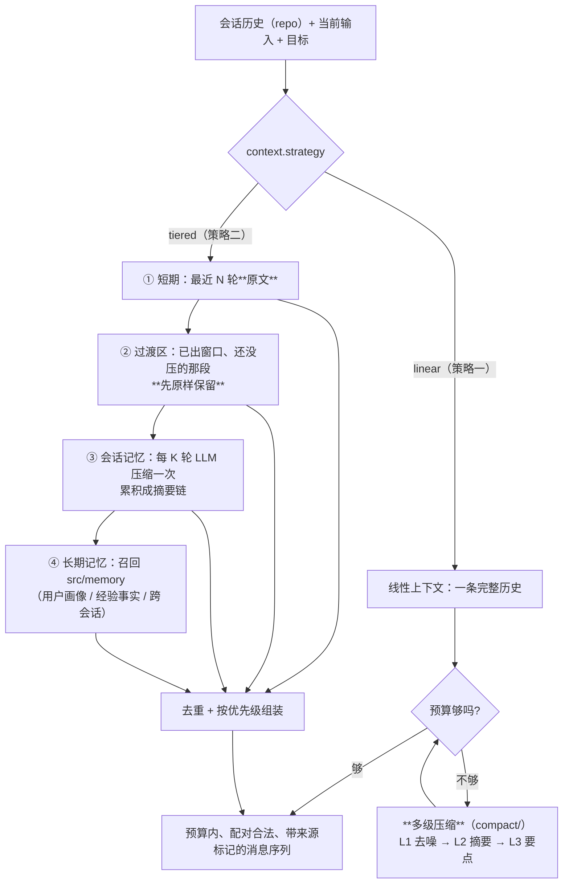

# `src/context` 需求说明书

| 项 | 值 |
|---|---|
| 文档层级 | **需求层**（第一篇）。后续：《`src/context` 架构概要设计》 |
| 覆盖范围 | `src/context/` 全部文件 + **`src/context/compact/`**（多级压缩，独立文件夹） |
| 上游依赖 | `foundation`（配置 / 时钟 / ID）、`src/gateway`（压缩摘要用的 LLM、消息构造、预算所需的窗口大小）、`src/memory`（长期记忆）、`src/repo`（会话与消息的读取） |
| 下游消费 | `src/agent`（七个测试阶段）、`src/multiagent`（辩论/编排） |
| 关键外部依赖 | 无。本模块是**纯编排** —— LLM 在 gateway 那侧，存储在本模块之外 |
| 强耦合 | `docs/memory/需求说明书-memory.md`（长期记忆）；`docs/gateway/需求说明书-gateway.md`（`FR-G-01` 唯一入口、消息构造）；`docs/repo/需求说明书-repo.md`（`FR-R-02` 会话与消息） |
| 状态 | 待评审 |

---

## 1. 这份文档回答什么

只回答**要解决什么问题**、**必须提供哪些能力**、**什么算合格**。

**本文不回答**：压缩算法怎么写、摘要提示词怎么设计、预算怎么切。
文中文件名仅用于圈定职责边界。

**前置阅读**：`docs/memory/需求说明书-memory.md` §2.2（记忆的错误会复利 ——
上下文层面对的**不是**同一类问题，见下）；`docs/gateway/需求说明书-gateway.md` `FR-G-01`。

---

## 2. 背景与定位

### 2.1 为什么需要独立的上下文层

模型每次调用只能看见**这一次请求里给它的东西**。而平台的七个测试阶段是**长链路**：

- 需求分析要啃完整份需求文档；
- 用例设计要带着需求阶段的结论；
- 缺陷分析要回看**几十轮之前**跑过的那条命令和它的输出。

把这一切原样留在对话里，会撞上三面墙：

| 墙 | 具体表现 |
|---|---|
| **窗口是有限的** | 上下文窗口再大也是常数，而链路长度不是 |
| **token 是要钱的** | 每轮重发全部历史，成本随轮数**平方**增长 |
| **长了反而更差** | 无关历史稀释注意力，模型在长对话里更容易丢掉中间的关键约束 |

所以「把历史怎么交给模型」本身就是一件事，而且是一件**每次都发生、错了不会报错**的事。

### 2.2 本模块真正难的地方：压缩不可逆，而丢掉的东西没人知道

工具层的难点是「副作用不能重来」，记忆层是「写进去的会复利」。上下文层是第三种：

> **压缩是有损的、不可逆的，而丢掉的信息**恰恰**是"以后某个时刻才会用到"的那种。**

丢掉一条工具输出时，没有任何东西会报错。它的后果在**三步之后**才显形：
模型基于一段残缺的历史做了一个决定，而你看到的是「模型怎么突然忘了前面说过的约束」——
这个症状离原因非常远。

而且这里有一个**反直觉的取舍**：

| 做法 | 当下 | 后果 |
|---|---|---|
| 什么都不压 | 安全 | 撞窗口，或者为无关历史付钱 |
| 悄悄截断 | **看起来也安全** | 模型拿到半截上下文，而且**它自己不知道** |
| **压 + 记账 + 留回捞钩子** | 多写一点代码 | 丢的东西**可查、可复原** |

第三条是本模块存在的理由。**截断和压缩的差别不在省了多少 token，而在"丢了什么"能不能被回答。**

### 2.3 这个目标做不到 100%，必须说清楚做到哪

**摘要一定会丢信息**，这是数学事实，不是实现水平问题。所以做到的是：

- **丢的过程可追溯**：每次压缩记一笔账（省了多少、原来是什么范围、产出是什么），
  事后能回答「当时那轮对话里到底有什么」；
- **丢的内容可回捞**：摘要里带着**原始消息的范围标识**，而原文在 `repo.message` 里 ——
  需要时能按标识取回，而不是"摘要就是全部了"；
- **模型知道自己在看摘要**：回灌的摘要**必须带标记**，否则它会把自己的摘要当成原始事实
  （与记忆的「不可信标记」是同一条纪律）。

**做不到的**：让摘要无损。任何人声称"我们的摘要不丢信息"，都是在骗自己 ——
能承诺的只有「丢得可见、丢得可查、丢得可回捞」。

---

## 3. 范围

### 3.1 本模块负责

| 职责 | 落点 |
|---|---|
| **上下文管理策略**的契约与选择（多种方式并存） | `types.py` / `manager.py` |
| **策略一：线性上下文 + 多级压缩** | `compact/`（独立文件夹）+ `builder.py` |
| **策略二：短期 / 会话 / 长期三层** | `selector.py` / `resolver.py` |
| **多级压缩**：分级判定、切分点选择、摘要产出、压缩账本 | **`compact/`** |
| **预算**：模型窗口 → 各段落配额 | `budget.py` |
| 产出**合法的消息序列**（配对、顺序、角色） | `builder.py` |
| 与长期记忆（`src/memory`）的接缝：检索 → 去重 → 注入 | `resolver.py` |
| 压缩与组装的**可观测性**（事件、账本） | `manager.py` |

### 3.2 本模块明确不负责

| 不做的事 | 归属 |
|---|---|
| **调用模型**（压缩摘要的一次补全） | `src/gateway`（`Gateway.chat`）；本模块只说「要一次摘要」 |
| **构造厂商消息对象** | `gateway.messages`（`B-1` 契约：除 gateway 外不许 import `provider`） |
| 会话与消息的**持久化** | `src/repo`（`session` / `message`） |
| **长期记忆**的写入、判定、衰减 | `src/memory`（本模块只**读**：召回结果） |
| 记住「这次运行到哪了」（断点续跑） | `src/repo/checkpoint.py` + `src/agent` |
| 决定「要不要回忆、回忆什么」 | `src/agent`（这是推理） |
| 模型路由、重试、降级、计量 | `src/gateway` |

### 3.3 与 `src/runtime`、`src/memory`、`src/agent` 的分工（容易混，先定清楚）

四者都在「让模型看到该看到的东西」，但管的是**不同的事**：

| | `src/runtime` | **`src/context`（本模块）** | `src/memory` | `src/agent` |
|---|---|---|---|---|
| 管什么 | 会话与消息**是什么**（领域对象、生命周期） | 这次请求**给模型看什么** | 跨会话**该记住什么** | **做什么**（推理与动作） |
| 时间尺度 | 会话 | 一次调用 | 长期 | 一次任务 |
| 输入 | 调用方 / 存储 | 会话历史 + 召回结果 + 预算 | 对话 / 轨迹 | 目标 |
| 输出 | 消息对象 | **一个有预算的消息序列** | 一批带相关度的记忆 | 步骤与工具调用 |
| 谁调谁 | context 读 runtime 的领域形态 | agent 调 context | context 调 memory | 顶层 |

一句话：**runtime 管「历史是什么」，memory 管「下次记得住」，context 管「这次放得下」**。
三者不重叠；**context 是唯一有权决定"这次不带什么"的地方**。

---

## 4. 上下文的责任链

**两种管理方式并存**，由配置选择（也可以按调用覆盖）。它们**共享同一批零件**
（预算、压缩、选择器），差别只在**组装方式** —— 这是本模块的结构主线。



**两条策略各自回答一个不同的问题**：

| 策略 | 回答 | 适合 | 代价 |
|---|---|---|---|
| **一：线性 + 多级压缩** | 「同一条历史，**越早的压得越狠**」 | 单任务长链路（一次跑几百轮） | 压缩发生在**热路径**上，需要缓存与阈值 |
| **二：三层记忆** | 「不同时间尺度**分开存**，各自有各自的机制」 | 长期陪伴型会话（跨天、跨会话） | 多了两块存储与两个参数，且**层与层之间要去重** |

> **它们不是二选一 —— 二可以复用一的零件**：策略二的「会话记忆」这一层自己也会变长，
> 那时它内部用的正是策略一的多级压缩。这正是 `compact/` 独立成一个文件夹的理由：
> **多级压缩是共用零件，不是哪条策略的私有实现。**

---

## 5. 功能需求

编号 `FR-C-xx`。

### 5.1 策略的选择

#### FR-C-01 — 多种管理方式必须并存且可切换

**要求**：

- 至少支持两种策略：**线性 + 多级压缩**（`linear`）与 **短期/会话/长期三层**（`tiered`）；
- 策略由配置选择（`context.strategy`），且**允许单次调用覆盖** ——
  多智能体的辩论场景与单 agent 的长任务，对上下文的要求不同；
- 所有策略对上层暴露**同一个接口**：给「历史 + 当前输入 + 预算」，拿回**消息序列 + 出处账本**；
- **不允许「哪个策略」这件事漏到调用方**：`src/agent` 不该知道现在是线性还是三层。

**验收点**：同一份历史，切 `strategy` 后两次调用产出不同的消息序列，
而调用方代码**一行没改**。

### 5.2 策略一：线性上下文 + 多级压缩

#### FR-C-02 — 线性上下文

**要求**：

- 历史是一条**有序**的消息序列，顺序即对话顺序（`FR-R-02` 的写入顺序是它的前提）；
- 上下文产出的消息序列**必须保持顺序**，且**角色交替与配对合法**（见 `FR-C-14`）；
- 线性不等于"原样全带"：它就是**多级压缩的输入**。

**验收点**：输入 50 条历史 → 输出要么全部保留，要么是**若干段摘要 + 最近原文**，
且顺序单调不减。

#### FR-C-03 — 多级压缩的级数

**要求**：压缩分**明确的若干级**，每一级有**确定的代价与损失**：

| 级 | 名字 | 做什么 | 代价 | 损失 |
|---|---|---|---|---|
| **L0** | 原文 | 不动 | 0 | 无 |
| **L1** | 去噪 | 合并重复、归一空白、**按上限截断工具输出** | 0（无 LLM） | 近无损（截断处必须标注） |
| **L2** | 摘要 | 把一段**连续**消息用 LLM 压成一段摘要 | 一次补全 | 有损（细节） —— **必须可回捞** |
| **L3** | 要点 | 把若干段 L2 摘要再压成要点列表 | 一次补全 | 有损（上下文脉络） |

- **级别的名字与顺序是契约的一部分**，不许出现"随便调一调"的中间态；
- 每一级的产出**必须标明自己是哪一级**，且携带**它覆盖的原始消息范围**（`FR-C-05`）；
- L2/L3 走 `src/gateway` 的 LLM（`FR-C-06` 的标记、`NFR-C-01` 的依赖方向）。

**验收点**：构造一份超预算历史 → 产出里能分辨出 L0（近几轮原文）与 L2/L3（更早的部分），
且每段都带级别与范围。

#### FR-C-04 — 级联按需触发，而不是一次压到底

**要求**：

- 只有在**预算不够时**才升级：能 L1 解决就不做 L2，能 L2 解决就不做 L3；
- 触发看的是**同一份预算计算**（`FR-C-12`），不是各段各算；
- **压缩结果必须可缓存**：同一段消息（按内容指纹）重复压缩要命中缓存 ——
  否则每多一轮就重压一次，成本随轮数线性涨，而**没有任何一行代码看起来是错的**；
- 升级**有上限**：到最高级仍不够时，**如实报告**「预算不足」，而不是继续砍（`FR-C-13`）。

**验收点**：预算够的历史 → **零次 LLM 调用**（L1 都不做）；预算差一点 → 只做 L1；
连续两轮请求同一段历史 → 第二次**命中缓存**（LLM 调用数不增加）。

#### FR-C-05 — 压缩账本（本策略的核心）

**要求**：

- 每一次压缩记一笔账：**覆盖的消息范围**、**级别**、**压缩前后 token 估算**、
  **产出内容**、**触发原因**；
- 账本必须能被读出来（事件 / 日志），因为**这是"当时到底有什么"唯一的事后依据**；
- 摘要产出**必须携带指向原始消息的标识**（消息 id 或 `(session_id, seq)` 范围）——
  这是**回捞**（`FR-C-16`）的钩子，没有它，摘要就是终点而不是索引。

**验收点**：一次压缩后，能回答「这段摘要覆盖了哪些原始消息」，
并按标识把原文取回来。

#### FR-C-06 — 摘要必须标明自己是摘要

**要求**：

- L2/L3 的产出回灌给模型时**必须带标记**（「以下是早期对话的压缩摘要，可能丢失细节」）；
- 理由与记忆的不可信标记**同源但不同**：记忆怕的是**被注入**，
  摘要注意的是**被当成原文** —— 模型会把"摘要里没提" 等同于 "当时没发生"；
- 标记必须**结构化可解析**，不能是纯装饰文本。

**验收点**：产出里每一段 L2/L3 都带标记，且模型能据此区分原文与摘要。

### 5.3 策略二：短期 / 会话 / 长期三层

#### FR-C-07 — 短期记忆：大小为 N 的滑动窗口

**要求**：

- 短期记忆 = **最近 N 轮的所有上下文**，**原文，不压缩**（这就是它与会话记忆的分界）；
- N 是**轮数**（不是 token 数）：轮数是用户能理解的单位，token 数是实现细节；
- 但**窗口本身仍受预算约束**：N 轮原文若本身就超预算，必须走压缩（`FR-C-13`），
  而不是"因为是窗口就无条件全带"；
- 窗口的边界必须落在**轮**的边界上（见 `FR-C-14` 的配对纪律）。

**验收点**：25 轮历史、N=10 → 最近 10 轮原文完整保留，且**未被压缩过**。

#### FR-C-08 — 会话记忆：滑动窗口之外，每 K 轮 LLM 压缩一次

**要求**：

- 窗口外的历史**每 K 轮**由 LLM 压缩一次，产出**追加**到会话摘要链；
- **K 是独立的参数**，与 N 无关：N 管"原文留多少"，K 管"多久压一次"；
- 摘要链**本身也会变长** → 超过配额时对它再压（这就是 `compact/` 的 L3 law）；
- 压缩**不得跨越"未完成的事"**：一次工具调用与它的结果、一个提问与它的回答，
  属于同一轮，不得被拆到摘要两侧（`FR-C-04` 的切分点纪律）。

**验收点**：跑 12 轮、K=6 → 会话摘要链有 2 段（第 6、第 12 轮各追加一次），
且窗口内 10 轮**不在**摘要里（没被重复压缩）。

#### FR-C-09 — 过渡区：出了窗口、还没被压缩的那一段

**要求**：

这是**两个参数不同步**产生的必然结果，必须显式处理，不能当它不存在：

```
     ├────────── 最近 N 轮（短期，原文） ──────────┤
     ├─ 过渡区：已出窗口、还没到 K 轮 ─┤──────── 已压缩进摘要链 ────────┤
```

- 过渡区的消息**必须先原样保留**（既没进摘要，也不是窗口）——
  **直接丢掉是静默丢信息**，正是 §2.2 说的那种错误；
- 过渡区**有上限**：超过 `transition_max_rounds` 时**强制压缩**（不等 K 轮）——
  否则 K > N 时过渡区会无限增长，直到撑爆预算；
- 设计上应**建议 K ≤ N**（压缩来得及，过渡区通常为空），
  但**不强制** —— K > N 是合法配置，只是要由上限兜住。

**验收点**：N=5、K=10，跑到第 8 轮 → 第 1~3 轮在**过渡区**（既不在窗口、也不在摘要里），
且**仍然被带进上下文**；把过渡区上限定为 2 轮再跑 → 第 3 轮时触发强制压缩。

#### FR-C-10 — 长期记忆：用户画像 / 经验事实 / 跨会话

**要求**：

- 长期记忆**不自己实现** —— 它就是 `src/memory`（`FR-M-xx`），本模块只**发起召回**并**消费结果**；
- 召回按当前任务/输入构造查询，`kind` 至少覆盖记忆已有的四类
  （`fact` / `preference` / `task_state` / `lesson`：分别对应经验事实、用户画像、任务状态、经验教训）；
- 召回结果**照原样保留相关度**，让 `FR-C-13` 能据此取舍，而不是拿到一个无差别列表；
- 长期记忆是**唯一跨会话通道**：会话记忆在一次会话结束后**沉淀**进长期记忆（`FR-C-15`）。

**验收点**：先在一个会话里存下「用例命名带需求号」并结束会话；
**新会话**里发起召回 → 命中它，且产出的上下文里带不可信标记（`FR-M` 的同一纪律）。

#### FR-C-11 — 三层之间必须去重

**要求**：

- 同一条信息**可能同时**出现在：窗口原文、会话摘要、长期记忆 —— 注入两次是**双重浪费**
  （白占预算 + 让模型以为是两件事）；
- 去重发生在**注入之前**，且必须**有界**（只比"要注入的这一小批"，不做全量比对）；
- 去重**不能误删**：只是"话题相近"不算重复 —— 判据要保守
  （与记忆的合并纪律同源：**漏去重是浪费，错去重是丢信息**）；
- 去重结果记进账本（`FR-C-05`），否则「为什么这条记忆没进来」没人答得上来。

**验收点**：造一条同时在窗口与会话摘要里的信息 → 只注入一次；
造两条话题相近但不同的信息 → **两条都在**。

### 5.4 预算与产出

#### FR-C-12 — 预算分配

**要求**：

- 预算**必须从模型窗口算起**，而不是拍一个固定 token 数：
  `可用输入 = 模型上下文窗口 − 输出预留 − 安全余量`；
- **模型上下文窗口当前不在配置里**（`models.<key>` 只有 `max_tokens`，那是**输出**预留）——
  这是一个必须补上的缺口，见 `DC-1`；补上之后由 **gateway 暴露按 alias 查询窗口**
  的入口，context **不自己猜**；
- 可用输入再分给各段（system / 当前输入 / 窗口 / 过渡区 / 会话摘要 / 长期记忆），
  每一段有**配额**，且**关键段有下限**；
- 估算器**只应有一份**：`gateway` 里已有 `_CHARS_PER_TOKEN = 4` 的经验值，
  context 不该再写一份（`DC-2`）。

**验收点**：换一个窗口更小的模型（改配置）→ 各段配额跟着变，且**没有一行业务代码改动**。

#### FR-C-13 — 溢出时按优先级取舍，且必须有界

**要求**：

- 溢出的处理顺序**固定且可解释**：
  `system 与当前输入（不可动） > 最近窗口原文 > 过渡区 > 会话摘要 > 长期记忆`；
- 砍到最低档仍不够 → **如实报「预算不足」**（含各段占用），
  **不得**继续截断当前输入或 system 提示；
- 每一段都有**下限**：低于下限时**整段不注入**，而不是注入半截 ——
  半截摘要比没有摘要更误导；
- 任何一次取舍都要能在账本里读到（`FR-C-05`）。

**验收点**：把预算压到极小 → 产出仍**合法**（配对正确），且报出「哪些段被砍、砍了多少」。

#### FR-C-14 — 产出的消息序列必须合法

**要求**：

- **配对完整**：`tool_call` 与它的 `tool_result` 必须在产出里**同进同出**
  —— 切在中间会让厂商直接 400，且报错说的是"消息顺序不对"，指不到真正的问题；
- **角色顺序合法**：不产生连续两条同角色 assistant 之类厂商不接受的形式
  （具体约束以 `gateway.messages` 的构造成员为准）；
- **system 只有一条**且在最前（`gateway.messages.system` 的既有约定）；
- 压缩**不得改变**"哪条消息是当前用户输入"这件事：它必须原样出现，且带它原本的 role。

**验收点**：构造一份"工具调用正跨在切分点"的历史 → 切分点**被挪开**，
产出的调用与结果始终成对。

### 5.5 与相邻模块的接缝

#### FR-C-15 — 会话结束时的沉淀

**要求**：

- 一次会话结束时（或达到阈值时），把**值得长期保留**的结论交给 `src/memory`
  （走它的三道闸门，本模块**不判定**该不该记）；
- 沉淀**不得阻断**会话结束：记忆是旁路（`NFR-M-07`）；
- 沉淀什么**由 memory 的闸门决定**，本模块只负责"把这段对话递过去"。

**验收点**：结束一次会话 → `memory.remember` 被调用一次（或按其配置关闭）；
记忆服务不可用时会话**照常结束**。

#### FR-C-16 — 摘要可回捞原文

**要求**：

- 摘要里的范围标识（`FR-C-05`）**必须能真的取回原文**（经 `src/repo` 的 message 查询）；
- 回捞**不是自动的**：它是给排障、评审、以及"模型说它需要细节"时的**手动通道**；
- 回捞失败要**明确出声**（原文可能已过保留期）—— 而不是安静地返回空。

**验收点**：拿一条 L2 摘要的范围标识 → 取回它覆盖的原始消息；
标识指向不存在的数据 → 报错说清，不返回空。

---

## 6. 非功能需求

| 编号 | 需求 | 说明 |
|---|---|---|
| `NFR-C-01` | **依赖方向单向** | context → gateway / memory / repo / foundation。**不得** import `provider`（消息一律经 `gateway.messages` 构造）；**不得** import `agent` / `multiagent`。⚠ **当前 import-linter 的 provider 契约里漏了 `context`**，见 `DC-3` |
| `NFR-C-02` | **产出有界** | 产出的消息序列**总 token 估算**必须 ≤ 可用输入预算；这是本模块唯一不可协商的硬约束 |
| `NFR-C-03` | **压缩可缓存** | 同一段历史的压缩结果按内容指纹缓存，避免每轮重压（`FR-C-04`） |
| `NFR-C-04` | **确定性优先** | 预算计算、切分点选择、去重判定**必须确定**（同输入同输出），便于回归；LLM 摘要允许漂移，但**范围与级别必须确定** |
| `NFR-C-05` | **可测试** | 预算、切分、去重、缓存必须能用**假时钟与假 LLM** 测，不得依赖真实模型 |
| `NFR-C-06` | **可观测** | 「这轮压缩了几次、省了多少、砍了哪些段、去重掉了什么」必须可查 —— 否则"模型为什么忘了"永远答不出来 |
| `NFR-C-07` | **不放大故障** | 压缩（LLM）失败必须**降级**：退回上一级或原样保留并告警，**不得**因此让整次调用失败 |
| `NFR-C-08` | **不静默丢内容** | 任何丢弃（截断、砍段、去重）都必须**有账可查**；「看起来正常但少了东西」是本模块最不能出现的一种失败 |
| `NFR-C-09` | **成本可控** | 压缩的 LLM 调用计入用量（`FR-G-08`），且**有次数上界**（单次请求最多升几级） |

---

## 7. 配置需求

```yaml
context:
  # 用哪条策略（FR-C-01）。两条都为真时以 strategy 为准。
  strategy: linear              # linear | tiered

  # 预算（FR-C-12）。窗口大小来自模型配置，不在这里重复写。
  budget:
    reserve_output_tokens: 4096   # 给输出留的；与 models.<key>.max_tokens 对齐
    safety_margin_tokens: 1024    # 估算误差与厂商差异的余量
    # 各段配额（占"可用输入"的比例）；不足时按 FR-C-13 的优先级砍
    segments:
      window: 0.50
      transition: 0.15
      session_summary: 0.20
      long_term: 0.15

  # 策略一：线性 + 多级压缩（FR-C-02..06）
  linear:
    compact:
      enabled: true
      # 级数上限。**默认不做 L3** —— 要点级会丢失时间脉络，应当是显式选择
      max_level: L2               # L1 | L2 | L3
      # 预算用到多少就升一级（FR-C-04）
      trigger_ratio: 0.75
      summary_alias: runtime.default   # 压缩摘要走 gateway 的逻辑名（不写厂商模型）
      max_llm_calls: 2            # 单次请求内最多几次压缩（NFR-C-09）
      cache: true                 # 压缩结果按内容指纹缓存（NFR-C-03）
      # L1 截断工具输出时的上限（近无损那一级）
      l1_max_tool_output_chars: 2000

  # 策略二：三层（FR-C-07..11）
  tiered:
    window_size: 10               # N：最近几轮原文（轮，不是 token）
    compress_every: 6             # K：每几轮压缩一次
    transition_max_rounds: 20     # 过渡区上限；超过则强制压缩（FR-C-09）
    dedupe: true                  # 三层去重（FR-C-11）
    # 长期记忆（FR-C-10）：召回参数；记忆本身的开关在 memory.* 段
    long_term:
      enabled: true
      top_k: 8
      kinds: [fact, preference, task_state, lesson]

  # 会话结束时的沉淀（FR-C-15）
  settle_on_close: true

  # 回捞（FR-C-16）
  rehydrate:
    enabled: true                 # 暴露「按摘要范围取回原文」的入口
```

**要求**：

- `C-C-1` **默认 `linear`**：两层已经是本模块的默认组合，三层多两块存储与两个参数，
  应当由需要它的人显式开启；
- `C-C-2` `summary_alias` **只写逻辑别名**，不写厂商模型名（与 `C-M-5` 同一条纪律）；
- `C-C-3` `max_level` 默认 **L2**：L3 会丢时间脉络，必须是显式选择；
- `C-C-4` `max_llm_calls` **必须有默认值且不为 0 之外的"无限"** ——
  没有它在，压缩本身可能变成成本的第二来源；
- `C-C-5` `window_size` 与 `compress_every` **建议 K ≤ N**（`FR-C-09`），
  K > N 时启动期**打告警**（它是合法配置，只是要让人知道自己选了过渡区）；
- `C-C-6` `budget.segments` 的**和必须 ≤ 1.0**，超出在启动期报错（配置错误要在启动时暴露）；
- `C-C-7` 所有键走 `BESA_` 环境变量与 `${VAR:-default}` 插值（`foundation.settings` 的既有约定）。

---

## 8. 验收标准（场景化）

**策略选择（§5.1）**

| # | 场景 | 期望 |
|---|---|---|
| `CX-1` | 同一份历史，strategy 分别配 linear / tiered | 两次产出不同，**调用方代码零改动** |
| `CX-2` | 单次调用覆盖策略 | 生效，且不影响同进程的后续调用 |

**策略一：多级压缩（§5.2）**

| # | 场景 | 期望 |
|---|---|---|
| `CX-3` | 历史远小于预算 | **零次** LLM 调用（L1 都不做） |
| `CX-4` | 历史刚超预算 | 只做 L1（去噪/截断），**不调 LLM** |
| `CX-5` | 预算差很多 | 升到 L2，产出**带级别标记**与**覆盖范围** |
| `CX-6` | 预算压到极小且 max_level=L2 | **如实报「预算不足」**，不擅自升到 L3 |
| `CX-7` | 连续两轮请求同一段历史 | 第二次**命中压缩缓存**，LLM 调用数不增 |
| `CX-8` | 查看一次压缩的账本 | 能回答范围 / 级别 / 前后 token / 触发原因 |
| `CX-9` | 拿 L2 摘要的范围标识回捞 | 取回被压缩的原始消息 |
| `CX-10` | 压缩时 LLM 不可用 | 降级（退回上一级或原样保留）**并告警**，整次调用不失败 |

**策略二：三层（§5.3）**

| # | 场景 | 期望 |
|---|---|---|
| `CX-11` | 25 轮历史，N=10 | 最近 10 轮**原文**保留，未被压缩 |
| `CX-12` | 跑 12 轮，K=6 | 摘要链 2 段；**窗口内 10 轮不在摘要里** |
| `CX-13` | N=5、K=10，跑到第 8 轮 | 第 1~3 轮在**过渡区**且**仍被带进上下文**（没被静默丢弃） |
| `CX-14` | 过渡区超过上限 | **强制压缩**（不等 K 轮） |
| `CX-15` | K > N 的配置 | 启动期**打告警**，但可运行 |
| `CX-16` | 长期记忆里有与会话摘要重复的内容 | 只注入一次（`FR-C-11`） |
| `CX-17` | 两条话题相近但不同的记忆 | **两条都注入**（去重保守，不误删） |
| `CX-18` | 新会话发起召回 | 命中上一个会话沉淀下来的长期记忆 |

**预算与产出（§5.4）**

| # | 场景 | 期望 |
|---|---|---|
| `CX-19` | 换一个窗口更小的模型（改配置） | 各段配额跟着变，业务代码零改动 |
| `CX-20` | 预算不足以放进全部低优先级段 | 按固定优先级砍，**并报出砍了什么** |
| `CX-21` | 工具调用正跨在切分点上 | 切分点**被挪开**，调用与结果始终成对 |
| `CX-22` | 极小预算 | 产出**仍然合法**（配对、角色、单 system） |
| `CX-23` | 任何一次产出 | 总 token 估算 ≤ 可用输入预算（`NFR-C-02`） |

**接缝与边界（§5.5 / §6）**

| # | 场景 | 期望 |
|---|---|---|
| `CX-24` | 结束一次会话 | 沉淀调用 memory；memory 不可用时会话**照常结束** |
| `CX-25` | 回捞指向已过期的原文 | **报错说清**，不返回空 |
| `CX-26` | 全仓库检索 | `src/context/` 不 import `provider` / `agent` / `multiagent` |
| `CX-27` | 一轮调用的压缩次数 | ≤ `max_llm_calls`（`NFR-C-09`） |
| `CX-28` | 每轮压缩 / 砍段 / 去重的明细 | 均可查（`NFR-C-06` / `NFR-C-08`） |

---

## 9. 决策点（需评审确认）

| 编号 | 决策点 | 备选 | 建议 |
|---|---|---|---|
| `DC-1` | **模型上下文窗口从哪来** | (a) 补进 `models.<key>.context_window`，由 gateway 暴露按 alias 查询；(b) 在 `context.budget` 里配一个固定值 | **(a)**。窗口是**模型属性**，不是上下文模块的偏好；写在 context 里会立刻与真实模型脱节（换 alias 就错），而错的方向是**超窗被厂商拒**或**白留一半预算** |
| `DC-2` | 估算器归哪 | (a) gateway 暴露一份公共估算；(b) context 自己实现；(c) 引入 tokenizer | **(a)**。`gateway` 已有 `_CHARS_PER_TOKEN=4`；两份估算会漂移，而漂移的表现是"预算算不准"，**不报错**。**(c) 不建议**：真实 tokenizer 要绑厂商，违反 `NFR-C-01` |
| `DC-3` | **`context` 不在 provider 契约里** | (a) 把 `context` 加进 import-linter 的 forbidden source；(b) 不动 | **(a)**。当前契约的 source 列表有 `agent/multiagent/event/repo/runtime/memory/skill/tool`，**唯独漏了 `context`** —— 而 context 恰恰要构造消息，是最容易"顺手 import provider"的地方。**这是本次设计发现的契约缺口** |
| `DC-4` | 两条策略的关系 | (a) 二选一；(b) 可组合（三层内部复用多级压缩） | **(b)**。策略二的会话摘要链自己会变长，那时用的就是多级压缩 —— 二选一等于把同一份逻辑写两遍 |
| `DC-5` | 压缩的切分粒度 | (a) 按消息条数；(b) 按"轮"；(c) 按 token | **(b) 轮**。轮是配对完整的最小单位（调用+结果、问+答），按条数切会把配对切开（`FR-C-14`）；token 是结果不是边界 |
| `DC-6` | 摘要标记的强度 | (a) 纯文本标记；(b) 结构化标记（可解析） | **(b)**。要和 `NFR-C-08` 的账本对上，且模型与程序的读法不该是同一套字符串匹配 |
| `DC-7` | 压缩失败怎么办 | (a) 整次调用失败；(b) 降级为上一级或原样保留 + 告警 | **(b)**。压缩是**优化**，不该变成新的故障点（`NFR-C-07`） |
| `DC-8` | 长期记忆与会话摘要去重的取舍 | (a) 保留记忆条目；(b) 保留会话摘要 | **(a)**。记忆条目**结构化、带来源、可单独淘汰**；摘要是一整块，删不掉其中一句 |
| `DC-9` | 是否做 L3（要点级） | (a) 默认开；(b) 默认关，显式选择 | **(b)**。L3 丢的是**时间脉络**（"先做了什么、后做了什么"），而调试与复现恰恰依赖它 |
| `DC-10` | 未压缩的过渡区怎么算预算 | (a) 并入窗口配额；(b) 独立配额 | **(b)**。独立配额才能让"过渡区涨到撑爆预算"这件事**可见**（`CX-13` / `CX-14`） |

---

## 10. 与相邻模块的契约

| 相邻模块 | 契约 |
|---|---|
| `src/gateway` | **唯一**的 LLM 入口（压缩摘要走 `Gateway.chat`）与消息构造（`gateway.messages`）；**并应暴露按 alias 查上下文窗口**（`DC-1`） |
| `src/memory` | 长期记忆的**唯一**来源：召回走 `MemoryService.recall`，沉淀走 `remember`；本模块**不做**记忆的判定与衰减 |
| `src/repo` | 会话与消息的读取（`FR-R-02`）、以及回捞原文（`FR-C-16`） |
| `src/runtime` | 提供会话/消息的**领域形态**；context 不定义第二套消息类型 |
| `src/agent` / `src/multiagent` | 决定何时构建上下文、任务是什么；context 只回答"这次给模型看什么" |
| `foundation` | `Clock`（可注入假时钟）、`Settings`（`context.*` 点分路径） |

---

## 11. 下一步

本文定稿后进入《`src/context` 架构概要设计》，届时需要产出：

- **两种策略的接口契约**与选择的落点（谁持有 strategy、怎么按调用覆盖）；
- **`compact/` 的文件划分**：级别定义、切分点、摘要器、账本、缓存各归哪个文件；
- **多级压缩的级联算法**：触发条件、升级顺序、预算耗尽时的收敛；
- **切分点算法**：怎么保证不切断"轮"（配对）—— 与 `gateway.messages` 的约束对齐；
- **压缩账本与缓存**的结构、指纹取什么、缓存放哪（进程内 / repo）；
- **三层的时间轴模型**：N/K/过渡区三者的状态机图，以及"什么时候算一轮"的判定；
- **预算分配的具体算法**与各段下限；
- **去重的判据**（多相似算重复）与它的保守方向；
- **与 memory 的接缝**：召回查询怎么构造、结果怎么去重、沉淀在哪触发；
- **窗口大小与估算器的获取路径**（`DC-1` / `DC-2` 的落地）；
- **事件**：压缩、砍段、去重各发什么事件；
- **`context` 补进 import-linter 契约**（`DC-3`）。
