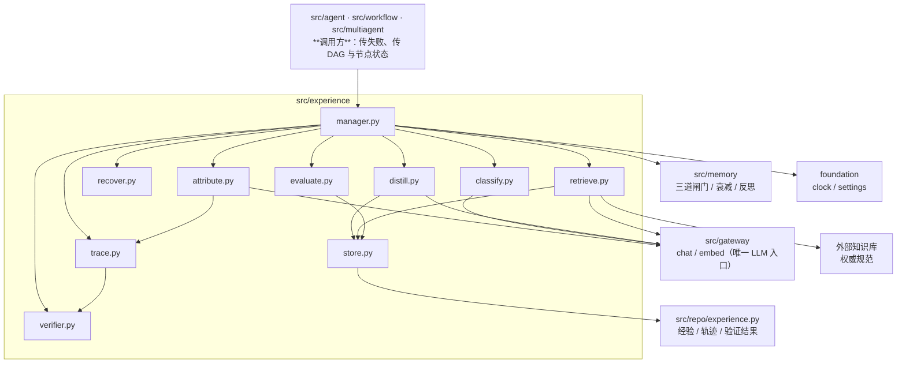
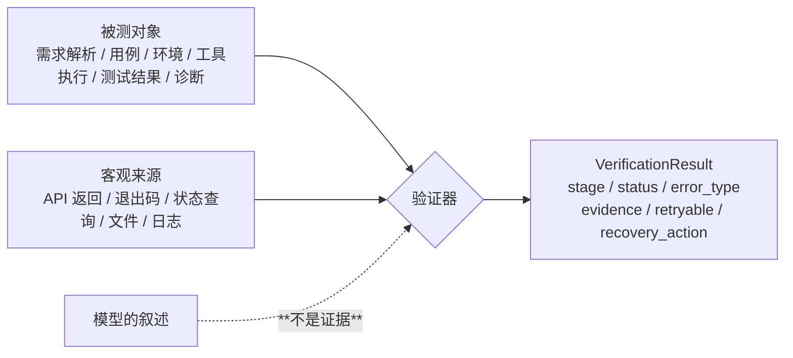
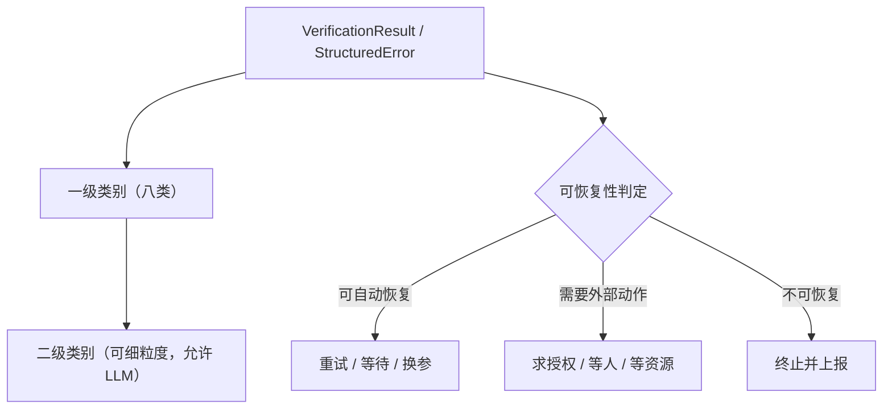
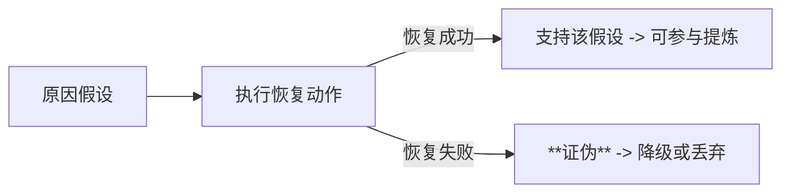
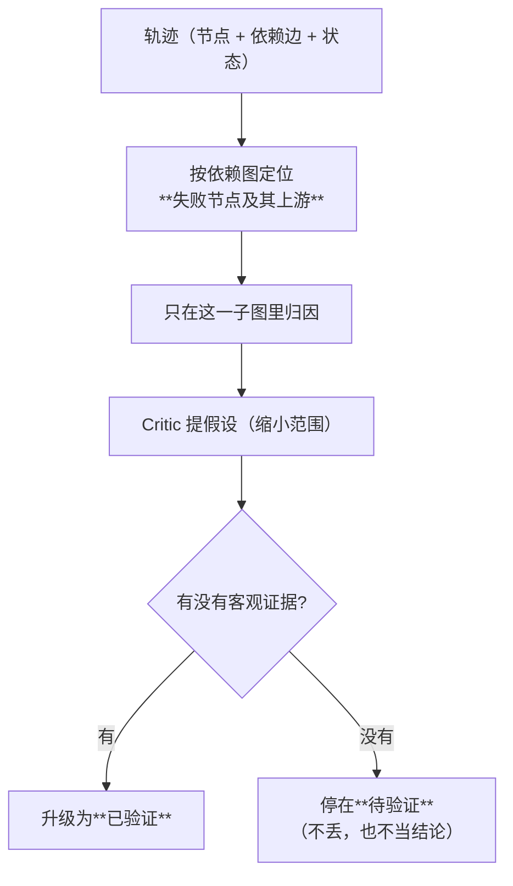
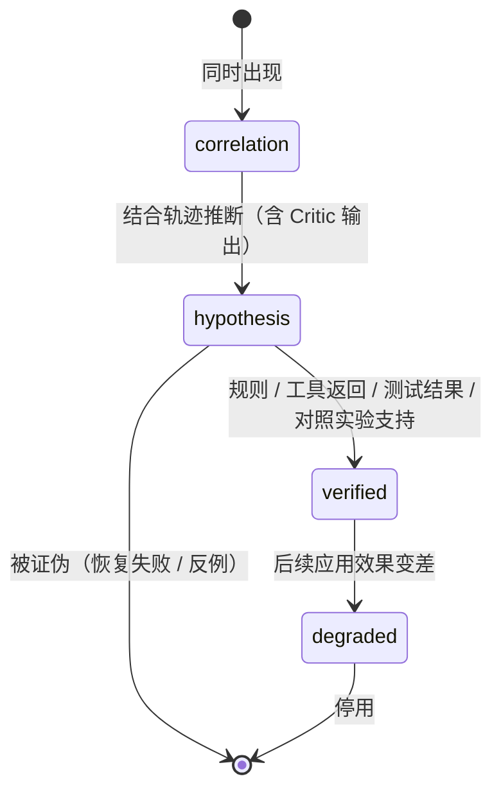
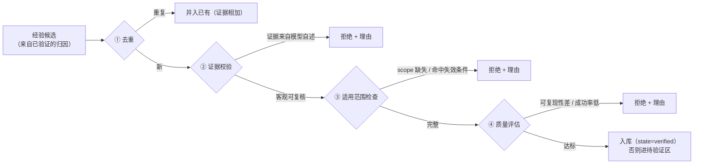
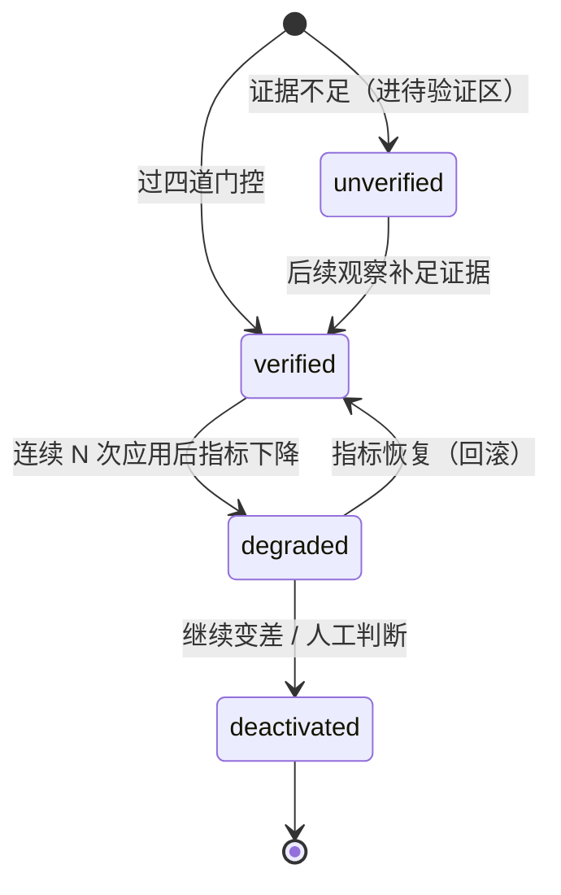
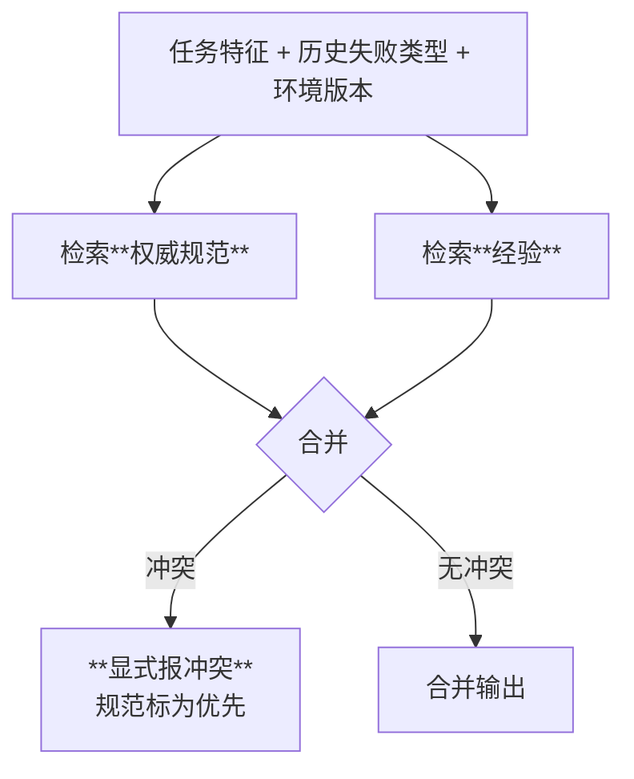
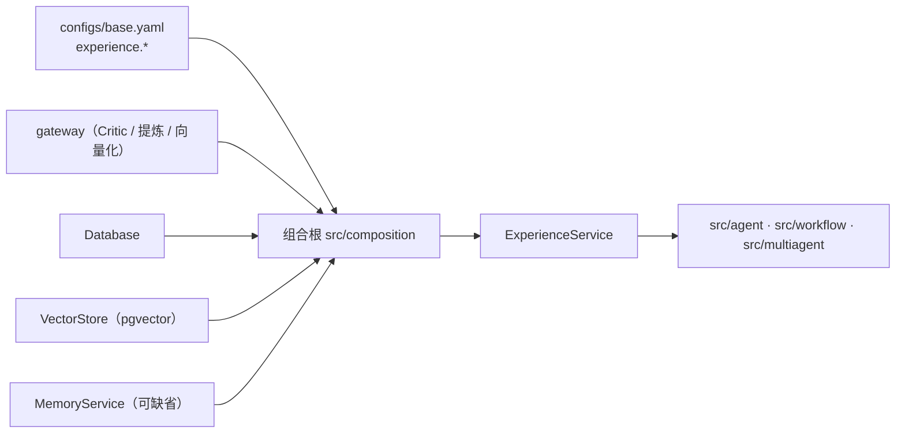

# `src/experience` 架构概要设计

| 项 | 值 |
|---|---|
| 文档层级 | **架构层**（第二篇）。前置：《`src/experience` 需求说明书》 |
| 承接 | 需求说明书-experience 的全部 `FR-E-xx` / `NFR-E-xx` |
| 强耦合 | `docs/memory/架构概要设计-memory.md`（三道闸门、衰减、反思蒸馏、`memory_op_log`）；`docs/agent/架构概要设计-agent.md`（`RunOutcome` 与 `needs_review`）；`docs/tool/架构概要设计-tool.md`（`tool_execution` 与 `uncertain`） |
| 外部依赖 | PostgreSQL + pgvector（经验元数据、适用条件与向量同库同事务） |
| 状态 | 待评审 |

---

## 0. 设计目标（一句话）

> 让「**有证据支持的原因**」与「**模型猜的原因**」成为系统里两种**数据形状不同**的东西 ——
> 从状态字段上就分开，而不是靠措辞区分；并且**没证据的那些进不了经验库**。

第二句同样重要，而且是最容易被忽略的一半：

> **经验必须能被收回来。** 一条被采纳后让效果变差的经验，要能降权、停用、回滚。
> 一个只进不出的经验库，用不了多久就是负资产。

**本模块在三层里的位置**：组件层（策略库）与编排层（Agent 池 + 动态 Workflow）**产生**执行反馈，
本模块把反馈变成经验，再**反过来改进前两层**。没有它，前两层的"动态"只能是动态地重复犯同一个错。

---

## 1. 结构总览

```
src/experience/
├── __init__.py      只导出契约与服务入口
├── types.py         StructuredError / Evidence / VerificationResult / RecoveryDecision
│                    Experience / ScopeCondition / ExperienceState
├── verifier.py      ① 可执行的验证器（六类验证对象，统一输出结构）
├── classify.py      ② 错误分类 + 可恢复性 -> 恢复决策的输入
├── trace.py         ③ 轨迹采集、裁剪、按依赖图定位失败节点
├── attribute.py     ③ 因果归因：相关性 -> 假设 -> **已验证**（三层状态机）  ★
├── recover.py       ⑤ 定向恢复（重试/等待/换参/回退/跳过/求授权/终止）
├── distill.py       ⑥ 经验提炼与**四道入库门控**                          ★
├── store.py         经验库（结构化字段 + 向量，读写与去重）
├── retrieve.py      ⑦ 检索协同（经验 + 权威规范，含优先级裁决）
├── evaluate.py      ⑧ 效果验证（与基线对比）与经验回收
├── manager.py       ★ 对外唯一入口 ExperienceService
└── (无内置存储实现)  落库全部走 src/repo

src/repo/experience.py   经验表 / 轨迹表 / 验证结果表（元数据 + 向量同事务）
```

**`manager.py` 是唯一把它们串起来的地方**，各文件按**闭环的八个环节**归位：

| 环节 | 文件 | 一句话 |
|---|---|---|
| ① 失败检测 | `types.py` + `manager.py` | 把失败变成**结构化错误**，而不是一段文本 |
| ② 错误分类 | `classify.py` | 分的是**动作**，不是标签 |
| ③ 证据收集 | `trace.py` + `verifier.py` | 证据要**可回指**，不是"模型说的" |
| ④ 因果归因 | `attribute.py` | 三层状态机：**没验证的不许当结论** |
| ⑤ 定向恢复 | `recover.py` | 五个输入合成一个动作，且**重试不是默认** |
| ⑥ 经验沉淀 | `distill.py` + `store.py` | 四道门控，**不是每次失败都值得入库** |
| ⑦ 检索复用 | `retrieve.py` | **规范优先**，经验只作补充 |
| ⑧ 效果验证 | `evaluate.py` | 与基线对比，**无效的收回来** |

### 1.1 依赖图



**四条硬边界**：

1. **不 import `provider`** —— import-linter 机械强制。Critic、提炼、向量化**全部**走
   `Gateway.chat` / `Gateway.embed`。
2. **不 import `agent` / `multiagent` / `workflow`** —— 是它们**调**本模块，不是反过来。
   失败信息、**DAG 与节点状态**都作为**参数**进来（结构化对象），不靠 import 拿。
   所以本模块**只定义一个接收依赖图的形状**，不依赖任何具体的执行引擎。
3. **不认识 pgvector / 不认识 SQL** —— 检索里的"按向量找最近邻"是一个 `VectorStore` 协议调用，
   与 `src/memory` 完全同构。
4. **不自己实现记忆的三道闸门** —— 合规对账、衰减、反思蒸馏**复用** `src/memory` 的零件。
   本模块自己的门控（证据 / 范围 / 质量）与记忆的闸门是**两件事**：
   记忆问"该不该记"，经验问"**证据够不够**"。

---

## 2. 核心机制一：验证器（第一层）

### 2.1 验证器只回答"事实是否成立"

这是本模块**唯一**不涉及判断、只涉及**观察**的一层。它的价值在于：
把"看起来合理"从流程里赶出去，换成"可复核的事实"。



**那条虚线是这一层的全部意义**：验证器**不接受**模型的输出作为唯一依据。
"环境准备好了吗"要用状态查询回答，不能用"模型说它准备好了"回答。

### 2.2 六类验证对象与统一输出

| 验证对象 | 验证方法 | 客观来源 |
|---|---|---|
| 需求解析 | 必需字段、约束覆盖率、来源引用 | 需求文档的结构化解析结果 |
| 测试用例 | Schema、规则、需求追踪关系 | 用例文件的字段与引用 |
| 环境准备 | API 返回值、设备状态、版本信息 | 状态查询接口 |
| 工具执行 | 返回码、状态查询、产物检查 | `tool_execution` + 产物路径 |
| 测试结果 | 断言、日志规则、预期结果对比 | 测试框架的输出 |
| 故障诊断 | 证据引用、结论一致性、可复现性 | 日志 + 对照实验 |

输出**同构**（`FR-E-05`），因为下游的分类器不该认识六套方言：

```python
@dataclass(frozen=True)
class VerificationResult:
    stage: str
    status: Literal["passed", "failed", "unknown"]
    error_type: str = ""                 # 统一错误码（见 §3.1）
    evidence: tuple[Evidence, ...] = ()  # **每一项都可回指**
    retryable: bool | None = None        # None = 不知道（**不是 False**）
    recovery_action: str = ""
    rule_version: int = 1                # 规则一变，历史结论的含义就变了
```

**`status="unknown"` 是一个必须存在的第三态**：验证器**会漏报也会误报**（`FR-E-06`），
所以"我验证不了"要能说出来，而不是被迫在 passed / failed 之间选一个。
`retryable=None` 同理：**不知道**不等于"不可重试"。

### 2.3 验证器本身也要被质疑

- **规则版本**随结果落库；改规则**不追溯改写**历史结论（否则"当时为什么这么判"就没了）；
- 关键规则（"环境是否就绪"这种）必须在**测试里覆盖** —— 否则它自己就是个单点故障，
  而且失败方式是**安静地**让后续所有环节拿到错证据。

---

## 3. 核心机制二：错误分类与可恢复性（第二层）

### 3.1 分类的产物是**动作**，不是标签



| 一级类别 | 二级示例 | 典型处理 |
|---|---|---|
| 需求理解错误 | 条件遗漏、约束冲突、需求歧义 | 补充检索、重新解析 |
| 知识检索错误 | 召回遗漏、版本不匹配、证据冲突 | 查询改写、扩大检索、版本过滤 |
| 用例生成错误 | 格式不合法、覆盖不足、预期结果错误 | 规则修正、局部重生成 |
| 环境错误 | 资源不可用、版本不匹配、初始化失败 | 等待、重新申请、环境重建 |
| 工具执行错误 | 参数错误、权限不足、超时 | 修正参数、申请授权、受控重试 |
| **测试本身失败** | 被测软件异常、断言不满足 | **分析日志定位缺陷 —— 不应盲目重试** |
| 诊断错误 | 证据不足、原因误判、结论矛盾 | 补充证据、比较候选假设 |
| 流程编排错误 | 依赖缺失、顺序错误、状态传递失败 | 修正 DAG、恢复受影响节点 |

**一级走规则，二级允许 LLM。** 一级类别决定**动作**，判错代价不对称
（把"测试本身失败"错分到"环境错误" → 对真正的缺陷反复重试）；
二级只是给排障提供更细的线索，模型漂移的代价小得多。

### 3.2 恢复决策：五个输入合成一个动作

```python
@dataclass(frozen=True)
class RecoveryInput:
    error_type: str
    evidence: tuple[Evidence, ...]
    retry_count: int
    remaining_budget: float | None       # None = 不知道（不是"无限"）
    risk: Literal["low", "medium", "high"]

@dataclass(frozen=True)
class RecoveryDecision:
    action: RecoveryAction               # retry / wait_recheck / adjust / rollback
                                         # / skip / request_auth / abort
    reason: str                          # **用了哪五个输入**
    missing_inputs: tuple[str, ...] = () # 哪一项缺失 —— 缺了要说出来
```

三条实现纪律：

1. **重试不是默认动作**（`DE-8`）。默认是"先分类、再决定" ——
   把 retry 放在默认位置会让分类这件事架空，而分类正是本模块存在的理由；
2. **预算/次数到顶时，动作必须变**：`remaining_budget` 耗尽 → 不再产生 retry；
3. **高风险即使"可自动恢复"也要确认**（`require_confirmation_on_risk`）——
   有副作用、不可逆的动作不属于自动决策的范围。

### 3.3 恢复的结果是**证据**



留着一条"恢复了但没用"的假设，等于给经验库埋一颗雷 ——
所以 `recover.py` 必须把结果**回灌**给 `attribute.py`（`FR-E-14`）。

---

## 4. 核心机制三：轨迹与因果归因（第三层）★

### 4.1 先定位，再归因

一次运行可能二十步、调十几次工具。**任何一步失败都与最终失败"相关"** ——
所以直接在整条轨迹上找原因，等于在一堆候选里挑一个顺眼的。



**排除"重试成功过的节点"**：第 3 步失败但重试成功了，它就不是第 5 步失败的原因。
这条看着显然，但不做定位就会犯 —— 因为它在轨迹里"也是红的"。

### 4.2 三层证据强度：本模块的核心纪律



| 状态 | 数据形状 | 入库 | 影响检索排序 | 影响恢复决策 |
|---|---|---|---|---|
| `correlation` | 只记"谁和谁同时红了" | 否 | 否 | 否 |
| `hypothesis` | 带 Critic 的理由与候选列表 | **只进"待验证"区** | **否**（`C-E-4`） | 否 |
| `verified` | 带客观证据链 + 验证方式 | 是 | 是 | 是 |
| `degraded` | 带降权原因与统计 | 是（留档） | 否 | 否 |

**为什么必须是四个不同的状态值，而不是一个 `confidence` 数字**（`ME-1`）：

> 数字会被比较、会被加权、会被"0.7 应该够了吧"这种判断悄悄放过。
> **状态值是硬的** —— 没验证过的就是进不了检索结果，没有中间地带。

### 4.3 Critic 的位置：缩小范围，不产生结论

Critic Agent 的产出被**强制**包装成假设：

```python
@dataclass(frozen=True)
class Hypothesis:
    statement: str                       # "可能因为检索返回了旧版本协议文档"
    suspected_node: str
    rationale: str                       # Critic 的理由（**只是理由，不是证据**）
    evidence: tuple[Evidence, ...] = ()  # 支持它的客观证据（**可以为空**）
    state: Literal["correlation", "hypothesis", "verified"] = "hypothesis"
    experiment: ExperimentRecord | None = None
```

**它能做什么**：把二十步的问题缩到两三个候选项 —— 这是真实的、不可替代的价值。
**它不能做什么**：把 `state` 直接设成 `verified`。那个字段**只能由证据推动**，
实现上就是：`attribute.py` 里唯一能把状态写成 `verified` 的函数要做**证据校验**，
而 Critic 的调用路径**不经过它**。

### 4.4 对照实验：把假设升格为结论的唯一手段

原文给的例子是一个**好实验**，值得当成模板：

> **固定需求与模型，只更换检索到的文档版本**，观察失败是否复现。

它好在**只有一个变量**。实验编排（`experiment.py` 或 `attribute.py` 内）的三条约束：

| 约束 | 为什么 |
|---|---|
| **一次归因的实验次数有上界**（`max_runs`） | 实验要真跑任务，成本是数量级的 |
| **只在证据不足时触发** | 已经有客观证据时做实验是浪费 |
| **结果必须落库**（`ExperimentRecord`） | 不然"验证过"就是一句空话，复查时无从复现 |

**证据不足时的行为没有"直接当结论"这个选项**（`C-E-5`）：
要么 `keep_unverified`（留在待验证区），要么 `drop`（丢掉）。逼配置者在这两者之间选。

### 4.5 轨迹要记什么、以及**记不下的时候怎么办**

必须能回答的需求（`FR-E-10`）落到一个结构上：

```python
@dataclass(frozen=True)
class TraceNode:
    node_id: str
    agent: str = ""
    skills: tuple[str, ...] = ()
    tools: tuple[str, ...] = ()
    versions: Mapping[str, str] = field(default_factory=dict)   # Agent/Skill/工具/文档版本
    inputs_digest: str = ""
    outputs_digest: str = ""
    status: str = ""
    error: StructuredError | None = None
    upstream: tuple[str, ...] = ()                              # 依赖边（**调用方传入**）
    retry_of: str | None = None                                 # 重试历史
    retrieved: tuple[DocRef, ...] = ()                          # 检索到的文档与版本
    verification: VerificationResult | None = None
    usage: Mapping[str, float] = field(default_factory=dict)    # token / 时延 / 资源
```

**有界与可裁剪**（`NFR-E-05`）：轨迹超过 `trace.max_bytes` / `max_nodes` 时，
**保留骨架**（节点 + 依赖边 + 状态 + 证据引用 + 版本），细节交给按需回捞 ——
与上下文层"摘要 + 回捞钩子"是同一条思路：
**丢可以，但要丢得可查、可回捞**。

---

## 5. 核心机制四：经验提炼与入库门控（第四层）★

### 5.1 四道门控



| 门控 | 判据 | 能不能用 LLM |
|---|---|---|
| ① 去重 | 相似度阈值 + 场景指纹 | 否（确定性） |
| ② 证据校验 | 证据是否来自客观来源、是否可独立复核 | **否**（必须确定） |
| ③ 适用范围检查 | `scope` 是否完整、是否与失效条件冲突 | 否（确定性） |
| ④ 质量评估 | 可复现性、成功率、样本量 | 允许 LLM 辅助归纳，**阈值判定确定** |

**②③ 必须是确定性的**（`ME-2`）：否则"这条经验为什么进来了"永远答不清楚，
而它恰恰是最需要答清楚的问题 —— 进来的东西会被复用。

### 5.2 经验的状态与形状

```python
@dataclass(frozen=True)
class Experience:
    experience_id: str
    category: Literal["fault_handling", "successful_path", "strategy_tuning"]
    scenario: str
    symptom: str
    conditions: Mapping[str, str]         # stage / error_type / ...
    evidence: tuple[Evidence, ...]
    root_cause: str
    cause_state: Literal["unverified", "verified"]     # **与归因状态一致**
    recovery_strategy: str
    scope: Mapping[str, str]              # **适用条件，不是备注**
    validation: ValidationStats           # reproducible / success_rate / samples
    state: ExperienceState                # unverified / verified / degraded / deactivated
    expires_when: ExpiryCondition | None  # 有版本依赖时**必填**
    created_at / updated_at / last_applied_at
```

**`scope` 是必填**（`FR-E-16`）：没有它，一条"环境 A 的经验"会被用到环境 B 上 ——
而两者语义上**非常像**，向量检索一定会把它们排在一起。

**三类经验同表、按类别过滤**（`FR-E-17`）：
"我要恢复一个失败"与"我要给任务选一套策略"是两种问法，靠 `category` 分。

### 5.3 经验的回收（本模块的第二条主线）



三条实现纪律：

- **降权/停用不能由单次结果触发**（`degrade_after_bad_uses`）——
  一次失败可能是偶发，而"因为一次偶发就停用一条有效经验"会让库越来越空；
- **停用不是删除**：`deactivated` 的经验仍在库里、带停用原因，只是不参与检索；
- **回滚要可追溯**：谁、什么时候、因为哪个指标变化。

---

## 6. 核心机制五：检索协同（第五层）

### 6.1 两路检索，一路优先



| 维度 | 技术知识库 | Agent 经验库 |
|---|---|---|
| 主要内容 | 协议文档、设计方案、接口说明、规范 | 执行轨迹、失败模式、恢复步骤、有效策略 |
| 回答的问题 | 系统**应该**遵循什么规则 | 在**类似执行场景**下，什么方法曾经有效 |
| 检索方式 | 语义、关键词、SQL、版本过滤 | **场景匹配、错误类型、环境版本、成功率** |
| 质量标准 | 权威性、完整性、时效性 | **可复现性、验证证据、适用范围、有效性** |
| 更新方式 | 文档更新与知识加工 | 执行反馈、经验验证、淘汰过期经验 |

### 6.2 两条硬规则

1. **规范优先，且冲突要显式说出来**（`FR-E-20` / `C-E-3`）。
   原文那个例子是本模块的**验收场景**：知识库说某项测试必须先满足前置条件，
   经验库记录"这类环境经常初始化失败" —— 系统应当**提前检查环境状态**，
   而**不是**因为历史上有人跳过该条件就跟着跳过。
   实现上：`retrieve.priority` **只允许** `knowledge_first`，且合并结果里带
   `conflicts` 字段，让上层看见"这里有两套依据打架"。

2. **未验证的经验不出现在检索结果里**（`C-E-4`，`max_unverified_in_results=0`）。
   它们待在待验证区，等后续观察把证据补足。

### 6.3 为什么不能只靠向量检索

两条经验的向量距离可以非常近，却在**适用条件上完全不同**：

```
经验 A：环境 A（版本 3.2）初始化超时 -> 等待 30s 后重查
经验 B：环境 B（版本 4.0）初始化超时 -> 重建环境
```

所以检索是**结构化过滤与语义相似度的组合**：先按
`error_type` / `stage` / `scope.environment_version` / `state=verified` 过滤，
再在剩下的集合里按语义排序。**过滤条件里 `scope` 与 `state` 不可省**。

---

## 7. 各文件设计

### 7.1 `types.py` —— 契约载体

```python
VerificationStatus = Literal["passed", "failed", "unknown"]
CauseState         = Literal["correlation", "hypothesis", "verified", "degraded"]
ExperienceState    = Literal["unverified", "verified", "degraded", "deactivated"]
RecoveryAction     = Literal["retry", "wait_recheck", "adjust", "rollback",
                             "skip", "request_auth", "abort"]

@dataclass(frozen=True)
class Evidence:
    kind: str            # tool_return / exit_code / state_query / log_line / assertion
    source: str          # **从哪拿到的**（可回指）
    detail: str = ""
    weight: float = 1.0  # 客观来源才允许 > 0
```

**`Evidence` 是贯穿全模块的最小单位**：验证器产出它、归因消费它、
经验带它、门控校验它。`source` 字段是"可独立复核"的全部依据。

### 7.2 `verifier.py`

- `Verifier` 协议：`async def verify(target, *, ctx) -> VerificationResult`；
- 六类注册（`requirement` / `test_case` / `environment` / `tool` / `result` / `diagnosis`），
  按 `experience.verifiers.enabled` 启用；
- **不接 LLM**（这是刻意的）：一类验证器若需要模型判断，那它就不属于"客观约束"；
- 规则版本随结果落库。

### 7.3 `classify.py`

- 一级：**规则表**（错误码 → 一级类别 的映射，可配）；
- 二级：可选 LLM（`classify.llm_alias`），失败就退回只用一级；
- **可恢复性判定独立于类别**：同一个"环境错误"里，"资源不可用"要等人，
  "初始化中"只要等一会儿 —— 判据是**证据**，不是类别；
- `decide_recovery(input) -> RecoveryDecision`，缺的输入写进 `missing_inputs`。

### 7.4 `trace.py`

- 采集：从 `RunOutcome` + `CheckpointRepo` + `ToolExecutionRepo` + 事件**拼**出一条轨迹，
  而不是要求各模块主动上报（那样每加一个模块就要改一次采集逻辑）；
- 裁剪：超限时保留骨架 + 证据引用；
- `locate_failure(trace) -> tuple[str, ...]`：按依赖边回溯，**排除重试成功的节点**。
  依赖边来自**调用方传入的图**（`src/workflow` 编排时传 DAG 与节点状态；单 agent 场景传步骤序列）——
  本模块**不认识 workflow 的类型**，只认一个紧凑记录；没有图时按步骤顺序退化（`EQ-6`）。

### 7.5 `attribute.py` ★

- `await attributes(trace, *, evidence) -> tuple[Hypothesis, ...]`：
  调 Critic 产出假设（**结果一律是 `hypothesis`**）；
- `verify_hypothesis(h, *, evidence, experiment) -> Hypothesis`：
  **唯一**能把状态推到 `verified` 的入口，内部做证据校验；
- 对照实验编排（一次归因最多 `max_runs` 次）；
- 证据不足 → 按 `on_insufficient_evidence` 决定"留在待验证"还是"丢掉"。

### 7.6 `recover.py`

- 动作实现在这里，**决策在 `classify.py`**（判断与执行分开，便于单测与审计）；
- 每个动作**自带上限**，且与 `remaining_budget` 联动；
- 结果回灌给 `attribute.py`（`FR-E-14`）。

### 7.7 `distill.py` ★

- 输入：**已验证**的归因（`state=verified`）+ 执行统计；
- 四道门控（§5.1），每道拒绝都要留理由；
- 输出 `Experience` 候选 → 交给 `store.py`；
- 有版本依赖时**强制要求** `expires_when`（`require_expiry_for_versioned`）。

### 7.8 `store.py`

- 结构化字段 + 向量**同事务**写入（与 `FR-R-08` 同一条纪律）；
- 去重靠"场景指纹 + 相似度阈值"（指纹确定，相似度兜底）；
- 提供按 `category` / `error_type` / `scope` / `state` / 成功率过滤的查询。

### 7.9 `retrieve.py`

- 两路检索（规范 + 经验）→ 合并 → 冲突标注；
- **过滤条件不可省**：`state=verified`、`scope` 匹配；
- 返回结果带**匹配依据与有效性统计**（`FR-E-21`）。

### 7.10 `evaluate.py`

- 指标：成功率 / 恢复率 / 重试次数 / 诊断时延；
- **必须与基线对比**（`C-E-6`）：`evaluate.baseline_required`；
- 回收触发：连续 `degrade_after_bad_uses` 次应用后指标下降 → `degraded`；
- 停用保留记录。

### 7.11 `manager.py` —— 唯一入口

```python
@dataclass
class ExperienceService:
    verifiers: VerifierRegistry
    classifier: Classifier
    tracer: Tracer
    attributor: Attributor
    recoverer: Recoverer
    distiller: Distiller
    store: ExperienceStore
    retriever: Retriever
    evaluator: Evaluator
    memory: Any | None = None        # 复用它的闸门/衰减；可缺省
    clock / events / gateway

    async def on_failure(self, failure, *, ctx) -> RecoveryDecision   # ①..⑤
    async def settle(self, trace_id, *, ctx) -> tuple[Experience, ...] # ⑥
    async def recall(self, query, *, ctx) -> Retrieved                   # ⑦
    async def record_application(self, experience_id, *, outcome, ctx)   # ⑧
    async def maintain(self, *, now=None) -> MaintenanceReport           # ⑧ 回收/淘汰
```

**旁路纪律**（`NFR-E-04`）：五个方法**都不得**把异常抛给调用方 ——
`on_failure` 失败时返回一个 `abort` + 原因（"经验环节不可用"），
让上层照常按"没有经验辅助"继续，**而不是让整个运行挂掉**。

---

## 8. 与 `memory` / `agent` / `repo` 的接缝

### 8.1 与 `src/memory`：复用零件，不合并

| 复用 | 说明 |
|---|---|
| 三道闸门（规则 / LLM 判断 / 合规对账） | 经验**沉淀进记忆**时走它（`settle_to_memory`），本模块不重写 |
| 衰减曲线 | 经验的有效性也可以按时间衰减（**与成功率并列**，不是替代） |
| 反思蒸馏 | 从多条经验归纳更高层的 `lesson`，用的是记忆的 `reflect` 零件 |
| `memory_op_log` 的轨迹思路 | 经验的状态流转同样要 append-only 留痕 |

**不复用的**：记忆的写入判定（"该不该记"）与经验的入库门控（"证据够不够"）
是两件事，各自实现，**串联**而不是合并。

### 8.2 与 `agent` / `workflow` / `multiagent`

| 方向 | 内容 |
|---|---|
| agent 提供 | `RunOutcome`（`status` / `error` / `reason` / `steps` / `tool_calls` / `cost` / `elapsed_s`） |
| agent 消费 | `on_failure` 的 `RecoveryDecision`；`recall` 的经验 |
| **不消费** | `needs_review` **不得**被当作失败送进来（`FR-E-02`） |
| **workflow** | **调用方**：编排时把 DAG 与节点状态**传进来**。本模块**不 import 它**，只定义一个接收它的紧凑记录类型（不依赖 workflow 的类型）。它未实现时，`trace.locate_failure` 退化为按步骤顺序定位，**能力下降要在事件里说清** |
| multiagent | 多 agent 协作策略；内部用 `src/workflow` 跑图，同样以**调用方**身份把图与节点状态传进来 |

### 8.3 与 `repo`

| 表 | 内容 | 关键点 |
|---|---|---|
| `experience` | 经验元数据 + 适用条件 | `scope` / `state` / `validation` 可索引 |
| `experience_trace` | 轨迹（骨架 + 引用） | 有界；超出部分落盘或引用 `event` |
| `experience_verification` | 验证结果 | 带 `rule_version` |
| 向量 | 复用 repo 的 `VectorStore` 协议 | 与经验元数据**同事务** |

---

## 9. 装配



**装配点**：`Runtime` 增加一个字段（与 `tools` / `memory` / `context` / `agent` 并列）：

```python
@dataclass
class Runtime:
    ...
    experience: ExperienceService | None = None
```

**`experience.enabled=false`（默认）时它为 `None`**，上层照常运行 ——
只是恢复退化成"按错误类型做最保守的事"，且不积累经验。

**启动期校验**：`retrieve.priority` 必须是 `knowledge_first`（否则直接拒绝启动）；
`max_unverified_in_results` 必须是 0；
`verifiers.enabled` 里出现未注册的验证器名要**告警**。

---

## 10. 事件

| 事件名 | 何时 | 关键载荷 |
|---|---|---|
| `experience.failure.detected` | 收到结构化失败 | `stage` / `error_type` / `retryable` |
| `experience.classified` | 分类完成 | 一级 / 二级类别、可恢复性、**决策依据** |
| `experience.hypothesis.proposed` | Critic 产出假设 | 候选数 / 涉及节点（**明确标为假设**） |
| `experience.hypothesis.verified` | 假设升格 | 用了哪条证据 / 是否用了对照实验 |
| `experience.hypothesis.dropped` | 假设被证伪或丢弃 | 原因 |
| `experience.recovery.decided` | 恢复决策 | 动作 / **五个输入** / 缺失项 |
| `experience.recovery.outcome` | 恢复结果 | 成功与否（**回灌给归因**） |
| `experience.gate.rejected` | 入库被某道门拦下 | 第几道 / 理由 |
| `experience.settled` | 经验入库 | 类别 / `state` / 是否带失效条件 |
| `experience.recalled` | 检索命中 | 条数 / 匹配依据 / 是否发生规范冲突 |
| `experience.applied` | 经验被应用 | 用于哪个任务 / 结果 |
| `experience.degraded` | 经验降权/停用 | 指标变化 / 触发阈值 |
| `experience.degraded_path` | 本模块自己降级 | 环节名 / 原因（旁路失败） |

**`experience.hypothesis.proposed` 与 `verified` 是两个事件、不是同一个带参数的事件**：
把"猜的"和"验过的"放进同一个事件名，就得靠读载荷才知道这次是哪种 ——
而那正是本模块最不该制造的一种混淆。

---

## 11. 关键设计决策

| 编号 | 决策 | 选择 | 理由 |
|---|---|---|---|
| `ME-1` | 假设与结论怎么区分 | **状态值**（四个不同取值），不用置信度数字 | 数字会被"0.7 应该够了吧"悄悄放过；状态值是硬的（§4.2） |
| `ME-2` | 门控能不能全交给 LLM | **不能**：证据校验与范围检查必须确定 | 否则"这条经验为什么进来了"永远答不清（`DE-9`） |
| `ME-3` | Critic 的地位 | **只产假设**，`verified` 只能由证据推动 | 通顺的解释与正确的解释是两件事（§4.3） |
| `ME-4` | 归因范围 | **先按依赖图定位失败节点及上游**，只在子图里归因 | 长链路里"任何一步都与失败相关"（§4.1） |
| `ME-5` | 重试的地位 | **一个需要理由的动作**，不是默认 | 默认重试会让分类架空（`DE-8`） |
| `ME-6` | 证据不足时 | **留在待验证区**，不入库、不进检索 | 丢弃会让同类失败重复摸索；升级则是造假（`DE-3`） |
| `ME-7` | 经验与规范冲突 | **规范优先**，且显式报冲突 | 原文那个例子就是验收场景（`DE-5`） |
| `ME-8` | 未验证经验参与检索吗 | **不参与**（`max_unverified_in_results=0`） | 检索结果会被直接采用，而它要求证据 |
| `ME-9` | 轨迹记不下时 | 保留**骨架 + 证据引用**，细节可回捞 | 与上下文层"摘要 + 回捞钩子"同一条思路 |
| `ME-10` | 经验能不能被收回 | **必须能**（降权 / 停用 / 回滚） | 只进不出的库是负资产（§5.3） |
| `ME-11` | 回收的触发条件 | **连续 N 次应用后指标下降**，不是单次 | 单次失败可能是偶发，会导致库越来越空 |
| `ME-12` | 与记忆三层的关系 | **分开但单向沉淀** | 字段差异太大；合表两边都别扭（`DE-7`） |
| `ME-13` | 验证器要不要用 LLM | **不用** | 需要模型判断的就不属于"客观约束" |
| `ME-14` | 效果验证的基线 | **强制**（`baseline_required`） | 没有基线的比率不是一个结论 |
| `ME-15` | 失败检测的输入 | **不含 `needs_review`** | 把"不确定"当失败归因 = 把不确定污染成"已知的原因" |
| `ME-16` | 唯一入口 | **`ExperienceService`** | 上层不该知道八环是怎么串的 |

---

## 12. 待确认（需评审）

| 编号 | 待确认 | 备选 | 倾向 |
|---|---|---|---|
| `EQ-1` | 经验库与记忆库是不是同一张表（`DE-7`） | (a) 合表；(b) 分表 + 单向沉淀 | **(b)**。`conditions` / `scope` / `validation` 记忆都没有；合表会让记忆的查询被无关字段污染 |
| `EQ-2` | 轨迹存哪（`DE-10`） | (a) 复用 `event`；(b) 复用 `checkpoint`；(c) 新表 | **(c) 新表，引用 `event`**。`checkpoint` 的语义是"执行到哪了"（断点续跑），不是轨迹；`event` 粒度太细（一次运行几十条），直接当轨迹用要现场拼 |
| `EQ-3` | 对照实验要不要默认开 | (a) 默认开；(b) 默认关；(c) 只在证据不足时开 | **(c)**。它要真跑任务，成本是数量级的；但**不开就没有"已验证"**，所以不能关掉这条路径 |
| `EQ-4` | 失效条件怎么表达 | (a) 版本区间；(b) 环境指纹；(c) 有效期 | **(a) + (b)**。版本区间最常用；环境指纹（依赖集合的哈希）能覆盖"同一版本但配置不同"。**纯时间有效期不够** —— 经验不是牛奶 |
| `EQ-5` | 效果验证的基线从哪来 | (a) 历史同期数据；(b) 专门的基准任务集；(c) 随机对照 | **(b) 起步，逐步补 (a)**。基准任务集可控且可复现；历史数据的干扰因素太多 |
| `EQ-6` | `src/workflow` 未实现时的依赖图 | (a) 等 `workflow`；(b) 用 `checkpoint` 的步骤顺序近似；(c) 单 Agent 轨迹就是线性图 | **(c)**。单 Agent 的轨迹本来就是线性的，"按顺序定位"退化为"定位到唯一失败的那一步" —— **能力下降要在事件里说清**，不要假装有依赖图 |
| `EQ-7` | 经验能不能被人工编辑 | (a) 只能停用不能改；(b) 可改但留版本 | **(b)**。运维需要订正明显的错误经验；但改动要留痕（经验是有证据的，改它等于改证据链的说法） |
| `EQ-8` | Critic 用哪个模型 | 与主 agent 同别名 / 独立别名 | **独立别名**（默认同值）。Critic 的调用量大、只需要"提出假设"，用更便宜的模型是合理的 |

---

## 13. 实施顺序


**为什么验证器排在前面**：没有它，后面每一步都在处理"模型的叙述"——
而归因、门控、检索全都会建立在这个错误的地基上。

**为什么实验（6）排在假设（5）之后**：先把"能产生假设但**不允许**入库"这条纪律跑通，
再打开升格通道。反过来的话，第一天就会有假设混进库里。

**为什么回收（9）排在最后但不省略**：它是最容易被当成"以后再说"的一环，
而它是 `ME-10` 的全部内容 —— 前八步做完、第九步不做，得到的是一个只进不出的库。

---

## 14. 风险

| 风险 | 触发条件 | 缓解 |
|---|---|---|
| **假设被当成结论** | 归因那一步"顺手"写成了结论 | `ME-1` 状态值 + `ME-3` 唯一入口 + `CE-13` 守着 |
| **错误经验自我强化** | 进了库、被检索、被复用 | 未验证不进检索（`ME-8`）+ 效果验证 + 回收（`ME-10`） |
| **对真实缺陷反复重试** | "测试本身失败"被错分到"环境错误" | 一级类别走规则（§3.1）+ `CE-7` |
| **经验跨环境误用** | 只按语义检索 | `scope` 必填 + 结构化过滤不可省（§6.3） |
| **经验覆盖规范** | 检索时"经验看起来更具体" | `priority` 只允许 `knowledge_first`（`C-E-3`）+ 冲突显式化 |
| **库只进不出** | 回收没实现或不触发 | `ME-10` / `ME-11` + `CE-28` |
| **验证器自己错了** | 规则写错且无测试 | 规则版本 + 关键规则必须有测试（`FR-E-06`） |
| **轨迹爆炸** | 一次运行几十步、每步大输出 | 有界 + 裁剪 + 证据引用（`ME-9`） |
| **旁路拖垮主流程** | 归因/提炼卡住 | `NFR-E-04`：全部旁路 + 超时 + 降级事件 |
| **成本失控** | Critic 与实验都是真跑 | 次数与 token 上界（`NFR-E-10`）+ `max_runs` |

---

## 15. 需求追溯

| 需求 | 落点 |
|---|---|
| `FR-E-01/02/03 失败检测` | `types.StructuredError` + `manager.on_failure` |
| `FR-E-04/05/06 验证器` | `verifier.py`（§2） |
| `FR-E-07/08/09 分类与恢复` | `classify.py`（§3） |
| `FR-E-10/11 轨迹与定位` | `trace.py`（§4.1 / §4.5） |
| `FR-E-12 因果归因三层` | `attribute.py`（§4.2 / §4.3） |
| `FR-E-13/14 定向恢复` | `recover.py`（§3.2 / §3.3） |
| `FR-E-15/16/17/18 经验提炼与门控` | `distill.py` + `store.py`（§5） |
| `FR-E-19/20/21 检索协同` | `retrieve.py`（§6） |
| `FR-E-22/23 效果验证与回收` | `evaluate.py`（§5.3） |
| `FR-E-24 闭环七问` | §13 的实施顺序 + 验收表 |
| `NFR-E-01 依赖单向` | §1.1 四条硬边界 |
| `NFR-E-02/03 假设与结论分开、不确定可见` | `ME-1` / `ME-3` / `ME-6` |
| `NFR-E-04 旁路` | `manager.py` 的旁路纪律 |
| `NFR-E-05 有界` | `ME-9` + `trace.max_bytes` + `NFR-E-10` |
| `NFR-E-06/07 可测试、确定性` | 门控与回收确定；LLM 只出现在假设与二级分类 |
| `NFR-E-08 可观测` | §10 事件 |
| `NFR-E-09 可回收` | `ME-10` / `ME-11` |
| `NFR-E-10 成本可控` | `max_runs` + LLM 上界 + 计入用量 |
| `NFR-E-11 隐私与合规` | 复用 `memory` 的合规闸门 |
