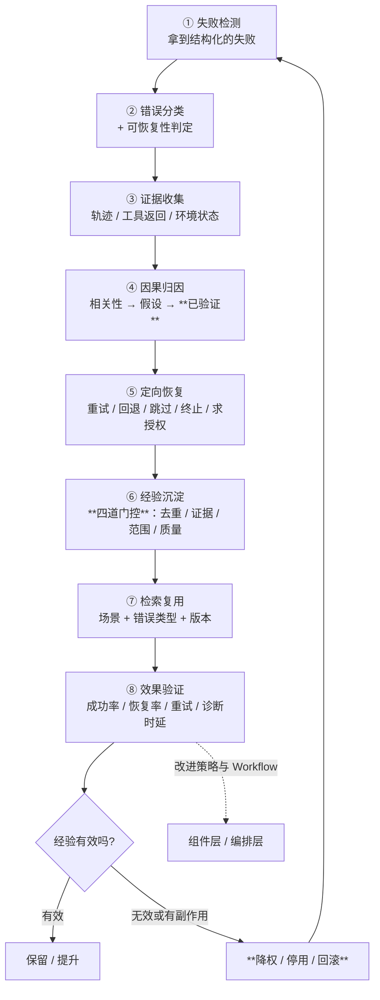

# `src/experience` 需求说明书

| 项 | 值 |
|---|---|
| 文档层级 | **需求层**（第一篇）。后续：《`src/experience` 架构概要设计》 |
| 覆盖范围 | 未来的 `src/experience/` 全部文件 + 落库侧经验表（与 `src/repo` 的接缝） |
| 上游依赖 | `foundation`（配置 / 时钟 / ID）、`src/gateway`（Critic 与经验提炼用的 LLM、向量化的唯一入口）、`src/repo`（执行轨迹、验证结果、经验元数据的落库） |
| 下游消费 | `src/agent`（失败恢复与经验检索）、`src/workflow`（编排时的节点级恢复与局部重跑）、`src/multiagent`（多 agent 协作，内部用 `workflow` 跑图）、未来的 `src/skill`（把反复验证有效的做法固化成技能） |
| 关键外部依赖 | PostgreSQL + pgvector（经验元数据、适用条件与向量**同库同事务**） |
| 强耦合 | `docs/memory/需求说明书-memory.md`（三道闸门、衰减、反思 —— 本模块大量复用它的零件）；`docs/agent/需求说明书-agent.md`（`RunOutcome` 与 `needs_review`）；`docs/tool/需求说明书-tool.md`（`tool_execution` 权威记录与 `uncertain`） |
| 状态 | 待评审 |

---

## 1. 这份文档回答什么

只回答**要解决什么问题**、**必须提供哪些能力**、**什么算合格**。

**本文不回答**：错误码怎么编号、轨迹怎么落库、检索怎么排序、经验表的字段类型。
文中文件名仅用于圈定职责边界。

**本文也不回答**「怎么让模型更聪明」—— 恰恰相反：本模块的全部力气都花在
**不让模型的猜测变成系统的结论**上（见 §2.2）。

**前置阅读**：`docs/memory/需求说明书-memory.md` §2.2（写在库里的东西会复利）；
`docs/tool/架构概要设计-tool.md` §2.3（`uncertain`：不知道就标成不知道）。

---

## 2. 背景与定位

### 2.1 为什么需要独立的经验层

平台的三个层次各管一件事：

| 层 | 回答 | 对应创新点 |
|---|---|---|
| **组件层** | 每个 Agent 内部**用什么策略** | 组件策略库与动态装配 |
| **编排层** | 多个 Agent **怎么协作**（选谁、怎么连成图） | Agent 池驱动的动态 Workflow |
| **优化层**（本模块） | 执行**失败之后**怎么定位原因、积累经验、持续改进 | 失败案例驱动的检索与经验协同 |

**本模块是唯一"向后看"的一层**：前两层产生执行反馈（成功与失败），
本模块把反馈变成**可复用的经验**，再反过来改进前两层的策略选择与流程编排 ——
没有它，前两层的"动态"只能是动态地重复犯同一个错。

而现有的两种做法都绕开了这个问题：

| 做法 | 它关注 | 它不问 |
|---|---|---|
| 传统 RAG | 文档召回得准不准、答案答得好不好 | 任务**为什么**失败、失败由哪个环节引起 |
| 传统 Agent 重试 | 当前任务还能不能继续跑 | 这次失败**能不能帮后续任务做得更好** |

于是失败变成一次性事件：定位一次、修一次、下次换个人（或换个会话）再踩一遍。

### 2.2 本模块真正难的地方：**「失败原因」是一个会骗人的东西**

工具层的难点是「副作用不能重来」，记忆层是「写进去的会复利」，上下文层是「压缩不可逆」。
这一层是第四种，而且可能是最危险的一种：

> **一个错误的结论，会在被"验证过"的外观下，被复用到所有相似的失败上。**

它有三层欺骗性：

1. **相关性冒充因果。** 某个节点失败与最终结果失败**同时出现**，看起来就像原因。
   而"同时出现"在长链路里几乎必然发生 —— 一次运行有二十步，任何一步失败都与最终失败相关。
2. **模型的解释太像解释了。** 让 Critic Agent 总结"失败原因"，它总能给出一个通顺、
   专业、让人信服的答案。**通顺与正确是两件事**，而前者会让人停止追问。
3. **错误经验会自我强化。** 它被写进库、被检索、被应用、被一次次"命中"，
   于是看起来越来越可信 —— 与记忆层的复利同源，但更狠：
   记忆至少还带着"这是从对话里来的"，而经验带着的是**"这是从一次真实失败里总结出来的"**。

所以本模块的第一目标不是"让系统从失败中学习"，而是：

> **让"有证据支持的原因"与"模型猜的原因"在系统里是两种不同的东西** ——
> 从数据形状上就分开，而不是靠措辞区分。

第二目标同样重要，而且常被忽略：

> **要能把经验收回来。** 一条被采纳后让效果变差的经验，必须能被降权、停用、回滚。
> 一个只会往里写、不会往回收的经验库，用不了多久就会变成一个**负资产**。

### 2.3 这个目标做不到 100%，必须说清楚做到哪

| 做不到 | 能做到 |
|---|---|
| 自动找到**真实的**根因 | 把"有证据支持"与"只是假设"分开，并让没证据的**进不了库** |
| 保证经验库永远干净 | 让每条经验带**适用条件、证据强度、成功率、失效条件**，过期的能被识别与回收 |
| 保证经验一定有用 | 用**可比较的指标**（成功率 / 恢复率 / 重试次数 / 诊断时延）回答"用了它到底好没好" |
| 消除长链路里的偶然失败 | 把**偶发**与**必现**分开（对照实验 / 复现次数），并让前者不入库 |
| 让 Critic 不说错话 | 让 Critic 的话**永远只以"假设"的身份存在**，直到被规则或实验验证 |

**最底下那两行是本模块的立场**：不确定就是不确定。
一条"待验证"的经验可以留在库里，但它**不能以已验证的身份参与检索排序**，
也**不能覆盖权威规范**。

---

## 3. 范围

### 3.1 本模块负责

| 职责 | 落点（预期） |
|---|---|
| **失败检测与结构化错误** | `types.py` / `manager.py` |
| **可执行的验证器**（六类验证对象，输出结构化结果） | `verifier.py` |
| **分层错误分类 + 可恢复性判定** | `classify.py` |
| **执行轨迹采集与失败节点定位** | `trace.py` |
| **因果归因**（相关性 / 假设 / 已验证三层） | `attribute.py` |
| **定向恢复**（重试 / 回退 / 跳过 / 终止 / 求授权） | `recover.py` |
| **经验提炼与入库门控** | `distill.py` |
| **经验库**（结构化字段 + 语义向量） | `store.py` |
| **检索协同**（经验与知识，含优先级规则） | `retrieve.py` |
| **效果验证与经验回收** | `evaluate.py` |
| **编排与对外入口** | `manager.py` |

### 3.2 本模块明确不负责

| 不做的事 | 归属 |
|---|---|
| 跑 Agent、调模型 | `src/agent` / `src/gateway` |
| 工具怎么执行、幂等、沙箱 | `src/tool` |
| **跨会话的稳定结论**（用户偏好、稳定事实） | `src/memory` |
| **权威规范**（协议文档、接口说明、标准） | 知识库（外部检索，见 §3.3） |
| 断点续跑（"执行到哪了"） | `src/repo/checkpoint.py` + `src/agent` |
| **图的编排与调度**（DAG 的构建、依赖调度、节点执行） | `src/workflow` |
| 多 agent 的**协作策略**（辩论 / 委员会 / 分层） | `src/multiagent`（内部用 `src/workflow` 跑图） |
| 事件总线本身 | `src/event`（空桩；本模块只用一个统一出口发事件） |
| 版本化能力的定义与固化 | 未来的 `src/skill`（本模块只**建议**固化，不自己固化） |

### 3.3 经验库 / 记忆库 / 知识库：三者必须定清楚（最容易混的一处）

三者都"存东西、都能被检索"，但**回答的问题完全不同**：

| | 知识库（外部） | 记忆库（`src/memory`） | **经验库（本模块）** |
|---|---|---|---|
| 主要内容 | 协议文档、设计方案、接口说明、规范 | 稳定事实、用户偏好、任务状态、经验教训 | **执行轨迹、失败模式、恢复步骤、有效策略** |
| 回答的问题 | 系统**应该**遵循什么规则 | 关于**这个人/这个项目**，什么长期成立 | 在**类似执行场景**下，什么方法曾经有效 |
| 检索方式 | 语义、关键词、SQL、版本过滤 | 语义 + 结构化过滤（类型 / 时间 / 来源） | **场景匹配、错误类型、环境版本、成功率** |
| 质量标准 | 权威性、完整性、时效性 | 置信度、来源强度、衰减曲线 | **可复现性、验证证据、适用范围、有效性** |
| 更新方式 | 文档更新与知识加工 | 写入闸门 + 衰减 + 反思蒸馏 | **执行反馈、经验验证、淘汰过期经验** |

**一句话的分工**：

> **知识库说"应该怎样"，记忆库说"这里一贯怎样"，经验库说"上次这样做，结果如何"。**

三条纪律（必须写进实现，不是口号）：

1. **权威规范永远优先。** 历史经验**不能覆盖**规范要求。反例：
   知识库说某项测试必须先满足前置条件，经验库记录"这类环境经常初始化失败" ——
   正确的动作是**提前检查环境状态**，而**不是**因为历史上有人跳过该条件就跟着跳过。
   优先级：**规范 > 经验 > 无**；经验与记忆冲突时，按**证据强度 + 更新时间**裁决。
2. **经验必须带条件。** 记忆存的是"结论"，经验存的是"**什么条件下**，什么症状，什么原因，怎么恢复"。
   丢掉条件，经验就退化成一条危险的常识。
3. **沉淀通道是单向的。** 一条反复验证有效的经验**可以**被沉淀为记忆里的 `lesson`
   （走记忆自己的三道闸门），但反过来不成立 —— 记忆里的东西**不会**自动变成经验，
   因为经验要求的证据强度更高。

---

## 4. 责任的闭环

> **完整闭环不等于把失败日志写进数据库。**



**八环各有各的失败方式，但只有两环是"安静地出错"**：

| 环 | 安静出错的样子 | 后果 |
|---|---|---|
| **④ 因果归因** | 把假设当成结论 | 错误经验进入库（且带着"验证过"的外观） |
| **⑧ 效果验证** | 不做，或不做对比 | 无效经验永远留在库里，且越用越久 |

其余六环出错都会**响**：验证器漏报会导致后续环节拿不到证据；
恢复策略选错会当场表现为"恢复了但还是失败"。所以本模块把设计的重心放在那两环上。

---

## 5. 功能需求

编号 `FR-E-xx`。

### 5.1 失败检测与结构化错误

#### FR-E-01 — 失败必须是**结构化**的，不是一段错误文本

**要求**：

- 进入本模块的失败**必须**已经是一份结构化对象，至少含：
  **阶段**、**状态**、**错误类型**、**证据**、**是否可重试**、**建议的恢复动作**；
- **不允许**把一段自然语言的报错直接当作输入 —— 那会让下游每一环都各自去解析一次，
  而每个地方的解析规则都不一样；
- 结构里的 `evidence` **必须是可回指的**（"在哪看到的：哪个工具返回、哪一行日志、哪个字段"），
  **不是**"模型说是因为……"。

**验收点**：给一段纯文本报错 → 被拒绝并要求走验证器（而不是被硬塞进流程）。

#### FR-E-02 — 来源必须是**本模块能验证的**那几种

**要求**：

- 失败来源至少覆盖：Agent 运行的终态（`RunOutcome` 的 `failed` / `needs_review`）、
  工具执行的非成功结果、验证器的否定结论、以及多 Agent 节点的失败状态；
- **`needs_review` 不算失败**，它是"需要人看一眼"（`docs/agent` 的 `MA-7`）。
  本模块**不得**把它当作失败去归因 —— 那会把"不确定"污染成"已知的原因"。

**验收点**：一次 `needs_review` 的运行 → 不产生任何经验候选。

#### FR-E-03 — 检测不得阻断主流程

**要求**：失败检测与后续的归因、提炼，**都是旁路**。
主流程（Agent 的运行）**不得**因为本模块出错而失败或变慢到不可接受；
但每一次跳过都要留痕（事件或日志），**不许静默**。

**验收点**：断开经验库 → Agent 运行照常完成，且日志里有"经验环节被跳过"。

### 5.2 第一层：可执行的验证器

#### FR-E-04 — 验证器只判断**客观约束**

**要求**：验证器回答的是"**事实是否成立**"，不是"看起来合不合理"。按验证对象至少覆盖六类：

| 验证对象 | 验证方法 | 例子 |
|---|---|---|
| 需求解析 | 必需字段、约束覆盖率、来源引用 | 测试要求是否遗漏触发条件 |
| 测试用例 | Schema、规则、需求追踪关系 | 前置条件、步骤、预期结果是否完整 |
| 环境准备 | API 返回值、设备状态、版本信息 | 测试环境是否**真实可用** |
| 工具执行 | 返回码、状态查询、产物检查 | 命令是否执行成功、产物是否存在 |
| 测试结果 | 断言、日志规则、预期结果对比 | 是否满足测试通过条件 |
| 故障诊断 | 证据引用、结论一致性、可复现性 | 根因是否得到日志或实验支持 |

- 验证**不得**依赖模型输出作为唯一依据。"环境准备好了吗"要用状态查询回答，
  不能用"模型说它准备好了"回答。

**验收点**：构造一个"模型说环境就绪但状态查询显示初始化中"的场景 →
验证器判**失败**，且证据里带的是状态查询的返回值。

#### FR-E-05 — 输出必须是结构化的

**要求**：验证器输出结构化结果，字段至少覆盖

```json
{
  "stage": "test_execution",
  "status": "failed",
  "error_type": "environment_not_ready",
  "evidence": ["environment_status=initializing"],
  "retryable": true,
  "recovery_action": "wait_and_recheck"
}
```

- **统一的错误码、证据格式与恢复动作契约**必须由本模块定义（见 `FR-E-07`），
  不许各验证器自己发明 —— 否则下游的分类器要认识十套方言；
- `evidence` 里的每一项都要能被独立复核（拿到原始来源）。

**验收点**：六个验证器输出的结构**同构**，分类器不需要按来源写分支。

#### FR-E-06 — 验证器本身也要能被质疑

**要求**：

- 验证器**会漏报也会误报**，这一点必须写进文档与错误信息；
- 验证器的结论要带**版本**（规则改了，历史结论的含义就变了）；
- 关键验证规则（如"环境是否就绪"）必须在**测试里覆盖**（否则它自己就是个单点故障）。

**验收点**：改动一条验证规则 → 新产生的验证结果带新版本号，历史结果不被追溯改写。

### 5.3 第二层：分层错误分类与可恢复性

#### FR-E-07 — 错误分类是**为了决定动作**，不是为了贴标签

**要求**：至少覆盖原文的八个一级类别，每类给出典型处理方式：

| 一级类别 | 二级类别示例 | 典型处理方式 |
|---|---|---|
| 需求理解错误 | 条件遗漏、约束冲突、需求歧义 | 补充检索、重新解析需求 |
| 知识检索错误 | 召回遗漏、版本不匹配、证据冲突 | 查询改写、扩大检索、版本过滤 |
| 用例生成错误 | 格式不合法、覆盖不足、预期结果错误 | 规则修正、局部重新生成 |
| 环境错误 | 资源不可用、版本不匹配、初始化失败 | 等待、重新申请、环境重建 |
| 工具执行错误 | 参数错误、权限不足、超时 | 修正参数、申请授权、受控重试 |
| **测试本身失败** | 被测软件异常、断言不满足 | **分析日志、定位缺陷，不应盲目重试** |
| 诊断错误 | 证据不足、原因误判、结论矛盾 | 补充证据、比较候选假设 |
| 流程编排错误 | 依赖缺失、顺序错误、状态传递失败 | 修正 DAG、恢复受影响节点 |

- **分类错了的代价不对称**：把"测试本身失败"错分到"环境错误"，会导致对真正的缺陷
  **反复重试**（既浪费时间，又掩盖问题）。

**验收点**：把"断言不满足"的失败 → 分到 `测试本身失败`，且恢复动作**不是**重试。

#### FR-E-08 — 第二个维度：可恢复性

**要求**：

- 每个错误除了类别，还要判定**可恢复性**，至少三档：
  **可自动恢复** / **需要外部动作**（求授权、等人、等资源）/ **不可恢复**（继续重试无效）；
- 判断要**基于证据**，不能只看类别：
  "环境初始化超时"适合有限重试，而"需求本身存在冲突"反复调用同一个 Agent 通常无效，
  "权限不足"**应当请求授权，而不是不断重试**。

**验收点**：构造"权限不足" → 恢复动作是**求授权**；构造"环境初始化中" → 是**等待后重查**。

#### FR-E-09 — 恢复决策至少综合五个输入

**要求**：恢复决策必须同时看

```
错误类型 + 失败证据 + 重试次数 + 剩余预算 + 操作风险
```

- 只按错误类型决策，会在"重试已到上限"或"预算已耗尽"时继续重试；
- **高风险操作**（有副作用的、不可逆的）即使"可自动恢复"，也要降级为需要确认；
- 每次决策都要**留下依据**（用了哪五个输入、得到了什么结论）。

**验收点**：同一类错误，在"预算充足"与"预算将尽"两种情况下给出**不同**的恢复动作，
且理由可读。

### 5.4 第三层：轨迹诊断与因果归因

#### FR-E-10 — 一条完整的轨迹至少记录什么

**要求**：一次执行轨迹至少要能回答

- 任务输入与目标；
- 用到的 Agent、Skill、工具**及其版本**；
- 每个节点的**输入、输出与状态**；
- 检索到的文档、引用与**版本**；
- 工具调用的参数、返回值与错误信息；
- **上下游依赖关系**、重试历史、最终验证结果；
- Token 消耗、执行时延、资源使用。

**要求（续）**：轨迹**有界**（字节与节点数上限），且**可裁剪**：
大到放不下时保留骨架（依赖关系 + 状态 + 证据引用），细节交给下游按需回捞。

**验收点**：拿一次失败的 `run_id` → 能列出失败节点、它的上游、以及每一处的原始证据引用。

#### FR-E-11 — 先定位，再归因

**要求**：

- 失败时**先**按依赖图确定**失败节点及其上游**，再做归因 ——
  否则会在一个与失败无关的节点上找原因（长链路里这种节点很多）；
- 定位的依据是**节点的真实状态与验证结果**，不是模型的叙述。

**验收点**：构造一条"第 5 步失败、第 3 步也失败但被重试成功"的轨迹 →
定位到第 5 步及它的上游，**不把第 3 步当原因**。

#### FR-E-12 — **因果归因必须分三层**（本模块的核心纪律）

**要求**：任何一条"原因"在系统里必须处于且只处于以下三层之一：

| 层 | 含义 | 证据强度 | 能不能入库 | 能不能影响检索排序 |
|---|---|---|---|---|
| **相关性线索** | 某个节点失败与最终结果失败**同时出现** | 最弱 | 否 | 否 |
| **原因假设** | 根据轨迹**推断**该节点可能导致后续错误（含 Critic 的输出） | 弱 | **否**（可暂存待验证） | 否 |
| **经验证的原因** | 由**规则检查、工具返回值、测试结果或对照实验**支持 | 强 | **是** | 是 |

- **Critic Agent 的输出永远只是"假设"。** 它可以提出解释、缩小排查范围，
  但**不能**作为因果结论；
- **证据不足时，宁可标成"未验证"，也不写进经验库。**
  "待验证"是一个合法的状态，不是失败；
- 对照实验要写清做法，例如：**固定需求与模型，只更换检索到的文档版本**，
  观察失败是否复现 —— 复现则支持"版本不匹配"这个假设。

**验收点**：给一段只有 Critic 结论、没有客观证据的失败 →
产出停留在"假设"层，**不产生经验**；补上对照实验证据后 → 才升级为"已验证"。

### 5.5 定向恢复

#### FR-E-13 — 恢复动作是一个**有限集合**

**要求**：至少覆盖

| 动作 | 何时用 |
|---|---|
| **重试**（受控、有上限） | 可自动恢复、且幂等安全 |
| **等待后重查** | 环境/资源类，且有等待价值 |
| **换参数/换工具** | 参数错、工具不可用 |
| **回退到上一个检查点** | 上游结论被证伪 |
| **跳过并标注** | 非关键节点，跳过不影响整体结论 |
| **求授权** | 权限不足 |
| **终止并上报** | 不可恢复，或高风险 |

- 每个动作都要**有上限**（次数、时长、成本）；
- **"重试"永远不是默认动作** —— 默认是"先分类，再决定"。

**验收点**：预算是零 → 不产生任何重试动作。

#### FR-E-14 — 恢复的结果要回灌到归因

**要求**：恢复成功或失败**都是证据**：

- 恢复了 → 支持"原因是可恢复的那类"；
- 没恢复 → **证伪**了那条假设，必须**降级或丢弃**它（不许留着当结论）。

**验收点**：一条假设对应的恢复动作失败 → 该假设不再参与经验提炼。

### 5.6 第四层：经验提炼与入库门控

#### FR-E-15 — **不是每次失败都值得入库**

**要求**：以下三类**必须被挡在库外**：

| 不该入库的 | 为什么 | 谁来挡 |
|---|---|---|
| **一次性的环境波动** | 不可复现，写进去就是噪声 | 复现次数 / 对照实验 |
| **缺乏证据的模型猜测** | 假设不是结论（`FR-E-12`） | 证据强度门控 |
| **已经过期的版本信息** | 版本一变，结论就失效 | 适用范围检查 + 失效条件 |

**验收点**：构造"只失败过一次且无客观证据"的案例 → **零条经验入库**。

#### FR-E-16 — 经验是**结构化对象**，不是一段文本

**要求**：至少含

```json
{
  "scenario": "5G测试环境初始化",
  "symptom": "执行前环境仍处于初始化状态",
  "conditions": { "stage": "environment_preparation" },
  "evidence": ["environment_status=initializing"],
  "root_cause": "待验证或已验证的原因",
  "recovery_strategy": "等待后重新检查环境状态",
  "validation": { "reproducible": true, "success_rate": 0.95 },
  "scope": { "environment_version": "适用版本" }
}
```

- `root_cause` **必须标明验证状态**（待验证 / 已验证），未验证的**不得**与已验证的同场竞技；
- `scope` 是**适用条件**，不是备注 —— 检索时它是一等过滤条件；
- `validation.success_rate` 这类数值**只用于说明字段含义**，真实值必须来自实际统计。

**验收点**：一条经验缺少 `scope` → 入库被拒（而不是补一个空对象放行）。

#### FR-E-17 — 经验分三类

**要求**：

| 类别 | 内容 | 主要用途 |
|---|---|---|
| **故障处理经验** | 某类错误的诊断步骤与恢复方案 | 失败时给出"先查什么、怎么恢复" |
| **成功执行经验** | 特定任务条件下**经过验证**的执行路径 | 编排时复用一条已知可行的路径 |
| **策略优化经验** | 某类任务更适合哪种检索 / 上下文管理 / Workflow 配置 | 反馈给组件层与编排层 |

三类**混在一起存**（同一张表），但**检索时要能按类别过滤** ——
"我要恢复一个失败"与"我要给任务选一套策略"是两种问法。

**验收点**：按类别过滤检索 → 只返回该类别。

#### FR-E-18 — 入库前的四道门控

**要求**：经验进入正式库前，必须依次过

```
① 去重（同一条经验不该有十个副本）
② 证据校验（证据是否可独立复核、是否来自客观来源）
③ 适用范围检查（scope 是否完整、是否与已知失效条件冲突）
④ 质量评估（是否可复现、成功率是否达标）
```

- 每一道都要**能拒绝**，且拒绝要**记下理由**；
- **有版本依赖的经验必须带失效条件**（哪个版本区间内有效）；
- 门控**不得**只由 LLM 判断 —— 至少证据校验与范围检查要是**确定性**的。

**验收点**：构造一条"证据来自模型自述"的经验 → 卡在第②道，且理由可读。

### 5.7 第五层：检索协同

#### FR-E-19 — 经验库**不是**另一份向量库

**要求**：见 §3.3 的对比表。落到能力上：

- 检索**必须支持结构化条件**（错误类型、环境版本、阶段、成功率下限），
  与语义相似度**组合**使用；
- 只按语义检索会把"环境 A 的经验"用到"环境 B"上 —— 而两者语义上**非常像**。

**验收点**：两条语义几乎相同、但 `scope.environment_version` 不同的经验 →
带版本过滤的检索只返回匹配的那条。

#### FR-E-20 — 知识 + 经验协同，且**规范优先**

**要求**：

- 执行新任务时：**先**检索相关规范知识，**再**按任务特征、历史失败类型与环境版本检索经验；
- 两者共同提供依据，但**经验不能覆盖规范**（§3.3 的纪律 1）；
- 冲突时要在**输出里显式说明冲突**（"规范要求 X，历史经验提示 Y"），
  让人或上层策略来裁决，**不许静默选一个**。

**验收点**：构造规范与经验冲突的场景 → 输出含冲突说明，且**规范被标为优先**。

#### FR-E-21 — 检索结果要带**为什么是它**

**要求**：每条被检索出来的经验，要能回答：

- 它是靠什么匹配上的（哪几个条件 + 相似度多少）；
- 它的成功率与证据强度是多少；
- 它**上次被应用**是什么时候、结果如何。

**验收点**：检索结果里每条都带匹配依据与有效性统计。

### 5.8 效果验证与经验回收

#### FR-E-22 — 用**可比较的指标**回答"用了它到底好没好"

**要求**：至少四个指标，且必须能**对比使用前后**：

| 指标 | 含义 |
|---|---|
| 成功率 | 相似任务最终成功的比例 |
| 恢复率 | 失败后被定向恢复成功的比例 |
| 重试次数 | 平均重试次数（越低越好） |
| 诊断时延 | 从失败到定位原因的时间 |

- **没有对照就没有结论**：只看"用了经验之后成功率 80%"不能说明经验有用 ——
  必须与"不用经验"的基线比较。

**验收点**：给出一次回归评测 → 产出与基线的对比，而不是一个孤立的数字。

#### FR-E-23 — 经验必须能被**回收**

**要求**：

- 一条被采纳后让指标变差的经验 → 能被**降权 / 停用 / 回滚**；
- **回滚要可追溯**：谁在什么时候、因为什么指标变化而停用了它；
- **停用不是删除**：它还在库里（带着停用原因），只是不再参与检索；
- 降权/停用**不能**由单次结果触发（一次失败可能是偶发）——
  需要达到配置的最小样本量。

**验收点**：一条经验在连续 N 次应用后指标下降 → 被自动降权，且日志里能读到依据。

#### FR-E-24 — 闭环的验收，是"能回答这七个问题"

**要求**：判断闭环是否真的成立，用下面这七条**逐条回答**（答不上来就是没闭环）：

1. 失败被识别了吗？产出的错误是**结构化**的吗？
2. 结合轨迹与证据提出假设了吗？
3. 假设**经过验证器或实验验证**了吗？
4. 有效经验**带着适用条件与版本**入库了吗？
5. 后续相似任务**真的检索并应用**了吗？
6. 用指标**比较过使用前后的结果**吗？
7. 无效或有害的经验被**降权 / 停用 / 回滚**了吗？

**验收点**：任一条答"否" → 闭环不成立（这正是"把失败日志写进数据库"与"形成闭环"的分界线）。

---

## 6. 非功能需求

| 编号 | 需求 | 说明 |
|---|---|---|
| `NFR-E-01` | **依赖方向单向** | experience → gateway / repo / memory / foundation。**不得** import `provider`（import-linter 机械强制）；**不得** import `agent` / `multiagent` / **`workflow`** —— 是它们**调**本模块，依赖图与节点状态由它们**传进来** |
| `NFR-E-02` | **假设与结论在数据形状上分开** | 不允许靠字段命名或措辞区分"猜的"与"验过的" —— 必须是**不同的状态值**（`FR-E-12`） |
| `NFR-E-03` | **不确定必须可见** | 证据不足就是"待验证"，不降级成"已验证"，也不丢弃（丢弃会让人以为它不存在） |
| `NFR-E-04` | **旁路** | 检测 / 归因 / 提炼 / 回收都不得让主流程失败；跳过必须留痕 |
| `NFR-E-05` | **有界** | 轨迹大小、对照实验次数、检索条数、经验的证据条数**都有上限** |
| `NFR-E-06` | **可测试** | 分类、门控、恢复决策、回收都必须能用**假时钟 + 假 LLM + 内存库**测 |
| `NFR-E-07` | **确定性优先** | 证据校验、范围检查、回收触发**必须确定**；只有"假设生成"允许 LLM 参与 |
| `NFR-E-08` | **可观测** | 「失败被分类成什么 / 假设有没有被验证 / 入库被哪道门拦下 / 经验被用了几次、效果如何」必须可查 |
| `NFR-E-09` | **可回收** | 每一条经验都必须能被停用与回滚（`FR-E-23`）；**没有"只能进不能出"的经验** |
| `NFR-E-10` | **成本可控** | Critic 与提炼的 LLM 调用有次数与 token 上界，且计入用量（`FR-G-08`） |
| `NFR-E-11` | **隐私与合规** | 轨迹里可能含真实业务数据；入库前要过脱敏与合规对账（复用 `src/memory` 的合规闸门） |

---

## 7. 配置需求

```yaml
experience:
  # 总开关。默认关 —— 它依赖轨迹采集与一套验证器，两者都不便宜
  enabled: false

  # 失败检测（FR-E-01 / FR-E-02）
  detect:
    # 哪些终态算"失败"。**不含 needs_review** —— 那是"需要人看一眼"，不是失败
    failure_statuses: [failed]
    include_tool_failures: true

  # 第一层：验证器（FR-E-04..06）
  verifiers:
    enabled: [requirement, test_case, environment, tool, result, diagnosis]
    # 验证器的规则版本；改了要递增，历史结论不被追溯改写
    rule_version: 1

  # 第二层：分类与恢复（FR-E-07..09）
  classify:
    enabled: true
    llm_alias: runtime.default      # 只用于"二级类别"的细粒度判断（可关）
    # 恢复决策的输入权重。**五项都要给**，缺一项就在决策依据里标明"缺"
    recovery:
      max_retries: 3
      max_wait_s: 300
      # 高风险动作即使可自动恢复也要确认
      require_confirmation_on_risk: true

  # 第三层：轨迹与归因（FR-E-10..12）
  trace:
    max_bytes: 2097152              # 单条轨迹上限（2MB），超了保留骨架
    max_nodes: 500
  attribute:
    enabled: true
    llm_alias: runtime.default
    # **允许产生"假设"，但假设永远不入库**（NFR-E-02）
    allow_hypothesis: true
    # 对照实验
    experiment:
      enabled: true
      max_runs: 3                   # 一次归因最多做几次对照（成本上界）
      # 证据不足时的行为。**没有"直接当结论"这个选项**
      on_insufficient_evidence: keep_unverified   # keep_unverified | drop

  # 第四层：经验提炼与门控（FR-E-15..18）
  distill:
    enabled: true
    llm_alias: runtime.default
    gates:
      dedupe_similarity: 0.92       # 高于此值判为重复
      require_evidence: true        # 没有客观证据 → 不入库
      require_scope: true           # 没有适用条件 → 不入库
      min_success_rate: 0.6         # 低于此值不作为"有效经验"入库
      min_samples: 3                # 少于这么多次观察，只能进"待验证"区
    # 有版本依赖的经验必须有失效条件（C-E-x）
    require_expiry_for_versioned: true

  # 第五层：检索协同（FR-E-19..21）
  retrieve:
    top_k: 5
    # **规范优先**（FR-E-20）。这一行不允许改成 experience_first
    priority: knowledge_first
    require_scope_match: true       # 版本/环境不匹配的经验不返回
    max_unverified_in_results: 0    # 未验证的经验不出现在检索结果里

  # 效果验证与回收（FR-E-22..23）
  evaluate:
    enabled: true
    # 与基线对比才有结论
    baseline_required: true
    # 降权/停用的触发：连续多少次应用后指标下降
    degrade_after_bad_uses: 3
    # 停用不删除
    deactivate_keeps_record: true

  # 沉淀通道（§3.3 纪律 3）：经验 → 记忆，**单向**
  settle_to_memory: false           # 复用 memory.remember（走它的三道闸门）
```

**要求**：

- `C-E-1` **默认关闭**（`experience.enabled=false`）：它依赖轨迹采集与一套验证器，
  两者都不便宜，且需要有人维护规则；
- `C-E-2` `detect.failure_statuses` **不含 `needs_review`** —— 把"不确定"当失败去归因，
  会把不确定污染成"已知的原因"；
- `C-E-3` `retrieve.priority` **只允许 `knowledge_first`**：历史经验不得覆盖权威规范（§3.3）；
- `C-E-4` `retrieve.max_unverified_in_results` **必须为 0**：未验证的经验不进检索结果；
- `C-E-5` `attribute.experiment.on_insufficient_evidence` **没有"直接当结论"这个选项** ——
  要么保留成"待验证"，要么丢掉；逼配置者在两者之间选；
- `C-E-6` `evaluate.baseline_required` 默认 true：**没有对照就没有结论**；
- `C-E-7` 所有 LLM 调用只写逻辑别名，不写厂商模型名；
- `C-E-8` 所有键走 `BESA_` 环境变量与 `${VAR:-default}` 插值（`foundation.settings` 的既有约定）。

---

## 8. 验收标准（场景化）

**失败检测（§5.1）**

| # | 场景 | 期望 |
|---|---|---|
| `CE-1` | 给一段纯文本报错 | 被拒绝，要求走验证器 |
| `CE-2` | 一次 `needs_review` 的运行 | **不产生**任何经验候选 |
| `CE-3` | 经验库断开 | Agent 运行照常完成，日志有"经验环节被跳过" |

**验证器（§5.2）**

| # | 场景 | 期望 |
|---|---|---|
| `CE-4` | 模型说环境就绪、状态查询说初始化中 | 判**失败**，证据是状态查询的返回值 |
| `CE-5` | 六个验证器的输出 | 结构**同构**，分类器不写分支 |
| `CE-6` | 改了一条验证规则 | 新结果带新版本号，历史结果不被改写 |

**分类与恢复（§5.3）**

| # | 场景 | 期望 |
|---|---|---|
| `CE-7` | 断言不满足 | 分到"测试本身失败"，恢复动作**不是重试** |
| `CE-8` | 权限不足 | 恢复动作是**求授权**，不是重试 |
| `CE-9` | 环境初始化中 | 恢复动作是**等待后重查** |
| `CE-10` | 同一错误，预算充足 vs 将尽 | 给出**不同**的恢复动作，理由可读 |
| `CE-11` | 预算是零 | 不产生任何重试动作 |

**归因（§5.4）**

| # | 场景 | 期望 |
|---|---|---|
| `CE-12` | 第 5 步失败、第 3 步失败但重试成功 | 定位到第 5 步 **及它的上游**，不把第 3 步当原因 |
| `CE-13` | 只有 Critic 结论、没有客观证据 | 停留在**假设**层，**不产生经验** |
| `CE-14` | 补上对照实验证据 | 升级为**已验证**，才可入库 |
| `CE-15` | 对照实验：固定需求与模型、只换文档版本，失败复现 | 支持"版本不匹配"假设，并记为证据 |
| `CE-16` | 拿一次失败的 `run_id` | 能列出失败节点、上游、每处证据引用 |

**经验提炼与门控（§5.6）**

| # | 场景 | 期望 |
|---|---|---|
| `CE-17` | 只失败过一次且无客观证据 | **零条**入库 |
| `CE-18` | 一条经验缺 `scope` | 入库被拒（不补空对象放行） |
| `CE-19` | 证据来自模型自述 | 卡在第②道门控，理由可读 |
| `CE-20` | 有版本依赖但无失效条件 | 被拒（`C-E-x`） |
| `CE-21` | 按类别过滤检索 | 只返回该类别 |
| `CE-22` | 同一经验的十个副本 | 去重后只剩一条 |

**检索协同（§5.7）**

| # | 场景 | 期望 |
|---|---|---|
| `CE-23` | 两条语义几乎相同、环境版本不同 | 带版本过滤只返回匹配的那条 |
| `CE-24` | 规范与经验冲突 | 输出含冲突说明，**规范标为优先** |
| `CE-25` | 检索结果 | 每条都带匹配依据与有效性统计 |
| `CE-26` | 未验证的经验 | **不出现在**任何检索结果里 |

**效果验证与回收（§5.8）**

| # | 场景 | 期望 |
|---|---|---|
| `CE-27` | 一次回归评测 | 产出**与基线的对比**，不是孤立数字 |
| `CE-28` | 一条经验连续 3 次应用后指标下降 | 被降权，日志含依据 |
| `CE-29` | 停用一条经验 | 它仍在库里、带停用原因，只是不再被检索 |
| `CE-30` | 问那七个闭环问题 | 每一条都能答上来（答否即未闭环） |

---

## 9. 决策点（需评审确认）

| 编号 | 决策点 | 备选 | 建议 |
|---|---|---|---|
| `DE-1` | 验证器与 Critic 的边界 | (a) 都交给 LLM；(b) 验证器判客观事实、Critic 只提假设；(c) 只做验证器 | **(b)**。原文点名这条边界。(a) 会让"模型说环境就绪"通过验证；(c) 放弃了缩小排查范围的能力 —— 长链路里没有缩小范围的机制，定位成本会爆炸 |
| `DE-2` | 什么算"已验证" | (a) Critic 说是；(b) 至少两条独立客观证据；(c) 规则通过即可 | **(b)**。单条证据可能是巧合（长链路里"同时出现"太廉价）。代价是有些真实原因够不到这条线 —— **那就让它停在"待验证"，这是可接受的** |
| `DE-3` | 未验证的经验要不要入库 | (a) 不入；(b) 入但分区；(c) 入且不区分 | **(b)**。"待验证"是一个合法状态，丢掉会让同类失败重复摸索；但**它不进检索结果**（`C-E-4`），也不能与已验证的同场竞技 |
| `DE-4` | 对照实验做不做 | (a) 不做（太贵）；(b) 有条件做；(c) 一律做 | **(b)**。它是唯一能把假设升格为结论的手段，所以不能不做；但一次归因最多几次（`max_runs`），且**只有在证据不足时**才触发 |
| `DE-5` | 经验与规范冲突怎么办 | (a) 经验优先；(b) 规范优先；(c) 交给 LLM 判断 | **(b)**。原文那个例子说得很清楚：可以因为经验**提前检查环境**，但**不能**因此跳过规范要求的前置条件。(c) 等于把规范性交给一个会漂移的东西 |
| `DE-6` | 自动更新要不要人工审批 | (a) 全自动；(b) 全人工；(c) 按风险分级 | **(c)**。低风险（只读、可回滚）自动；高风险（影响权限、环境、发布）要审批。全自动的代价是"性能退化"（原文点名的风险），全人工则不会有积累 |
| `DE-7` | 经验库与记忆库的关系 | (a) 合成一个；(b) 分开但单向沉淀；(c) 完全无关 | **(b)**。字段差异太大（`conditions` / `scope` / `validation` 记忆都没有），合表会让两边都别扭；而单向沉淀让反复验证有效的经验能进入"跨会话的长期结论" |
| `DE-8` | 重试在恢复动作里的地位 | (a) 默认动作；(b) 一个需要理由的选项 | **(b)**。默认重试会把"分类"这件事架空 —— 而分类正是本模块存在的理由 |
| `DE-9` | 门槛全由 LLM 判断行不行 | (a) 行；(b) 不行，关键门控必须确定 | **(b)**。证据校验、范围检查、回收触发必须是**确定性**的（`NFR-E-07`）—— 否则"这条经验为什么进来了"永远答不清楚 |
| `DE-10` | 轨迹存哪 | (a) 复用 `event` 表；(b) 复用 `checkpoint`；(c) 新表 | **(c) 新表 + 引用 `event`**（待评审，见架构文档 `EQ-2`）。`checkpoint` 语义是"执行到哪了"（断点续跑），不是轨迹；`event` 粒度太细（一次运行几十条），直接当轨迹用要现场拼。这条要与 `repo` 一起定 |

---

## 10. 与相邻模块的契约

| 相邻模块 | 契约 |
|---|---|
| `src/agent` | 提供失败的**结构化描述**（`RunOutcome` 的 `status` / `error` / `reason` / `steps`）；本模块**不改**它的运行 |
| `src/workflow` | **调用方，不是被依赖方**：编排时把 **DAG 与节点状态传进来**（本模块只定义一个接收它的紧凑记录类型，**不 import 它**）。它未实现时，归因退化为按步骤顺序定位（`EQ-6`） |
| `src/multiagent` | 多 agent **协作策略**；内部用 `src/workflow` 跑图，同样以**调用方**身份把图与节点状态传进来 |
| `src/tool` | `tool_execution` 是工具类失败的**权威证据源**；`uncertain` 不得被当作失败归因 |
| `src/repo` | 轨迹、验证结果、经验元数据的落库；`event` 表提供细粒度事件 |
| `src/memory` | **复用它的零件**：三道闸门（合规/规则/LLM）、衰减、反思蒸馏、`memory_op_log` 的轨迹思路；经验 → 记忆是**单向沉淀**（`settle_to_memory`） |
| 外部知识库 | 提供权威规范；**检索时优先于经验**（`C-E-3`） |
| `src/gateway` | Critic 与提炼用的 LLM、以及向量化的**唯一**入口 |
| `src/event` | 事件总线（空桩）；本模块只用一个统一出口发事件 |
| `foundation` | `Clock`（可注入假时钟）、`Settings`（`experience.*` 点分路径） |

---

## 11. 下一步

本文定稿后进入《`src/experience` 架构概要设计》，届时需要产出：

- **结构化错误的字段契约**：错误码、证据格式、恢复动作分别怎么定义与演进；
- **验证器的接口与注册**：六类验证器各自的输入输出、规则版本怎么落库；
- **分类器**：一级/二级类别的判定顺序、哪些走规则哪些走 LLM；
- **恢复决策函数**：五个输入怎么合成一个动作，以及"高风险要确认"怎么表达；
- **轨迹的存储形态**（`DE-10`）与它和 `event` / `checkpoint` 的关系；
- **归因的证据强度模型**：什么组合算"已验证"、对照实验怎么被编排与记录；
- **经验表结构**：`conditions` / `scope` / `validation` 的字段与索引（含 pgvector 的使用）；
- **四道门控的实现**：哪几道确定、哪几道允许 LLM、拒绝理由怎么留；
- **检索排序**：结构化过滤与语义相似度怎么融合、规范与经验的冲突怎么表达；
- **效果验证**：基线从哪来、指标怎么统计、回收触发怎么防止被单次噪声触发；
- **与 `src/memory` 的复用边界**：哪些零件直接调、哪些只借思路。

---

## 12. 这一版没写进初稿的两件事（相对原文的补充）

原文给了五个层次与一组边界，本版补了两件原文点到但没展开的事：

| 补的 | 为什么必须补 |
|---|---|
| **经验的可回收**（`FR-E-23` / `NFR-E-09`） | 原文在"优点与代价"里点了"缺乏质量门控，自动更新可能导致性能退化"，但五个层次里没有对应的能力。一个只进不出的经验库，用久了就是负资产 |
| **对照基线的强制**（`C-E-6`） | 原文说要用指标比较使用前后的结果。**没有基线的比率不是一个结论** —— 所以把它提升成配置里的硬要求，而不是一句建议 |
