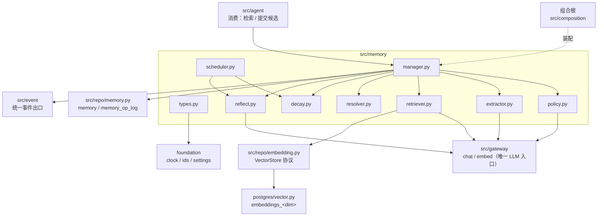
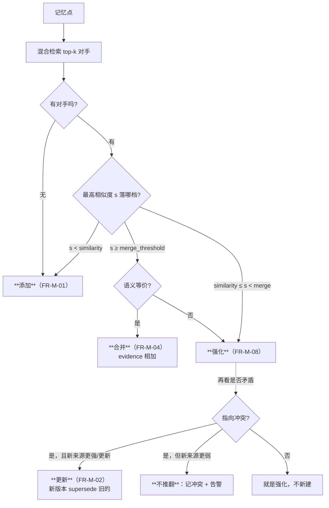
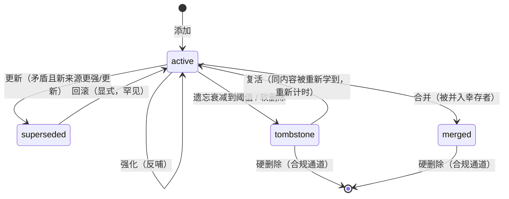
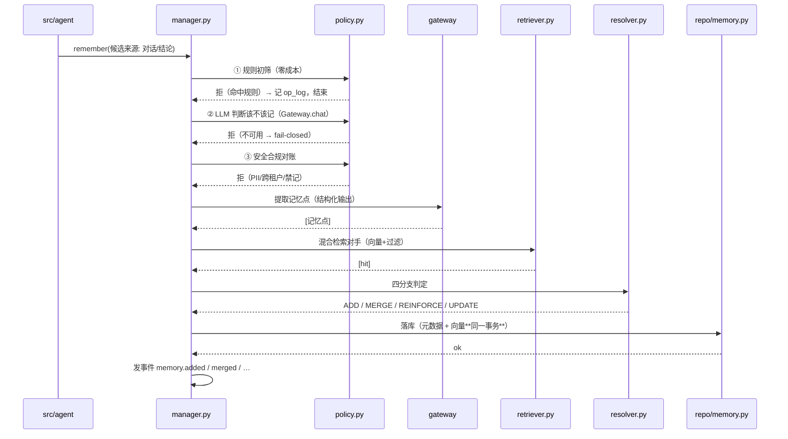
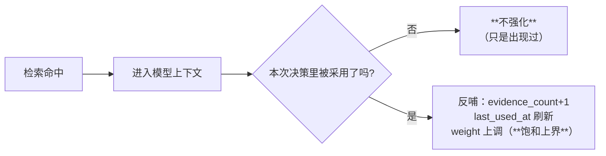
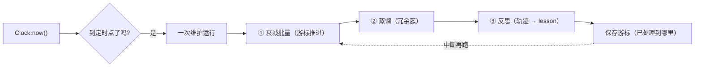
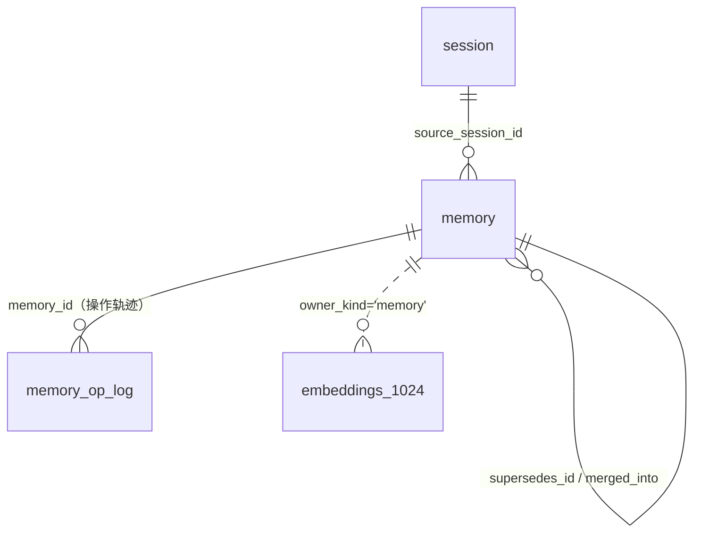
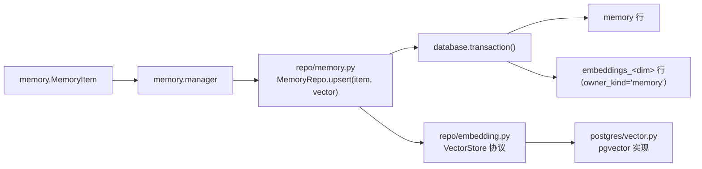
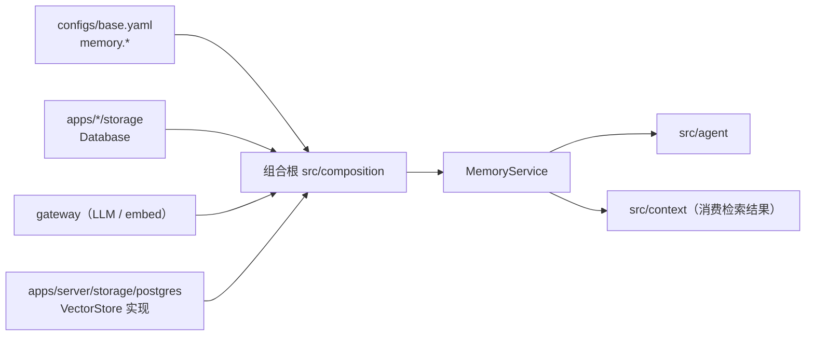
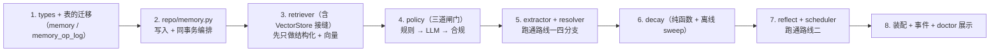

# `src/memory` 架构概要设计

| 项 | 值 |
|---|---|
| 文档层级 | **架构层**（第二篇）。前置：《`src/memory` 需求说明书》 |
| 承接 | 需求说明书-memory 的全部 `FR-M-xx` / `NFR-M-xx` |
| 强耦合 | `docs/repo/架构概要设计-repo.md`（记忆表、向量表、事务边界）；`docs/gateway/架构概要设计-gateway.md`（LLM 与向量化的门面） |
| 外部依赖 | PostgreSQL 17.11 + pgvector 0.8.6（本机实测） |
| 状态 | 待评审 |

---

## 0. 设计目标（一句话）

> 让「**该记的记得住、不该记的进不来、过时的自己退场**」成为默认 ——
> 并把「**一个决定记下来**」这个动作，连同它的理由，显式地留痕，而不是悄悄地写进库。

第三句和第一句同样重要。记忆的错误不像工具那样发生一次就结束，它会**复利**：
被检索、被采用、被强化，越用越"真"。所以本模块把重心放在**写入之前**——
三道闸门（`FR-M-11..13`）与四分支判定（`FR-M-16`）都发生在落库之前，
因为落库之后的一切（清理、回滚、污染）都无法回退。

**两条路线各管一件事**，都不是"顺便补上的"：

| 路线 | 它回答的问题 | 不做的后果 |
|---|---|---|
| **在线写入**（写时判定） | 这次信息**该不该记、记成什么、和旧的怎么合** | 无差别地存 → 冗余与矛盾堆积，检索被稀释 |
| **离线维护**（定时判定） | **没人用的**记忆该不该退场、**存量**能不能提炼成经验 | 只增不减 → 成本与噪声无上界，且永远不产生"经验" |

**贯穿两条路线的一条纪律**：每一个「记下来 / 改掉 / 删掉」的动作都要**留痕**
（`memory_op_log`）。文档、事件、日志三处都要说清「**这条为什么会进来、它凭什么被删**」。

---

## 1. 结构总览

```
src/memory/
├── __init__.py      只导出契约与服务入口，不导出具体实现
├── types.py         MemoryItem / MemoryKind / MemoryState / MemoryOp / WriteVerdict / RetrievalHit
├── policy.py        存记忆前的三道闸门：规则初筛 → LLM 判断 → 安全合规对账      ← 存记忆前
├── extractor.py     从对话/轨迹里 LLM 提取记忆点                              ← 路线一
├── retriever.py     混合检索：向量 + 结构化过滤 + 关键词                       ← 检索
├── resolver.py      冲突与冗余判断 → 四分支（添加/更新/合并/强化）             ← 存记忆中
├── decay.py         遗忘与衰减曲线（间隔重复式）                              ← 路线二
├── reflect.py       反思与蒸馏（从记忆轨迹提炼经验）                          ← 路线二
├── scheduler.py     定时点/时间段的离线维护触发与游标                          ← 路线二
├── manager.py       ★ 编排：把上面串成一次写入 / 一次维护 / 一次检索
└── (无内置存储实现)  落库全部走 src/repo

src/repo/memory.py        memory / memory_op_log 表（元数据 + 向量的同事务编排）
src/repo/embedding.py     VectorStore 协议（已设计，未实现，见 docs/repo §3.4）
apps/server/storage/postgres/vector.py   embeddings_<dim> 表（pgvector，未创建）
```

**`manager.py` 是唯一把它们串起来的地方**，各文件按**生命周期**归位：

| 阶段 | 文件 | 一句话 |
|---|---|---|
| **存记忆前** | `policy.py` | 三道闸门，**顺序本身是约束**：便宜的在前，贵的在后 |
| **存记忆中**（路线一） | `extractor.py` → `retriever.py` → `resolver.py` | 提取 → 找对手 → 判四分支 |
| **检索** | `retriever.py` | 混合检索，只返回"当前有效"且带相关度 |
| **用记忆后** | `decay.py`（强化侧）/ `manager.py` | 反哺：被采用才强化 |
| **路线二** | `scheduler.py` → `decay.py` / `reflect.py` | 定时 → 衰减退场 / 反思蒸馏 |

### 1.1 依赖图



**四条硬边界**：

1. **不 import `provider`** —— import-linter 的「gateway 是 provider 的唯一消费者」契约把 `memory`
   列在禁止名单里（`pyproject.toml` 第 113–126 行）。提取、判断、反思、向量化**全部**走 `Gateway.chat` / `Gateway.embed`。
2. **不 import `agent` / `multiagent`** —— 依赖方向单向（`NFR-M-01`）。是它们调记忆，不是记忆调它们；
   会话内容作为**参数**进来，不靠 import 拿。
3. **不认识 pgvector / 不认识 SQL** —— 检索里「按向量找最近邻」是一个 `VectorStore` 协议调用，
   实现由 `apps/server/storage/postgres/vector.py` 注入（与 `repo` 拿 `Database` 同构，`FR-R-08`）。
4. **不自己落库** —— 所有写入经 `src/repo/memory.py` 的编排，与业务行**同一个事务**。

---

## 2. 核心机制一：写入判定（路线一）

### 2.1 为什么是「先检索后判定」而不是「直接写」

最朴素的做法是：提取到记忆点 → 直接新增一行。它的后果在**第二周**才显现：

| 时间 | 库里发生什么 | 检索变成什么 |
|---|---|---|
| 第 1 天 | 记下「接口超时 30s」 | 一条，准 |
| 第 3 天 | 又记下「接口超时 30s」（措辞不同） | 两条，都相关，模型看到重复 |
| 第 10 天 | 记下「接口超时改成 60s」 | 三条**互相矛盾**，top-k 一起返回，**模型无从取舍** |
| 第 30 天 | … | 信号被自己的副本淹没 |

所以**每一条候选都必须先去找它的"对手"**：已有记忆里最相近的若干条。
没有对手，才是添加；有对手，就必须回答「**它是同义、是佐证、还是矛盾**」。

### 2.2 四分支的判据

判定不是单一相似度阈值，而是**三个信号共同决定**：



三个信号：

| 信号 | 从哪来 | 参与哪个判定 |
|---|---|---|
| **语义相似度 `s`** | 混合检索的相关度（向量距离 + 关键词） | 决定"相近到什么程度" |
| **是否语义等价** | 对 top-1 的一次 LLM 判定（同义 / 佐证 / 矛盾 / 无关） | 区分"合并"与"强化"、发现"矛盾" |
| **来源强度与时效** | 候选的 `source`、`confidence`、时间 vs 旧条目的 | 决定矛盾时**谁取代谁** |

**为什么矛盾不能一律"新的取代旧的"**：来源更弱的新信息（模型的一次猜测）
不该推翻来源更强的旧事实。矛盾且新来源更弱时，正确动作是**记冲突并告警**，
让人或后续的证据来决定——这与项目「拒绝静默」一致：不假装知道谁对。

### 2.3 状态机



**只有 `active` 会被检索返回**（`FR-M-05` / `NFR-M-09`）。
`superseded` / `merged` / `tombstone` 一律排除——这是"记忆会退场"在检索侧的落点。

### 2.4 非对称性：判定的保守方向

与工具幂等完全同构的一条纪律，必须写下来：

> **漏合并是浪费（多一条），错合并是丢信息（少一条，且无人知道）。**
> **错更新是污染（把对的说成错的），漏更新是滞后（还留旧的）。**

所以：

- **合并阈值 > 强化阈值**（配置层 `C-M-4` 强制），合并更保守：够像但不完全等价时，宁可不并；
- **更新要求来源更强或更新**，否则只记冲突；
- **添加永远安全**（多一条），**合并/更新永远危险**（动到了已有的东西）。

### 2.5 完整流程



**两道 fail-closed 的门**（`DM-11`）：LLM 判断不可用 → 不记；检索不可用 → 不直接添加
（`FR-M-12` / `FR-M-15`）。判不了就不动，是这套机制里唯一安全的默认。

---

## 3. 核心机制二：离线维护（路线二）

### 3.1 衰减曲线：间隔重复式

记忆的权重按**指数半衰期**衰减，**访问会重置计时**（`FR-M-07` / `DM-3`）：

```
衰减因子 decay(Δt) = 0.5 ** (Δt / half_life)          # Δt = now - last_accessed_at
有效权重 effective_weight = base_weight * decay(Δt) * (1 + log(1 + evidence_count))
if effective_weight < tombstone_threshold:  →  tombstone
```

三个要点：

- **半衰期可配**，且**受保护记忆**用更长的半衰期（`preference` 一年 +）；
  `NFR-M-06` 要求确定性——公式里不得有随机数，`now` 由注入的 `Clock` 提供
  （单测用 `FakeClock.advance` 推到任意时刻）。
- **访问重置**：每次"被采用"（不是"被检索"，见 §3.3）都刷新 `last_accessed_at`，
  于是"常用且有用"的记忆活得久——这就是**间隔重复**。
- **证据加成**：`evidence_count` 越高的记忆抗衰减越强（被多次独立佐证的事更可信）。

### 3.2 惰性计算 + 离线批量：两处都要

衰减**不能只在离线跑**（两次维护之间，检索会把早该淡出的记忆当新鲜的返回），
**也不能只在读时算**（全表算不动，且淘汰需要扫描）：

| 位置 | 做什么 | 为什么 |
|---|---|---|
| **读时惰性** | 用 `last_accessed_at` + `half_life` 现算 `effective_weight`，按它排序/过滤 | 保证**检索那一刻**的排序与淘汰判定是准的，成本只在命中的少量条目上 |
| **离线批量** | 扫描长期未访问的记忆，重算权重，低于阈值转 `tombstone` | 保证**存储**不涨；且淘汰是写操作，不该在同步读路径上做 |

> **`last_decayed_at` 存的是"上次离线重算的时刻"**，用于让离线任务增量推进——
> 不是用来算权重的（权重永远现算）。这个区分不写清楚，会出现"离线没跑，权重就不变"的错觉。

### 3.3 强化与衰减的耦合：只在"被采用"时强化

这是 §2.2 复利风险的**刹车**（`FR-M-08` / `CM-23`）：



- **"命中 ≠ 有用"**：一条错误记忆也会每次被检索到；若命中就强化，它反而会因为"总被取出来"而升权，
  正是 §2.2 的复利。所以**只在被采用时**才强化。
- **饱和上界**（`reinforce_saturate`）：权重不能无限涨，否则一条老记忆永久霸占检索首位。
- 「被采用」这个信号从哪来：由**调用方**（agent）在决策完成后回填——
  记忆层不猜，也不把"返回给了模型"当成"被用了"。

### 3.4 反思与蒸馏

离线任务在衰减之后，从**记忆轨迹**（`memory_op_log` + 记忆行）里提炼经验（`FR-M-06` / `FR-M-20`）：

| | 反思 reflect | 蒸馏 distill |
|---|---|---|
| 输入 | 一段时间/一个作用域内的多条记忆 + 操作轨迹 | 一簇**语义冗余**的记忆 |
| 动作 | LLM 归纳出更高层的 `lesson` | 把一簇压成一条更抽象、更稳定的记忆 |
| 产出 | **新记忆**（走同样的三道闸门 + 落库） | 一条幸存记忆 + 其余标 `merged` |
| 回指 | 产出必须能列出"从哪几条归纳来" | 同左 |

**反射产出的仍是记忆**（`DM-7`）：只有落成记忆，它才能被检索、被强化、被衰减——
与其它记忆同一套生命周期，不另开一套"报告"。

**反思必须有上界**（`FR-M-20` / `NFR-M-12`）：`max_trajectory_items`、`max_output_items`、
时间与 token 预算；且**走独立的时间预算**，不与在线请求争限流额度。

### 3.5 调度与可重入

`scheduler.py` 提供**可注入时钟**的触发点（`FR-M-18`），不用外部 cron：



- **游标**记录"上次处理到哪"，中断续跑不重复（`CM-26`）；
- **单次运行有界**：`batch_size` × `max_batches_per_run`（`NFR-M-08`）；
- **失败不回滚整轮**：某批失败只跳过该批并告警（记忆维护是旁路，`NFR-M-07`）。

---

## 4. 记忆数据表设计

需求里的**六组**字段是**逻辑分组**，不是六张表。物理上落到
**一张主表 + 一张轨迹表 + repo 既有两张向量表**——理由在表后的"刻意的选择"里。



### 4.1 六组字段 → 物理落点

| 需求分组 | 落点 | 具体列 |
|---|---|---|
| **① 基础组件与租户隔离** | 每张表共用的基座列 | `memory_id`(uuid uniq) · `tenant_id` · `scope` · `owner_id` · `session_id` · `caller` · `created_at` · `updated_at` · `schema_version` |
| **② 核心记忆表示** | `memory` | `content` · `content_hash` · `summary` |
| **③ 记忆分类与属性** | `memory` | `kind` · `category` · `tags` · `source_kind` · `source_session_id` · `source_agent` · `source_trace_id` · `confidence` · `importance` · `sensitivity` |
| **④ 记忆语义向量** | **repo 的向量表**（不落 `memory`） | `embeddings_<dim>`(`owner_kind='memory'`, `owner_id=memory_id`) + `vector_spaces` |
| **⑤ 版本与时效控制** | `memory` + `memory_op_log` | `state` · `version` · `supersedes_id` · `superseded_by` · `merged_into` · `valid_from` · `valid_to`；轨迹进 `memory_op_log` |
| **⑥ 访问热度** | `memory` | `access_count` · `last_accessed_at` · `used_count` · `evidence_count` · `weight` · `last_decayed_at` |

### 4.2 表清单

| 表 | 关键列 | 索引 / 约束 |
|---|---|---|
| `memory` | `id`(BigIntPk) `memory_id`(uuid uniq) `tenant_id` `scope` `owner_id` `kind` `content` `content_hash` `summary` `category` `tags` `source_kind` `source_session_id` `source_agent` `source_trace_id` `confidence` `importance` `sensitivity` `state` `version` `supersedes_id` `superseded_by` `merged_into` `valid_from` `valid_to` `access_count` `last_accessed_at` `used_count` `evidence_count` `weight` `last_decayed_at` `session_id` `caller` `metadata` `created_at` `updated_at` | **uniq(memory_id)**；idx(scope, tenant_id, kind, state, created_at desc)；idx(state, last_accessed_at)；idx(content_hash, scope)；idx(source_session_id) |
| `memory_op_log`（**append-only**） | `id`(BigIntPk) `op_id`(uuid uniq) `memory_id` `op` `before_hash` `after_hash` `reason` `actor` `source_trace_id` `payload` `scope` `tenant_id` `occurred_at` | idx(memory_id, occurred_at desc)；idx(op, occurred_at desc)；idx(scope, occurred_at desc) |
| `vector_spaces` | `space`(uniq) `dim` `metric` `model_key` | uniq(space)（**repo 既有设计**） |
| `embeddings_<dim>` | `space` `owner_kind` `owner_id` `model_key` `embedding`(vector(N)) `created_at` | uniq(space, owner_kind, owner_id)；**HNSW(embedding vector_cosine_ops)**（**repo 既有设计**） |

> **本模块只声明"这两张向量表必须存在、必须是这个形状"，不在本模块建**——
> 表模型归 `apps/server/storage/postgres/vector.py`（列类型是 pgvector 的 `vector(N)`），
> 但注册到同一个 `foundation/db.Base`，所以"元数据 + 向量同一事务"成立（`FR-R-08`）。

### 4.3 说明几处刻意的选择

1. **六组不拆成六张表**。`memory` 是一条记忆的**一个逻辑实体**——
   拆成"核心 / 分类 / 热度"三张表意味着**每一次检索都要三次 join**，
   而检索在热路径上。分组体现在**列的组织**与**索引的规划**上，不体现在表的数量上。
   唯一的例外是**向量**（必须独立，因为 `vector(N)` 把维度钉在列类型上，`DR-4`）
   与**轨迹**（append-only，与可变主体分离才不会被 update 污染）。

2. **`memory_op_log` 是 append-only**，与 `event` 表同级纪律：
   操作轨迹**不更新、不删除**。它同时承担三件事——审计（谁改的）、
   反思的输入（轨迹）、回滚的依据（`before_hash`）。

3. **访问计数就地更新，只有"操作级"事件才落轨迹**（`DM-6`）：
   `access_count` / `last_accessed_at` 在 `memory` 行上原地 +1；
   `memory_op_log` 只记**写入/更新/合并/强化/衰减/删除**，**不记每一次读取**——
   否则一次 `CM-19`（命中 1000 条）就写 1000 行，读放大不可接受。

4. **`content_hash` 是幂等的锚**（`FR-M-01`）：`hash(normalize(content) + scope)`，
   唯一性在此判定。规范化**只做跨重试必然一致的部分**（空白、编码、大小写），
   **不做语义归一化**——与工具幂等的同一条纪律，语义等价交给 `resolver` 的 LLM 判定。

5. **`valid_to` 与 repo 既有设计的 `expires_at` 是同一列的改名**（时效控制 `FR-M-07` / `DM-10`）：
   `task_state` 硬过期与普通衰减是两回事，前者是"到点即无效"，用 `valid_to` 表达；
   repo 文档 §4 里叫 `expires_at`，**实现时统一为 `valid_to`**，需要同步更新 repo 文档。

6. **`tenant_id` 是本设计唯一动到 repo 既有契约的地方**（`DM-9`）：
   `docs/repo/架构概要设计-repo.md` §4 的 `memory` 表**没有租户列**，
   而全平台目前（`grep tenant` 零命中）也没有租户概念。
   **本设计把它当作"待平台统一的先行落点"**：记忆表先带 `tenant_id`（可空），
   并在文档里显式标注——不假装它是记忆模块的局部问题。

7. **时间戳统一 `timestamptz`**（`DR-9`），
   衰减用的 `now` 一律来自注入的 `Clock`，不取墙钟（`NFR-M-05` / `NFR-M-06`）。

---

## 5. 各文件设计

### 5.1 `types.py` —— 契约载体

```python
MemoryKind   = Literal["fact", "preference", "task_state", "lesson"]
MemoryState  = Literal["active", "superseded", "merged", "tombstone"]
MemoryScope  = Literal["session", "user", "project", "global"]
MemoryOp     = Literal["add", "update", "delete", "merge", "reinforce", "decay", "reflect"]

@dataclass(frozen=True)
class MemoryItem:            # 一条记忆的领域形态（与 ORM 行解耦）
    memory_id: uuid.UUID
    kind: MemoryKind
    content: str
    scope: MemoryScope
    state: MemoryState = "active"
    confidence: float = 0.5
    importance: float = 0.5
    weight: float = 1.0
    source: MemorySource          # 来源：session/agent/trace
    valid_from / valid_to: datetime | None
    metadata: Mapping[str, Any]

@dataclass(frozen=True)
class GateVerdict:           # 闸门结论（三道闸门统一返回这个）
    allow: bool
    reason: str              # 命中哪条规则 / 为什么拒
    gate: Literal["rules", "judge", "compliance"]
    kind / confidence: ...   # 闸门②会顺带判定种类与初始置信度

@dataclass(frozen=True)
class RetrievalHit:          # 检索结果（带相关度，FR-M-05 / FR-R-08）
    memory: MemoryItem
    score: float             # 相关度（越大越相关）
    distance: float          # 原始距离（供上层判断）

Resolution = Literal["add", "merge", "reinforce", "update", "conflict"]
```

**为什么 `MemoryItem` 与 ORM 行解耦**：与 `repo` 的 `CheckpointView` / `ExecutionView` 同构——
领域层拿到的应是**领域形态**，不是带脏跟踪的 ORM 行。`repo` 负责两个方向的映射。

### 5.2 `policy.py` —— 三道闸门（`FR-M-11..13`）

```python
class WriteGate(Protocol):
    async def judge(self, candidate: MemoryCandidate, *, ctx: MemoryContext) -> GateVerdict: ...

class RuleGate(WriteGate):        # ① 确定性，零外部调用，**最先**
    RULES = (_too_short, _too_long, _looks_ephemeral, _looks_secret, _scope_allowed)

class LlmJudgeGate(WriteGate):    # ② 一次轻量补全，走 Gateway.chat，**失败即拒**
    ...

class ComplianceGate(WriteGate):  # ③ 硬否决，不可被跳过
    ...
```

**顺序是约束，不是建议**：规则初筛零成本、能挡掉一大半（含密钥这种**绝不能进 LLM** 的），
所以必须在最前；LLM 判断有 token 成本与延迟，排在中间；合规对账有**硬否决权**，
即使前两道放行也要过。三道闸门**短路求值**（前一道拒就不进下一道）。

**`on_unavailable=reject` 是 fail-closed**（`DM-11`）：`Gateway.chat` 不可用时，
`LlmJudgeGate` 返回 `allow=False`，并带上"因判断不可用而拒绝"——**不放过任何一条没被判断过的**。

> 闸门顺带产出 `kind` 与初始 `confidence`：`extractor` 提取的是"内容与来源"，
> "这是哪一类、有多可信"由闸门②判定——**提取与分级分开**，避免了"提取模型既写内容又给自己打分"。

### 5.3 `extractor.py` —— 从对话提取记忆点（`FR-M-14`）

- 输入：一段对话（`Sequence[Message]` 或一个任务结论）+ 作用域上下文；
- 输出：`[MemoryCandidate]`，每条带内容、来源引用、以及可选的 `kind` 提示；
- **结构化输出**：用 gateway 的 `json_schema` / `response_format` 拿结构化结果，
  不解析散文；
- **上界**：`max_items_per_call`（默认 5）与 `max_input_tokens`（默认 8000）硬限制；
- **产出是候选**，**不落库**——必须过 `policy` 与 `resolver`。

### 5.4 `retriever.py` —— 混合检索（`FR-M-05` / `FR-M-15`）

三种信号合成一个排序：

| 信号 | 实现 | 备注 |
|---|---|---|
| **语义** | `Gateway.embed(alias, [query])` 拿查询向量 → `VectorStore.search(space, vector, top_k, filter)` | 向量化**只经 gateway**；距离由 `VectorStore` 返回 |
| **结构化过滤** | `kind` / `scope` / 时间范围 / `state='active'` / 来源 | **强制**：`state` 与 `scope` 是**不可省**的过滤条件（`FR-M-05` / `NFR-M-03`） |
| **关键词** | `content` 上的词法匹配（用于专有名词、代码标识符——向量对它们不敏感） | 可选，与向量结果做融合（RRF） |

**只返回 `active`**：`state='active' AND (valid_to IS NULL OR valid_to > now)` 是**每个查询的底座条件**，
写在检索 SQL 的必经路径上，不交给调用方传（`NFR-M-09`）。

**有界**：`max_results` / `max_bytes` 双上限——结果直接进上下文（`NFR-M-08`）。

### 5.5 `resolver.py` —— 冲突与冗余判断（`FR-M-16`）

```python
async def resolve(
    candidate: MemoryCandidate, hits: Sequence[RetrievalHit], *, ctx: MemoryContext
) -> Resolution
```

- **无对手** → `add`；
- **有对手**：先按相似度分档（`merge_threshold` / `similarity_threshold`），
  对最高分对手做**一次 LLM 判定**（等价 / 佐证 / 矛盾 / 无关）；
- **矛盾**再看来源强度与时效 → `update`（新来源更强/更新）或 `conflict`（记冲突 + 告警）；
- **保守方向**见 §2.4：合并比强化严、更新比冲突谨慎。

**判定必须可复现**（`NFR-M-06`）：阈值分档是确定的；LLM 判定允许模型漂移，
所以**判定结论与依据要一起落进 `memory_op_log`**，让漂移可被审计。

### 5.6 `decay.py` —— 遗忘与衰减（`FR-M-07`）

```python
def effective_weight(item: MemoryItem, now: datetime) -> float
def next_state(item: MemoryItem, *, now, policy: DecayPolicy) -> MemoryState
async def sweep(...)      # 离线批量：扫描 → 重算 → tombstone
```

- **纯函数**：`effective_weight` 只依赖 `(item, now, policy)`，**无副作用、无随机**（`NFR-M-06`）；
- **读时惰性**用 `effective_weight` 排序/过滤；**离线批量**用 `sweep` 做淘汰；
- **受保护记忆**（`preference` / `importance ≥ 阈值`）走 `protected_half_life`。

### 5.7 `reflect.py` —— 反思与蒸馏（`FR-M-06` / `FR-M-20`）

- **reflect**：读一段时间/作用域的记忆 + 轨迹 → 归纳 `lesson`；
- **distill**：对一簇高冗余记忆 → 压成一条 + 其余标 `merged`；
- **产出走同样的闸门与落库**，保证"反思出来的也是记忆，也守规矩"；
- **有界**：`max_trajectory_items` / `max_output_items` / 时间预算；
- **失败不留半成品**：LLM 不可用 → 本轮不做，不写任何东西。

### 5.8 `scheduler.py` —— 调度（`FR-M-18`）

- 依赖注入的 `Clock`（`foundation.Clock`），支持 `schedule`（cron 形）与 `interval_hours`；
- **游标持久化**（存 `memory_op_log` 的末位或一条独立的 maintenance 记录），可重入；
- **单次运行有界**（`batch_size × max_batches_per_run`）；
- **不占用在线限流额度**：维护的 LLM 调用走独立会计（`FR-M-20` / `C-M-7`）。

### 5.9 `manager.py` —— 编排（唯一入口）

```python
@dataclass
class MemoryService:
    gate: WriteGate                 # 组合三道闸门
    extractor: Extractor
    retriever: Retriever
    resolver: Resolver
    decay: DecayPolicy
    repo: MemoryRepo                # src/repo/memory.py
    gateway: Gateway
    clock: Clock
    events: EventEmitter

    async def remember(self, source: MemorySource, *, ctx) -> RememberResult  # 路线一
    async def recall(self, query: str, *, ctx, kinds=None, top_k=...) -> list[RetrievalHit]  # 检索
    async def reinforce(self, memory_id, *, used: bool, ctx) -> None         # 反哺
    async def maintain(self, *, now=None) -> MaintenanceReport               # 路线二
```

**`MemoryService` 是模块唯一的对外面**：`src/agent` 只认这四个方法，
不知道闸门有几道、检索怎么混、衰减什么曲线。这与 `ToolExecutor` 是工具层唯一入口同构。

**旁路纪律**（`NFR-M-07`）：四个方法**都不得**把异常抛给调用方——
`remember` / `reinforce` 失败只记事件告警；`recall` 失败返回空列表并标注降级。
记忆是旁路，不该拖垮会话。

---

## 6. 与 repo 的接缝

| 方向 | 内容 |
|---|---|
| memory 产生 | `MemoryItem` / `MemoryOpRecord`（领域形态） |
| repo 消费 | `MemoryRepo.upsert(item, vector=...)` / `append_op(...)` / `search(...)` |
| repo 编排 | 「写 `memory` 行 + 写 `embeddings_<dim>` 行」**在同一个事务**（`FR-R-08` / `FR-M-17`） |
| repo 提供 | `VectorStore` 协议（`search` / `upsert` / `delete`），实现由 storage 注入 |
| repo 不 import | `memory`（`NFR-R-03` 硬约束）——所以 `MemoryRepo` 接收的是**存储无关的行类型**，不是 `MemoryItem` |



**`VectorStore.search` 必须返回距离**（`FR-R-08`），
`retriever` 才能把距离转成相关度 `score`。

---

## 7. 装配



**装配点**：`src/composition/bootstrap.py` 的 `Runtime` 增加一个字段
（与 `tools` / `catalog` 并列）：

```python
@dataclass
class Runtime:
    ...
    memory: MemoryService | None = None     # memory.enabled=false 时为 None
```

**注入边界与工具层一致**：`Database`、`VectorStore`、`EmbeddingStore` 由 app 层
（`apps/*/storage`）建好后注入，`src/` 不 import `apps/`。**没有 pgvector / 没有数据库时**，
`memory` 为 `None`，`remember` / `recall` 直接返回降级结果（记忆是旁路，不是硬依赖）。

**embedding 别名**：复用 `gateway.aliases.emb.default`（与 `tool.catalog.embedding_alias` 同源），
`MemoryService` 只持有别名，不持有模型。

**启动期检查**（对照 `Runtime.inspect_tools`）：`memory.enabled=true` 时，
启动时校验向量空间存在且维度匹配（`FR-R-08` 的"维度不匹配必须报错"）、
`DecayPolicy` 的阈值与本表列存在——**配置错误在启动时暴露，不等到第一次写入**。

---

## 8. 记忆事件

**出口统一**：`MemoryService` 是记忆模块**唯一**的事件出口（同 `ToolExecutor` 之于工具层）。
命名沿用 `<模块>.<对象>.<动作>`，载荷复用 `event` 表的 `subject` / `outcome` 两列：

| 事件名 | 何时 | `subject` / `outcome` |
|---|---|---|
| `memory.candidate.rejected` | 三道闸门任一拒绝 | 闸门名 / `rejected` |
| `memory.added` | 新建记忆 | `kind` / `added` |
| `memory.merged` | 合并 | `kind` / `merged` |
| `memory.reinforced` | 反哺强化（写入侧或使用侧） | `kind` / `reinforced` |
| `memory.updated` | 新版本取代旧版本 | `kind` / `updated` |
| `memory.conflicted` | 矛盾但新来源更弱，未推翻 | `kind` / `conflict` |
| `memory.decayed` | 衰减转 tombstone | `kind` / `tombstoned` |
| `memory.reflected` | 反思/蒸馏产出 | `kind` / `reflected` |
| `memory.degraded` | 记忆服务不可用 / 降级 | 环节名 / `degraded` |

**为什么要记 `memory.candidate.rejected`**（`NFR-M-10`）：
"闸门到底拦下了多少、各命中什么规则"是调参（阈值、规则）唯一的反馈来源。
不记它，三道闸门就是一个**看不见的黑箱**——太严还是太松永远答不出来。

---

## 9. 关键设计决策

| 编号 | 决策 | 选择 | 理由 |
|---|---|---|---|
| `MR-1` | 判定位置 | **落库之前** | 记忆的错记会复利（§0），事后清理不可回退 |
| `MR-2` | 命中/未命中与动作的对应 | **命中有对手 → 判四分支；未命中 → 添加** | 没有可比的旧记忆时无从判冲突（`DM-1`） |
| `MR-3` | 相似度判定 | **三信号**（相似度 + LLM 等价判定 + 来源强度） | 单靠阈值分不开"同义"与"矛盾"——它们相似度都高 |
| `MR-4` | 矛盾处理 | **新来源更强/更新才取代；否则记冲突** | 来源更弱的猜测不该推翻来源更强的事实（§2.2） |
| `MR-5` | 保守方向 | **合并 > 强化 > 添加**（危险度） | 错合并丢信息、错更新污染；添加永远安全（§2.4） |
| `MR-6` | 衰减曲线 | **指数半衰期 + 访问重置 + 证据加成** | 表达"越久越淡、常被用则回血"（`DM-3`） |
| `MR-7` | 衰减在哪算 | **读时惰性 + 离线批量**，两处都要 | 只在离线不准，只在读时算不动（§3.2） |
| `MR-8` | 强化的触发 | **只在"被采用"时**，不是"被检索"时 | 命中就强化 = 错误记忆自我强化（`FR-M-08` / §3.3） |
| `MR-9` | 反思产出形态 | **新记忆**（`kind=lesson`），走同样闸门 | 与其它记忆同一生命周期，不另开一套（`DM-7`） |
| `MR-10` | 删除档位 | **软删默认 + 硬删合规通道** | 软删留轨迹（反思/审计要用），硬删是合规刚需（`DM-5`） |
| `MR-11` | 向量表 | **复用 repo 的 `embeddings_<dim>`，不另建** | `vector(N)` 钉维度（`DR-4`），且"元数据+向量同事务"只对同库表成立 |
| `MR-12` | 访问热度 | **计数就地 + 只记"操作级"轨迹** | 每次读取落行会读放大到不可接受（`DM-6`） |
| `MR-13` | 判断不可用 | **fail-closed（拒）** | 放行等于没闸门；错记复利不可逆（`DM-11`） |
| `MR-14` | 记忆回灌的信任级 | **不可信数据**，回灌前标记 | 记忆源于对话，可能被注入；旧记忆是新会话的注入源（`DM-13`） |
| `MR-15` | 唯一对外面 | **`MemoryService` 四个方法** | 上层不该知道闸门/检索/衰减的内部结构（§5.9） |

---

## 10. 待确认（需评审）

| 编号 | 待确认 | 备选 | 倾向 |
|---|---|---|---|
| `MQ-1` | **`tenant_id` 的落地范围**（`DM-9`） | (a) 只记忆表先加；(b) 全平台统一加 | **(a) + 显式标注待统一**。这是本设计唯一动到 repo 既有契约的地方，需与 repo 一起定 |
| `MQ-2` | **`expires_at` → `valid_to` 改名** | 改名 / 保留旧名 | **改名**（`§4.3-5`），但需同步 repo 文档与已落地代码 |
| `MQ-3` | **混合检索的融合算法** | RRF / 加权求和 / 只做向量 | **RRF**（无需调权重、对量纲不敏感），需实测关键词召回是否值得 |
| `MQ-4` | **"被采用"信号怎么传** | agent 显式回填 / 用后续工具结果推断 | **显式回填**：记忆层不猜（`MR-8`）；但要给 agent 定一个不打扰主流程的回填点 |
| `MQ-5` | **蒸馏怎么发现"冗余簇"** | 向量聚类 / 相似度连通分量 / LLM 分组 | **相似度连通分量**起步（确定、可测），簇内再用一次 LLM 归纳 |
| `MQ-6` | **复活的语义** | 同内容重新学到 → 复活 tombstone / 建新行 | **复活**（`§2.3`）：保留原 `memory_id` 与轨迹，只重置计时与权重 |
| `MQ-7` | **维护任务与在线请求的资源分账** | 同限额 / 独立限额 / 独立进程 | **独立限额**（`C-M-7`）；是否独立进程看实测 |
| `MQ-8` | **`schema_version` 的粒度** | 表级 / 条目级 | **条目级**：蒸馏/提取的格式可能演进，`CheckpointRow` 的 `format_version` 是同一纪律 |

---

## 11. 实施顺序



**为什么 `retriever` 排在 `policy` 之前**：`resolver` 依赖它，而路线一的四分支是**最容易验证**的部分
（构造四个场景即可）——先把主链路跑通，再挂闸门。但**发布时闸门必须在位**：
`policy` 未就绪前，`memory.enabled` 保持 `false`。

**每步的验收点**（对应 §8 的 `CM-*`）：
S1→`CM-31`；S2→`CM-13`；S3→`CM-15..19`；S4→`CM-1..6`；S5→`CM-7..12`；
S6→`CM-21..24`；S7→`CM-20/25/26/27`；S8→`CM-32/33`。

---

## 12. 风险

| 风险 | 触发条件 | 缓解 |
|---|---|---|
| **错误记忆复利**（§0/§2.2） | 闸门太松 / LLM 判错 | 三闸门叠加 + fail-closed（`MR-13`）+ 只用"被采用"强化（`MR-8`）+ 全链留痕 |
| **闸门太严，什么也记不住** | 阈值配高 / 规则过宽 | `memory.candidate.rejected` 事件统计（`NFR-M-10`）——用数据调，不靠感觉 |
| **跨租户泄漏** | 检索忘记加 `scope` 过滤 | `state`/`scope` 过滤写在**检索必经路径**（`§5.4`）而非调用方传；`CM-6` / `CM-16` 守着 |
| **检索拖慢主链路** | 检索/向量化在热路径上、又慢又贵 | 结果有界（`max_results`/`max_bytes`）+ 记忆是旁路（超时即降级返回空，`NFR-M-07`） |
| **成本黑洞** | 提取/判断/反思的 LLM 调用不计账 | 全走 gateway，计入 `FR-G-08` 用量（`NFR-M-12`）；维护走独立预算 |
| **维护任务跑不完** | 记忆量大、单轮无界 | `batch_size × max_batches_per_run` + 游标续跑（`FR-M-18`） |
| **被污染记忆成为注入源** | 记忆内容含指令且原样回灌 | 回灌前标记不可信（`MR-14` / `NFR-M-02`），对照 `NFR-T-08` |
| **`tenant_id` 半吊子落地** | 只记忆表有、别的表没有，被当成"隔离已完成" | 文档显式标注"待平台统一"（`MQ-1`），不假装它是局部问题 |

---

## 13. 需求追溯

| 需求 | 落点 |
|---|---|
| `FR-M-01 添加` | `resolver.py`（`add` 分支）/ `repo/memory.py` |
| `FR-M-02 更新` | `resolver.py`（`update`）/ `memory.state` 状态机（§2.3） |
| `FR-M-03 删除` | `memory.state`（tombstone）/ `repo/memory.py`（purge） |
| `FR-M-04 合并` | `resolver.py`（`merge`）/ `memory.merged_into` |
| `FR-M-05 检索` | `retriever.py` |
| `FR-M-06 反思与蒸馏` | `reflect.py` |
| `FR-M-07 遗忘与衰减` | `decay.py`（§3.1） |
| `FR-M-08 反哺与强化` | `manager.reinforce` + `resolver`（§3.3） |
| `FR-M-09/10 存什么/不存什么` | `types.MemoryKind` + `policy.py` |
| `FR-M-11..13 三道闸门` | `policy.py`（§5.2） |
| `FR-M-14 提取` | `extractor.py` |
| `FR-M-15 写入路径检索` | `retriever.py`（写入路径调用） |
| `FR-M-16 冲突与冗余判断` | `resolver.py`（§2.2 / §5.5） |
| `FR-M-17 同事务` | `repo/memory.py`（§6） |
| `FR-M-18..20 离线维护` | `scheduler.py` + `decay.py` + `reflect.py` |
| `NFR-M-01 依赖单向` | §1.1 四条硬边界 |
| `NFR-M-02 不可信输入` | `MR-14` / 检索回灌标记 |
| `NFR-M-03 租户隔离` | `§5.4` 强制过滤 + `MQ-1` |
| `NFR-M-04/08 有界与写放大` | `§4.3-3` + `§5.4` 上限 |
| `NFR-M-05/06 可测试/确定性` | `decay.py` 纯函数 + 注入 `Clock` |
| `NFR-M-07 不放大故障` | `manager.py` 旁路纪律（§5.9） |
| `NFR-M-09 时效诚实` | `§5.4` 检索底座条件 |
| `NFR-M-10 可观测` | §8 事件 + `memory.candidate.rejected` |
| `NFR-M-11 可追溯` | `memory_op_log`（§4.3-2） |
| `NFR-M-12 成本可控` | 走 gateway + 独立预算（§3.4 / §7） |
