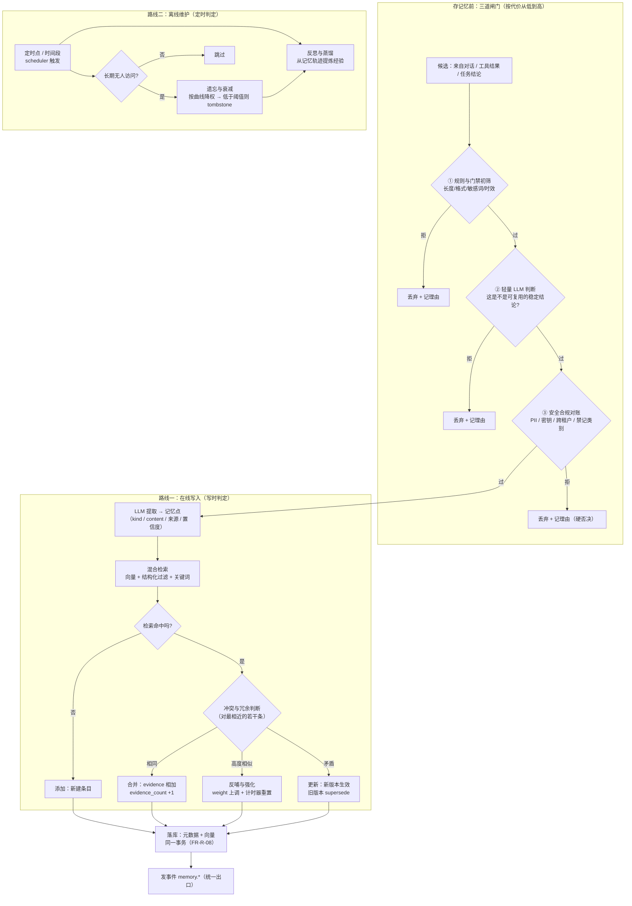

# `src/memory` 需求说明书

| 项 | 值 |
|---|---|
| 文档层级 | **需求层**（第一篇）。后续：《`src/memory` 架构概要设计》 |
| 覆盖范围 | `src/memory/` 全部文件 + 落库侧 `src/repo/memory.py`（与 repo 的接缝） |
| 上游依赖 | `foundation`（配置 / 时钟 / ID）、`src/gateway`（提取与反思用的 LLM、向量化的唯一入口）、`src/repo`（记忆元数据与向量的落库） |
| 下游消费 | `src/agent`（七个测试阶段）、`src/multiagent`、`src/context`（检索结果注入上下文） |
| 关键外部依赖 | PostgreSQL + pgvector（记忆元数据与向量**同库同事务**） |
| 强耦合 | `docs/repo/需求说明书-repo.md` `FR-R-04` / `FR-R-08`（记忆表与向量契约）；`docs/gateway/需求说明书-gateway.md`（LLM 与向量化的唯一入口） |
| 状态 | 待评审 |

---

## 1. 这份文档回答什么

只回答**要解决什么问题**、**必须提供哪些能力**、**什么算合格**。

**本文不回答**：表怎么建、向量怎么索、衰减曲线的具体公式、LLM 提示词怎么写。
文中文件名仅用于圈定职责边界。

**前置阅读**：`docs/repo/需求说明书-repo.md` `FR-R-04`（记忆条目）、`FR-R-08`（向量存储与检索）；
`docs/tool/需求说明书-tool.md` §2.2（「副作用不能重来」——本模块的难点与它**不是同一类**，见 §2.2）。

---

## 2. 背景与定位

### 2.1 为什么需要独立的记忆层

平台的七个测试阶段（需求 → 设计 → 用例 → 环境 → 执行 → 分析 → 缺陷）都是**长链路、跨会话**的工作。
一个会话里学到的东西——「这个项目用 pytest 不用 unittest」「XX 模块的用例命名必须带需求号」
「上次那条命令在这个环境里会超时」——如果只活在**这一次对话的上下文**里，那么：

- **下一个会话从零开始**：同样的偏好要被再问一遍，同样的教训要被再踩一次；
- **上下文窗口是稀缺资源**：每次都把全历史塞回去，等于用最贵的方式做最笨的事；
- **平台不会变聪明**：七阶段跑一百遍，第一百遍和第一遍一样懵。

所以需要一个**跨会话、可检索、会退场**的记忆层：把一次交互里产生的**可复用结论**沉淀下来，
在需要时按相关性取回，而不是无差别地堆积。

### 2.2 本模块真正难的地方：写进去的记忆会自我放大

工具的副作用是**一次性**的：`write` 重复执行，后果发生一次就固定了。
记忆不是。一条错误的记忆一旦写进去，会：

| 环节 | 发生什么 |
|---|---|
| **检索** | 它在**每一次**相关查询里被取出来，摆到模型面前 |
| **反哺** | 它被用于一次实际决策，于是被当作「有用的」而**强化** |
| **强度上升** | 强化让它在下一次检索里**排名更高**、更不容易被衰减 |
| **复利** | 越用越像事实，而被它污染的决策又产生新的、与它一致的行为 |

> 工具的错误是**一次事故**，记忆的错误是**复利**。
> 一条「这个项目禁止用 mock」的假记忆，会安静地把后续所有测试都带偏，
> 而它每被用一次，就变得更"真"一分。

**所以本模块的第一目标不是「记得住」，而是「不该记的进不来」。**
把判定压到**写入之前**（§5.3 的三道闸门），代价最小、且唯一可行——
一旦记忆被写进去并被强化过，事后清理它的成本（以及它已经造成的污染）都无法回退。

### 2.3 这个目标做不到 100%，必须说清楚做到哪

记忆的写入判定是一个**语义问题**，而语义判定会错：

- **「规则初筛」是确定的但粗**：它能拦掉格式、长度、明显的临时信息，拦不掉「一句听起来很像事实的错误」；
- **「LLM 判断」是有语义的但会漂**：同一个 prompt 在边界样本上可能给出不同结论，也可能被对话里的措辞带跑；
- **「安全合规对账」是权威的但只能是黑名单式**：它挡得住已知的敏感类别，挡不住未知的。

因此做到的是**「三道闸门叠加，把误入率压到可接受，并让每一次放行都有据可查」**，
不是「保证没有错误记忆」。这与项目「拒绝静默」的主线一致：
**每一次「决定记下来」都要留下理由**，事后能回答「这条为什么会进来」。

同时必须承认另一侧的代价：闸门**过严**会丢掉有用的经验。
所以闸门的设计原则是**「宁缺毋滥，但放行的要可追溯」**——
宁可漏记（下次还能重新学到），不可错记（会复利污染）。

---

## 3. 范围

### 3.1 本模块负责

| 职责 | 落点 |
|---|---|
| 记忆的**契约与类型**（种类、状态、操作、判定结果） | `types.py` |
| **八个原子操作**的语义与编排 | `manager.py`（编排）+ 各专用文件 |
| **写入前的三道闸门**（规则初筛 / LLM 判断 / 安全合规对账） | `policy.py` |
| **从对话与轨迹中提取记忆点** | `extractor.py` |
| **混合检索**（向量 + 结构化过滤 + 关键词） | `retriever.py` |
| **冲突与冗余判断 → 四分支**（添加 / 更新 / 合并 / 强化） | `resolver.py` |
| **遗忘与衰减曲线** | `decay.py` |
| **反思与蒸馏**（从记忆轨迹提炼经验） | `reflect.py` |
| **离线维护的调度**（定时点 / 时间段） | `scheduler.py` |
| 记忆事件的**发布**（走统一事件出口） | `manager.py` |

### 3.2 本模块明确不负责

| 不做的事 | 归属 |
|---|---|
| 记忆表与操作日志表的**建表与落库** | `src/repo/memory.py`（本模块只产生数据） |
| **向量化的调用**（调 embedding 模型） | `src/gateway`（`Gateway.embed`），本模块只拿回向量 |
| 用 LLM 做**提取与反思**的**模型路由、重试、降级、计量** | `src/gateway`（`Gateway.chat`），本模块只说「要一次补全」 |
| **pgvector 的 SQL / 表模型 / 索引** | `apps/server/storage/postgres/vector.py`；repo 只定义 `VectorStore` 协议（`FR-R-08`） |
| 决定的**上下文预算、压缩、注入顺序** | `src/context`（本模块只交回「检索到什么」，怎么放进窗口是 context 的事） |
| 判断「**什么时候**该去回忆 / 该记什么业务结论」 | `src/agent` / `src/multiagent`（这是推理） |
| 会话与消息的存储 | `src/repo`（`session` / `message`） |

### 3.3 与 `src/context` 和 `repo.memory` 的分工（容易混，先定清楚）

三者都与「让模型看到更多东西」有关，但处在**不同的时间尺度**上：

| | `src/context` | `src/memory`（本模块） | `src/repo/memory.py` |
|---|---|---|---|
| 管什么 | **这一次**请求的窗口怎么拼 | 跨会话**该记住什么、怎么取回** | 记忆怎么**可靠地落下去、高效地取出来** |
| 时间尺度 | 一次调用 | 长期（会话以上） | 无（存储层） |
| 输入 | 本次的 message 列表 | 历史对话 / 记忆轨迹 | 已经算好的记忆行与向量 |
| 输出 | 一个**有预算的** message 序列 | 一批**带相关度**的记忆 | 写入 / 读出的行 |

一句话：**context 管「这一次放得下」，memory 管「下一次记得住」，repo 管「存得稳」**。
memory 的检索结果**交给** context 去注入；memory **不**直接改 message 列表。

> 另一处易混：`apps/cli/storage/memory.py` 是**内存版数据库实现**（`InMemoryDatabase`），
> 与「记忆」无关，不要被文件名骗了。

---

## 4. 一条记忆的责任链

记忆的生命周期分**两条路线**：**在线写入**（会话进行中，写时判定）与**离线维护**（后台，定时判定）。
两条路线共用同一批原子操作，但**触发者与时间尺度不同**。



**两条路线各自回答一个问题**：

| 路线 | 触发 | 回答 | 不做的后果 |
|---|---|---|---|
| **在线写入** | 会话/任务进行中，产生了候选记忆 | 「这次信息**该不该记、记成什么、和旧的怎么合**」 | 无差别地存 → 冗余与矛盾堆积，检索被稀释 |
| **离线维护** | 定时点 / 时间段，后台 | 「**没人用的**记忆该不该退场、**存量**能不能提炼成经验」 | 记忆只增不减 → 成本和噪声无上界，且永远不产生"经验" |

**贯穿两条路线的一条纪律**：每一个「记下来 / 改掉 / 删掉」的决定，都要**留下理由与来源**
（`memory_op_log`，见架构文档 §4）。否则事后无法回答「这条为什么会进来」「它凭什么被删」。

---

## 5. 功能需求

编号 `FR-M-xx`。

### 5.1 八个原子操作

记忆的全部能力收敛为**八个原子操作**。其余一切（在线写入、离线维护、检索注入）都是它们的编排。

#### FR-M-01 — 添加

**要求**：

- 新建一条记忆条目，携带**种类**（`kind`，见 `FR-M-09`）、内容、来源、初始置信度/权重；
- 写入时**必须**同时写入它的向量（同一个事务，`FR-R-08`），不允许「先写元数据、稍后补向量」；
- 条目**必须**带租户/作用域（§5.4 基础组件），且写入者**只能写自己可见的作用域**；
- 添加是**幂等**的：同一来源、同一内容指纹重复添加，不得产生第二条（按 `content_hash` 判定）。

**验收点**：同一段对话被提取两次 → 库里只有一条，第二次命中的是 `resolver` 的合并/强化分支，而不是新建。

#### FR-M-02 — 更新

**要求**：

- 当新信息与既有记忆**矛盾**时，更新**不是就地覆盖**，而是**产生新版本、把旧版本标记为被取代**
  （`supersedes` / `superseded_by`，见 §5.4 版本与时效）；
- 旧版本**保留**（可追溯、可回滚）；但**不得再被当作「当前事实」检索出来**；
- 更新必须记录**为什么判为矛盾**（新旧内容摘要 + 判定依据）。

**验收点**：先记「接口超时是 30s」，再记「接口超时改成 60s」→ 检索「超时多少」只返回 60s；
旧条目仍在库里、`state=superseded`，并能查到它被谁取代。

#### FR-M-03 — 删除

**要求**：

- 删除分**两档**，且默认走**软删除**：

  | 档 | 语义 | 何时用 |
  |---|---|---|
  | **软删除（tombstone）** | 标记为删除、**立即不可检索**、但保留轨迹 | 常规：用户要求忘记、内容过时、衰减到阈值以下 |
  | **硬删除（purge）** | 行与向量从库中移除 | **合规要求**（如用户行使删除权、误存了敏感信息） |

- 软删除**必须**立即从检索结果中消失（不能"标记了但还能搜到"）；
- 硬删除**必须**连同它的向量一起删（向量留在库里 = 内容没删干净）；
- 任何删除都必须**可归因**（谁/什么触发的）。

**验收点**：软删一条 → 后续检索**零命中**，但操作日志里能查到删除动作与理由。

#### FR-M-04 — 合并

**要求**：

- 当两条（或以上）记忆**语义相同、只是措辞不同**时，合并为一条，而不是留着两条互相稀释检索；
- 合并**必须**保留证据强度：合并后的 `evidence_count` = 各来源之和（不是覆盖）；
- 被合并的条目**不物理消失**，标记为 `state=merged` 并指向合并后的目标（`merged_into`）；
- 合并**不得**跨租户、跨作用域。

**验收点**：三条措辞不同但语义相同的偏好 → 合并为一条，`evidence_count` 为 3，
旧三条均 `state=merged` 且指向新条目。

#### FR-M-05 — 检索

**要求**：

- **混合检索**：语义（向量）+ 结构化过滤（种类 / 时间范围 / 来源 / 作用域）+ 关键词，三者**可组合**；
- 默认**只返回「当前有效」的记忆**：`state=active` 且未过期（`FR-M-02` / `FR-M-07`）；
- 返回结果**必须带相关度**（距离/分数），而不是只给一个 top-k 列表——上层要据此决定用不用（`FR-R-08` 的同一纪律）；
- 有 **top-k 与字节上限**：一次检索不得返回无界结果（它会直接进上下文，见 `NFR-M-08`）；
- 检索**必须可被隔离**：查询只作用于调用方可见的租户/作用域，任何越界的记忆**不得**出现在结果里。

**验收点**：写入 3 条后，用「向量 + 只取 kind=fact」组合检索 → 只返回同时满足两者的条目，且带相关度；
跨租户查询 → 零命中。

#### FR-M-06 — 反思与蒸馏

**要求**：

- **反思**：从**记忆轨迹**（一个会话/一个项目/一段时间内的多条记忆与它们的操作记录）中，
  由 LLM 总结出**更高层的经验**（`kind=lesson`）——例如「这个项目反复出现的是环境准备问题」；
- **蒸馏**：把**冗余的一簇**记忆压缩成一条更抽象、更稳定的记忆，而不是让十条相似条目长期并存；
- 反思与蒸馏**产出的仍是记忆**（走同样的落库与闸门），不是一次性的报告；
- 反思**必须有输入上界**：一次反思读取的轨迹条数、tokens 有上限；
- 反思**不得**凭空产生事实——它只能**归纳已存在**的记忆，产出必须能回指到它的输入（证据链）。

**验收点**：喂入 10 条关于「环境准备失败」的记忆 → 产出 1 条 `lesson`，
且该条目能列出它是从哪几条归纳来的。

#### FR-M-07 — 遗忘与衰减

**要求**：

- 记忆的**权重随时间衰减**，衰减由**时长曲线**决定（不是线性地一刀切）；
- **访问会重置/减缓衰减**（间隔重复：被反复用到的记忆留得更久）——这是「强化」与「衰减」的耦合点；
- 衰减到下限的记忆**转入软删除**（`FR-M-03`），而不是立即硬删（轨迹仍要留给 `FR-M-06`）；
- **高价值记忆必须有保护**：被显式标记为「重要」或属于某些 `kind`（如 `preference`）的记忆，
  要么不衰减、要么有更长的半衰期——否则用户的长期偏好会被"用得太少"误删；
- 衰减**必须可复现**：给定 `(上次衰减时间, 当前时间, 访问记录)`，结果**确定**（不得依赖随机数或墙钟抖动）。

**验收点**：用假时钟把一条普通记忆推到远超半衰期、期间零访问 → 它转入 `tombstone`；
同样时长的 `preference` 记忆仍在，且检索得到。

#### FR-M-08 — 反哺与强化

**要求**：

- **反哺**：记忆被检索命中、且**在本次决策中被采用**后，把这个事实回写到记忆上（`evidence_count+1`、
  `last_used_at` 更新、权重上调）——让"被用过且有用"变成可累积的证据；
- **强化两条路径都要有**：
  - **写入时**：新信息与既有记忆高度相似（非矛盾）→ 强化既有条目（`FR-M-16`），不新建；
  - **使用时**：检索命中并被采用 → 强化（本条的"反哺"）；
- 强化**必须有上界**：权重不能无限增长（要有饱和），否则一条老记忆会永久霸占检索首位；
- 强化必须区分「**命中**」与「**被采用且正确**」——只是在结果里出现过，不等于它有用。
  **采用了但没有正反馈**时不得当作强化证据（否则错误记忆会因为"总被取出来"而自我强化，正是 §2.2 的复利）。

**验收点**：一条记忆被检索 5 次但从未被采用 → 权重**不因这 5 次而升高**；
被采用 3 次 → 权重按饱和曲线上升，且 `evidence_count` 能对上。

### 5.2 存什么、不存什么

#### FR-M-09 — 应该存：四类

**要求**：只有落入以下四类之一的信息才有资格成为记忆（`kind` 取值）：

| `kind` | 含义 | 例子 | 特殊要求 |
|---|---|---|---|
| `fact` | **稳定事实** | 「本仓库的库名是 `besa_agent`」「pytest 是测试框架」 | 必须可追溯到**来源**；事实类的矛盾判定最严格（`FR-M-16`） |
| `preference` | **用户偏好** | 「用例命名要带需求号」「不要用英文回复」 | **默认受保护**（不轻易衰减，`FR-M-07`）；变更走更新而非删除 |
| `task_state` | **任务状态** | 「需求分析阶段已完成，下一步是用例设计」 | **天然易过期**：必须有**时效**（TTL 或显式失效），到期即视为过时，不是等衰减 |
| `lesson` | **经验教训** | 「这个环境跑集成测试必须先起 Redis」 | 通常由**反思/蒸馏**产出（`FR-M-06`）；权重高、半衰期长 |

**验收点**：四类各存一条 → 检索时能按 `kind` 正确过滤；`task_state` 到达有效期后自动不可检索。

#### FR-M-10 — 不该存：三类（闸门的判定对象）

**要求**：以下三类**默认不得入库**，由 §5.3 的三道闸门拦截：

| 类别 | 为什么不能存 | 主要拦它的是 |
|---|---|---|
| **临时信息** | 转瞬即变（「现在几点」「这次请求的 trace_id」），存下来就是噪声 | 规则初筛（时效/形态）+ LLM 判断 |
| **未验证事实** | 模型的一次猜测、用户的随口假设——**没被证实就存等于把猜测变成事实** | LLM 判断（是否被确认过）+ 来源核查 |
| **口头噪声** | 寒暄、情绪、与任务无关的闲聊——占据检索位、稀释信号 | LLM 判断（是否是可复用结论） |

> **判据一句话**：一条信息值得记，当且仅当「**它在下一次、另一个会话里，仍然成立且有用**」。
> 不满足这条的，无论听起来多有价值，都不该进记忆。

**验收点**：一段含寒暄 + 一个稳定偏好的对话 → 只提取出偏好那一条，寒暄不产生任何记忆。

### 5.3 存记忆前的三道闸门

三道闸门**按「代价从低到高」排序**，前一道能拦下的就**不进入**下一道（省钱、省延迟）。
闸门是**在线写入**与**反思蒸馏产出**共用的（两条路径都要过门）。

#### FR-M-11 — 闸门①：规则与门禁初筛

**要求**：

- **确定性规则**，零外部调用、零 LLM 成本，必须在**进 LLM 之前**执行：
  - 长度/形态：过短（无信息）或过长（多半是整段原文）不记；
  - 时效形态：明显的临时信息（时间戳、随机 id、当次请求参数）不记；
  - 敏感形态：命中密钥/凭据/身份证号等**已知模式**的直接拒绝；
  - 门禁：调用方/作用域**不在允许记忆的范围**内（如未开启记忆的会话）直接拒绝。
- 每条规则都必须**可解释**：拒绝时留下命中的规则名（供计费与调参）。

**验收点**：一段含 `sk-` 开头字符串的候选 → 被闸门①直接拒绝，且**没有产生任何 LLM 调用**。

#### FR-M-12 — 闸门②：轻量 LLM 判断

**要求**：

- 用**一次轻量补全**回答「这是不是可复用的稳定结论」，并输出：是否该记、归为哪一类（`FR-M-09`）、
  一个初始置信度；
- **必须走 `src/gateway`**（`Gateway.chat`），不直连 `provider`（架构约束见 §10）；
- 判断**必须廉价且超时受控**：单次判断有 token 与时间上界；判断失败/超时**按拒绝处理**（fail-closed），
  **不得**因为判断不可用就"默认记下来"；
- 判断是**有成本**的，所以它排在校验和规则之后、且在**批量**候选上要能合并请求（一次判断多条）。

**验收点**：gateway 不可用时，候选记忆**不被写入**（fail-closed），且事件里记明「因判断不可用而拒绝」。

#### FR-M-13 — 闸门③：安全合规对账

**要求**：

- **硬否决权**：无论前两道闸门结论如何，安全合规命中即拒绝，且**不可被上层跳过**；
- 对账内容至少包括：
  - **PII / 敏感信息**：人名、联系方式、凭据等——按策略**拒绝**或**脱敏后**才允许入；
  - **租户隔离**：候选的来源作用域与目标作用域**不一致**时拒绝（防止把 A 的信息记进 B）；
  - **禁记类别**：配置里声明的禁止记忆的类别/关键词（合规要求）。
- 对账结果**必须可审计**：命中哪一条、依据是什么，落进操作日志。

**验收点**：候选含未脱敏的手机号 → 被拒绝（或按配置脱敏后入库），且日志里能查到命中的规则；
把 A 租户会话的内容往 B 租户写 → 被拒绝。

### 5.4 路线一：在线写入（写时判定）

#### FR-M-14 — 从历史对话提取记忆点

**要求**：

- 输入是**一段对话**（本次会话的若干消息）或一个任务的结论，输出是**若干记忆点**；
- 提取**必须走 gateway 的 LLM**，且使用**结构化输出**（要能拿到 `kind` / 内容 / 来源 / 置信度，
  而不是一段散文）；
- 提取**有条数上界**：一次提取最多产出 N 条（否则一次长对话能灌进几十条噪声）；
- 提取的每一条都**必须携带来源**（哪次会话 / 哪条消息 / 哪个 agent），这是后续「更新」和「审计」的依据；
- 提取**产出候选，不是记忆**——它必须再过 §5.3 的三道闸门。

**验收点**：一段 50 条消息的对话 → 产出有限条（≤ 配置上界）候选，每条都有来源引用与 `kind`。

#### FR-M-15 — 混合检索（写入路径上的那次）

**要求**：

- 在写入前，用**记忆点**去检索**已有记忆**，找出最相近的若干条，供冲突/冗余判断；
- 检索是**混合的**（同 `FR-M-05`），且这次检索**只返回候选对手**（top-k 而非全部）；
- 检索**必须在写入同一租户/作用域内**进行——只能和"自己看得见的记忆"去比；
- **检索不可用时不得静默新建**：无法确认是否已存在时，要么按冲突处理（走保守分支），
  要么挂起并告警，**不得**默认「没有旧记忆 → 直接添加」（那会制造重复，见 `FR-M-16` 的非对称性）。

**验收点**：检索服务不可用时，候选**不被直接添加**，且事件里记明降级行为。

#### FR-M-16 — 冲突与冗余判断 → 四分支

**要求**：

- 对检索到的最相近记忆，判定四种关系并落到四个动作：

  | 关系 | 判定 | 动作 | 对应操作 |
  |---|---|---|---|
  | **相同** | 语义等价、措辞不同 | **合并**（证据相加） | `FR-M-04` |
  | **高度相似** | 同义、不矛盾、进一步佐证 | **反哺与强化**（不新建） | `FR-M-08` |
  | **矛盾** | 指向冲突、不能同时成立 | **更新**（新版本取代旧版本） | `FR-M-02` |
  | **无匹配** | 检索未命中 | **添加** | `FR-M-01` |

- **非对称性必须写下来**（与 tool 的幂等是同一条纪律）：
  **漏合并是浪费（多一条），错合并是丢信息（少一条且没人知道）。**
  所以判定的**保守方向是「宁可多留、不可错并」**：相似度阈值要够高才合并，
  矛盾判定要够握把才更新；
- **矛盾 ≠ 更新来源**：仅当新信息**更可信或更新**时才取代旧的；来源更弱的新信息，
  应作为**冲突**记录并告警，而不是直接推翻既有事实；
- 四个分支**都必须**产出可追溯的判定依据（相似度、命中的旧条目、判定理由）。

**验收点**：构造四个场景各一次 → 分别命中合并 / 强化 / 更新 / 添加，且每条的判定依据都能查到。

#### FR-M-17 — 写入与向量的同事务

**要求**：

- 记忆元数据与它的向量**必须在同一个事务**里落地（`FR-R-08`）——
  崩在中间要么两条都没有、要么两条都有，**不得**出现「有记忆、搜不到」或「有向量、没有记忆」；
- 一次写入的多条记忆可以**一个事务多行**（`NFR-R-06` 的写放大纪律），不逐条提交；
- 写入是**旁路**：记忆写入失败**不得**让正在进行的会话/任务失败（`NFR-M-07`）。

**验收点**：在「写元数据后、写向量前」注入异常 → 库里没有任何残留；会话本身照常结束。

### 5.5 路线二：离线维护（定时判定）

#### FR-M-18 — 后台调度

**要求**：

- 维护任务可被**定时点**（如每天 03:00）或**时间段**（如每 6 小时一次）触发；
- 调度**不依赖外部 cron**：由本模块的 `scheduler.py` 提供可注入时钟（`foundation.Clock`）的触发点，
  以便单测用 `FakeClock` 推到任意时刻；
- 一次维护是**有界的**：单次处理的记忆条数、耗时、LLM 调用次数都有上界——
  否则一个百万条记忆的库会让维护任务永远跑不完；
- 维护必须**可重入/可续跑**：中断后再跑，不得重复处理已处理的批次（按游标推进）。

**验收点**：用 `FakeClock` 推进到触发点 → 维护任务被触发一次；中途中断再跑 → 不重复处理。

#### FR-M-19 — 衰减与遗忘（离线执行）

**要求**：

- 路线二执行 `FR-M-07` 的衰减：扫描「长期无人访问」的记忆，按曲线降权，低于阈值转软删除；
- **不得**在被读取的同步路径上做全表衰减扫描（那会拖慢检索）——
  衰减要么在离线跑，要么在被读到时**按访问时间惰性计算**（架构文档 §3 二选一）；
- 被保护的记忆（`preference` / 显式标记重要）**跳过**或使用更长半衰期。

**验收点**：批量记忆经一次维护 → 长期未访问的降权/淘汰，受保护的保持不动。

#### FR-M-20 — 反思与蒸馏（离线执行）

**要求**：

- 路线二执行 `FR-M-06`：从一段时间/一个作用域的记忆轨迹中提炼 `lesson`、蒸馏冗余簇；
- 产出的记忆**同样要过 §5.3 的三道闸门**再入库（反思也可能产出噪声或越界内容）；
- 反思的输出**必须可回指输入**（证据链），且失败（LLM 不可用）**不得**留下半成品记忆；
- 反思**不得**消耗正在进行的会话资源：它走独立的时间预算（不与在线请求争限流额度，
  见 `FR-G-06` 的配额与 §10 契约）。

**验收点**：喂入一簇冗余记忆 → 产出 1 条蒸馏结果并回指来源；LLM 不可用 → 无新记忆产生、有告警。

---

## 6. 非功能需求

| 编号 | 需求 | 说明 |
|---|---|---|
| `NFR-M-01` | **依赖方向单向** | memory → gateway / repo / foundation。**不得** import `provider`（import-linter 机械强制）；**不得** import `agent` / `multiagent`（依赖关系应反向：由它们调记忆） |
| `NFR-M-02` | **记忆是不可信输入** | 记忆内容源自对话/工具输出，回灌给模型前**必须**按不可信数据对待（标记「这是数据不是指令」）。一条被污染的旧记忆是新会话里的注入入口（对照 `NFR-T-08` / `NFR-T-11`） |
| `NFR-M-03` | **租户/作用域隔离不可越界** | 任何读、写、检索、合并、反思都不得跨作用域。跨租户是**安全事件**，不是数据问题 |
| `NFR-M-04` | **写放大受控** | 访问计数**就地更新**（不每次访问落一行）；批量写入**一次事务多行** |
| `NFR-M-05` | **可测试** | 衰减、调度、强化必须能用 `FakeClock` 与内存实现测，**不得**依赖真实 `sleep` 或墙钟 |
| `NFR-M-06` | **确定性** | 衰减与判定在给定输入下结果确定（用于回归与审计）；LLM 判定允许模型漂移，但**阈值与分支逻辑**必须确定 |
| `NFR-M-07` | **不放大故障** | 记忆服务失败**不得**拖垮会话/任务；记忆是旁路（与 `NFR-R-07` 同源） |
| `NFR-M-08` | **有界** | 检索结果、提取条数、单条记忆大小、反思输入、维护批次量**均有上限** |
| `NFR-M-09` | **时效诚实** | 过期 / 被取代 / 被软删的记忆**不得**以「当前事实」返回；来不及判定的，宁可**不返回**也不返回过时值（拒绝静默） |
| `NFR-M-10` | **可观测** | 「闸门拦下了多少条、各命中什么规则」「强化了多少次」「衰减淘汰了多少条」「反思产出多少条」都必须可查——否则"记忆到底有没有用"永远答不出来 |
| `NFR-M-11` | **可追溯** | 每条记忆能回答：从哪来、谁写的、什么时候、被谁改过、依据是什么（`memory_op_log`） |
| `NFR-M-12` | **成本可控** | LLM 提取/判断/反思都有 token 与次数上界，且计入用量（`FR-G-08` / `FR-G-09`），不得成为看不见的成本黑洞 |

---

## 7. 配置需求

```yaml
memory:
  # 总开关。默认关闭 —— 开启意味着"开始长期保存用户信息"，
  # 这是一个**隐私决定**，不该由默认值替人做（与 tool.bash 默认关闭同一纪律）
  enabled: false

  # 允许写入的作用域（默认拒绝，白名单式）
  scope:
    allow: [session]          # session | user | project | global
  # 写入前的三道闸门（FR-M-11..13）
  gates:
    rules: true               # 闸门①：确定性规则，始终建议开
    llm_judge:
      enabled: true
      alias: runtime.default  # 走 gateway 的逻辑名，不写厂商模型
      max_tokens: 256
      timeout_s: 5
      on_unavailable: reject  # **没有默认值**，必须显式配：判不了就不记（fail-closed）
    compliance:
      pii: redact             # reject | redact | allow
      deny_keywords: []       # 合规禁记清单
      # 敏感形态直接拒绝（不指望脱敏兜底，对照 tool 的 deny_paths）
      deny_patterns: ["sk-", "AKIA", "-----BEGIN"]

  # 应该存 / 不该存（FR-M-09 / FR-M-10）
  kinds:
    enabled: [fact, preference, task_state, lesson]
    task_state_ttl_hours: 168       # task_state 天然会过期（7 天）
  # 路线一：在线写入（FR-M-14..17）
  write:
    extract:
      enabled: true
      alias: runtime.default
      max_items_per_call: 5         # 一次提取的条数上界
      max_input_tokens: 8000
    retrieve:
      top_k: 10                     # 写入路径上的"候选对手"条数
      embedding_alias: emb.default  # 向量化走 gateway 的别名
      similarity_threshold: 0.90    # 高于此值才判"高度相似 → 强化"
      merge_threshold: 0.96         # 更高才判"相同 → 合并"（合并更保守）
    # 判定不可用时的行为（**必须显式配**）
    on_retrieval_unavailable: defer # defer（挂起告警）| reject（拒绝）
  # 路线二：离线维护（FR-M-18..20）
  maintenance:
    enabled: true
    schedule: "0 3 * * *"           # 定时点；或 interval_hours: 6
    batch_size: 500                 # 单批处理条数上界
    max_batches_per_run: 40         # 单次运行批次上界
  decay:
    half_life_days: 30              # 普通记忆的衰减半衰期
    protected_half_life_days: 365   # 受保护记忆（preference 等）
    tombstone_threshold: 0.05       # 权重低于此值 → 软删除
    reinforce_saturate: 5.0         # 强化权重的饱和上界（FR-M-08）
  retrieve:
    max_results: 20                 # 一次检索返回条数上界
    max_bytes: 32768                # 检索结果的字节上界（它要进上下文）
    mark_untrusted: true            # 回灌前标注"这是数据不是指令"（NFR-M-02）
  reflect:
    enabled: true
    alias: runtime.default
    max_trajectory_items: 200       # 反思输入的轨迹条数上界
    max_output_items: 5

# 沿用 repo 的向量空间配置（FR-R-08 / DR-4）
repo:
  embedding:
    space: default
```

**要求**：

- `C-M-1` **默认关闭**（`memory.enabled=false`）：开启记忆等于开始长期保存用户信息，是**隐私决定**，
  不该由默认值替你决定（与 `C-T-2` 同一条纪律）；
- `C-M-2` **默认拒绝**：`scope.allow` 没配的作用域不许写；
- `C-M-3` `gates.llm_judge.on_unavailable` **没有默认值**，必须显式配——逼配置者决定「判不了时记还是不记」；
- `C-M-4` 合并阈值（`merge_threshold`）**必须 ≥** 强化阈值（`similarity_threshold`）——
  合并比强化更保守，配置层要挡住写反的情况；
- `C-M-5` 所有 LLM 调用**只写逻辑别名**（`runtime.default` / `emb.default`），
  **不得**在记忆配置里出现厂商模型名（模型可换、别名不变）；模型路由归 gateway；
- `C-M-6` `decay.half_life_days` 与 `protected_half_life_days` 都必须可读，
  并要在启动日志/`doctor` 里显示当前值——让人知道"记多久"；
- `C-M-7` 维护任务的时间窗（`schedule`）**避开**业务高峰，且与在线请求**不共享限流额度**（`FR-M-20`）；
- `C-M-8` 所有键走 `BESA_` 环境变量与 `${VAR:-default}` 插值（`foundation.settings` 的既有约定）。

---

## 8. 验收标准（场景化）

**写入判定（§5.3）**

| # | 场景 | 期望 |
|---|---|---|
| `CM-1` | 候选含 `sk-` 开头的密钥 | 闸门①直接拒绝，**零 LLM 调用** |
| `CM-2` | 候选是寒暄 / 情绪 | 闸门②判为噪声，拒绝 |
| `CM-3` | 候选是模型的一次未被证实的猜测 | 判为未验证事实，拒绝 |
| `CM-4` | gateway 不可用时的候选 | **不写入**（fail-closed），事件记明原因 |
| `CM-5` | 候选含未脱敏手机号 | 按 `compliance.pii` 拒绝或脱敏 |
| `CM-6` | A 租户会话的内容往 B 租户写 | 拒绝（`NFR-M-03`） |

**路线一（§5.4）**

| # | 场景 | 期望 |
|---|---|---|
| `CM-7` | 同一对话提取两次 | 库里只有一条；第二次走合并/强化，不新建 |
| `CM-8` | 新信息与旧记忆高度相似但不矛盾 | **强化**旧条目，不新建（`FR-M-08`） |
| `CM-9` | 新信息与旧记忆语义相同、措辞不同 | **合并**，`evidence_count` 相加，旧条目标 `merged` |
| `CM-10` | 新信息与旧记忆矛盾且来源更强/更新 | **更新**：新版本生效，旧版本 `superseded` 且不再被检索 |
| `CM-11` | 矛盾但新信息来源更弱 | **不推翻**旧事实；记为冲突并告警 |
| `CM-12` | 检索服务不可用 | 不直接添加；按 `on_retrieval_unavailable` 挂起或拒绝 |
| `CM-13` | 写元数据后、写向量前崩溃 | 库里无残留（同事务，`FR-R-08`） |
| `CM-14` | 记忆写入失败 | 会话/任务**照常结束**（`NFR-M-07`） |

**检索（§5.1 FR-M-05）**

| # | 场景 | 期望 |
|---|---|---|
| `CM-15` | 「向量 + 只取 kind=fact」组合检索 | 只返回同时满足两者的条目，且带相关度 |
| `CM-16` | 跨租户查询 | 零命中 |
| `CM-17` | 一条 `superseded` / 过期 / `tombstone` 的记忆 | **不出现在**检索结果里 |
| `CM-18` | 检索命中一条含疑似注入指令的记忆 | 回灌内容带**不可信标记**（`NFR-M-02`） |
| `CM-19` | 一次检索命中 1000 条 | 被 `max_results` / `max_bytes` 截断且有界 |

**路线二（§5.5）**

| # | 场景 | 期望 |
|---|---|---|
| `CM-20` | 假时钟推到触发点 | 维护任务触发一次 |
| `CM-21` | 长期未访问的普通记忆 | 按曲线降权，低于阈值转 `tombstone` |
| `CM-22` | 长期未访问的 `preference` | 仍在、仍可检索（受保护） |
| `CM-23` | 一条记忆被检索 5 次但从未被采用 | 权重**不升高**（不做虚假强化） |
| `CM-24` | 一条记忆被采用 3 次 | 权重按饱和曲线上升，`evidence_count` 对得上 |
| `CM-25` | 维护任务的输入 | 处理条数 / 耗时 / LLM 调用次数都在上界内 |
| `CM-26` | 维护中途中断后再跑 | 不重复处理已处理批次 |
| `CM-27` | 喂入 10 条同主题记忆 | 产出 1 条 `lesson` / 蒸馏结果，且**能回指来源** |
| `CM-28` | 反思时 LLM 不可用 | 无新记忆产生，有告警，无半成品 |

**边界与架构（§6）**

| # | 场景 | 期望 |
|---|---|---|
| `CM-29` | 全仓库检索 | `src/memory/` 不 import `provider` / `agent` / `multiagent` |
| `CM-30` | 一次写入 20 条记忆 | 在**一个事务**里多行落地（`NFR-M-04`） |
| `CM-31` | 衰减结果 | 给定同样输入，两次运行结果**一致**（`NFR-M-06`） |
| `CM-32` | 闸门拦截数 / 强化次数 / 淘汰数 / 反思产出 | 均可查（`NFR-M-10`） |
| `CM-33` | 每条记忆 | 能回答"从哪来、谁写的、被谁改过、依据是什么"（`NFR-M-11`） |

---

## 9. 决策点（需评审确认）

| 编号 | 决策点 | 备选 | 建议 |
|---|---|---|---|
| `DM-1` | **写入路径上「检索命中 / 未命中」与动作的对应** | (a) 命中 → 冲突判断，未命中 → 添加；(b) 未命中 → 冲突判断，命中 → 添加 | **(a)**。只有**命中**才谈得上"冲突 / 冗余 / 合并 / 强化"——没有可比的旧记忆时，无从判冲突。原始描述里「检索成功则添加」一句按语义应读作**命中才判冲突、未命中才添加**，本文按 (a) 落定并在实现里显式校验 |
| `DM-2` | **在线 vs 离线分工** | (a) 全部在线；(b) 全部离线；(c) 在线写、离线维护 | **(c)**。写入的判定有时效性（会话结束就不好再问上下文），必须在线；衰减与反思要扫存量、要 LLM、要时间尺度，必须离线 |
| `DM-3` | **衰减曲线** | (a) 线性；(b) 指数（间隔重复式）；(c) 分段线性 | **(b) 指数半衰期 + 访问重置**。线性会在固定时间后"一刀切"，与"重要且常用的记忆该留得久"矛盾；指数天然表达"越久越淡、被用到就回血" |
| `DM-4` | **衰减在哪算** | (a) 离线全表扫；(b) 读时惰性计算 | **两者结合**：读时按 `last_access` 惰性算权重（保证检索准），离线做批量淘汰与重算（保证存储不涨）。**不得**在同步检索路径上全表扫描 |
| `DM-5` | **删除的档位** | (a) 只软删；(b) 只硬删；(c) 软删为默认 + 硬删为合规通道 | **(c)**。软删保留轨迹（反思要用、审计要用），硬删是合规刚需（用户删除权）。硬删必须连向量一起删 |
| `DM-6` | **访问热度用就地计数还是追加日志** | (a) 全就地计数；(b) 每次访问落一行 | **(a) 计数就地 + 关键节点才落 `memory_op_log`**。每次检索都落行会让读放大到不可接受；轨迹的**粒度**取"操作级"（写入/更新/合并/强化/删除），而非"每次读取" |
| `DM-7` | **反思产出的形态** | (a) 新记忆条目（`kind=lesson`）；(b) 一次性报告；(c) 标签 | **(a)**。只有落成记忆，它才能被检索、被强化、被衰减——与其它记忆同一套生命周期，不另开一套 |
| `DM-8` | **租户隔离怎么落** | (a) 应用层过滤；(b) 行级安全（RLS）；(c) 独立 schema/库 | **(a) 起步，预留 (b)**。本仓库目前**全平台没有租户概念**（`grep tenant` 零命中），所以这不是"记忆模块内部的决定"，而是一个**平台级新维度**（见 `DM-9`）。一期用作用域列 + 应用层强制 + 检索强制过滤 + `CM-6` 测试守着；数据量/合规要求上来后升级到 RLS |
| `DM-9` | **引入 `tenant_id` 的代价** | (a) 只记忆表加；(b) 全平台统一加 | **需要评审**。这是本设计**唯一动到 repo 既有契约**的地方——`docs/repo/架构概要设计-repo.md` §4 的 `memory` 表**没有**租户列。若只给记忆表加，会与其它表不一致；若全平台加，是跨模块改造。**建议：先按 (a) 落记忆表并显式标注"待平台统一"，不要假装它是局部问题** |
| `DM-10` | **`task_state` 的时效** | (a) TTL；(b) 靠衰减；(c) 显式失效 | **(a) TTL 为主 + (c) 支持显式失效**。任务状态是"到点即错"，用衰减是**太慢**的降级；必须硬时效 |
| `DM-11` | **判定不可用时的默认** | (a) 拒绝（fail-closed）；(b) 放行 | **(a) 拒绝**。放行等于没闸门；而记忆的错记会复利（§2.2）。代价是漏记，可接受 |
| `DM-12` | **合并的保守方向** | (a) 阈值宽松（多合并）；(b) 阈值严格（少合并） | **(b) 严格**。"错并"会丢信息且无人察觉（`FR-M-16` 的非对称性）；"漏并"只是多一条，后续蒸馏还能收拾 |
| `DM-13` | **记忆内容回灌的信任级** | (a) 等同系统提示；(b) 等同不可信数据 | **(b)**。记忆源于对话，对话可能被注入；一条被污染的旧记忆是**新会话的注入源**（`NFR-M-02`）。标记成本低，不标会长期留后门 |
| `DM-14` | **记忆模块是否默认开启** | (a) 默认开；(b) 默认关 | **(b) 默认关**。开启 = 开始长期保存用户信息，是隐私决定（`C-M-1`，同 `C-T-2`） |

---

## 10. 与相邻模块的契约

| 相邻模块 | 契约 |
|---|---|
| `src/gateway` | **唯一**的 LLM 与向量化入口：提取/判断/反思走 `Gateway.chat(alias, messages, …)`，向量化走 `Gateway.embed(alias, texts, …)`。本模块**只写逻辑别名**，不认厂商模型 |
| `src/repo` | `memory` / `memory_op_log` 表的落库与「元数据 + 向量同事务」的编排（`FR-R-04` / `FR-R-08`）；本模块只产生数据、不建引擎、不 commit |
| `apps/server/storage/postgres/vector.py` | `vector(N)` 列、HNSW 索引、`<=>` 距离 SQL；本模块只声明"需要一个按空间检索的 `VectorStore`" |
| `src/context` | 消费记忆的**检索结果**（带相关度与不可信标记），负责注入窗口与预算；本模块**不**直接改 message 列表 |
| `src/agent` / `src/multiagent` | 决定**何时**回忆、**何时**提交候选记忆；本模块只回答"记下来会怎样、取回来是什么" |
| `src/event` | 记忆事件走统一出口，命名 `memory.<object>.<action>`（如 `memory.added` / `memory.merged` / `memory.decayed` / `memory.reflected`）；载荷复用 `subject` / `outcome` |
| `foundation` | `Clock`（衰减与调度必须可注入假时钟）、`new_id()`（`memory_id`）、`Settings`（`memory.*` 点分路径）、`Base`（表注册） |

---

## 11. 下一步

本文定稿后进入《`src/memory` 架构概要设计》，届时需要产出：

- **八个原子操作**的接口签名与状态机（`active` / `superseded` / `merged` / `tombstone` 的合法迁移）；
- **三道闸门**的判定顺序、各自的输入/输出形态，以及"判断不可用"的分支；
- **混合检索**怎么把三种信号（向量 / 结构化 / 关键词）合成一个排序，以及相关度怎么给；
- **冲突与冗余判断**的具体特征与阈值（相似度、来源强度、时间新旧怎么共同决定"更新还是冲突"）；
- **衰减曲线**的具体形式（指数半衰期怎么算、访问怎么重置、受保护记忆怎么豁免）与惰性计算方案；
- **记忆数据表**六组的物理落点：哪几列落在 `memory`、哪张表承载轨迹（`memory_op_log`）、
  向量如何复用 repo 的 `embeddings_<dim>`；
- **与 repo 的接缝**：`repo/memory.py` 的写入编排、`repo/embedding.py` 的 `VectorStore` 协议；
- **调度**：`scheduler.py` 的触发模型、可重入游标、与在线限流的分账；
- **装配**：`Runtime` 里怎么挂记忆服务、`Database` 与 embedding alias 怎么注入；
- **事件**：记忆事件的清单、`subject` / `outcome` 的取值；
- **`tenant_id` 的落地范围**（`DM-9`，需与 repo 一起确认）。
