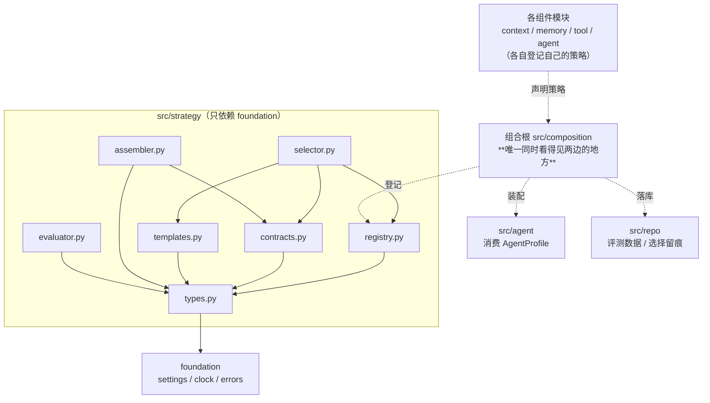
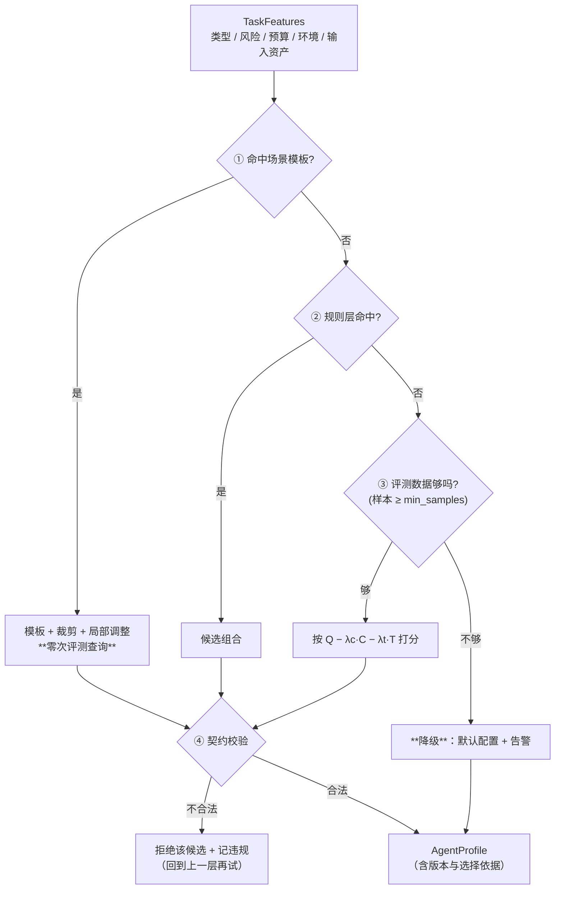
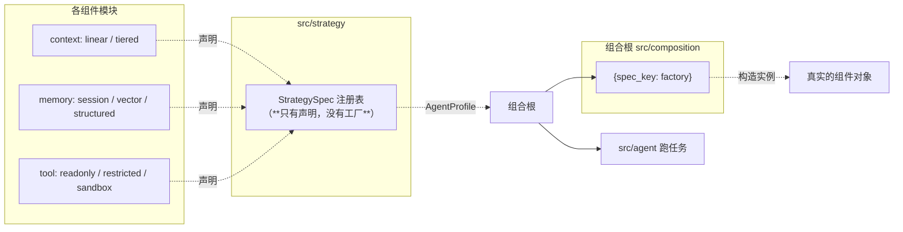
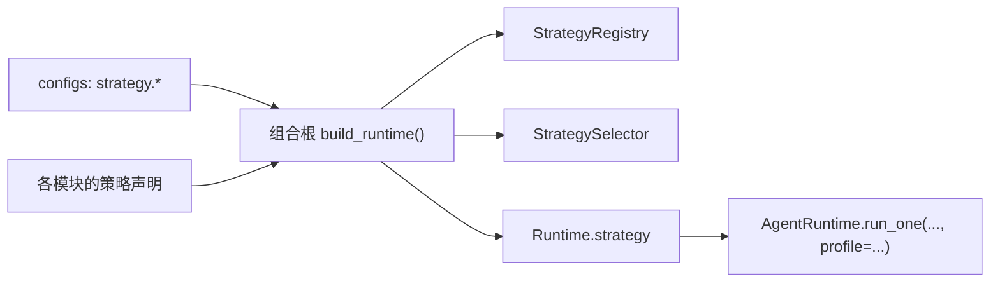
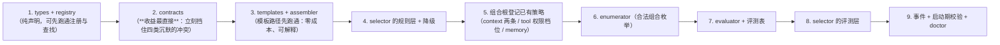

# `src/strategy` 架构概要设计（组件策略层）

| 项 | 值 |
|---|---|
| 文档层级 | **架构层**（第二篇）。前置：《`src/strategy` 需求说明书》 |
| 承接 | 需求说明书-strategy 的全部 `FR-ST-xx` / `NFR-ST-xx` |
| 强耦合 | `docs/agent/架构概要设计-agent.md`（profile 的消费方）；`docs/context/架构概要设计-context.md`（上下文策略就是本层登记的第一批策略）；`docs/tool/架构概要设计-tool.md`（权限档位与工具选择） |
| 外部依赖 | 无。本层**不调模型、不落库、不执行** |
| 状态 | 待评审 |

---

## 0. 设计目标（一句话）

> 让「**这次任务该用哪套做法**」变成一个**在跑之前就能回答、且能说出理由**的问题 ——
> 而不是「每个组件各配一个开关，配错了到运行时才发现」。

第二句同样是边界，而且它比第一句更容易被违反：

> **这一层不实现任何策略。** 它只做**登记、校验、选择、装配**四件事。
> 一旦它开始"顺手实现一个"，上下文管理就会在 `context` 与本层各有一份 ——
> 而这正是「gateway 的顺序规则曾有两个实现」那类问题的标准翻版。

---

## 1. 结构总览

```
src/strategy/
├── __init__.py      只导出契约、注册表、选择器与装配器
├── types.py         契约载体：ComponentKind / StrategySpec / TaskFeatures /
│                    AgentProfile / SelectionDecision / Violation
├── registry.py      策略注册表（重名硬失败；不可用的策略**在册**并带原因）
├── contracts.py     ★ 组件契约：可机械校验的合法性规则（本层的核心价值）
├── selector.py      ★ 策略选择：模板 → 规则 → 评测 → 降级
├── templates.py     场景模板与裁剪（模板是**数据**）
├── assembler.py     把选中组合装配成 AgentProfile（产出**配置**，不是实例）
└── evaluator.py     离线评测：在基准任务上比较候选组合的 Q / C / T
```

**没有 `errors.py`**：异常沿用 `foundation.errors` 的既有约定，不为三个异常单开一个文件。

**预留桩名**：`selector.py` / `contracts.py` 是本设计**新提出**的两个文件，
其余五个名字与仓库既有的模块布局（`types` / `registry` / `templates` / `assembler` / `evaluator`）
保持一致 —— 名字是契约的一部分，换名会让"谁在哪"重新变模糊。

### 1.1 依赖图



**四条硬边界**：

1. **不 import 任何组件模块**（`context` / `memory` / `tool` / `agent` / `gateway`）——
   只依赖 `foundation`。这是它能被独立测试、且不会长成上帝模块的前提（`NFR-ST-01`）；
2. **不 import `provider`** —— 已由 import-linter 机械强制（所有顶层模块都受这条约束）；
3. **不认识实例，只认识声明** —— 它持有的是 `StrategySpec`，不是组件对象。
   工厂函数**不住在这里**（见 §6）；
4. **不执行** —— 它不发请求、不落库、不写文件。发现它在做这几件事 = 边界破了。

---

## 2. 核心机制一：策略的标准化声明

### 2.1 一条策略的六要素

```python
@dataclass(frozen=True)
class StrategySpec:
    kind: ComponentKind            # 七类之一（上下文 / 记忆 / 检索 / 工具选择 / 权限 / 验证 / 执行）
    name: str                      # 该类别下唯一；不同类别可以重名
    version: str                   # **升版会让旧评测结论失效**（FR-ST-11）
    interface: str                 # 它满足哪一个组件契约
    inputs: frozenset[str]         # 它需要什么（进契约校验）
    provides: frozenset[str]       # 它产出什么（进契约校验）
    preconditions: tuple[str, ...] # 什么情况下才成立（如"multiagent 可用"）
    cost: CostEstimate             # tokens / latency_ms / external_calls —— 量级即可
    scenarios: tuple[str, ...]     # 擅长 / 不擅长（给人看，也是规则层的依据）
    metrics: Mapping[str, str]     # 用什么衡量它做得好
    available: bool = True
    unavailable_reason: str = ""

@dataclass(frozen=True)
class CostEstimate:
    tokens: int = 0
    latency_ms: int = 0
    external_calls: int = 0
```

### 2.2 为什么成本与质量指标**必须填**

它们是**声明值**，允许不准。但不允许不填 —— 理由分两层：

- **不填，这一层就退化成"开关"**：开关能配上，但**没法被比较**；
  而本模块的全部价值就在比较与选择上（`FR-ST-02`）；
- **填了不准，问题会自己暴露**：选择器挑了一个"声明便宜、实际很贵"的策略，
  评测数据（`evaluator`）会把它纠正回来。**不填则永远不会被纠正** ——
  因为它连"可以错"的资格都没有。

### 2.3 「不可用」怎么表示

**保留在册，带上原因**（`FR-ST-05`），与 `ModelSpec.unavailable_reason` 是同一条纪律：

```
为什么不能直接不登记：
  "为什么不能用它" 在排障时是最常见的问题之一。
  不登记 → 这个问题的答案是一个查不到的空缺；
  在册 + 原因 → 答案是一句能照做的话（"multiagent 未启用"）。
```

**选择器不得选中不可用的策略**；而当一条候选组合因为某个不可用策略而不成立时，
理由里要**指名道姓**（而不是笼统的"没有可用组合"）。

---

## 3. 核心机制二：组合契约（本层的核心价值）

### 3.1 为什么冲突要在**装配之前**挡住

需求文档 §2.2 讲的那四类冲突，共同形态是「每个组件各自正常，任务整体失败」。
它们在时间轴上的位置决定了处理方式：

```mermaid
flowchart LR
    A["选出一组策略"] --> B{"契约校验"}
    B -- 通过 --> C["装配 → 跑任务"]
    B -- 不通过 --> D["**立刻拒绝 + 说明冲突**"]
    C --> E["运行时出错<br/>（工具被拒 / 记忆残缺 / 验证退化）"]
    E --> F["**离原因非常远**：<br/>表现为"这个任务怎么老失败"]
```

`E → F` 那一段的成本是：一轮真实的模型调用、可能的真实副作用、以及**排查时间**。
而校验的成本是：一个纯函数调用。**两者的差距就是这一层存在的理由。**

### 3.2 契约是一条规则，不是一个开关

```python
class Contract(Protocol):
    name: str
    def check(self, profile: AgentProfile) -> tuple[Violation, ...]: ...

@dataclass(frozen=True)
class Violation:
    rule: str                       # 哪条规则
    components: tuple[ComponentKind, ...]   # **哪两个组件冲突**
    detail: str                     # 为什么
    suggestion: str = ""            # 怎么改（能给的都要给）
```

**规则集是开放的**：新增一条约束 = 加一个函数 + 一条登记，**不改校验器本身**
（与 `FR-A-01` 的"新增阶段只加数据"、`FR-ST-01` 的"新增策略只加登记"是同一条纪律）。

### 3.3 内置的五条规则（一期）

| 规则 | 冲突的两个组件 | 为什么 |
|---|---|---|
| `readonly_blocks_write_tools` | 权限 × 工具选择 | 工具必然被拒，而 agent 会重试它直到撞上步数上界 —— **失败发生在很远的地方** |
| `state_compression_loses_memory_fields` | 上下文 × 记忆 | 压缩可能丢掉记忆要的字段，存进去的是**残缺经验** |
| `cross_validation_needs_multiagent` | 验证 × 依赖可用性 | 验证会**安静地**退化成"只有一个 agent 的结论" |
| `compare_needs_multiple_candidates` | 执行策略内部自相矛盾 | 比较需要多个候选，单次执行只产出一个 |
| `stateless_conflicts_with_structured_memory` | 记忆机制内部 | 同一组件不能既是"不记"又是"记得最细" |

> 每条规则的 `detail` 都要写**后果**，而不是"不兼容"三个字。
> 与 tool 层的"拒绝时说清缺哪个权限"、gateway 的"未知 alias 要列出全部"是同一条纪律：
> **错误信息的质量直接决定这一轮是"人自己改对"还是"来查文档"。**

### 3.4 合法组合的可枚举性

```python
def enumerate_valid(
    registry: StrategyRegistry, contracts: Sequence[Contract]
) -> tuple[AgentProfile, ...]
```

朴素做法是**笛卡尔积再过滤**：

```
7 类组件 × 每类 n 个策略 → 全部组合 → 逐条跑契约 → 合法集合
```

一期策略数很少（每类 2–5 个），笛卡尔积在几千量级，**够用**。
**但这个方法本身要作为一个指标**（`NFR-ST-08`）：

- 合法组合数落在**两位数到三位数** → 约束写得够紧；
- 落在**四位数** → 约束等于没写，说明该补规则了；
- **枚举不出来**（数量爆炸到跑不完）→ 说明某条契约压根没生效。

> 把"能不能枚举"当成验收标准，是因为**约束的松紧没有别的观测手段** ——
> 组合配错了只会在运行时以"任务老失败"的形式出现。

**枚举结果的用途只有一个**：喂给离线评测（`evaluator`）。
枚举出来却不评测，等于知道有哪些选择而不知道哪个好。

### 3.5 高风险任务是**硬约束**，不进目标函数

```
普通任务：  在「合法组合」里，按 Q − λc·C − λt·T 取最大
高风险任务：在「合法 ∩ 已验证」里，按同一个式子取最大
            空集 → 拒绝执行（**不是**降级到未验证的组合）
```

**为什么不能"加权"**：加权意味着安全**可以被更低的成本抵掉** ——
而"这次便宜 20%，但用了一套没验证过的配置去动生产环境"不是一个可以接受的交易。
原文明确写了这一点，这里把它落成一条结构性规则：**安全约束是集合运算，不是目标函数的项。**

---

## 4. 核心机制三：选择（先规则，后评测）

### 4.1 三层 + 一个降级终点



**顺序即优先级，且这个顺序有理由**（与上下文的 L1 排在 L2 前、agent 路由的规则排在 LLM 前同一个思路）：

- **模板**：零成本、可解释、经过人工设计 —— 首选；
- **规则**：零成本、可解释；
- **评测**：需要历史数据，是唯一"花得起但慢"的一层；
- **降级**：不是一层选择，是**失败时的落点**。

### 4.2 打分与它的边界

```
score(π) = Q(π) − λc · C(π) − λt · T(π)
```

| 符号 | 来自 | 归一化 |
|---|---|---|
| `Q(π)` | 离线评测的质量指标（成功率 / 引用命中率 / 格式合法率……） | 归一到 `[0,1]` |
| `C(π)` | 评测期实测的成本，缺则用 `StrategySpec.cost.tokens` 的累加 | 除以基准组合的成本 |
| `T(π)` | 同上，时延 | 除以基准组合的时延 |

**归一化必须做**：`Q` 是 `[0,1]` 的小数，而 token 数是四位甚至五位数 ——
不归一化的话 `λc` 无论怎么调都形同虚设（一个数量级差就能把质量项淹掉）。
**除以"基准组合"而不是除以最大值**：基准是稳定的，最大值会随候选集变化，
而"随候选集变化的分母"会让同一个组合在两次选择里得到不同的分数。

### 4.3 版本：记了就要用

`evaluator` 产出的每条结论都带**策略版本向量**：

```python
@dataclass(frozen=True)
class EvalRecord:
    profile_key: str
    versions: Mapping[str, str]     # {组件.策略: 版本}
    quality: float
    cost: float
    latency: float
    samples: int
    benchmark_set: str
    at: float
```

选择器读评测数据时**逐项校验版本**：只要有一个版本对不上，这条记录就**视为不存在**
（`FR-ST-11`）。理由：拿旧版的结论套新实现，是"**看起来有依据**"的决策 ——
它比没有依据更危险，因为它不会被怀疑。

### 4.4 确定性

同一份 `TaskFeatures` + 同一份评测快照 → **同一组配置**（`NFR-ST-03`）。
这意味着：

- 候选排序必须**全序**（分数相同时按 `(component, name)` 字典序兜底，不能靠字典插入顺序）；
- 评测数据要按 `(benchmark_set, 有效版本向量)` 一起读，**不能读"最新一条"** ——
  那会让两次相邻的选择用上不同的数据。

---

## 5. 各文件设计

### 5.1 `types.py`

`ComponentKind`（七类，`Literal`）· `StrategySpec` / `CostEstimate` ·
`TaskFeatures`（类型 / 风险 / 预算 / 环境 / 输入资产）· `AgentProfile`（七类各绑一个策略 + 版本 + 参数 + 选择依据）·
`SelectionDecision`（选中的 profile + 用的哪一层 + 理由 + 候选 + 分数）· `Violation`。

`AgentProfile` **必须可序列化**（`FR-ST-15`）：它就是"配置"，要能存进评测记录、
写进事件、被组合根读出来构造组件。

### 5.2 `registry.py`

```python
class StrategyRegistry:
    def register(self, spec: StrategySpec) -> None      # (kind, name) 重名 → 硬失败
    def get(self, kind: ComponentKind, name: str) -> StrategySpec   # 未知 → **列出该类别全部**
    def by_kind(self, kind: ComponentKind) -> tuple[StrategySpec, ...]
    def available(self, kind: ComponentKind) -> tuple[StrategySpec, ...]
    def mark_unavailable(self, kind: ComponentKind, name: str, reason: str) -> None
```

**运行时标记不可用**（`mark_unavailable`）是给前置条件用的：例如启动时发现
`multiagent` 未启用，就把依赖它的那条策略标掉，而**不是**从表里删掉。
删掉会让"为什么不能用"变成一个查不到的空缺。

### 5.3 `contracts.py`

五条内置规则（§3.3）+ `enumerate_valid`。
规则实现是**纯函数**：`(AgentProfile) -> tuple[Violation, ...]` —— 无 IO、无时间、无随机，
所以它可以在单测里穷举（`NFR-ST-04`）。

### 5.4 `selector.py`

```python
class StrategySelector:
    def select(self, features: TaskFeatures) -> SelectionDecision
```

- 模板 → 规则 → 评测 → 降级，四步短路（§4.1）；
- **高风险闸门在第一步就生效**：先把候选集切成「合法 ∩ 已验证」，
  再往里走任何一层（`FR-ST-08`）；
- 空集 → 返回一个 `degraded=True` 的决策（高风险时是"拒绝"），**不抛异常** ——
  "选不出"是一种正常结果，只是要出声。

### 5.5 `templates.py`

模板是**配置数据**（`C-ST-6` 校验策略名存在性）；`裁剪` 按输入资产去掉显式声明可裁的组件
（`FR-ST-14`）。**模板只允许调整"关键组件"** —— 关键组件由模板自己声明，
不声明的组件一律保持模板原值。这是组合爆炸的第二种控制手段，也是默认路径。

### 5.6 `assembler.py`

```python
def assemble(decision: SelectionDecision) -> AgentProfile     # 纯数据变换
```

**它不做装配的"另一半"** —— 真正把 profile 变成组件实例的是组合根（§6）。
这个文件只负责"把决策固化成一份可传递、可留痕的配置"。

### 5.7 `evaluator.py`

- 输入：基准任务集 + 候选组合列表（来自 `enumerate_valid`，且受 `max_combos_per_run` 限制）；
- 输出：`EvalRecord` 列表，交给 `repo` 落库；
- **它自己不执行任务** —— 执行是 `src/agent` 的事，本模块**注入一个 runner**
  （`Callable[[AgentProfile, BenchmarkTask], Awaitable[RunOutcome]]`），
  与 `ChatModel` / `Embedder` 的注入方式同构；
- 这样 `evaluator` 保持"不执行"的边界（`NFR-ST-02`），
  而"怎么跑一次任务"的知识留在组合根。

---

## 6. 与相邻模块的接缝：**声明与实现的分界**

这是本设计里最要紧的一张图。**策略的实现属于各组件模块，工厂属于组合根，
而本层只持有声明。**



**分工的三句话**：

1. **各模块声明**：`context` 说"我有 `linear` 与 `tiered` 两条策略，它们是这些接口、这个成本"；
2. **本层只认声明**：它拿这些声明去**校验、选择、装配**，从不 import 那些模块；
3. **组合根持有工厂**：只有它同时看得见"声明"与"实现"，所以只有它能真的构造 ——
   与 `DT-5`（工具定义 → `ToolSpec` 的转换在组合根）**完全同构**。

> **工厂不住在本层，是刻意的**：只要 `.register(spec, factory)` 里带上了工厂，
> 就会有人忍不住在 `selector` 里"顺手启一个组件试试" ——
> 那一刻本层就开始执行了（`NFR-ST-02` 就破了）。

---

## 7. 装配



**`Runtime` 加一个字段**（与 `tools` / `memory` / `context` / `agent` 并列）：

```python
@dataclass
class Runtime:
    ...
    strategy: StrategySelector | None = None
```

**profile 是"每次运行一份"，不是"每个进程一份"** —— 这条决定了它的位置：

- `ContextManager` / `ToolExecutor` 是**进程级**的（构造贵、有状态、要复用）；
- 而「这次任务用哪套策略」**每次都可能不同**，所以它是 `run_one` 的**参数**，
  不是启动时定死的构造参数。

如果一开始就把 profile 做成进程级单例，那么"同一个进程里跑两类任务"
就必然退化——而那时改回来要动所有调用点。

**与 `build_agent` 的关系**：`build_agent` 不感知 strategy（`DST-9`）。
它拿到的仍是 executor / catalog / context；profile 驱动的是**运行时怎么用它们**
（走哪条上下文策略、给哪些工具类目、权限放到哪一档）。

**启动期校验**：

- `default_profile` 必须存在且**通过契约校验**（`C-ST-2`）；
- `contracts.enabled=false` → **告警**（`C-ST-1`）；
- `guard.high_risk_requires_validated=false` → **告警**（`C-ST-3`）；
- 模板里引用的策略名必须已注册（`C-ST-6`）。

---

## 8. 事件

出口统一在 `selector`（本层只有一个事件出口 —— 与 tool / memory / context / agent 同一条纪律）。

| 事件名 | 何时 | 关键载荷 |
|---|---|---|
| `strategy.selected` | 选中一组配置 | `layer`（template/rules/evaluated/default）/ `reason` / `profile_key` / `versions` / `score` |
| `strategy.combo_rejected` | 组合被契约拒绝 | `rule` / `components` / `detail` |
| `strategy.degraded` | 降级到默认配置 | `reason`（试过哪些层）/ `layer` |
| `strategy.unavailable` | 选中组合里有不可用策略 | `kind` / `name` / `unavailable_reason` |
| `strategy.template_matched` | 命中模板 | `template` / `trimmed`（裁剪了什么）/ `adjusted`（调整了哪些组件） |
| `strategy.evaluated` | 一次离线评测完成 | `benchmark_set` / `combos` / `top`（前三名的 Q/C/T） |
| `strategy.high_risk_refused` | 高风险任务没有已验证组合 | `features` 摘要（**这是拒绝，不是降级**） |

**为什么 `strategy.selected` 必须带 `layer` 与 `reason`**：这七个事件里只有
`combo_rejected` 与 `high_risk_refused` 是"响亮的"。其余五个都发生在正常运行中，
一个只说"选中了 X"的事件**回答不了任何排障问题** —— 而排障问题恰恰是
「同一个任务，昨天好好的，今天为什么换了套配置」。

---

## 9. 关键设计决策

| 编号 | 决策 | 选择 | 理由 |
|---|---|---|---|
| `MST-1` | 本层实现策略吗 | **不实现**，只登记 / 校验 / 选择 / 装配 | 自己实现会导致同一件事两份实现（`DST-1`） |
| `MST-2` | 依赖方向 | **只依赖 `foundation`**，不 import 任何组件模块 | 这是它能独立测试、且不会变成上帝模块的前提（`NFR-ST-01`） |
| `MST-3` | 工厂住哪 | **组合根**，不在本层 | 本层带上工厂就会有人"顺手试一下"，那一刻它就开始执行了（§6） |
| `MST-4` | 冲突怎么发现 | **装配前的声明式契约** | 运行时发现意味着已经烧了钱、可能已有副作用（§3.1） |
| `MST-5` | 契约规则的形式 | **纯函数 + 开放登记** | 可穷举测试；新增约束不改校验器（§3.2） |
| `MST-6` | 选择顺序 | **模板 → 规则 → 评测 → 降级** | 能零成本且可解释地解决的，就不要花钱（§4.1） |
| `MST-7` | 打分是否归一化 | **归一化，且除以"基准组合"** | 不归一化则 `λc` 形同虚设；除以最大值会让分母随候选集漂移（§4.2） |
| `MST-8` | 高风险怎么处理 | **集合运算（合法 ∩ 已验证），不进目标函数** | 安全不能被更低的成本抵掉（§3.5） |
| `MST-9` | 评测结论与版本 | **版本对不上就视为没有数据** | 拿旧结论套新实现是"看起来有依据"的决策，比没有依据更危险（§4.3） |
| `MST-10` | profile 的生命周期 | **每次运行一份**（`run_one` 的参数） | 进程级单例会让"同一进程跑两类任务"必然退化（§7） |
| `MST-11` | 不可用的策略 | **在册 + 原因**，不删 | 删掉会让"为什么不能用"变成查不到的空缺（§2.3） |
| `MST-12` | 合法组合能否枚举 | **必须能**，且数量作为指标 | 约束的松紧没有别的观测手段（§3.4） |
| `MST-13` | `evaluator` 怎么跑任务 | **注入 runner**，自己**不执行** | 保持"不执行"的边界；怎么跑一次任务的知识留在组合根（§5.7） |
| `MST-14` | 与 `src/agent` 的关系 | **agent 只认识 `AgentProfile`，不认识 strategy** | 让 agent 认识 strategy 会把两层的边界搅在一起（`DST-9`） |
| `MST-15` | 唯一事件出口 | **`selector`** | 与 tool / memory / context / agent 同一条纪律 |

---

## 10. 待确认（需评审）

| 编号 | 待确认 | 备选 | 倾向 |
|---|---|---|---|
| `STQ-1` | 一期登记哪些策略 | (a) 只登记**已有实现**的（`context` 的 `linear`/`tiered`、`tool` 的权限档位、`memory` 的记忆与检索……）；(b) 把原文七类 × 全部策略都登记成 `unavailable` | **(a) + 少量 (b)**。「真有实现」的才算策略；确实要点名的（如「多 Agent 交叉验证」）登记为 unavailable 并挂上"依赖 multiagent"。**不假装有** |
| `STQ-2` | `TaskFeatures` 谁产生 | (a) 调用方直接给；(b) 由 `src/agent` 从任务推断 | **两者都要**：`agent` 的路由已经在做"任务 → 阶段"的推断，特征推断应当与它合并成一次（否则同一个任务会被推断两遍，还可能得出互相矛盾的结论）。**需要与 agent 的设计对齐** |
| `STQ-3` | 基准任务集从哪来 | (a) 人工维护一份小的（10–30 条）；(b) 从历史运行里采样 | **(a) 起步**。(b) 会引入"历史任务的分布"这个隐藏变量，而评测要的是**可比** |
| `STQ-4` | 评测结果落哪张表 | (a) `repo` 新表 `strategy_eval`；(b) 复用 `event` 的 payload | **(a)**。评测结论是被**查询**的（选择器要读），而事件表是 append-only 的排障流水 |
| `STQ-5` | 选择留痕落哪 | (a) 复用 `event`；(b) 独立表 | **(a)**。选择留痕是"发生过什么"，与事件同类；`FR-ST-11` 要的"还原当时的世界"靠事件 + 评测快照标识即可 |
| `STQ-6` | 契约规则要不要可配置 | (a) 全部内置，配置只能加不能改；(b) 允许配置覆盖 | **(a)**。允许关掉内置规则等于允许"明知会出问题还配上去" |
| `STQ-7` | 模板裁剪的表达 | (a) 模板声明 `trimmable: [...]`；(b) 用条件表达式 | **(a) 起步**。表达式会变成一个没有测试的小语言 |

---

## 11. 实施顺序



**为什么 `contracts` 排在最前面**（`S2`）：它是这一层**唯一立刻见效**的部分 ——
不依赖任何评测数据、不需要任何组件改动，当天就能把四类"沉默的冲突"挡在装配之前。
而 `selector` 的评测层（`S7`/`S8`）依赖数据积累，放最后。

**每步的验收点**（对应 §13 的 `CST-*`）：
S1→`CST-1/2/3`；S2→`CST-6/7/8`；S3→`CST-4`；S4→`CST-11/13`；S5→`CST-3`；
S6→`CST-9/10`；S7→`CST-22/23`；S8→`CST-12/16`；S9→`CST-20/21`。

---

## 12. 风险

| 风险 | 触发条件 | 缓解 |
|---|---|---|
| **本层开始实现策略** | "顺手写一个更方便的上下文策略" | `MST-1` / `MST-2` + `CST-5` 的机械扫描；理由写在 §0 的第二句 |
| **契约规则形同虚设** | 规则太宽，合法组合仍有几千种 | `MST-12`：把合法组合数当指标，四位数就说明该补规则 |
| **选择不可复现** | 打分有并列却靠字典顺序、或读"最新一条"评测 | `MST-7` / `MST-9` + `CST-14` |
| **拿旧结论套新实现** | 策略升版但评测没重跑 | `MST-9`：版本对不上就视为没数据（**降级 + 告警**） |
| **组合爆炸拖垮评测** | 枚举出几百个组合全评一遍 | `max_combos_per_run`（`C-ST-5`）+ 先按规则粗筛 |
| **profile 被做成进程级单例** | "启动时选一次就够了" | `MST-10`：它是 `run_one` 的参数 |
| **高风险走加权目标** | 有人觉得"安全也能算成本" | `MST-8`：它是集合运算，不是目标函数的项 |
| **降级悄悄发生** | 选不出时静默用默认配置 | `FR-ST-12` + `strategy.degraded` 事件（`CST-21`） |
| **与 agent 的特征推断打架** | 两处各自推断任务类型 | `STQ-2`：合并成一次，需要与 agent 的设计对齐 |

---

## 13. 需求追溯

| 需求 | 落点 |
|---|---|
| `FR-ST-01 七类组件 / 策略开放` | `types.ComponentKind` + `registry.py` |
| `FR-ST-02 策略六要素` | `types.StrategySpec`（`__post_init__` 校验） |
| `FR-ST-03 实现由各模块提供` | §6 声明 / 实现 / 工厂三分工 |
| `FR-ST-04 注册与查找` | `registry.py` |
| `FR-ST-05 不可用策略在册` | `registry.mark_unavailable` |
| `FR-ST-06 组件契约` | `contracts.py`（五条内置规则，§3.3） |
| `FR-ST-07 组合空间受约束` | `contracts.enumerate_valid`（§3.4） |
| `FR-ST-08 高风险硬约束` | `selector` 的候选集切分（§3.5 / §4.1） |
| `FR-ST-09 任务特征` | `types.TaskFeatures` |
| `FR-ST-10 先规则后评测` | `selector.py`（§4.1 / §4.2） |
| `FR-ST-11 可复现 + 版本失效` | `types.EvalRecord.versions` + `selector` 的版本校验（§4.3 / §4.4） |
| `FR-ST-12 降级出声` | `selector` 的 `degraded` 分支 + `strategy.degraded` 事件 |
| `FR-ST-13 场景模板` | `templates.py` |
| `FR-ST-14 模板裁剪` | `templates.py`（`trimmable`） |
| `FR-ST-15 装配产出配置` | `assembler.py` + `types.AgentProfile` |
| `FR-ST-16 默认配置` | `templates.baseline` + 启动期校验（§7） |
| `FR-ST-17 可观测` | §8 事件 |
| `FR-ST-18 离线评测` | `evaluator.py`（注入 runner） |
| `NFR-ST-01 不依赖组件模块` | §1.1 硬边界 1 |
| `NFR-ST-02 不执行` | §1.1 硬边界 4 + `MST-3` / `MST-13` |
| `NFR-ST-03 确定性` | §4.4 |
| `NFR-ST-04 可测试` | 契约与选择器都是纯函数（§5.3 / §5.4） |
| `NFR-ST-05 可观测` | §8 |
| `NFR-ST-06 失败指名道姓` | `Violation.components` / `unavailable_reason`（§2.3 / §3.2） |
| `NFR-ST-07 不放大故障` | `selector` 返回 `degraded` 而非抛异常（§5.4） |
| `NFR-ST-08 约束可枚举` | `enumerate_valid` + §3.4 的数量指标 |
| `NFR-ST-09 接口稳定` | `ComponentKind` / `TaskFeatures` 字段名即为契约（§5.1） |
