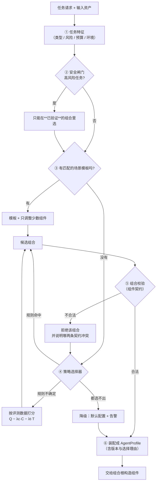

# `src/strategy` 需求说明书（组件策略层）

| 项 | 值 |
|---|---|
| 文档层级 | **需求层**（第一篇）。后续：《`src/strategy` 架构概要设计》 |
| 覆盖范围 | `src/strategy/` 全部文件 —— 组件策略的**注册、校验、选择与装配**。**不包含任何策略自己的实现** |
| 上游依赖 | `foundation`（配置 / 时钟 / ID）。各组件模块把**自己的策略实现**登记进来（`src/context` / `src/memory` / `src/tool` / `src/agent`） |
| 下游消费 | `src/agent`（按选出来的配置跑一次任务）、`src/workflow`（编排层，按配置挑节点）、`src/multiagent`（多 agent 协作）、组合根 `src/composition`（唯一装配点） |
| 关键外部依赖 | 无。本模块**不调模型、不落库、不执行动作** —— 它是纯声明与选择 |
| 强耦合 | `docs/agent/需求说明书-agent.md`（运行时消费这里的产出）；`docs/context` / `docs/memory` / `docs/tool`（策略能力的来源） |
| 状态 | 待评审 |

---

## 1. 这份文档回答什么

只回答**要解决什么问题**、**必须提供哪些能力**、**什么算合格**。

**本文不回答**：每一种策略怎么实现、选择器用什么模型、注册表用什么结构。

**本文尤其要说清一件事**：这一层**不实现任何策略** ——
它是「把别人实现好的策略按任务选出来、校验能拼、装成一份配置」的那一层。
这条边界放跑，它就会长成一个什么都管的上帝模块。

**前置阅读**：`docs/agent/需求说明书-agent.md`（运行时怎么消费配置）、
`docs/context/需求说明书-context.md` §5.1（**上下文管理本身就已经是一条策略**：`linear` / `tiered`）。

---

## 2. 背景与定位

### 2.1 为什么需要一个组件策略层

平台要做的是**软件测试全流程**，而这条链路上的任务彼此差得很远：

| 任务 | 真实的样子 |
|---|---|
| 知识库问答 | 一两轮，要的是**准**（有引用），窗口小、便宜 |
| 用例生成 | 多轮，要的是**全**（覆盖需求点），要读需求与协议 |
| 环境操作 | 有**副作用**，要的是**稳**，权限必须收紧 |
| 故障诊断 | 长链路，要的是**敢回头**（假设—验证—回溯），贵也认 |

共用一套配置，必然是**每一类都不合适**：问答被贵而复杂的诊断流程拖慢，
环境操作被问答的宽松权限敞开。而它们的差异**恰好落在同样几个位置上** ——
上下文怎么管、记忆用不用、检索走哪条路、工具给哪些、权限放到哪一档、
结果怎么验、失败怎么办。这七处就是「组件」。

> 价值不在于「配置化」这个形式，而在于：**新增一种做法 = 加一个策略**，而不是改一遍 agent。
> 前者可独立测、可单独回滚；后者只能整体回归。

### 2.2 本模块真正难的地方：**组合的错是沉默的错**

**单个策略几乎不会错**。错的都是组合：

| 组合 | 单独看 | 拼起来 |
|---|---|---|
| 只读权限 + 需要写测试环境的工具 | 都对 | **工具必然被拒**，而 agent 会反复重试它，直到撞上步数上界 |
| 「任务状态压缩」的上下文 + 「结构化经验记忆」 | 都对 | 上下文没保住任务状态字段，记忆拿不到它要的结构，**存进去的是残缺经验** |
| 「多 Agent 交叉验证」 + multiagent 未启用 | 都对 | 验证环节**永远拿不到第二意见**，而它会安静地退化成"只有一个 agent 的结论" |
| 候选方案比较 + 单次执行 | 都对 | 比较需要多个候选，单次执行只产出一个 —— **这套组合没有意义**，但不报错 |

共同形态是：**每个组件都按自己的契约正常工作，而任务整体失败** ——
启动时不报错、任何组件里也不报错，只表现为「这个任务怎么老失败」，离原因非常远。

所以本模块的第一目标不是「能选出一组配置」，而是：

> **把「这组配置能不能拼」变成一件在**跑之前**就能回答、且能说出理由的事。**

### 2.3 这个目标做不到 100%，必须说清楚做到哪

| 做不到 | 能做到 |
|---|---|
| 保证选出来的组合**最优** | 保证它**合法**，且在给定评测数据下**不比默认配置差** |
| 穷举 4096 种组合的验证成本 | 用约束把合法组合**砍到几十种**，且约束是**可机械校验**的 |
| 让策略选择永远正确 | 让每一次选择都**可解释、有版本、可复现**；选错能**安全降级** |
| 保证任意任务都能自动选对 | 保证**选不出时按模板 / 默认配置走**，而不是让 LLM 自由拼装 |
| 靠 LLM 判断哪种组合更好 | 用**离线基准**比较（成功率 / 时延 / 成本），LLM 只负责提候选 |

**最后一条是本模块的立场**：选择可以是聪明的，但**判断哪个组合更好必须靠数据**。
让 LLM 直接说「知识问答用这套更好」，等于把回归测试的基准换成了一次采样。

---

## 3. 范围

### 3.1 本模块负责

| 职责 | 落点 |
|---|---|
| **策略的标准化描述**：接口、输入输出、前置条件、成本、质量指标、适用场景 | `types.py` |
| **策略注册表**：登记 / 查找 / 版本 / **未实现的策略怎么表示** | `registry.py` |
| **组件契约与组合校验**：哪些组合不合法，以及为什么 | `contracts.py` |
| **策略选择**（规则 → 评测数据），含**降级** | `selector.py` |
| **场景模板**：预定义配置 + 只动态调整少数关键组件 | `templates.py` |
| **装配**：把选中组合变成一份**可交给组合根的配置** | `assembler.py` |
| **离线评测**：比较不同组合的 Q / C / T | `evaluator.py` |

### 3.2 本模块**明确不负责**（这一节比上一节重要）

| 不做的事 | 归属 |
|---|---|
| **实现任何一种策略** | 各自的家：上下文归 `src/context`、记忆与检索归 `src/memory`、工具选择与权限归 `src/tool`、验证与执行策略归 `src/agent` |
| 调模型（含"让 LLM 帮我选一组"） | `src/gateway`。本模块最多把候选交给它，**不自己发请求** |
| 真的把组件构造出来 | 组合根 `src/composition`：本模块产出**配置**，不产出实例 |
| 落库（评测数据、选择留痕） / 跑任务 / **编排与调度** / 多 agent 协作 | `src/repo` / `src/agent` / **`src/workflow`（创新点 2）** / `src/multiagent` |

> **一句话边界**：**别人提供"怎么做"，本模块决定"这次用哪个怎么做"。**
> 它不认识任何一个具体实现 —— 只认识契约。

### 3.3 与 `src/skill`、`src/agent`、各组件模块的分工（容易混，先定清楚）

| | `src/skill` | **`src/strategy`（本模块）** | `src/tool` 的权限/目录 | `src/agent` |
|---|---|---|---|---|
| 是什么 | **可持久化的能力定义**（名称 + 版本 + 提示词/步骤） | **组件策略的登记与选择**（契约 + 条件 + 成本） | 策略的**实现**（权限判定、按类别筛工具） | 按配置**跑一次任务** |
| 谁产生 / 变更 | 人 / 配置；只增不改 | 各模块自己登记；加策略 = 加一条登记 | 开发者写代码 | — |
| 时间尺度 | 一次能力的生命周期 | 一次任务的**开跑之前** | 运行中 | 运行中 |

一句话：**skill 是"会做什么"，strategy 是"这次用哪种做法"，agent 是"去做"**。

⚠ **与 `src/context` 最容易混的一处**：上下文层**自己就有策略**（`linear` / `tiered`）。
那两条是**上下文层的内部实现**，本模块**不重写它们** —— 它只是在「上下文管理」这个组件下，
把 `linear` / `tiered` 当作两个可选策略来**登记与选择**。
两者是「实现」与「登记」的关系，不是两份实现。

---

## 4. 一次选择的职责链



**五个"必须显式"的地方**：高风险任务没有已验证组合、组合不合法、选择器选不出、
组件不可用、降级 —— 每一个的静默后果都写在 §5 对应的那一条 FR 里。

---

## 5. 功能需求

编号 `FR-ST-xx`。

### 5.1 组件的划分与策略的标准化

#### FR-ST-01 — 七个组件是固定的分类，策略是开放的

**要求**：

- 组件**类别**固定为七种（它是本层的骨架，不该随手加）：

| 组件 | 它决定什么 | 可选策略（一期登记的） | 适用场景 |
|---|---|---|---|
| **上下文管理** | 这次给模型看什么 | 全量保留 / 滑动窗口 / 多级摘要 / 任务状态压缩 | 短对话 / 长任务 / 多阶段 |
| **记忆机制** | 跨会话记什么 | 无状态 / 会话记忆 / 向量检索 / 结构化经验 | 单次问答 / 连续调试 / 故障复用 |
| **检索策略** | 到哪里取依据 | 向量 / BM25 / SQL / 混合 / 查询分解 | 技术问答 / 参数查询 / 故障分析 |
| **工具选择** | 给模型哪些工具 | 固定集 / 按任务动态选 / 按依赖选 | 单一操作 / 复杂任务 |
| **权限管理** | 放到哪一档 | 只读 / 受限执行 / 审批后 / 沙箱 | 知识查询 / 环境操作 / 自动化 |
| **验证机制** | 结果怎么算合格 | 格式校验 / 规则验证 / 工具结果验证 / 多 Agent 交叉验证 | 用例生成 / 测试执行 / 故障诊断 |
| **执行策略** | 失败了怎么办 | 单次执行 / 重试 / 回溯 / 候选方案比较 | 简单任务 / 易失败任务 / 复杂诊断 |

- **策略是开放的**：加一个策略不需要动本模块的代码（与 `FR-A-01` 的七个阶段同一条纪律）；
- **一期只登记"真有实现"的策略**：表里那些还没有实现的（如「多 Agent 交叉验证」依赖
  未实现的 `src/multiagent`），登记成**不可用**并带上原因，而不是假装有
  （与 `ModelSpec.unavailable_reason` 同一条纪律：**保留在册但不假装可用**）；
- 组件的**类别名是契约**（进配置、进事件、进评测记录），不许中途改名。

**验收点**：`doctor` 能列出七个组件、每个组件下**可用**与**不可用**的策略，不可用的带原因。

#### FR-ST-02 — 策略不只是开关，是一份声明

**要求**：每条策略登记时必须给出**六项**，缺一不可：

| 项 | 说明 |
|---|---|
| **接口** | 它满足哪一个组件契约（如 `ContextComponent`），以及它需要的输入是什么 |
| **版本** | 策略可以有多个版本；**任务跑完后的评测记录要能对上版本** |
| **前置条件** | 什么情况下它才成立（如「多 Agent 交叉验证」需要 `multiagent` 可用） |
| **资源成本** | 预计的 token / 时延 / 外部调用次数量级（评测与选择都要用） |
| **适用场景** | 它擅长什么、不擅长什么（**这是给人看的，也是规则层的依据**） |
| **质量指标** | 用什么衡量它做得好（如引用命中率、格式合法率） |

- **没有这六项的不是策略，只是开关**：开关能配上，但**没法被比较** ——
  而本模块的全部价值就在比较与选择上；
- 成本与质量指标是**声明值**，允许不准，但不允许不填：
  与真实值不符是数据问题，不填是设计问题。

**验收点**：登记一条缺任何一项的策略 → **硬失败**，错误信息指出缺哪一项。

#### FR-ST-03 — 策略实现由各模块自己提供，本模块只认契约

**要求**：

- 本模块**不 import 任何组件模块的实现**（不 import `context` / `memory` / `tool` / `agent`）；
- 各模块在组件根**登记**自己的策略：登记的是「名字 + 契约 + 工厂函数」，
  工厂函数由组合根持有（依赖方向：组合根同时看得见两边，与
  `DT-5` 的「工具定义 → `ToolSpec` 的转换在组合根」完全同构）；
- 于是本模块**可以独立于任何组件被测试**：喂一堆假的策略声明即可跑通全部逻辑。

**验收点**：`src/strategy/` 不 import `context` / `memory` / `tool` / `agent`（机械扫描）。

### 5.2 策略注册表

#### FR-ST-04 — 注册与查找

**要求**：

- 按 `(组件类别, 策略名)` 注册；**重名硬失败**（与 `FR-T-02` 同一条纪律：
  静默覆盖会让一条策略悄悄失效）；
- 查找失败时**列出该类别下的全部策略名**（拼错是最常见的错误）；
- 同一个策略名在**不同组件下可以重名**（`sliding_window` 在上下文与记忆里都可能有），
  所以键是二元组，不是单名。

**验收点**：注册两条同类别同名的策略 → 报错；查一个不存在的策略 → 错误里含全部可用名。

#### FR-ST-05 — 不可用的策略必须在册，且带原因

**要求**：

- 前置条件不满足时，策略登记为 **`unavailable` + 原因**，**不是从注册表里消失**；
- 原因要具体（「`multiagent` 未启用」而不是「不可用」）；
- 选择器**不得**选中不可用的策略；组合因此不成立时，要说清**是哪个策略不可用导致的**。

**验收点**：关掉 `memory` → 「向量检索记忆」变成 `unavailable`，原因可见；
选择器不会选中它，且选中失败时的理由指向它。

### 5.3 组合合法性（本模块的核心）

#### FR-ST-06 — 组件契约：哪些拼法**根本不能成立**

**要求**：契约是**可机械校验的规则**，每条规则要说清「为什么」：

| 规则 | 冲突点 | 为什么 |
|---|---|---|
| **只读权限 × 需要写入的工具** | 权限策略与工具选择 | 工具必然被拒，而 agent 会重试它直到撞上步数上界 —— **失败发生在很远的地方** |
| **任务状态压缩 × 结构化经验记忆** | 上下文策略与记忆策略 | 压缩可能丢掉记忆要的字段，存进去的是**残缺经验** |
| **多 Agent 交叉验证 × multiagent 不可用** | 验证机制 × 依赖可用性 | 验证会安静地退化成"只有一个 agent 的结论" |
| **候选方案比较 × 单次执行** | 执行策略自相矛盾 | 比较需要多个候选，单次执行只产出一个 —— 这套组合**没有意义** |
| **无记忆 × 结构化经验记忆** | 记忆机制内部矛盾 | 同一组件不能既是"不记"又是"记得最细" |

- 输入是一份**完整组合**，输出是**违规列表**（每条带冲突的两个组件与原因）；
- 校验**必须在装配之前**跑，且**失败要指名道姓**；规则集是**开放的** ——
  新增一条约束 = 加一个函数 + 一条登记，不改校验器本身。

**验收点**：构造「只读权限 + 需要写入环境的工具」→ 被拒，且错误里说清
「工具必然被拒，而失败会表现为撞上步数上界」。

#### FR-ST-07 — 组合空间必须被约束住，不是靠"少配一点"

**要求**：

- 六组件各四策略时有 `4^6 = 4096` 种组合（七个组件更多）；**约束的作用是把合法组合收敛到几十种**，
  而不是靠人自觉不配错；
- 合法组合**应当可枚举** —— 「能不能枚举」是"约束写得够不够紧"的试金石；
- 枚举结果要能被**离线评测**消费（`FR-ST-18`），不然约束再紧也不知道哪个更好。

**验收点**：给定七类组件与一期已登记的策略 → 能列出全部合法组合，数量在**两位到三位数**量级；
加入一条新契约后数量下降，且下降的那些能被解释。

#### FR-ST-08 — 高风险任务只能落在已验证的组合里

**要求**：

- 任务带**风险等级**（由调用方给或按模板推），高风险任务（如要动测试环境的）
  **只能在"已通过验证"的组合集合里选**；
- 这个集合**不得**由模型决定：它来自离线评测的结果（`FR-ST-18`）与显式白名单；
- 高风险任务**不参与加权目标函数**（`Q − λc·C − λt·T`）的权衡 ——
  安全约束是硬约束，不能被"成本更低"抵掉（原文明确写了这一点）；
- 没有任何已验证组合可用时 → **拒绝执行**，而不是降级到未验证的组合。

**验收点**：把某个组合从已验证集合里移除 → 高风险任务不会再选中它，
且给出的理由是"该组合未经验证"，而不是"分数不够"。

### 5.4 策略选择

#### FR-ST-09 — 任务特征是选择的唯一输入

**要求**：

- 选择的输入是一组**结构化特征**，不是自由文本：任务类型、风险等级、
  预算（token / 时延 / 金额）、执行环境、输入资产（有没有已有用例、有没有历史故障）；
- 特征可以由调用方直接给，也可以从任务描述**推断**（推断归 `src/agent` 的路由那类逻辑，
  本模块只消费结果）；
- **特征的取值是契约**：它进事件、进评测记录，不许中途改名。

**验收点**：同样一份特征两次调用 → 选出同一组配置（确定性）。

#### FR-ST-10 — 选择器：**先规则，后评测**，且每一步都可解释

**要求**：

- **规则层**（零成本、可解释、可测）：按模板与显式规则命中；
- **评测层**（需要历史数据）：在合法候选里按 `Q(π) − λc·C(π) − λt·T(π)` 打分取最大，
  其中 `Q` 来自离线评测，`C` 是成本、`T` 是时延；
- **规则层能解决就绝不进评测层**（与上下文 L1 排在 L2 前、路由的规则排在 LLM 前同一个思路）；
- 评测数据**缺失或样本太少**时：**不得**退化成"随机挑一个"或"让 LLM 挑" ——
  按**默认配置**走 + 告警（`FR-ST-15`）；
- 选择结果必须给出：**选中的组合、理由、候选集、每个候选的分数、用的是哪一层**。

**验收点**：规则命中 → 零次评测查询；规则不命中且评测数据充足 → 分数可读；
评测数据不足 → 走默认配置且告警。

#### FR-ST-11 — 选择必须可复现，且**版本变了就不认旧结论**

**要求**：

- 每一次选择记录：任务特征、选中的组合（含**每个策略的版本**）、理由、时间、
  以及当时的评测数据快照标识 —— 给定记录要能回答"当时为什么选了它"。
  这让「同一个任务，昨天好好的，今天换了套配置」可以被查清，
  而它正是这类系统里最难查的一类问题；
- **引用的评测数据必须校验版本**：某条策略升版后，基于旧版的结论**不再自动适用**，
  一律视为"没有数据"（走降级 + 告警），而不是拿旧结论套新实现。
  **记了版本就要用它** —— 只记不用等于没记；
- 这两条是一件事的两面：**记录要能还原出当时的世界，判断要基于同一个世界**。

**验收点**：① 拿一条历史记录 → 能还原当时的候选集与分数；
② 把某条策略版本 +1 → 选择器不再复用它的旧评测结论。

#### FR-ST-12 — 选择失败的降级必须出声

**要求**：以下四种情况**一律降级到"经验证的默认配置"并告警**，不得静默：

| 情况 | 告警里必须说清 |
|---|---|
| 规则与评测都选不出 | 试过哪些层、为什么都没选中 |
| 所有候选组合都不合法 | 违规列表 |
| 选中的组合里有 `unavailable` 的策略 | 是哪个策略不可用 |
| 高风险任务没有已验证组合 | 这一点要说清（**这条是拒绝执行，不是降级**，`FR-ST-08`） |

**验收点**：把评测数据清空 → 运行照常，日志里有降级原因，且事件里有对应记录。

### 5.5 场景模板

#### FR-ST-13 — 模板 = 预定义配置 + **只调整少数关键组件**

**要求**：

- 内置四个场景模板（与原文一致，完整取值见 §7）：知识库问答（多级摘要 + 混合检索 +
  会话记忆 + **引用验证**）、用例生成（任务状态 + 协议知识 + **约束校验 + 格式验证**）、
  环境操作（任务状态压缩 + **受限权限 + 环境状态检查 + 失败恢复**）、
  故障诊断（多级摘要 + 历史案例 + **多假设分析 + 日志证据验证 + 回溯**）；
- 模板匹配后**只允许动态调整少数关键组件**（哪些算"关键"由模板声明）——
  这是组合爆炸的第二种控制手段，也是**默认路径**；
- 模板是**配置数据**，新增模板不改代码；
- 模板与策略库一样，**引用了 `unavailable` 的策略时必须报警**，
  不然模板会安静地退化。

**验收点**：给定「已有测试用例，只跑执行与分析」→ 命中剪辑后的模板，
且**没有**去动"权限"之外的组件（可从选择记录里看出）。

#### FR-ST-14 — 模板裁剪：按输入资产去掉不需要的环节

**要求**：

- 模板可以声明「当输入资产满足 X 时，某些组件不需要动」——
  例如「已有测试用例」时，需求分析与用例生成不必启用；
- 裁剪**只影响被显式声明为可裁剪的组件**，其余保持模板原样；
- 裁剪结果必须记进选择记录（`FR-ST-11`）。

**验收点**：给出「已有用例」这一输入 → 相关组件未被启用，且记录里能看到裁剪依据。

### 5.6 装配与降级

#### FR-ST-15 — 装配产出的是**配置**，不是实例

**要求**：

- 装配的产出是一份 `AgentProfile`：七类组件各绑定了哪一个策略（含版本）、
  一组参数、以及**选择依据**；
- 它**不构造任何组件对象**，也不 import 任何组件模块 ——
  真正的构造发生在组合根（与 `DT-5` 同构）；
- 产出必须**自解释**：拿到一份 profile，能回答"它是怎么被选出来的"。

**验收点**：`AgentProfile` 可以被序列化成 JSON 再读回来，两次跑出的配置一致。

#### FR-ST-16 — 默认配置是"经验证的"，不是"随手写的"

**要求**：

- 必须有一份**默认配置**（降级目标、以及没配模板时的兜底）；
- 默认配置必须**通过组合校验**，且**进过离线评测**（否则它只是"另一套没验证过的配置"）；
- 默认配置**不含高风险权限**（沙箱/受限优先），因为它是"没人做决定时"的落点。

**验收点**：删掉全部模板与评测数据 → 系统仍能用默认配置跑通，且默认配置在校验里是合法的。

### 5.7 可观测与评测

#### FR-ST-17 — 选择过程必须可观测

**要求**：选择、拒绝、降级、模板命中、评测完成**五类动作各要有事件**
（清单与 `subject` / `outcome` 的取值见架构概要设计 §8）；
其中**选中**与**降级**两条必须带：理由、候选、以及用的是哪一层
（规则 / 模板 / 评测）。

**为什么必须在要求里点名"理由"**：这五类事件里只有**拒绝**是响亮的 ——
其余四类都发生在"正常运行"里，一个只说"选中了 X 组合"的事件**回答不了任何排障问题**。

**验收点**：拿一次任务的 id → 能还原它当时的选择路径。

#### FR-ST-18 — 离线评测：用数据回答"哪个组合更好"

**要求**：

- 评测在一组**基准任务**上跑，每个候选组合产出：成功率 / 质量指标 / 时延 / 成本；
- 评测**不阻塞在线**：它是后台任务，与 `memory.maintain` 同类；
- 评测结果**必须可用**（落进 `repo`，供选择器读）——
  只把结果打日志等于没做；
- 评测要能**比较**：同一批基准任务、同一个模型、只换组合，
  否则差异里混着别的变量，结论不可用。

**验收点**：对两个组合跑同一批基准 → 拿到可比的成功率与时延，且能被选择器读到。

---

## 6. 非功能需求

| 编号 | 需求 | 说明 |
|---|---|---|
| `NFR-ST-01` | **不依赖任何组件模块** | `src/strategy/` **不得** import `context` / `memory` / `tool` / `agent` / `gateway` / `provider`（`FR-ST-03`）。它只依赖 `foundation`。**这条是这一层能独立存在的前提** |
| `NFR-ST-02` | **纯声明与选择，不执行** | 本模块不调模型、不落库、不执行动作。发现它在发请求 = 边界破了 |
| `NFR-ST-03` | **确定性** | 同样的任务特征 + 同样的评测数据 → 选出同样的组合；选择过程不得引入随机或时间依赖 |
| `NFR-ST-04` | **可测试** | 全部逻辑（注册、校验、选择、装配）都能用**假策略声明**跑通，不需要任何真实组件 |
| `NFR-ST-05` | **可观测** | `FR-ST-17` 的事件必须发；"这次为什么选了它"要能从事件还原 |
| `NFR-ST-06` | **失败要指名道姓** | 组合非法时要说清**哪两个组件**、**哪条契约**；策略不可用时要说清**哪个**策略、**为什么** |
| `NFR-ST-07` | **不放大故障** | 选择失败、评测数据不可用**不得**让任务跑不起来 —— 一律降级到默认配置（`FR-ST-12`） |
| `NFR-ST-08` | **约束可枚举** | 合法组合必须能被枚举出来（`FR-ST-07`）—— 不能枚举就说明约束没写紧 |
| `NFR-ST-09` | **接口稳定** | 组件类别名、任务特征名、契约名都是**契约**：改名要升版本，且要有迁移说明 |

---

## 7. 配置需求

```yaml
strategy:
  enabled: true
  default_profile: baseline     # 降级目标（FR-ST-16）：必须合法且进过评测

  selection:
    rules: true                 # 先规则（FR-ST-10）
    evaluated: true             # 再评测数据
    weights: { cost: 0.3, latency: 0.2 }   # lambda_c / lambda_t
    min_samples: 20             # 样本少于它就当"没有数据"

  guard:
    high_risk_requires_validated: true   # 高风险只在已验证组合里选（FR-ST-08）
    risk_source: caller         # caller | template
    sensitive_components: [permission, tool_selection]

  contracts:
    enabled: true               # **关掉它等于关掉本模块的理由**（C-ST-1）
    extra_rules: []

  templates:                    # 场景模板（FR-ST-13）。加模板不改代码
    kb_qa:            { risk: low,  context: multi_level_summary, retrieval: hybrid,        memory: session, validation: citation_check }
    case_generation:  { risk: low,  context: task_state,          retrieval: protocol_kb,   memory: session, validation: constraint_check }
    env_operation:    { risk: high, context: task_state_compression, retrieval: sql,        memory: stateless, permission: restricted, tool_selection: dependency_based, validation: env_state_check }
    fault_diagnosis:  { risk: high, context: multi_level_summary,  retrieval: case_kb,      memory: vector,   execution: backtrack, validation: log_evidence }
    # 默认配置：**高风险权限一概不含** —— 它是"没人做决定"时的落点
    baseline:         { risk: low,  context: sliding_window,      retrieval: vector,       memory: stateless, permission: readonly, tool_selection: fixed, validation: format, execution: retry }

  evaluation:
    enabled: true
    schedule: "23 4 * * *"      # 与 memory 的维护任务错开
    benchmark_set: default
    max_combos_per_run: 20      # 组合是几十到几百，**必须有上界**（C-ST-5）
```

**要求**：

- `C-ST-1` `contracts.enabled` **默认 true**；关掉时**启动期告警** —— 它关掉的是本模块存在的理由（§2.2）；
- `C-ST-2` `default_profile` 必须存在**且合法**：配了一个不存在的模板 → 硬失败；
- `C-ST-3` 把 `guard.high_risk_requires_validated` 关掉时**必须告警**：那意味着高风险任务可以用没验证过的组合；
- `C-ST-4` `selection.weights` 只作用于**非高风险**任务；高风险是硬约束，不进目标函数（`FR-ST-08`）；
- `C-ST-5` `evaluation.max_combos_per_run` **必须有值**，否则一次评测能跑到天亮；
- `C-ST-6` 模板里引用的策略名必须在注册表里，否则**启动期告警**（同 `C-A-5`）。

---

## 8. 验收标准（场景化）

| # | 场景 | 期望 |
|---|---|---|
| `CST-1` | 登记一条缺"成本"的策略 | **硬失败**，指出缺哪一项 |
| `CST-2` | 同类别下登记两条同名策略 / 查一个不存在的策略 | 前者报错；后者错误信息里含该类别全部可用名 |
| `CST-3` | 关掉 `memory` | 「向量检索记忆」变 `unavailable` 且带原因；选择器不会选中它 |
| `CST-4` | 模板里引用一个不存在的策略 | 启动期告警 |
| `CST-5` | 扫描 `src/strategy/` | 不 import `context` / `memory` / `tool` / `agent` / `gateway` / `provider` |
| `CST-6` | 只读权限 + 需要写入环境的工具 | **被拒**，说清"失败会表现为撞上步数上界" |
| `CST-7` | 任务状态压缩 + 结构化经验记忆 | 被拒，说清"记忆会拿到残缺结构" |
| `CST-8` | 多 Agent 交叉验证 + multiagent 未启用 / 候选比较 + 单次执行 | 均被拒，且指向冲突的那两点 |
| `CST-9` | 枚举某个模板下的合法组合 | 两位数到三位数，且**可重复** |
| `CST-10` | 新增一条契约后重新枚举 | 数量下降，且下降的组合能被解释 |
| `CST-11` | 命中模板 | 走模板 + 局部调整，**零次评测查询** |
| `CST-12` | 未命中模板、评测数据充足 | 按 `Q − λc·C − λt·T` 打分选出，分数可读 |
| `CST-13` | 评测数据为空 | 走默认配置 + **告警**；不随机挑、不交给 LLM |
| `CST-14` | 同一份特征跑两次 | 选出**同一组**配置 |
| `CST-15` | 高风险任务 / 无已验证组合 | 前者只在已验证集合里选；后者**拒绝执行**（不是降级） |
| `CST-16` | 某条策略升版 | 它旧的评测结论**不再被复用** |
| `CST-17` | 选中组合里有 `unavailable` 的策略 | 降级 + 告警，且说清是哪个 |
| `CST-18` | 产出 `AgentProfile` | 可序列化、可读回、自带选择依据 |
| `CST-19` | 删掉全部模板与评测数据 | 用默认配置照常跑通 |
| `CST-20` | 把 `contracts.enabled` 关掉 | 启动期告警 |
| `CST-21` | 一次选择 / 一次降级 | 事件里有理由 / 候选 / 分数 / 用的哪一层；降级要带原因 |
| `CST-22` | 两个组合跑同一批基准 | 拿到**可比**的成功率与时延，且落库 |
| `CST-23` | 一次评测 | 组合数受 `max_combos_per_run` 限制 |

---

## 9. 决策点（需评审确认）

| 编号 | 决策点 | 备选 | 建议 |
|---|---|---|---|
| `DST-1` | 本层实现策略吗 | (a) 只登记与选择，实现留在各自模块；(b) 本层自己实现一套 | **(a)**。自己实现会导致同一件事有两个实现（如上下文管理在 `context` 与本层各一份），而那正是「gateway 的顺序规则曾有两个实现」那类问题的翻版 |
| `DST-2` | 怎么知道有哪些策略 | (a) 各模块登记（工厂注入）；(b) 本层 import 各模块 | **(a)**。本层不 import 组件模块是它能独立测试的前提（`NFR-ST-01`）；(b) 会让它变成依赖所有模块的上帝模块 |
| `DST-3` | 选择用什么 | (a) 规则 + 评测数据；(b) LLM 自由选 | **(a)**。LLM 的选择**不可复现、不能回归**；它可以**提候选**，但不能当裁判（§2.3 的立场） |
| `DST-4` | 组合冲突怎么发现 | (a) 声明式契约 + 机械校验；(b) 运行时靠报错发现 | **(a)**。"运行时才发现"意味着已经烧了钱、可能已经产生副作用（`FR-ST-06` 的第一条就是这类） |
| `DST-5` | 默认配置的地位 | (a) 经验证的、且是降级目标；(b) 随手写的一组 | **(a)**。降级目标是"没人做决定"时的落点，它必须是最不该出错的那一个 |
| `DST-6` | 高风险任务怎么处理 | (a) 硬约束（只能在已验证集合里）；(b) 加权时可调 | **(a)**。安全不能被"成本更低"抵掉（原文明确写了） |
| `DST-7` | 没实现的策略怎么登记 | (a) 登记为 `unavailable` + 原因；(b) 不登记 | **(a)**。不登记的话，"为什么不能用它"变成一个查不到的空缺（同 `ModelSpec.unavailable_reason`） |
| `DST-8` | 策略升级后旧的评测结论 | (a) 失效，视为没数据；(b) 继续沿用 | **(a)**。拿旧版的结论套新实现，是"看起来有依据"的决策，比没依据更危险 |
| `DST-9` | 本模块与 `src/agent` 的关系 / 模板裁剪的边界 | agent 认 strategy 还是只认 profile；模板可否任意裁剪 | **profile 由组合根产出并注入，agent 只认识 `AgentProfile` 这个数据结构**；裁剪**只限模板显式声明可裁的组件** —— 任意裁剪等于又把模板退化成"自由选择"，组合爆炸的控制手段就没了 |

---

## 10. 与相邻模块的契约

| 相邻模块 | 契约 |
|---|---|
| `src/context` | 提供 `linear` / `tiered` 两个上下文策略的**实现**；本模块只登记与选择，**不重写** |
| `src/memory` | 提供记忆机制与检索策略的实现（含三道写入闸门与衰减） |
| `src/tool` | 提供工具选择（`Catalog` 的按类别/检索筛）与权限档位的实现 |
| `src/agent` | **消费** `AgentProfile` 跑任务；本模块不参与运行时的任何决策 |
| `src/composition` | **唯一装配点**：把 profile 变成真实的组件实例（与 `DT-5` 同构） |
| `src/repo` | 评测数据与选择记录的落库 |
| `foundation` | `Settings`（`strategy.*`）、`Clock`（评测的时间戳） |
| `src/workflow` | **不依赖**：它是编排层（创新点 2，见 `docs/workflow/`），本模块只登记「多 Agent 交叉验证」这类策略并校验其可用性 |
| `src/multiagent` | **不依赖**：多 agent 协作在上层；本模块只登记需要它的那些策略并校验可用性 |

---

## 11. 下一步

本文定稿后进入《`src/strategy` 架构概要设计》，届时需要产出：

- **七个组件的契约形态**（每类的最小接口）与它和现有接口的对齐；
- **策略声明的结构**，以及它进配置 / 事件 / 评测记录的字段；
- **契约规则的表达方式**（函数式还是声明式）与"新增一条规则"的代价；
- **选择器的两层结构**：模板怎么匹配、评测层怎么打分、两者怎么衔接；
- **合法组合的枚举算法**与复杂度；
- **`AgentProfile` 的形状**：怎么被组合根消费、怎么序列化；
- **评测的基准任务集**、结果落库、版本不一致怎么判失效；
- **事件清单**与 `subject` / `outcome` 取值；**装配**（`Runtime` 加什么字段）；
- **实施顺序**：先契约校验（收益最直接），还是先选择器。
