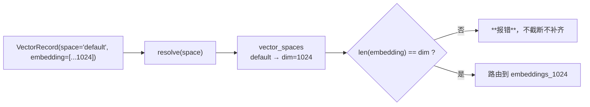
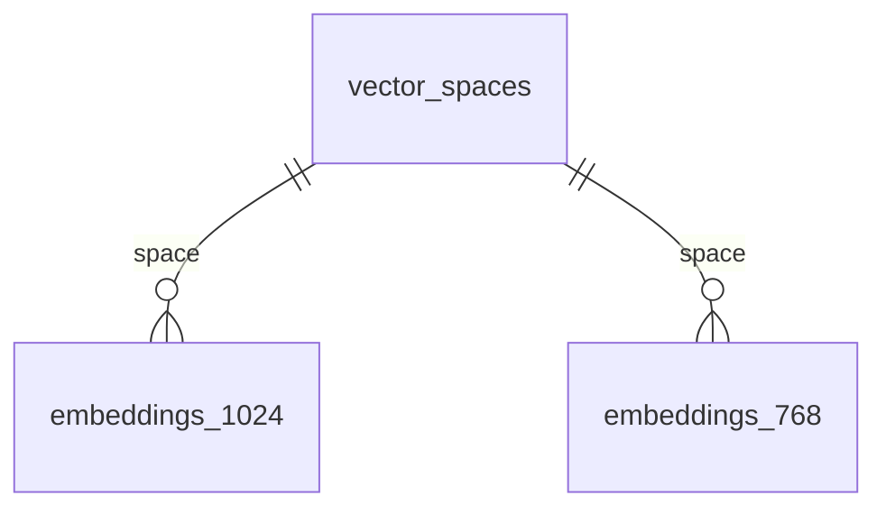
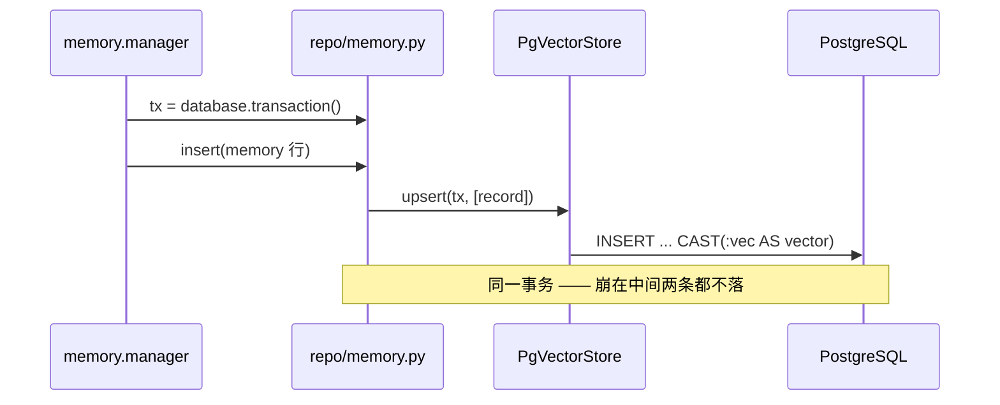
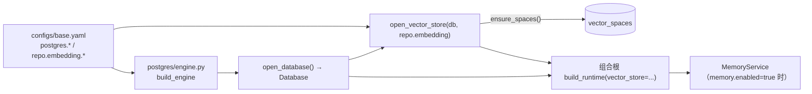

# 向量检索模块 架构概要设计（`apps/server/storage/postgres/vector.py`）

| 项 | 值 |
|---|---|
| 文档层级 | **架构层**。承接 `docs/repo/需求说明书-repo.md` `FR-R-08`（向量存储与检索）与 `docs/memory/需求说明书-memory.md` `FR-M-05` / `FR-M-15` |
| 强耦合 | `docs/server_storage/架构概要设计-server_storage.md` §5（**为什么实现放在这里** —— 本文不重复那部分）；`docs/repo/架构概要设计-repo.md` §3.4 / §4（协议、表约束） |
| 外部依赖 | PostgreSQL 17.11 + **pgvector 0.8.6**（本机实测） |
| 状态 | 待评审 |

---

## 0. 设计目标（一句话）

> 让「**把一条向量写进去、再把最相近的几条取回来**」这件事，与它的业务行
> **在同一个事务里**成立，并且**维度不匹配时立刻报错** —— 而不是安静地返回一堆
> 没有数学意义的"最近邻"。

第二句和第一句同等重要。维度错配是向量检索里**唯一一种不会自己暴露的错误**：
把 1024 维的查询发给 4096 维的空间，截断或补齐后的距离算得出来、排得出序、
返回得了结果 —— 而那个排序**没有任何意义**。所以它必须是一个硬错误。

---

## 1. 边界：谁定义协议，谁实现协议

这一层是「协议的具体实现」，不是新的抽象。判据是 `NFR-S-01`：

| 层 | 内容 | 为什么在这里 |
|---|---|---|
| `src/repo/embedding.py` | `VectorSpace` 描述、`VectorRecord` / `VectorHit`、`VectorStore` 协议 | **存储无关**：换一个向量后端，这些形状一字不改 |
| **本文**（`apps/server/storage/postgres/vector.py`） | `vector(N)` 列类型、HNSW 索引、`<=>` 距离 SQL、维度路由 | **必须绑定具体后端**：三样东西都是 Postgres + pgvector 特有的 |

判据的细节见 `docs/server_storage/架构概要设计-server_storage.md` §5.1（`DS-6`）。

**唯一的服务对象是组合根**：它把 `Database` 与 `PgVectorStore` 建好，
分别注入 `src/repo` 与 `src/memory`。`src/` 里出现 `from apps...` 的一刻，这条边界就塌了。

---

## 2. 核心机制一：维度分表与路由

### 2.1 为什么按维度分表，而不是一张表

pgvector 的 `vector(N)` 把维度**钉在列类型上**。而本平台配置里 768 / 1024 / 4096 三种并存
（`models.emb-mock.dimension=768`、`models.emb-dashscope.dimension=1024`）。

三条路：

| 方案 | 问题 |
|---|---|
| 一张表 `embedding vector(4096)` + 短向量补齐 | **补齐出来的距离是错的**，而且不报错 |
| 一张表 + JSONB 存向量 | 用不了 HNSW 索引，退化成全表扫描 |
| **按维度分表** `embeddings_768` / `_1024` | 表数 = **维度数**，不随实体数增长 |

选第三条。膨胀因子写清楚：**表数由「配置里有几种维度」决定，而不是由「有多少种实体」决定** ——
后者会随着每个测试阶段新增而膨胀（七个阶段 × 三种维度 = 21 张表）。

> **不支持任意维度**。`SUPPORTED_DIMS` 是一份显式白名单，**当前是 (768, 1024)**。
> 出现新维度时必须**改代码 + 加迁移**，而不是让运行时动态建表 ——
> 动态 DDL 会让「谁能建表」这件事从迁移手里漏出去。

### 2.1.1 为什么 4096 不在白名单里（实测发现，初稿写错了）

初稿把 `4096` 也列为支持的维度。**第一次跑迁移就炸了**，pgvector 报的是：

```
column cannot have more than 2000 dimensions for hnsw index
```

这是 pgvector 的**硬限制**：HNSW 索引最多支持 2000 维的 `vector` 类型。
「超过 2000 维」要走 `halfvec`（上限 4000）或先降维 —— 那是**一次真正的设计变更**，
不是加一行白名单。

于是这里做了一个取舍：**「列进支持」就等于「建得出索引」**。

| 做法 | 后果 |
|---|---|
| 建一张 4096 的表但不建索引 | 那个空间的检索**悄悄退化成全表扫描** —— 症状是"检索变慢了"，离原因很远 |
| **不支持 4096，报错说清为什么** | 想要它的人拿到的是**一句能照做的话**（换 halfvec / 降维），而不是一个安静的性能坑 |

选后者。这条正是本模块的纪律：**能力边界要诚实标注**，宁可响亮地失败。

### 2.2 空间由 `vector_spaces` 登记，维度是它的身份



`vector_spaces` 是**运行时的唯一事实来源**：`(space, dim, metric, model_key)`。
`ensure_spaces()` 在启动时按配置**播种并校验** —— 已存在但维度不同，直接报错。

**空间名不等于模型键**：同一个空间可以被不同的 embedding 别名写入（只要维度一致），
而 `model_key` 记录「最后写进来的那条是用哪个模型算的」，用于**模型换代时的排查**。

---

## 3. 表结构



| 表 | 关键列 | 约束 / 索引 |
|---|---|---|
| `vector_spaces` | `space`(uniq) `dim` `metric` `model_key` `created_at` | **uniq(space)** |
| `embeddings_<dim>` | `id`(BigIntPk) `space` `owner_kind` `owner_id` `model_key` `embedding`(`vector(N)`) `created_at` | **uniq(space, owner_kind, owner_id)**；**HNSW(embedding vector_cosine_ops, m=16, ef_construction=64)** |

三处说明：

1. **`uniq(space, owner_kind, owner_id)` 是 upsert 的锚**：一条记忆换了 embedding 模型时，
   是**替换**它的向量，而不是并存两条 —— 否则检索会返回同一个 owner 的多个分数。
2. **`owner_kind` + `owner_id` 而不是外键**：同一张向量表要服务多种实体
   （`memory` / 未来的 `message` / `document`），它们列形状完全一致，只有 owner 不同。
   这也让「记忆的向量」与「文档的向量」在同一套索引里各自成立。
3. **表模型注册到 `foundation/db.Base`**，与 `src/repo` 的表**同一个 Base** ——
   这是「向量与关系行同事务」能成立的前提（`FR-R-08`）。

> **由此产生一处必须写明的耦合**：`migrations/env.py` 要同时 import
> `repo.models` 与本文的表模型，才能让 Alembic 看见全部表。
> 这是**唯一**一处「迁移侧跨 apps/src 引用」，`env.py` 的注释里已经写明原因。

---

## 4. 核心机制二：向量怎么绑定（本模块最容易写错的一处）

### 4.1 不引入 `pgvector` 这个 Python 包

上层的 `pgvector` Python 包能做两件事：提供一个 SQLAlchemy 列类型、注册 asyncpg 的
type codec。两者都**可以用二十行代码替代**，而代价是给 `postgres` 这个可选依赖组
再加一个包。

所以本模块**自己实现** :class:`Vector`（一个 `UserDefinedType`）：
`get_col_spec()` 吐 `vector(N)`（迁移与 autogenerate 需要它），
`result_processor` 把 `'[1,2,3]'` 解析回元组。

### 4.2 绑定方式：**必须走数组 cast，不能走文本**

这是本模块最容易写错的一处，**已在本机 pgvector 0.8.6 上实测**：

| 写法 | 结果 |
|---|---|
| `SELECT '[1,2,3]'::vector` | ✅ 字面量可行（字面量的类型是 `unknown`，直接走类型的输入函数） |
| `SELECT CAST(%s AS vector)`，参数是 **`float8[]` / `real[]`** | ✅ **可行** |
| `SELECT CAST(%s AS vector)`，参数是 **`text`** | ❌ `invalid input syntax for type vector: "{1,2,3}"` |

原因在 `pg_cast` 里：pgvector 定义了 `double precision[] → vector`、`real[] → vector`、
`integer[] → vector`、`numeric[] → vector`（都是 assignment cast），
**但没有定义 `text → vector`**。

而"参数是 text"恰恰是最自然的写法（把向量格式化成 `'[1,2,3]'` 传进去）——
PG 对未定类型参数默认解析成 `text`，于是**在参数化查询里必然失败**，
而字面量测试却会通过。本地手测很容易用字面量验完就以为对了。

**所以绑定显式声明为数组类型**：

```python
bindparam("embedding", type_=ARRAY(Float))     # → double precision[]
... VALUES (..., CAST(:embedding AS vector), ...)
```

### 4.3 距离运算符

`<=>` 是**余弦距离**（`1 - cosine_similarity`）。空间声明 `metric=cosine` 时用它；
`l2` 用 `<->`、`inner_product` 用 `<#>`。运算符合法值由空间的 `metric` 决定，
**不匹配就是配置错误**。

---

## 5. 三类 SQL 的形状

**upsert**（写入或替换）：

```sql
INSERT INTO embeddings_1024 (space, owner_kind, owner_id, model_key, embedding, created_at)
VALUES (:space, :owner_kind, :owner_id, :model_key, CAST(:embedding AS vector), :created_at)
ON CONFLICT (space, owner_kind, owner_id)
DO UPDATE SET embedding = EXCLUDED.embedding,
              model_key = EXCLUDED.model_key,
              created_at = EXCLUDED.created_at
```

**search**（最近邻）：

```sql
SELECT owner_kind, owner_id, embedding <=> CAST(:query AS vector) AS distance
FROM embeddings_1024
WHERE space = :space
  [AND owner_kind = :owner_kind]
  [AND owner_id IN :owner_ids]
ORDER BY embedding <=> CAST(:query AS vector)
LIMIT :top_k
```

**delete**（硬删除记忆时必须连向量一起删，`FR-M-03`）：

```sql
DELETE FROM embeddings_1024
WHERE space = :space AND owner_kind = :owner_kind AND owner_id IN :owner_ids
```

三处设计说明：

1. **表名是模板拼进去的，参数一律走绑定**。表名来自 `SUPPORTED_DIMS` 的白名单，
   不是用户输入 —— 而**向量本身走绑定**，不做字符串拼接。
2. **`search` 只返回距离，不返回向量本身**：调用方（`memory.retriever`）要的是排序和
   相关度，不是那一千个浮点数 —— 把它们读回来只是白占带宽。
3. **`ORDER BY` 与 `SELECT` 里各算一次 `<=>`**：PG 会把相同表达式合并，
   这里写两次是为了让两个子句各自可读。

---

## 6. 索引与它的运维代价

选 **HNSW**（`vector_cosine_ops`，`m=16`，`ef_construction=64`）而不是 IVFFlat：

| | HNSW | IVFFlat |
|---|---|---|
| 建索引前提 | 无 | **需要先有数据再训练** |
| 新增数据 | 直接可用 | 需重建才能覆盖新分布 |
| 适用 | **边写边查** | 批量导入后查 |

平台是**边写边查**（agent 一跑起来就持续写记忆），所以选 HNSW。

**代价必须写进运维手册**（`DS-*` 的同一纪律：让人以为"配了就快"比不配更危险）：

- HNSW 构建受 `maintenance_work_mem` 限制。本机 `shared_buffers` 是 128MB，
  默认的 `maintenance_work_mem`（通常 64MB）在表变大后会**走磁盘排序**，慢到不可接受；
- 首次建索引前应临时调大（**只在当前会话**，不写进全局配置）：

  ```sql
  SET maintenance_work_mem = '512MB';   -- 建完即可，无需持久化
  CREATE INDEX ... USING hnsw (...);
  ```

- `ef_search`（查询时的候选规模）可在会话级调整，默认 40；召回不够时先动它，
  **不要**先动 `m`（改 `m` 要重建索引）。

**两处已知限制**（都由 pgvector 本身决定，不是本模块的选择）：

1. **HNSW 索引只能服务一种 ops 类**（`vector_cosine_ops` / `vector_l2_ops` /
   `vector_ip_ops`）。当前只建 cosine 索引 —— 若将来出现 `metric=l2` 的空间，
   需要**额外建一个 l2 索引**（同一张表可以挂多个），否则那个空间的检索会退化成
   全表扫描（**不会报错**）。见 `DV-4`。
2. **HNSW 最多 2000 维**（§2.1.1）。所以 `SUPPORTED_DIMS` 里没有 4096 ——
   要它得改用 `halfvec` 或降维，那是一次设计变更。

---

## 7. 事务接缝

`VectorStore` 的每个方法都收一个 `tx`，这是刻意的（`src/repo/embedding.py` 的说明）：



若让 `VectorStore` 自己持有连接，就没有任何东西拦得住
「记忆行提交了、向量没提交」这种半截状态 —— 而它的症状是**检索永远查不到那条记忆**，
离原因很远。

---

## 8. 装配



**启动时做三件事**：建引擎 → 健康检查（含 `vector` 扩展，`FR-S-03`）→
`ensure_spaces()` 播种并校验空间。第三件失败必须**阻断启动**：
一个维度配错的空间，症状是"检索总返回空"，比启动失败难查得多。

**没有 vector 能力时**：`open_vector_store` 返回 `None`，组合根把 `vector_store=None`
传下去，记忆退到「结构化 + 关键词」检索 —— **这是一条完整路径，不是残废版**
（`memory.retriever` 里写得明白）。

---

## 9. 关键设计决策

| 编号 | 决策 | 选择 | 理由 |
|---|---|---|---|
| `DV-1` | 实现放哪 | `apps/server/storage/postgres/vector.py` | `vector(N)` / `<=>` / HNSW 三样都是 PG 特有（`DS-6`） |
| `DV-2` | 维度策略 | **按维度分表**，白名单 **(768, 1024)** | 表数 = 维度数，不随实体膨胀；**不支持动态建表**；**4096 被 HNSW 的 2000 维上限挡在门外**（§2.1.1） |
| `DV-3` | 是否引入 `pgvector` Python 包 | **不引入**，自实现 `Vector` 类型 | 二十行可替代；`postgres` 可选依赖组保持最小 |
| `DV-4` | 距离度量 | 索引固定 **cosine** | 平台默认度量；l2/ip 空间需另建索引（已记为已知限制） |
| `DV-5` | 索引类型 | **HNSW**（m=16, ef=64） | 边写边查；IVFFlat 需要先有数据再训练 |
| `DV-6` | 空间未登记时 | **报错**，不自动创建 | 自动建空间的维度来自第一条数据 —— 而那条数据可能是错的 |
| `DV-7` | 维度不匹配 | **硬报错**（`DimensionMismatch`） | 截断/补齐后的距离没有数学意义，且**不报错**（`FR-R-08`） |
| `DV-8` | 向量怎么绑定 | **数组参数 + `CAST(:v AS vector)`** | 实测：`text → vector` 的 cast **不存在**（§4.2） |
| `DV-9` | 无向量能力时 | 退到结构化 + 关键词，**不阻断** | 记忆是旁路；`vector_store=None` 是一条完整路径 |

---

## 10. 待确认（需评审）

| 编号 | 待确认 | 备选 | 倾向 |
|---|---|---|---|
| `VQ-1` | 空间维度从哪里来 | (a) 配置里显式写 `repo.embedding.dim`；(b) 从 embedding 别名的候选模型推导 | **(a)**。别名的候选会换（mock ↔ dashscope），而空间维度**不该随环境漂移** —— 漂移的那一刻，已有数据全部失效。代价是配置多一处必须与模型对齐，需要一条启动期校验 |
| `VQ-2` | 一条 owner 多模型向量 | (a) 只保留最新；(b) 每个模型一行 | **(a)**。`uniq(space, owner_kind, owner_id)` 强制单行；多模型并存会让同一条记忆返回多个分数 |
| `VQ-3` | 非 cosine 空间 | (a) 暂不支持；(b) 按 metric 建多个索引 | **(a) 起步**，把限制写进文档与 `DV-4`；出现 l2 需求时再补索引 |
| `VQ-4` | 向量归一化 | (a) 写入前归一化；(b) 交给模型与索引 | **(b)**。cosine 距离对模长不敏感，归一化是多余的一次遍历 |
| `VQ-5` | `ef_search` 怎么调 | 会话级 SET / 索引参数 / 不暴露 | **会话级**，作为配置项暴露；**不**让调用方每次查询都传 |

---

## 11. 测试策略

向量检索的测试分两层，**分界线是「需不需要真的有一个 pgvector」**：

| 层 | 覆盖 | 怎么跑 |
|---|---|---|
| **单测** | `Vector` 类型的 DDL、解析、格式化；空间解析与维度校验；SQL 里是否用了数组绑定（**防止退回 text 绑定**） | 不需要 PG，任何环境都跑 |
| **集成** | upsert → search 的往返、`ON CONFLICT` 覆盖、维度错配报错、跨 owner 隔离 | **需要真 PG**；不可达时整组跳过（与 `test_postgres_guard.py` 同一纪律） |

**集成测试不污染共享库**：PG 的 DDL 是**事务性**的，所以可以在一个事务里建表、跑完、回滚。
这比「建完再 DROP」安全 —— 后者在中途失败时会留下垃圾表。

---

## 12. 风险

| 风险 | 触发条件 | 缓解 |
|---|---|---|
| **维度错配静默返回垃圾** | 配置改维度、数据没清 | `DV-7` 硬报错 + 启动期 `ensure_spaces` 校验 |
| **文本绑定**（§4.2 的坑） | 有人把数组绑定改成字符串 | 单测里有一条断言盯着 SQL 文本用了 `CAST(` 且绑了数组 |
| **非 cosine 空间退化成全表扫描** | 出现 `metric=l2` 的空间 | `DV-4` 记为已知限制；文档写清 |
| **建索引把库拖慢** | 表大 + `maintenance_work_mem` 默认 | §6 的运维步骤；不在迁移里默认调大全局参数 |
| **向量表被当成"业务表"** | 有人按测试阶段自持向量表 | 表数 = 维度数（`DV-2`），文档写死 |
| **迁移看不到向量表** | `env.py` 漏 import | 漏掉的后果是 **DROP TABLE 的迁移**；`env.py` 注释写明 |
| **维度超出 HNSW 上限** | 有人加了个 4096 维的模型 | §2.1.1：不支持，且报错里直接给出两条出路（halfvec / 降维） |

---

## 13. 实现期回填的修订

**第一批：写迁移时就发现的**（跑之前看不出来，只有真的建索引才会炸）

| 项 | 初稿 | 实测之后 |
|---|---|---|
| 支持维度 | 768 / 1024 / **4096** | **768 / 1024** —— HNSW 上限 2000 维，4096 的表**建不出索引**。留一张建不出索引的表 = 那个空间的检索悄悄变成全表扫描 |
| 报错信息 | 「不支持 N 维」 | 超过 2000 时**额外给出两条出路**（`halfvec` 上限 4000 / 先降维）—— 只说"不支持"会让人去翻源码 |

> 这两条都不是设计推理能得出的，是**跑一次**才知道的。它也是这一层的存在理由：
> `vector(N)` 与 HNSW 的边界由 pgvector 定，不由我们的抽象定。

**第二批：接回记忆层时发现的**

| 项 | 现象 | 结论 |
|---|---|---|
| `tx.fetch_all` 的语义 | 用它读多列，`owner_id` 读出来是 `None` | 它**只返回第一列**（`foundation/database.py` 的 docstring 写着）。读多列必须用 `tx.execute(...).mappings()` —— 这类错误不会报错，只会给出**半对的数据** |
