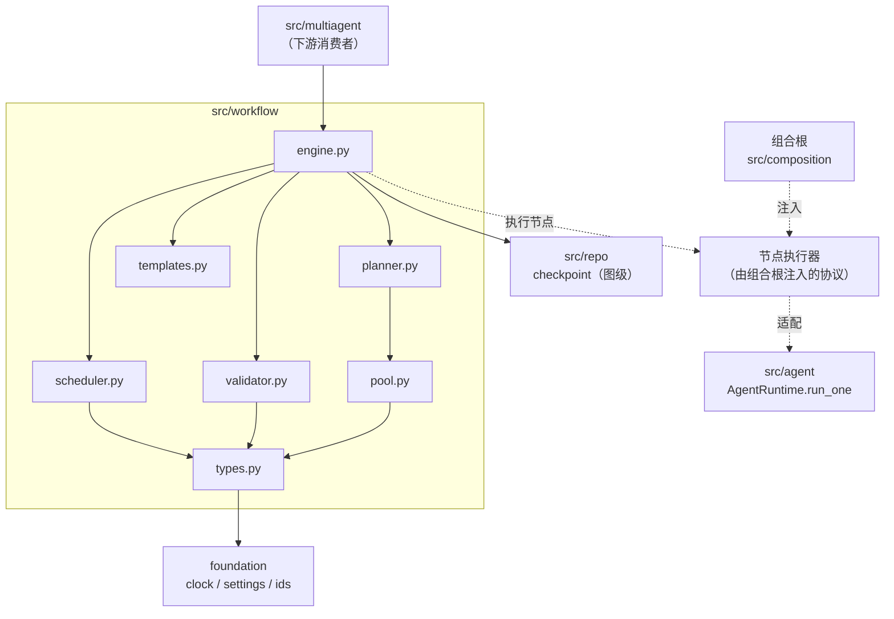
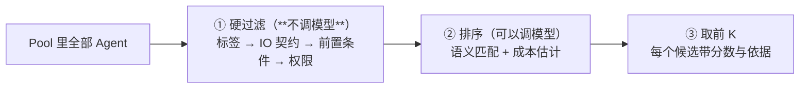
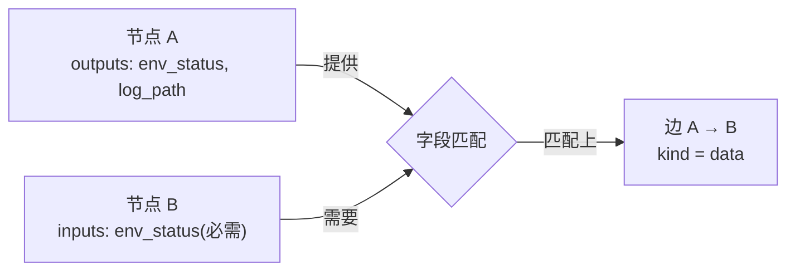
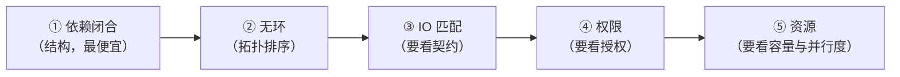
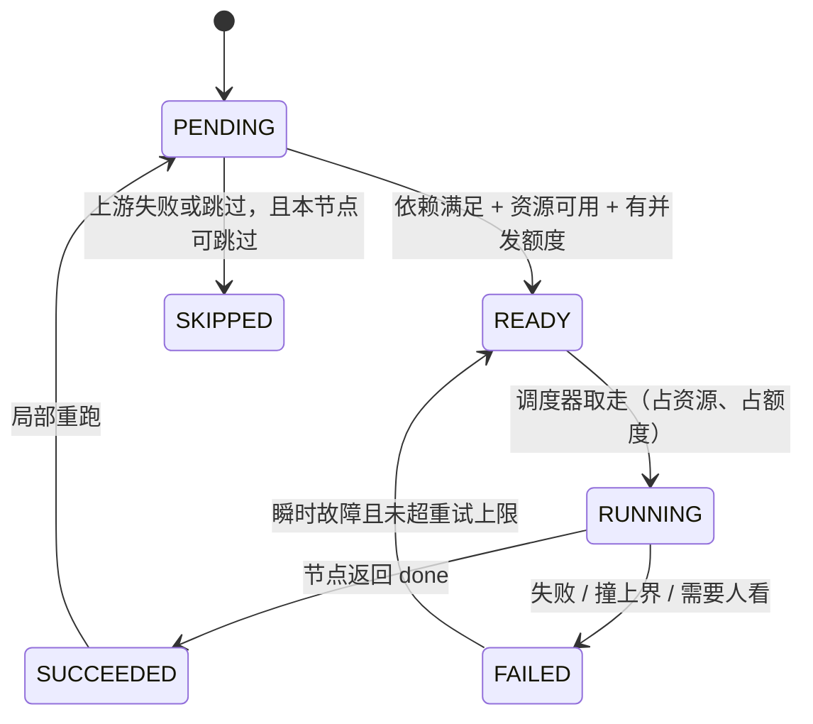
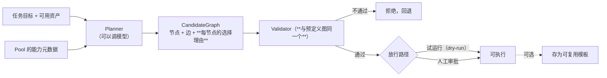
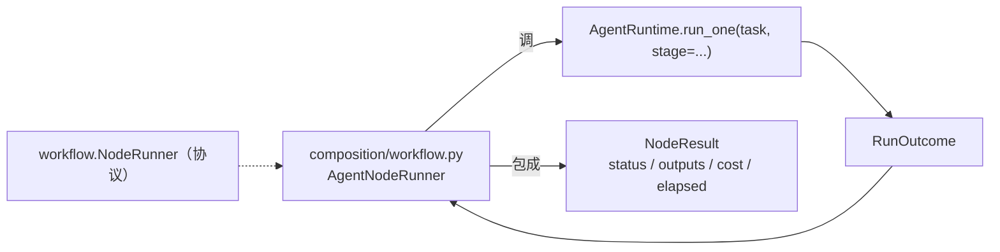
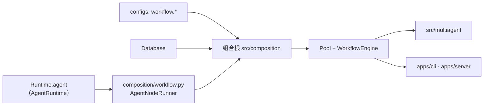
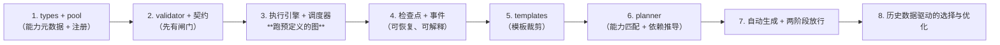

# `src/workflow` 架构概要设计

| 项 | 值 |
|---|---|
| 文档层级 | **架构层**（第二篇）。前置：《`src/workflow` 需求说明书》 |
| 承接 | 需求说明书-workflow 的全部 `FR-W-xx` / `NFR-W-xx` |
| 强耦合 | `docs/agent/架构概要设计-agent.md`（节点执行器协议那一端）；`docs/repo/架构概要设计-repo.md`（检查点与两张待补的表） |
| 外部依赖 | 无。**节点执行是注入的协议** —— 本模块不认识 agent，也不认识模型 |
| 状态 | 待评审 |

---

## 0. 设计目标（一句话）

> 让「**谁来做、按什么顺序做**」成为一张**跑之前就被证明可跑、跑起来每一步都可解释**的图 ——
> 而不是一段写在代码里的调用顺序，或者一次模型临场决定、没人复核过的计划。

三句话展开：

- **可校验**：图的正确性（输入接得上、依赖闭合、无环、有权限、资源不冲突）
  在**执行之前**被证明，不通过就一个节点都不跑。
- **可编排**：顺序由**两类依赖**共同决定 —— 数据依赖看得见，**资源依赖看不见**
  （它不在数据流里），必须由声明推出来。
- **可恢复**：失败是**局部**的。二十个节点里坏了三个，不该把成功的十七个重跑一遍。

**第二句是本设计的核心判断。** 测试场景里最常见的依赖恰恰不是数据依赖：
两条用例之间没有数据往来，但它们抢同一个测试环境 —— 漏掉这条**看不见的边**，
症状是**只在并发时出现的偶发失败**，而它离原因非常远。

---

## 1. 结构总览

```
src/workflow/                 ← 新模块（`src/multiagent/workflow/` 作废，见 §8.3）
├── __init__.py      只导出契约与执行引擎入口
├── types.py         Node / Edge / Workflow / NodeState / Capability / NodeResult / GraphIssue
├── pool.py          ★ Agent Pool：能力元数据注册表 + 三段漏斗的第一段（硬过滤）
├── planner.py       ★ 选节点 + 推依赖 → 候选图（含数据依赖与资源依赖）
├── validator.py     ★ 五类校验（**执行前的闸门**）
├── scheduler.py     ★ 就绪判定 / 并行 / 资源占用 / 失败处置 / 局部重跑
├── engine.py        ★ 执行引擎：把上面串起来跑完一张图（**对外唯一入口**）
└── templates.py     预定义与模板的加载、版本化、参数化裁剪
```

**为什么是这三个文件（`pool` / `planner` / `validator`）而不是一个"规划器"**：
它们回答的是三个**可以分别出错**的问题 ——
「谁能干」（能力匹配）、「谁接谁」（依赖推导）、「这张图能不能跑」（校验）。
合成一个文件之后，一次失败就分不清是"没找对人"还是"边连错了"。

### 1.1 依赖图



**四条硬边界**：

1. **不 import `agent`** —— 节点执行是**注入的协议**（`NFR-W-02` / `DW-2`）。
   换了什么？换来的是「**用假节点就能测调度、并行、失败处置**」，
   以及将来 skill 节点复用同一套引擎**不必改引擎**。
   代价是组合根多一层包装（§9）。
2. **不 import `provider`** —— 会补进 import-linter 契约（`DW-8`）。
   本模块连模型都不认识，更没有理由认识厂商。
3. **不 import `multiagent`** —— 依赖方向相反：multiagent 是本模块的**消费者**。
4. **不 import `context` / `memory`** —— 上下文与记忆是**逐节点**的事（需求 §10）。
   编排层统管它们，等于假设"一张图里所有阶段该看到同样的上下文"，而那明显不对。
5. **不 import `strategy`（组件层）** —— 节点**内部**用哪套组件策略不归编排层管（需求 §3.3 ④）。
   编排层替节点挑策略，等于把组件层的组合空间搬进图里，而图的组合空间更大，
   组件层辛苦建立的**契约校验**在这里一点都用不上。

---

## 2. 核心机制一：能力匹配（三段漏斗）

### 2.1 顺序是约束：**确定性的一定排在概率性的前面**



**为什么反过来的写法是错的**：如果先让模型排序，再检查合法性，那么
「模型选出来的前 K 个」里可能一个都不合法 —— 于是要么放宽约束（危险），
要么反复重排（贵且不确定）。**先出局、再排序**，排行榜里剩下的每一个都天然合法。

**硬过滤的内部顺序也固定**，按代价从低到高：

| 步 | 检查 | 为什么在这个位置 |
|---|---|---|
| 1 | **能力标签**（集合包含） | 纯集合运算，零成本，能滤掉一大半 |
| 2 | **IO 契约**（字段名/类型能不能凑齐） | 还是集合运算，但要查一遍当前可用资产 |
| 3 | **前置条件**（`requires` 是否满足） | 要看运行上下文（环境就绪没、资产在不在） |
| 4 | **权限**（本次运行的授权够不够） | 最"重"，要读授权配置 |

### 2.2 排序：语义 + 成本，且**分数要留痕**

```
rank_score = w_sem × 语义相似度   −  w_cost × 归一化成本估计
```

- 语义相似度：节点描述 / 标签 与「任务目标 + 当前缺失的资产」的匹配度；
- 成本估计：`est_latency_s` 与 `est_tokens`（能力元数据里声明），归一化后取和；
- **权重可配**，但**分数与各项分项都要留在候选记录里** —— 它是 `FR-W-07` 那条
  「为什么用它」的唯一依据。

**落选的也要留痕**：至少记「被哪一条硬过滤挡掉了」。因为「为什么没用那个 agent」
与「为什么用了这个」是同等常见的问题，而后者容易回答、前者很难。

---

## 3. 核心机制二：依赖推导（**两类边**）

### 3.1 数据依赖：从 IO 契约推



- **字段级匹配**，不是节点级：「A 的 outputs 里有 B 需要的字段」才连边；
- 匹配规则可配（`data_dependency: schema | name | off`），但**必须确定**（`NFR-W-05`）；
- **歧义不许静默消解**：两个上游都能提供同一个字段时，
  按 `on_ambiguous_provider` 处理 —— `reject`（报歧义，人来裁决）或 `priority`（按配置的优先级选**并记录**）。
  「默默取第一个」在图这种结构上特别危险：它让一张**看起来一样**的图，
  在两次生成里接上不同的上游。

### 3.2 资源依赖：**这不是一条数据边**（本设计的核心）

节点通过 `exclusive_resources` 声明它**独占**什么。推导规则：

```
对每个资源 r：
    使用 r 的节点集合 N(r) = { n | r ∈ n.exclusive_resources }
    若 capacity(r) == 1：N(r) 内两两之间，按拓扑序加**有向串行边**（kind = resource）
    若 capacity(r) == k > 1：**不加边**，转成调度期的一个计数约束
```

**为什么容量 1 用边、容量大于 1 用计数**：

- 容量 1（"独占"）是一条**二元约束**（这两个不能同时），而二元约束正是**边**能表达的 ——
  写进边之后，它成为**图的一部分**，能被校验器检查、能在图上被看见；
- 容量 k（"最多 k 个"）**不是二元约束** ——「三个节点抢两个槽位」没法用边表达。
  把它硬塞成边会把图变得不必要地串行（本该两两并行，变成长链）。所以它留在**调度器**里，
  用计数判定。

> **代价必须写下来**：容量大于 1 的资源冲突**在图上不可见**。它只在调度时被挡住，
> 于是「为什么这两个节点没并行」只能查调度日志，不能看图。

### 3.3 两类边在后续处理里的**不同待遇**（容易写错的一处）

| 处理 | 数据边 | 资源边 |
|---|---|---|
| **就绪判定** | 上游必须 `SUCCEEDED` | 互斥节点**没有正在跑的** |
| **重跑传播**（`FR-W-17`） | **参与**传播（上游输出变了，下游可能得重跑） | **不参与**传播（它不传数据） |
| **校验** | IO 匹配要查 | 并行度要查 |
| **是否进图** | 进 | 容量 1 时进；容量大于 1 时不进 |

**资源边不参与重跑传播**是刻意的：一条"不能同时"的约束，
与"上游的输出变了"没有任何关系。把它算进传递闭包，会让「改左分支」
莫名其妙地重跑右分支 —— 而用户看到的是"重跑了一堆不相干的节点"。

---

## 4. 核心机制三：DAG 校验（执行前的闸门）

### 4.1 它是纯函数

```python
def validate(workflow: Workflow, *, pool: Pool, auth: Auth) -> tuple[GraphIssue, ...]
```

**无 IO、无副作用、确定**。所以它能被单测穷举、能被离线批跑（"把模板库里的图全验一遍"）、
也能在保存模板之前再跑一次。

### 4.2 五类检查，**顺序也是按代价排的**



结构性的先查：**一张有环的图，谈 IO 匹配没有意义** —— 拓扑序都排不出来。

### 4.3 fail-closed，且**拒绝要能照着改**

- 任何一个 issue → **一个节点都不跑**（`FR-W-12`）；
- issue 必须带**节点 id + 类别 + 建议**，例如：

```
[IO 不匹配] 节点 defect_triage 的必需输入 'diagnosis_evidence' 无人提供。
  候选上游：analysis（输出 'hypothesis'）
  建议：改 analysis 的输出契约，或在初始资产里提供 diagnosis_evidence
```

「建议」这一项不是客套：没有它，人得自己把整张图和全部契约对着看一遍。

---

## 5. 核心机制四：调度与状态机

### 5.1 状态机



**`SKIPPED` 与 `FAILED` 必须分开**：「这条没跑」与「跑了但失败了」是两件事。
混在一起之后，「这次到底覆盖了多少」永远答不出来 —— 而覆盖率正是测试平台的核心指标。

### 5.2 就绪判定：**跳过怎么传播**（一处容易漏的细节）

上游客 `SKIPPED` 时，下游怎么办？答案取决于**那个输入是不是必需的**：

| 上游客状态 | 该输入 `required` | 下游 |
|---|---|---|
| `SUCCEEDED` | — | 满足 |
| `SKIPPED` / `FAILED` | **是** | 下游也 `SKIPPED`（它拿不到必需输入） |
| `SKIPPED` | 否 | 下游可以跑（缺的字段用默认值 / 空） |
| 还在 `PENDING` / `RUNNING` | — | 不满足，继续等 |

这条规则**必须读 IO 契约里的 `required` 标记** —— 所以 `FR-W-02` 要求
"输入要标是否必需"不是形式主义：少了它，`SKIPPED` 只能一律往下传
（会跳过本该跑得动的节点），或者一律不传（会让下游拿空输入跑）。

### 5.3 并行：**两道闸门**

```
就绪 且 资源可用  →  再抢 asyncio.Semaphore(max_parallel)  →  RUNNING
        ↑ 图内的约束                        ↑ 对外的约束
```

- **资源闸门**挡住"声明了冲突的节点同时跑"（`FR-W-09`）；
- **额度闸门**挡住"二十个节点一起打爆上游"（`FR-W-15`）；
- 两者都要：缺资源闸门是**偶发失败**，缺额度闸门是**限流与成本事故**（`DW-10`）。

### 5.4 失败处置：按类别，不是一律重试

| 类别 | 判定依据 | 处置 |
|---|---|---|
| 瞬时 | 错误类别（复用 `src/tool` 的异常分类口径） | 重试，≤ `retry_max` |
| 输入 / 需求 | 依赖缺失、需求矛盾 | 不重试，`FAILED` |
| 权限 | 工具层的拒绝对因 | 不重试，**指出缺什么** |
| 需要人看 | 节点返回 `needs_review` | **停下并上报** —— 那是 agent 层交上来的人工决策点，编排层替它决定就是越权 |
| 可跳过 | 节点标了 `optional` | `SKIPPED`，下游按 §5.2 处理 |

**默认 `classify`，不提供"一律重试"**（`C-W-5`）。

### 5.5 局部重跑：沿**数据边**算传递闭包


- 只沿**数据边**传播（§3.3）；
- 闭包外的节点**不重跑** —— 这是本模块省钱的地方；
- **重跑范围必须可解释**：「重跑了哪几个、因为谁变了」。

### 5.6 检查点：**两层，不重叠**

| 层 | 管什么 | 落在哪 |
|---|---|---|
| **agent 层** | 一次运行内部**跑到第几步** | `repo/checkpoint.py`，`run_id` |
| **图这一层** | 这张图**跑到哪个节点** | 同一张表，`node_id = "<workflow_run_id>:<节点id>"` |

**为什么复用而不是新造一张表**：断点续跑要问的是「这次执行到哪了」，
图跑到哪个节点只是它的**另一个粒度**（`DT-15` 是同一条推理）。
一个图级检查点还额外带上：节点状态、输出**摘要**、耗时、以及**那次运行是否重跑过**。

> **输出只存摘要**（与 `AgentStep` 同一条纪律）：全文在 `tool_execution` 与落盘文件里；
> 检查点是**状态**不是日志。

---

## 6. 核心机制五：自动生成的两阶段

### 6.1 Planner 产**候选**，不产执行计划



**三条约束**：

1. **Planner 没有执行权**。它连"跑一个节点"的能力都没有 ——
   接口上就调不到（`FR-W-19` 的验收点正是"没有任何节点被执行"）；
2. **同一套校验器**。不许因为"它是模型生成的"就放松标准（`FR-W-35`）；
   放松的那一天，就是自动图开始在生产里炸的那一天；
3. **放行才可执行，放行才可存模板**。未验证的图进模板库，
   会把一次没验证的规划**固化**成"以后都照这个跑"（`DW-5`）。

### 6.2 放行状态

```
candidate → validated → (dry_run_passed | approved) → executable → (可选) persisted_as_template
     ↑           ↑                ↑                        ↑
   Planner    校验器          试运行或人            引擎可以跑它
```

每一步都留痕：谁批的、试运行跑了哪几个节点、结果如何。
**`candidate` 与 `validated` 是两个状态** —— 混在一起会让"这张图到底验过没有"
变成一个查不出来的问题。

---

## 7. 各文件设计

### 7.1 `types.py` —— 契约

```python
NodeState  = Literal["PENDING","READY","RUNNING","SUCCEEDED","FAILED","SKIPPED"]
EdgeKind   = Literal["data", "resource"]
IssueKind  = Literal["io_mismatch","dependency_closure","cycle","permission","resource_conflict"]

@dataclass(frozen=True)
class Capability:            # FR-W-02 的六类
    tags: frozenset[str]
    inputs:  Mapping[str, FieldSpec]     # FieldSpec(type, required)
    outputs: Mapping[str, FieldSpec]
    requires: tuple[str, ...]            # 前置条件（如 env:ready）
    needs_assets: tuple[str, ...]
    parallelizable: bool = True
    side_effects: bool = False
    retryable: bool = True
    exclusive_resources: tuple[str, ...] = ()
    est_latency_s: float = 0.0
    est_tokens: int = 0
    version: str = ""

@dataclass(frozen=True)
class AgentSpec:
    name: str
    capability: Capability
    runner: NodeRunner                    # 注入的执行入口

@dataclass(frozen=True)
class Node:
    id: str                               # **图内唯一**，事件与检查点都用它
    agent: str                            # 指向 Pool 里的名字
    inputs: Mapping[str, str] = ...       # 字段 -> 来源（节点 id 或资产名）
    optional: bool = False                # 失败可跳过（FR-W-16）
    reason: str = ""                      # **为什么选它**（FR-W-07）

@dataclass(frozen=True)
class Edge:
    src: str
    dst: str
    kind: EdgeKind = "data"
    field: str = ""                       # 数据边：传的是哪个字段

@dataclass(frozen=True)
class Workflow:
    workflow_id: str
    version: str = ""
    nodes: tuple[Node, ...] = ()
    edges: tuple[Edge, ...] = ()
    origin: Literal["predefined","template","auto"] = "predefined"

@dataclass(frozen=True)
class GraphIssue:
    kind: IssueKind
    node_id: str = ""
    detail: str = ""
    suggestion: str = ""                  # **能照着改**（§4.3）
```

- `Node.id` 与 `AgentSpec.name` **分开**：同一张图里同一个 agent 可能出现两次
  （两个不同的用例并行跑），而**事件与检查点需要一个唯一的地址**；
- `Workflow` 是**不可变**的：执行过程中的状态变化记在**执行侧**，不写回图本身。
  一张跑过的图与一张没跑过的图，定义应当一模一样 —— 否则"重跑一次同样的图"就不成立。

### 7.2 `pool.py` —— Agent Pool

```python
class Pool:
    def register(self, spec: AgentSpec) -> None      # 重名硬失败
    def get(self, name: str) -> AgentSpec            # 未知 → 报错并**列出全部名字**
    def names(self) -> tuple[str, ...]
    def filter(self, *, task: TaskContext) -> tuple[Candidate, ...]   # ① 硬过滤
    def rank(self, candidates, *, task, limit) -> tuple[Candidate, ...]  # ② 排序
```

- `register` 时**校验六类元数据齐全**（`FR-W-02`）—— 缺 `outputs` 的 agent
  会让依赖推导**推不出边**，而那时的症状是"图里少了一条边"，没人会想到是注册的问题；
- `Candidate` 记录分数、命中标签、以及（被淘汰时）被哪条规则挡掉。

### 7.3 `planner.py` —— 选节点 + 推依赖

```python
async def plan(task, *, pool, mode, templates, asset, cfg) -> PlanResult
```

```
① 按 mode 取骨架：预定义 / 模板裁剪 /（auto 时）交给模型
② 数据依赖：字段级匹配 → 边（歧义按配置处理）
③ 资源依赖：exclusive_resources → 串行边（容量 1）或计数约束（容量 > 1）
④ 补全节点：为每个节点的必需输入**指定来源**（上游节点 id 或资产名）
⑤ 产出 CandidateGraph（含每个节点的 reason）
```

**第④步是最容易漏的**：连完边不等于每个输入都有来源。
一个没有来源的必需输入，正是 `FR-W-11` 第 1 类校验要抓的东西 ——
**规划阶段尽力补全，校验阶段兜底**，两道都做，因为漏了的代价是运行时才炸。

### 7.4 `validator.py` —— 纯函数

见 §4。它对**预定义图与自动图一视同仁**，这是设计上的硬要求。

### 7.5 `scheduler.py` —— 调度

```python
class Scheduler:
    async def run(self, workflow, *, engine, checkpoint) -> RunReport
```

- **就绪判定**（§5.2）与**资源记账**（容量 > 1 的计数）都在这里；
- 并行用 `asyncio`，额度用 `Semaphore`，资源用一张"当前占用表"；
- **同一张图的两次运行，串行部分的顺序必须一致**（`NFR-W-05`）——
  就绪节点的选取按**拓扑序 + 节点 id** 排，不用集合的迭代顺序
  （那在 Python 里虽然稳定，但换实现就变）。

### 7.6 `engine.py` —— 唯一入口

```python
@dataclass
class WorkflowEngine:
    pool: Pool
    scheduler: Scheduler
    checkpoint: Any | None = None
    database: Any | None = None
    clock: Clock = ...
    events: Any | None = None
    policy: WorkflowPolicy = ...

    async def run(self, workflow: Workflow, *, asset, resume=False) -> RunReport
    async def plan_and_run(self, task, *, mode=None, ...) -> RunReport   # 规划 + 校验 + 执行
    def validate(self, workflow) -> tuple[GraphIssue, ...]              # 只校验，不执行
```

- `run` **必须先校验**（除非配置显式关掉），这是 `FR-W-12` 的落点；
- `plan_and_run` 在 `auto` 模式下**不会**直接执行：它停在"候选 + 校验结论"，
  等放行（§6.2）；
- `RunReport` 是**自足**的：每个节点的 `RunOutcome`（或等价的节点结果）+ 图终态 + 耗时 + 成本。

### 7.7 `templates.py` —— 预定义与模板

- 从 `workflow.templates.dir` 加载定义（文件、版本化、可 review、可进 git）；
- **模板裁剪**：按输入资产判断该去掉哪些节点，并**记录依据**（`FR-W-06`）；
- 裁剪后**仍然要过校验器** —— 去掉一个节点可能让另一个节点的输入悬空，
  而那正是裁剪最典型的错误。

---

## 8. 与相邻模块的接缝

### 8.1 与 `src/agent`：节点执行器协议

```python
@runtime_checkable
class NodeRunner(Protocol):        # 定义在 src/workflow（协议归使用方）
    async def __call__(self, *, node: Node, capability: Capability,
                       inputs: Mapping[str, Any], run_id: str) -> NodeResult: ...
```

组合根做一次适配：



**agent 侧零改动** —— 它的 `run_one` 本来就自足、不含"我正在被编排"的假设（`NFR-A-02`）。
映射关系只有两处需要写清：

| agent 的 `RunOutcome` | 图这一层 |
|---|---|
| `done` | `SUCCEEDED` |
| `failed` / `cancelled` | `FAILED` |
| `needs_review` | `FAILED` + **可区分的理由**（编排层不替它决定，见 §5.4） |

**`needs_review` 不单独开一个节点状态**：它在图这一层的语义确实是"这个节点没成"，
而它"需要人看"这件事**由理由携带**就够了。多一个状态会让状态机的每个分支都要多想一次。

### 8.2 与 `src/repo`：两层检查点 + **两张待补的表**

| 用途 | 现状 |
|---|---|
| 图级检查点（跑到哪个节点） | **复用 `checkpoint` 表**，`node_id = "<workflow_run_id>:<节点id>"` |
| workflow 资产（版本化模板） | ⚠ **没有表** —— 需要新增 `repo/workflow.py`（`WQ-1`） |
| 图运行记录（每次运行的结果） | ⚠ 可以用检查点承载，也可以单独一张表（`WQ-2`） |

### 8.3 与 `src/multiagent`（以及它下面那个空子包）

- **本模块是上游**：multiagent 的协作策略内部**可以**拿本模块跑一张图
  （辩论的三轮 = 一张串行图）。本模块**不认识**"辩论""投票"这些词；
- **`src/multiagent/workflow/` 作废**（`DW-1`）：四个空文件（`workflow.py` /
  `node.py` / `edge.py` / `executor.py`）与本文是**同名的两件事**，留着会让下一个人
  不知道该往哪加东西。执行引擎要被多处复用，放在 `multiagent` 内部会强迫使用方依赖整个多 agent 层。
  **处理方式**：删除那四个空文件，或在 `__init__.py` 里注明"已迁往 `src/workflow`"。

---

## 9. 装配



**装配点**：`Runtime` 增加一个字段（与 `tools` / `memory` / `context` / `agent` 并列）：

```python
@dataclass
class Runtime:
    ...
    workflow: WorkflowEngine | None = None
```

**启动期校验**：

- `pool.require_metadata=true` 时，注册的每个 agent 的六类元数据必须齐全（`FR-W-02`）；
- `validate.enabled=false` → **日志与 `doctor` 显示"校验已关闭"**（`C-W-2`）；
- `auto.allow=false` → 显示"自动生成已关闭"；
- `resources` 里声明了但**没有任何节点引用**的资源 → **告警**（多半是设备名拼错了，`C-W-7`）。

**没有 agent 时**：`workflow` 为 `None`，照常启动 —— 编排层是**增益**，
单 agent 那条路径不依赖它。

**新增的模块名要进 `pyproject.toml`**：`root_packages` 与 provider 契约的
`source_modules`（`DW-8`）—— **与新模块同一次提交**，否则它会成为一个
不受依赖方向约束的顶层模块（`context` 曾漏、`runtime` 被删后契约报错，都是同一类事）。

---

## 10. 事件

出口统一在 `WorkflowEngine`（每个模块只有一个事件出口）。

| 事件名 | 何时 | 关键载荷 |
|---|---|---|
| `workflow.mode.selected` | 模式选定 | `mode` / **理由**（命中了哪条预定义流程或模板） |
| `workflow.plan.generated` | 候选图产出 | 节点数 / 边数 / 每节点的 `reason` / 来源（predefined/template/auto） |
| `workflow.planned.rejected` | 校验不通过 | `issues`（类别 + 节点 + 建议） |
| `workflow.approved` | 自动图被放行 | 路径（dry_run / approval）+ **谁批的** |
| `workflow.template.saved` | 存为模板 | `workflow_id` / `version` / 放行凭据 |
| `workflow.node.started` | 节点开始 | **节点 id** / agent / 是否重跑 |
| `workflow.node.finished` | 节点结束 | 节点 id / 状态 / 耗时 / 成本 / 输出摘要 |
| `workflow.node.skipped` | 节点被跳过 | 节点 id / **为什么跳**（上游失败 / 可选 / 缺必需输入） |
| `workflow.rerun` | 局部重跑 | **触发的节点** / 被标回 PENDING 的闭包 |
| `workflow.finished` | 图终态 | 终态 / 成功·失败·跳过数 / 总耗时 / 总成本 |
| `workflow.resource.waited` | 因资源被挡 | 节点 id / 资源名 / 等了多久 |

**三个刻意的载荷选择**：

- **节点 id，不是节点名**：同一个 agent 在一张图里可能出现多次，
  用名字会让事件无法定位到具体那一次（与 `ToolExecutionRow.subject` 的同一条推理）；
- **`workflow.node.skipped` 单独一个事件**：跳过是本模块最容易被忽视的状态，
  而它直接影响"这次覆盖了多少"；
- **`workflow.resource.waited`**：容量大于 1 的资源冲突**在图上不可见**（§3.2），
  所以它是唯一能回答"为什么这两个节点没并行"的地方。

---

## 11. 关键设计决策

| 编号 | 决策 | 选择 | 理由 |
|---|---|---|---|
| `MW-1` | 引擎放哪 | **`src/workflow/` 新模块** | 要被多处复用；`src/multiagent/workflow/` 作废（`DW-1`） |
| `MW-2` | 节点执行怎么接 | **注入 `NodeRunner` 协议** | 换来"用假节点测调度"（`CW-42`）与"skill 节点不改引擎"；代价是组合根一层包装（`DW-2`） |
| `MW-3` | 能力匹配顺序 | **硬过滤在前，排序在后** | 反之则排行榜里可能一个都不合法（§2.1） |
| `MW-4` | 依赖的两类 | **数据边 + 资源边，都显式建** | 资源冲突不在数据流里，推不出来（`DW-3`）；只算数据边会得到偶发失败 |
| `MW-5` | 容量大于 1 的资源 | **不加边，转成调度期计数** | 「三个抢两个」不是二元约束，硬塞成边会把图变得不必要地串行（§3.2）。代价：这类冲突**图上不可见**，靠 `workflow.resource.waited` 补偿 |
| `MW-6` | 资源边与重跑 | **资源边不参与重跑传播** | 它不传数据；算进去会让"改左分支"莫名其妙重跑右分支（§3.3） |
| `MW-7` | 校验失败 | **fail-closed，一个都不跑** | 跳过坏节点 = 下游拿空输入跑（`DW-4`） |
| `MW-8` | 校验器 | **纯函数，预定义图与自动图共用** | 能穷举单测、能离线批跑、能在存模板前再跑一次 |
| `MW-9` | `SKIPPED` 的传播 | **看下游那个输入是否必需** | 少了它只能"一律传"（跳过本该跑的）或"一律不传"（拿空输入跑）（§5.2） |
| `MW-10` | 并行闸门 | **资源闸门 + 额度闸门，两道都要** | 缺前者是偶发失败，缺后者是限流与成本事故（`DW-10`） |
| `MW-11` | 失败处置 | **按类别分级，默认 `classify`** | 需求矛盾重试无效；权限不足该申请授权（`DW-6`） |
| `MW-12` | 局部重跑 | **只沿数据边求传递闭包** | 这是省钱的地方（`DW-7`） |
| `MW-13` | 检查点 | **复用 `checkpoint` 表，两层粒度** | 「跑到哪」的另一个粒度而已，不值当新造一张表（`DT-15` 同源） |
| `MW-14` | 自动图能否直接跑 | **不能，必须试运行或人工审批** | 平台会产生真实副作用；未验证的图进模板库会被固化（`DW-5`） |
| `MW-15` | `Workflow` 是否可变 | **不可变**；状态记在执行侧 | 跑过的图与没跑过的图定义必须一样，否则"重跑同一张图"不成立 |
| `MW-16` | 节点 id 与 agent 名 | **分开** | 同一个 agent 在一张图里可能出现多次，事件与检查点需要唯一地址 |
| `MW-17` | 新模块的契约登记 | **同一次提交里加进 `root_packages` 与 provider 契约** | 漏在契约外的模块项目已经吃过两次（`context` 曾漏、`runtime` 删除后契约报错） |

---

## 12. 待确认（需评审）

| 编号 | 待确认 | 备选 | 倾向 |
|---|---|---|---|
| `WQ-1` | **workflow 资产（版本化模板）存哪** | (a) 文件 + git；(b) `repo` 新表 | **(a) 起步**（可 review、可 diff、版本化天然），(b) 留给"运行时保存的自动图"。**这需要与 `docs/repo` 一起定**，它是一处跨模块改动 |
| `WQ-2` | 图运行记录要不要单独一张表 | (a) 复用 `checkpoint`；(b) 新表 `workflow_run` | **(a) 起步**。(b) 的好处是能直接按图查（`SELECT ... WHERE workflow_id`），代价是多一张表 |
| `WQ-3` | Planner 用不用模型 | (a) 规则；(b) 模型 + 规则兜底 | **看模式**：模板裁剪用规则（确定），自动生成用模型 + **硬过滤兜底**（`FR-W-03`） |
| `WQ-4` | 资源容量大于 1 时的公平性 | 先到先得 / 按拓扑序 / 按成本 | **先到先得**起步；不公平的那天再引入优先级 |
| `WQ-5` | 试运行的"范围"怎么定 | 跑全部节点 / 跑前 N 个 / 跑一个子集 | **前 N 个**（能覆盖图的前半段形状），但**必须在事件里写清跑了哪些** |
| `WQ-6` | 图定义的语言 | YAML / Python DSL | **YAML**（进 `configs/workflows`，可 review）；Python DSL 会让"图"变成代码，而它该是数据 |
| `WQ-7` | 与 `src/skill` 的关系 | 一期就接 / 二期 | **二期**：skill 是空桩；`NodeRunner` 协议天然容纳它，不必现在动 |

---

## 13. 实施顺序



**为什么这个顺序不能反**（这是本设计最该守住的一条）：

- **先有校验器（第 2 步）再有引擎（第 3 步）**：反过来的话，引擎会先跑起来、
  再补校验，而**补上的校验永远比一开始就在的那道松** —— 因为那时已经有图在跑了；
- **先跑预定义的图（第 3 步）再做裁剪（第 5 步）**：预定义图是人审过的，
  用它当"执行引擎对不对"的基准；裁剪引入的差异是**可枚举的**；
- **自动生成排在最后（第 7 步）**：它把「选谁」（第 6 步）与「连边」的每一种错误
  都组合进来了。前面五步没跑稳就做它，出现的每一个问题都要在
  "是匹配错了、边连错了、还是引擎本身有 bug"之间猜；
- **历史数据驱动（第 8 步）**：它要的样本量只有前面全跑起来才有。

**每步的验收点**（对应 §15 的 `CW-*`）：
S1→`CW-1..5`；S2→`CW-16..23`；S3→`CW-24/25/38`；S4→`CW-31/32/33/39/40`；
S5→`CW-6/7/8`；S6→`CW-10..15`；S7→`CW-9/34/35/36/37`；S8→（本设计未覆盖）。

---

## 14. 风险

| 风险 | 触发条件 | 缓解 |
|---|---|---|
| **资源冲突导致偶发失败** | 节点没声明独占资源 | `FR-W-09` + **把"推不出来的推不出来"写进文档与 doctor**（`NFR-W-08`）—— 不宣称"配了就安全" |
| **校验被绕过** | 有人图省事关掉它 | `C-W-2`：关掉要能在日志与 doctor 里看到；`CW-22` 守着 |
| **自动图直接进生产** | `auto.allow=true` + 审批形同虚设 | `DW-5`：默认关闭；放行两条路径都要留痕；未放行不得进模板库 |
| **重跑范围过大** | 资源边也参与传播 | `MW-6` + `CW-31` |
| **并行打爆上游** | 只有资源闸门、没有额度闸门 | `MW-10` |
| **跳过被静默传播** | 不读 `required` 标记 | `MW-9` + `workflow.node.skipped` 事件 |
| **两份 workflow 概念并存** | `src/multiagent/workflow/` 留着 | `DW-1`：作废它；两个同名概念会让下一个人加错地方 |
| **新模块漏在契约外** | 忘了改 `pyproject.toml` | `MW-17`：与新模块**同一次提交**（项目已吃过两次） |
| **两层检查点搞混** | 分不清"跑到第几步"与"跑到哪个节点" | §5.6 的对照表；`node_id` 加 `workflow_run_id` 前缀 |
| **规划阶段漏指定输入来源** | 只连边不补来源 | §7.3 第④步 + 校验器兜底（两道都做） |

---

## 15. 需求追溯

| 需求 | 落点 |
|---|---|
| `FR-W-01 Pool 是能力注册表` | `pool.py`（§7.2） |
| `FR-W-02 六类能力元数据` | `types.Capability` + `pool.register`（§7.1 / §7.2） |
| `FR-W-03 三段漏斗` | `pool.filter` + `pool.rank`（§2） |
| `FR-W-04 三种模式` | `templates.py` + `engine.py` |
| `FR-W-05 模式选择顺序` | `engine.plan_and_run`（§6.1） |
| `FR-W-06 模板裁剪可解释` | `templates.py`（§7.7） |
| `FR-W-07 选择理由` | `types.Node.reason` + `pool.Candidate`（§2.2） |
| `FR-W-08 数据依赖推导` | `planner.py`（§3.1） |
| `FR-W-09 资源依赖` | `planner.py`（§3.2） |
| `FR-W-10 两类边都算` | `scheduler.py`（§5.2 / §3.3） |
| `FR-W-11 五类校验` | `validator.py`（§4.2） |
| `FR-W-12 fail-closed` | `engine.run`（§4.3） |
| `FR-W-13 问题要说清` | `types.GraphIssue`（§4.3） |
| `FR-W-14 状态机` | `types.NodeState` + `scheduler.py`（§5.1） |
| `FR-W-15 就绪与并行` | `scheduler.py`（§5.3） |
| `FR-W-16 失败按类别` | `scheduler.py`（§5.4） |
| `FR-W-17 局部重跑` | `scheduler.py`（§5.5） |
| `FR-W-18 图级检查点` | `engine.py` × `repo`（§5.6） |
| `FR-W-19 Planner 产候选` | `planner.py`（§6.1） |
| `FR-W-20 放行才可执行` | `engine.py`（§6.2） |
| `FR-W-21 可观测` | §10 |
| `NFR-W-01 依赖单向` | §1.1 四条硬边界 |
| `NFR-W-02 引擎与节点解耦` | `NodeRunner` 协议（§8.1） |
| `NFR-W-03 校验 fail-closed` | §4.3 |
| `NFR-W-04 不放大故障` | `engine` 的收尾是旁路 |
| `NFR-W-05 确定性` | 校验/匹配/就绪判定均为纯逻辑；就绪选取按拓扑序（§7.5） |
| `NFR-W-06 有界` | `C-W-6`（没有"不限"） |
| `NFR-W-07 可测试` | 假执行器 + 假时钟（`CW-42`） |
| `NFR-W-08 能力边界诚实标注` | §3.2 的代价说明 + `doctor` |
| `NFR-W-09 可观测` | §10 |
| `NFR-W-10 不静默降级` | §9 启动期校验 |
