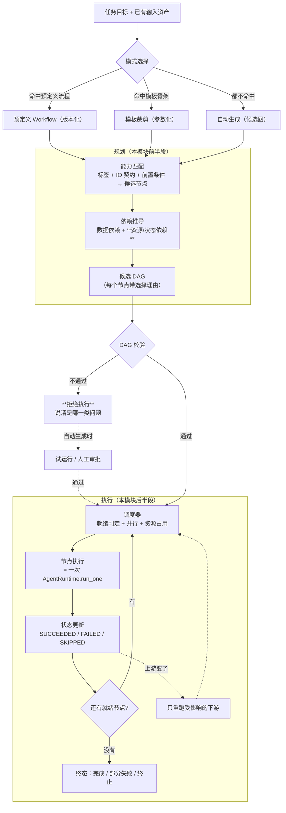
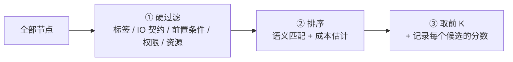
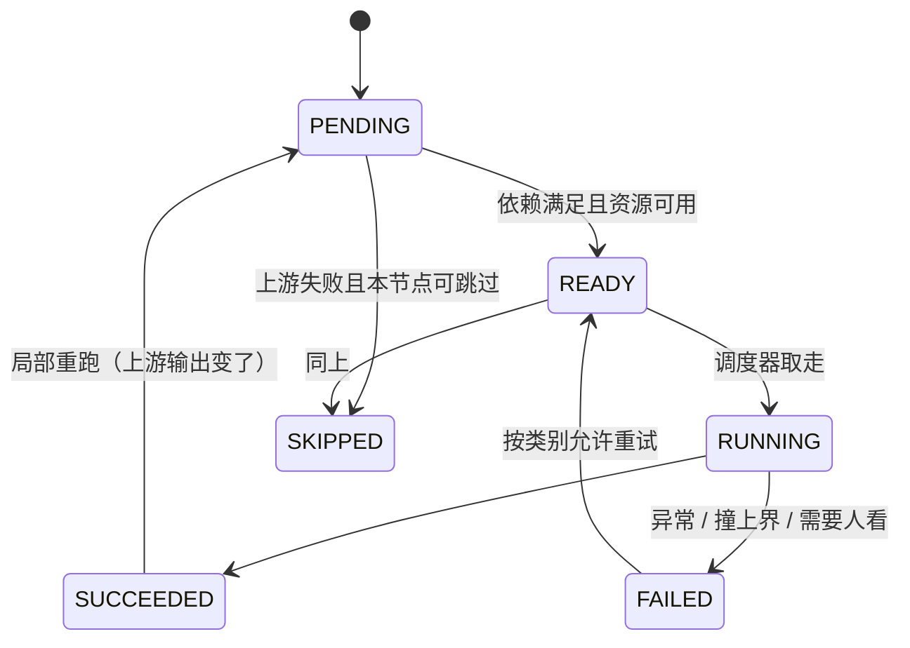

# `src/workflow` 需求说明书（Agent 池驱动的动态 Workflow）

| 项 | 值 |
|---|---|
| 文档层级 | **需求层**（第一篇）。后续：《`src/workflow` 架构概要设计》 |
| 覆盖范围 | 规划的 `src/workflow/` 全部文件（Agent 池、能力匹配、依赖推导、DAG 校验、调度、执行引擎、模板） |
| 上游依赖 | `foundation`（配置 / 时钟 / ID）、`src/repo`（图级检查点、workflow 资产） |
| 下游消费 | `src/multiagent`（协作策略内部可以拿它当执行器）、`apps/cli` · `apps/server` · `apps/mcp` |
| 关键外部依赖 | 无。**节点执行是注入进来的协议** —— 本模块不认识 agent，也不认识模型 |
| 强耦合 | `docs/agent/需求说明书-agent.md`（一个节点就是一次 `AgentRuntime.run_one`）；`docs/repo/需求说明书-repo.md`（`FR-R-05` 断点续跑） |
| 状态 | 待评审 |

---

## 1. 这份文档回答什么

只回答**要解决什么问题**、**必须提供哪些能力**、**什么算合格**。

**本文不回答**：DAG 怎么存、调度器怎么写、能力元数据用什么格式。
文中文件名仅用于圈定职责边界。

**前置阅读**：`docs/agent/需求说明书-agent.md` §3.3（单 agent 是**零件**，
它不知道自己被编排）；`docs/tool/需求说明书-tool.md` §2.2（副作用不能重来 ——
编排层会**放大**这个问题，见 §2.2）。

---

## 2. 背景与定位

### 2.1 为什么需要一层独立的编排

平台的七个测试阶段天然有**顺序与依赖**：

- 缺陷归因依赖诊断证据，而诊断依赖执行结果，执行依赖环境就绪；
- 用例生成依赖需求解析的结论，而需求解析要先读到真实的需求文档；
- 一批用例之间**没有数据依赖**，但它们抢同一个测试环境 —— 于是也必须串行。

把这些顺序**写死在代码里**，会得到一棵改不动的调用树：每加一种任务类型，
就要在树里插一个分支；每换一次执行顺序，就要改一处 `if`。

把顺序**完全交给模型临场决定**，会得到另一类问题：它每次给的图都不太一样，
错的地方藏在"某个节点的输入其实接不上上游的输出"这种地方 —— **不报错**，
只在运行时以一个语焉不详的失败暴露出来。

所以本模块要的是第三条路：**把「谁来做、按什么顺序」变成一个可以校验、可以执行、
可以观察的显式对象** —— 一张图。

### 2.2 本模块真正难的地方：图的**适配**，而不是图本身

画一张 DAG 不难。难的是这张图**真的跑得起来**。三处具体的难：

**① 有一类依赖根本不在数据流里。**

数据依赖可以从输入输出契约推出来（下游要的字段，上游给不给得出来）。
但测试场景里最常见的依赖恰恰**不是**数据依赖：

| 依赖 | 从哪来 | 漏掉它的后果 |
|---|---|---|
| **数据依赖** | 下游的必需输入字段 ⊆ 上游的输出字段 | 节点拿到空输入，跑到一半才炸 |
| **资源 / 状态依赖** | 两个节点**声明了同一个独占资源**（同一台设备、同一个测试环境、同一份配置） | **并行跑两个各自以为独占环境的节点** → 偶发失败，且**只在高并发时出现** |

第二类**推不出来** —— 它不是从数据流里长出来的，只能由节点**显式声明**
「我需要独占 `env:5g-lab`」。于是：

> 本模块把「资源」提升成一等公民：**两个节点声明了同一个独占资源，就自动产生一条串行边。**
> 这条边在数据流里**看不见**，而少了它，图的正确性就没有保障。

**② 自动生成的图看起来总是合理的。**

模型能画出一张漂亮的流程图，每个框都像一个步骤。而错误集中在三处：
接不上的输入输出、引用了一个不存在的节点、以及**并行度与资源对不上**。
这三处**都不会在生成时报错** —— 它们只在执行时暴露，而那时已经花掉了一部分预算。

**③ 一个节点失败，不等于整张图失败。**

二十个节点的图里有三个用例失败了。是整张图重来（浪费前面十七个节点的钱），
还是只重跑受影响的下游（但哪些受影响？）—— 这个判断需要**依赖关系本身**
作为依据，而"重试"这种朴素做法没有这个信息。

> 所以本模块的第一目标不是「能生成图」，而是
> **「图在跑之前就被证明是可跑的，跑起来之后每一步的状态都是可解释的」**。

### 2.3 这个目标做不到 100%，必须说清楚做到哪

| 做不到 | 能做到 |
|---|---|
| 保证自动生成的图**一定**可跑 | 保证**不可跑的图在跑之前被拒**（校验器是 fail-closed 的） |
| 保证选出来的图是**最优**的 | 保证每个节点的选择**有理由可读**，且理由能被复核 |
| 保证并行绝对不冲突 | 保证**声明过的**资源冲突被挡住；**没声明的**推不出来（`NFR-W-08` 要求把它说出来） |
| 保证一次跑完 | 保证失败是**局部**的：可跳过、可回退、可只重跑受影响的下游 |
| 保证模型规划的图直接进生产 | 保证**未经试运行或人工审批的自动图不得执行**（`FR-W-20`） |

**最后一条是本模块的立场**：自动生成是**候选**，不是**执行计划**。
「模型画了一张图，我们就照跑」这件事，在一套会产生真实副作用的测试平台上不能接受。

---

## 3. 范围

### 3.1 本模块负责

| 职责 | 落点（规划） |
|---|---|
| **Agent Pool**：能力元数据的注册、查询与候选过滤 | `pool.py` |
| **能力匹配**：从任务与输入资产选出候选节点 | `pool.py` / `planner.py` |
| **依赖推导**：数据依赖 + 资源/状态依赖 → 候选 DAG | `planner.py` |
| **DAG 校验**：IO 匹配、依赖闭合、无环、权限、资源（**执行前的一道闸门**） | `validator.py` |
| **调度**：就绪判定、并行、失败处置、局部重跑 | `scheduler.py` |
| **执行引擎**：把上面串起来跑完一张图（对外唯一入口） | `engine.py` |
| **三种工作模式**：预定义 / 模板裁剪 / 自动生成 | `templates.py` + `planner.py` |
| **图级检查点**：节点级的中间结果与状态 | `engine.py` × `repo` |
| **图的事件与可观测** | `engine.py` |

### 3.2 本模块明确不负责

| 不做的事 | 归属 |
|---|---|
| **单个 agent 内部怎么做**（提示词、工具、预算、续跑判定） | `src/agent` —— 本模块只知道「一次 `run_one` 是一次节点执行」 |
| 模型怎么选、重试、降级、计量 | `src/gateway` |
| 多个 agent 怎么**协作与汇总**（辩论、委员会、投票） | `src/multiagent`（见 §3.3） |
| 可持久化的能力定义（带版本的技能） | `src/skill`（**空桩**，一期节点只认 agent） |
| 图定义与执行记录的**落库** | `src/repo`（本模块只产生数据；见 §10 的一处待补） |
| 长期记忆、上下文压缩 | `src/memory` / `src/context` —— **逐节点的**，不由编排层统管 |

### 3.3 与 `src/multiagent`、`src/agent`、`multiagent/workflow` 的分工（容易混，先定清楚）

**① 与 `src/agent`：节点 vs 图。**

| | `src/agent` | **`src/workflow`（本模块）** |
|---|---|---|
| 是什么 | **一个节点**：一次任务怎么跑完 | **一张图**：这些节点按什么顺序跑 |
| 一次运行 | `AgentRuntime.run_one()` → `RunOutcome` | 一张图的多个 `RunOutcome` |
| 认识对方吗 | **不认识**。agent 明确不持有"我正在被编排"的假设（`NFR-A-02`） | **也不 import agent**：节点执行是一个**注入的协议**（§10） |

第二条是本设计的一个硬选择：**本模块不 import `src/agent`**。
理由是它换来两件东西 —— 执行引擎可以**用假节点单测**（不必真的起 agent），
以及未来 `src/skill` 落地后，skill 节点可以复用同一套调度，而不必改引擎。
代价是组合根要多做一次注入（把 `AgentRuntime` 包成节点执行器）。

**② 与 `src/multiagent`：协作 vs 顺序。** 这是最容易混的一处。

| | `src/multiagent` | **`src/workflow`（本模块）** |
|---|---|---|
| 回答的问题 | **要不要多 agent、多个怎么合**（辩论 / 委员会 / 并行 / 层级） | **谁先做、谁依赖谁、能不能并行** |
| 典型产物 | 「三个 agent 各写一版用例，然后投票」 | 「环境准备 → 执行 → 分析 → 缺陷」这张图 |
| 与对方的关系 | 它的协作策略**可以用** workflow 来执行（例如辩论的三轮就是一张串行图） | **不认识"辩论""投票"这些词** |

一句话：**multiagent 决定「谁和谁比」，workflow 决定「谁先谁后」**。
本模块不实现任何协作语义；multiagent 需要按顺序跑若干 agent 时，把本模块当执行器用。

**④ 与组件层（`src/strategy`，见 `docs/strategy/`）：编排层**不决定**「节点内部怎么做」。**

系统分三层，本模块只占中间那层：

| 层 | 模块 | 回答 |
|---|---|---|
| 组件层 | `src/strategy` | 单个 agent **内部**用哪套策略（上下文 / 记忆 / 检索 / 工具 / 权限 / 验证 / 执行） |
| **编排层** | **`src/workflow`（本模块）** | **多个节点谁先谁后、能不能并行、失败了怎么办** |
| 优化层 | `src/experience` | 从执行反馈里提炼经验，反过来改进上面两层 |

所以本模块**不 import `src/strategy`，也不认识 `AgentProfile`** ——
一个节点用什么组件配置，是**节点自己**（或产出它的那次装配）的事。

反过来也成立：编排层**不得**为了让某类节点"更快"而替它挑策略。
那等于把「组合爆炸的控制」从组件层偷偷搬进图里 —— 而图里的组合空间比策略库大得多，
组件层辛苦建立的契约校验在这里一点都用不上。

**③ 与 `src/multiagent/workflow/`（一个空的同名子包）：明确作废。**

目录里已经有一个 `src/multiagent/workflow/`，四个文件（`workflow.py` / `node.py` /
`edge.py` / `executor.py`）**全是 0 字节**。它与本模块**不是同一件事**，也不该并存：

- 执行引擎要被**多处复用**（multiagent 的三种策略、未来的 skill 编排、apps 直调）。
  把它放在 `src/multiagent/` 内部，会让"只想要一个 DAG 执行器"的使用方**被迫依赖整个多 agent 层**；
- 两份同名概念并存，下一个人分不清该往哪个 `workflow.py` 里加东西 ——
  而**项目已经吃过一次这个亏**（gateway 的顺序规则曾有两个实现）。

**结论：`src/multiagent/workflow/` 作废**（四个空文件删除或保留为空占位并在 `__init__` 里注明），
本模块是 Workflow 的**唯一归属**。这条写进 §9 的决策点 `DW-1`。

---

## 4. 一张图的责任链



**三个"必须显式"的地方**（都不允许静默处理）：

| 位置 | 静默处理的后果 |
|---|---|
| **校验不通过仍然执行** | 一个接不上的图跑到一半失败，前面节点的钱白花，而错误现场离原因很远 |
| **资源依赖没被推导出来** | 两个节点并行抢同一个测试环境 → **偶发**失败，只在并发时出现 |
| **节点失败一律重试** | 需求本身矛盾时反复调同一个 agent 通常无效（而且烧钱）；权限不足时该申请授权，不是重试 |

---

## 5. 功能需求

编号 `FR-W-xx`。

### 5.1 Agent Pool 与能力元数据

#### FR-W-01 — Pool 是**能力注册表**，不是实例集合

**要求**：

- `Agent Pool` 的每一条是个 **Agent 描述**：一个名字 + 一份**能力元数据** + 一个**执行入口**；
- 执行入口是**注入的**（协议形状，见 §10），不是 `import src.agent`；
- 注册时**重名硬失败**（与 `FR-T-02` / `FR-A-01` 同一条纪律：静默覆盖会让一个 agent 悄悄失效）；
- 名字是**稳定的标识**，不带版本 —— 版本进元数据（`FR-W-02`），
  因为"同一张图在两次运行里选了不同的实现"是排查时最难的一类问题。

**验收点**：注册两个同名 agent → 报错；查一个不存在的名字 → 报错并**列出全部可用名**。

#### FR-W-02 — 能力元数据至少要能回答这六个问题

**要求**：每条 Agent 描述必须携带下表六类信息。**缺任何一类都要在注册期报错**，
而不是等运行时才发现"推不出依赖"：

| 类别 | 字段（示例） | 它回答的问题 |
|---|---|---|
| **能力标签** | `tags: [requirement_parse, protocol_lookup]` | 这个 agent **能干什么**（粗筛用） |
| **输入 / 输出契约** | `inputs` / `outputs`（字段名 + 类型 + 是否必需） | 它的**输入从哪来、产出能给谁**（依赖推导的依据） |
| **前置条件** | `requires: [env:ready]`、`needs_assets: [test_cases]` | 跑它**之前必须先有什么** |
| **执行属性** | `parallelizable` / `side_effects` / `retryable` | 能不能并行、有没有副作用、能不能重试 |
| **资源属性** | `exclusive_resources: [env:5g-lab]`、`est_latency_s` / `est_tokens` | 它**占什么、花多少** |
| **版本** | `version` + `impl` | 是**哪一版实现**（可解释性与回滚） |

**验收点**：注册一个缺 `outputs` 的 agent → **注册期**就报错并说清缺哪一类。

#### FR-W-03 — 能力匹配是三段漏斗，**不是让模型按名字挑**

**要求**：



- **第①段必须是确定性的**（不调模型）：能干的先留、不能干的先出局。
  只在硬过滤之后才允许用模型做排序 —— 顺序反过来的话，模型会选出一个
  "听起来对但输入接不上"的节点，而**那正是自动生成最大的坑**；
- 硬过滤**至少**检查：任务要求的标签 ⊆ agent 标签、所需输入在**当前可用资产**里能凑齐、
  前置条件能被满足、本次运行**有权限**跑它；
- 排序必须给出**分数与依据**（语义相似度 / 成本估计），供 `FR-W-10` 的理由输出用。

**验收点**：给一个需要 `env:5g-lab` 的任务 → 只有声明了该资源的 agent 进入候选；
把 `use_llm_ranking` 关掉 → 仍然能选出一个**合法**的候选集（只是可能不是最好的）。

### 5.2 三种工作模式（**不是相互替代**）

#### FR-W-04 — 三种模式并存，各有各的适用面

| 模式 | Workflow 来源 | 典型场景 | 确定性 |
|---|---|---|---|
| **预定义** | 人工设计、**版本化管理** | 完整测试分析与执行 | 最高 |
| **模板化** | 预定义骨架 + **参数化裁剪** | 已有用例，只跑「环境准备 → 执行 → 分析」 | 高 |
| **自动生成** | 依任务目标与 Agent 能力**动态规划** | 临时评估、专项验证、没有先例的组合 | 最低 |

**验收点**：三种模式各自能跑通同一个小任务（用同一套执行引擎）。

#### FR-W-05 — 模式选择顺序固定：**预定义 → 模板 → 自动**

**要求**：

- 选择顺序**不能反**：能用预定义的绝不用模板，能用模板的绝不自动生成；
- 理由是**确定性递减、成本与风险递增**：预定义图是被人审过、跑过的；
  自动生成的图只被校验器看过一遍；
- 每次选择都要**说出为什么落到这一档**（「命中了模板 X，因为它要求的资产都在」）；
- `auto` 模式**默认关闭**，必须显式打开（见 `C-W-3`）。

**验收点**：同时存在一个匹配的预定义流程和一个模板 → **选预定义**，且理由可读。

#### FR-W-06 — 模板裁剪必须是**可解释的**

**要求**：

- 模板裁剪 = 从骨架里**去掉**若干节点（如"已有用例 → 去掉用例生成"），
  而不是重新规划一张图；
- 裁剪**必须**记录：去掉了哪些节点、依据是什么（哪个输入资产已经存在）；
- 裁剪之后**仍然要过校验器**（`FR-W-11`）—— 去掉一个节点可能让另一个节点的输入悬空，
  而那正是裁剪最典型的错误。

**验收点**：给"已有用例"的输入 → 裁掉 `test_case` 节点，
且验证器**没有**因此报"某节点输入缺失"；人为去掉一个被依赖的节点 → **校验报错**。

### 5.3 节点选择与依赖推导

#### FR-W-07 — 节点选择要产出**选择理由**

**要求**：

- 每一个入选节点都要带：**分数**、**命中了哪些标签**、**它的输入由谁提供**、
  （自动生成时）**模型给的理由**；
- 每一个**落选**的候选也要留下痕迹（至少是"被哪一条硬过滤挡掉了"）——
  「为什么没用那个 agent」与「为什么用了这个」同等重要。

**验收点**：拿一张生成好的图 → 能逐节点回答"它为什么在这里"。

#### FR-W-08 — 数据依赖从 IO 契约**推导**

**要求**：

- 若节点 B 的某个**必需输入**字段，能从节点 A 的**输出**字段中匹配到，
  则 A → B 有一条**数据依赖**边；
- 匹配规则**必须确定**（同名字段优先；允许配置的类型兼容表）；
- **歧义要说出来**：多个上游都能提供同一个字段时，不许默默取第一个 ——
  要么按配置的优先级规则选并记录，要么报"歧义"让人裁决。

**验收点**：B 要 `env_status`、A 输出 `env_status` → 有一条 A→B 的边；
两个上游都能给 → 不静默二选一。

#### FR-W-09 — 资源 / 状态依赖**必须从声明推出来**（本模块的核心之一）

**要求**：

- 节点通过 `exclusive_resources` 声明它**独占**哪些资源（测试环境、设备、共享配置、端口）；
- **两个节点声明了同一个独占资源 → 自动产生一条串行边**（顺序可配，默认按拓扑序）；
- 这条边**不是数据边**：它不传数据，只表达"不能同时"；
- **推不出来的部分必须明说**：没有声明独占资源的节点，引擎**无法**判断它会不会冲突。
  这一点要写进文档与 `doctor`（`NFR-W-08`）—— 让人以为"配了就安全"比不配更危险；
- 资源可以有**容量**（`capacity: 2` 表示最多两个节点同时占用），默认容量 1（独占）。

**验收点**：两个都声明 `env:5g-lab` 的节点 → 图里有一条串行边，调度时**不会**并行；
把容量配成 2 → 允许并行。

#### FR-W-10 — 依赖必须是**两类都算**，缺一不可

**要求**：就绪判定同时看两类边：

```
节点就绪 = 所有「数据依赖」的上游 SUCCEEDED
        且 所有「资源依赖」的互斥节点**没有正在跑的**
```

- 只算数据依赖 → 资源冲突（`FR-W-09`）；
- 只算资源依赖 → 拿到空输入。

**验收点**：构造一张只有资源冲突、没有数据依赖的图 → 串行执行（而不是并行）。

### 5.4 DAG 校验（**执行前的一道闸门**）

#### FR-W-11 — 五类校验，一类都不能少

| # | 校验 | 检查什么 | 不通过时的症状（若不检查） |
|---|---|---|---|
| 1 | **IO 匹配** | 每个节点的必需输入，都能由上游输出或初始资产提供 | 节点拿着空输入跑，跑到一半才炸 |
| 2 | **依赖闭合** | 没有引用不存在的节点；没有悬空的边 | 调度器永远等一个不存在的节点 |
| 3 | **无环** | 有向无环 | 死锁（互相等对方） |
| 4 | **权限** | 节点要求的权限 ⊆ 本次运行的授权 | 跑到那个节点才被工具层拒绝 |
| 5 | **资源** | 同一独占资源上的并行度 ≤ 容量；声明的资源确实存在 | 两个节点抢同一个环境（`FR-W-09`） |

**验收点**：五类各构造一个坏图 → 校验器**都能报出来**，且**都不执行**。

#### FR-W-12 — 校验失败**不得执行**（fail-closed）

**要求**：

- 校验不通过 → **一个节点都不跑**，并返回结构化的问题列表（哪一类、哪个节点、为什么）；
- **不允许"跳过有问题的节点继续跑"** —— 一个节点被跳过，它的下游就是拿空输入在跑；
- 校验**有能力**被显式跳过，但它必须是一个**显式的配置动作**（`C-W-4`），
  且跳过时**必须告警**与留痕；
- 校验的结论**必须确定**：同一张图校验两次，结论一致（`NFR-W-05`）。

**验收点**：把配置设成"不校验" → 能跑，但事件与日志里**明确标出这次没校验**。

#### FR-W-13 — 校验问题要说清**是哪一类、在哪个节点**

**要求**：错误信息必须能直接照着改，例如：

```
[IO 不匹配] 节点 defect_triage 的必需输入 'diagnosis_evidence' 无人提供。
  可能的上游：analysis（输出 hypothesis，非该字段）
  建议：检查 analysis 的输出契约，或在初始资产里提供 diagnosis_evidence
```

**验收点**：五类错误各有一条可读的信息，且都指出了具体节点名。

### 5.5 调度与执行

#### FR-W-14 — 节点状态机



- 六个状态**一个都不能少**：`SKIPPED` 与 `FAILED` 必须分开 ——
  「这条没跑」和「跑了但失败了」是两件事，混在一起会让"这次到底覆盖了多少"无法回答；
- `needs_review`（agent 层的终态）映射成 `FAILED` + 一个**可区分的理由**，
  而不是单独第七个状态 —— 它在图这一层的语义确实是"这个节点没成"；
- 每个状态变化都要**可观测**（`FR-W-21`）。

**验收点**：跑一张图，构造出全部六种状态，且每种都能在事件里查到。

#### FR-W-15 — 就绪判定与并行

**要求**：

- 就绪判定见 `FR-W-10`（两类依赖都要看）；
- **并行有上界**（`max_parallel`）：不是所有就绪节点都同时跑 —— 一个图跑出二十个并发请求，
  对 gateway 的限流与成本都是灾难；
- 并行**不得**破坏 `FR-W-09` 的资源约束；
- 同一张图**两次运行**在相同输入下，**串行部分的顺序必须一致**（`NFR-W-05`，
  并行部分不要求）—— 否则"上次能过这次不过"永远查不清。

**验收点**：一张有 5 个可并行节点、`max_parallel=2` 的图 → 并发度**从不超过 2**。

#### FR-W-16 — 失败按**类别**处置，不是一律重试

| 类别 | 处置 | 为什么 |
|---|---|---|
| **瞬时故障**（网络抖动、限流） | **有限重试**（`retry_max`） | 重试真的能解决 |
| **输入/需求问题**（依赖缺失、需求矛盾） | **不重试**，标 `FAILED` | 反复调同一个 agent 通常无效，只会烧钱 |
| **权限不足** | **不重试**，显式指出缺什么 | 该做的是申请授权（与 `FR-T-09` 同一条纪律） |
| **需要人看**（agent 返回 `needs_review`） | **停下并上报**，不自动继续 | 那是 agent 层明确交上来的人工决策点 |
| **可跳过**（该节点有兜底分支/非必需） | 标 `SKIPPED`，继续跑下游 | 图里有些节点是"锦上添花" |

**要求**：处置策略可配（`C-W-5`），但**默认不许"一律重试"**。

**验收点**：构造四类失败各一次 → 只有瞬时那一次重试了。

#### FR-W-17 — 局部重跑：上游变了，**只重跑受影响的下游**

**要求**：

- 上游节点的输出发生变化（或它被重跑过）→ 只把**它的传递闭包内**的下游标回 `PENDING`；
- **不受影响的分支不重跑**（这是本模块存在的价值之一：省的是真金白银）；
- 重跑的范围要**可解释**：说清"重跑了哪几个节点、因为谁变了"。

**验收点**：一张菱形图（两条并行分支汇合）→ 改左分支的输入 → **只重跑左分支与汇合点**，
右分支不重跑。

#### FR-W-18 — 图级检查点：崩了不用整图重来

**要求**：

- 每个节点结束（成功/失败/跳过）写一条**节点级**检查点：节点 id、状态、输出**摘要**、耗时；
- 恢复时**已完成且输入未变**的节点**不重跑**；
- 检查点复用 `repo` 的既有机制（`FR-R-05`），**不新造一套**；
- 与 agent 层的关系要写清：**agent 的检查点管「一次运行内部跑到第几步」，
  图的检查点管「这张图跑到哪个节点」** —— 两层，不重叠（与 `docs/agent` 里
  「检查点 / 幂等」的分工是同一个思路）。

**验收点**：跑到第三个节点时中断 → 恢复后**前两个不重跑**；
把第二个节点的输入改掉 → 它和它的下游**重跑**。

### 5.6 自动生成的两阶段（**候选不是执行计划**）

#### FR-W-19 — Planner 产出的是**候选图**，且带理由

**要求**：

- Planner 的输出包含：节点集、边集、**每个节点的选择理由**、
  每个节点的**输入来源**（由哪个上游/资产提供）；
- Planner **不得**直接触发执行；
- 生成的图**必须**过 `FR-W-11` 的校验，与预定义图**同一套校验器、同一个标准** ——
  不许因为"它是模型生成的"就放松。

**验收点**：让 Planner 生成一张图 → 拿到的是候选对象，**没有任何节点被执行**。

#### FR-W-20 — 未经**试运行或人工审批**，自动图不得执行、不得存为模板

**要求**：

- 两条放行路径，二选一：
  - **试运行**（dry-run）：在一个受控范围内真的跑一遍（或跑一个子集），拿到结果再决定；
  - **人工审批**：把候选图、选择理由、校验结论一起交给人；
- 两条路径都**必须留痕**：谁批的 / 试运行的范围与结果；
- **未放行的图不得写入模板库** —— 否则一次没验证的规划会变成"以后都照这个跑"，
  而它的错误会被固化下来。

**验收点**：`auto` 模式下生成一张图 → **不会自动执行**；未经审批尝试存模板 → **被拒**。

### 5.7 可观测

#### FR-W-21 — 一张图跑完，要能回答这四个问题

| 问题 | 靠什么回答 |
|---|---|
| **为什么是这张图**（模式选择 + 节点选择理由） | `workflow.plan.generated` / `workflow.mode.selected` |
| **每个节点跑了多久、花了多少、结果如何** | `workflow.node.finished` |
| **哪些节点被跳过了、为什么** | `workflow.node.skipped` |
| **重跑了什么、因为谁变了** | `workflow.rerun` |

**要求**：至少覆盖上表事件；载荷里要带**节点 id**（不是节点名，重跑时会重名）。

**验收点**：拿一个 `workflow_run_id` → 能把整个过程还原出来。

---

## 6. 非功能需求

| 编号 | 需求 | 说明 |
|---|---|---|
| `NFR-W-01` | **依赖方向单向** | workflow → foundation / repo。**不得** import `provider`（会补进 import-linter 契约，见 §9 `DW-8`）；**不得** import `agent`（节点执行是注入的协议，§3.3）；**不得** import `multiagent`（依赖方向相反） |
| `NFR-W-02` | **引擎与节点解耦** | 执行引擎只认「节点执行器」协议；用假执行器就能测调度、并行、失败处置 —— 不必真的起 agent |
| `NFR-W-03` | **校验是 fail-closed 的** | 校验不通过一个节点都不跑（`FR-W-12`）；跳过校验必须是显式配置且留痕 |
| `NFR-W-04` | **不放大故障** | 单个节点失败**不得**让进程崩；图的**收尾**（检查点、事件）是旁路，失败只告警 |
| `NFR-W-05` | **确定性** | 依赖推导、校验、就绪判定**必须确定**（同输入同结论）；并行度不保证，但串行顺序必须一致 |
| `NFR-W-06` | **有界** | 节点数、并行度、重试次数、单图总时延与总成本都有上界；**没有"不限"这个选项** |
| `NFR-W-07` | **可测试** | 调度、就绪、局部重跑必须能用假时钟与假执行器测，不得依赖真实 `sleep` |
| `NFR-W-08` | **能力边界要诚实标注** | 资源冲突**只在声明过的资源上**能被挡住；没声明的推不出来。这一点要写进文档、配置与 `doctor` —— 让人以为"配了就安全"比不配更危险（与 `NFR-T-10` 同源） |
| `NFR-W-09` | **可观测** | `FR-W-21` 的四类事件必须发；「为什么是这张图」要能从事件还原 |
| `NFR-W-10` | **不静默降级** | 「自动生成被关闭」「校验被跳过」「某节点因缺资源未并行」都必须在日志或 `doctor` 里可见 |

---

## 7. 配置需求

```yaml
workflow:
  enabled: true

  # 模式（FR-W-04 / FR-W-05）。**选择顺序固定**：predefined → template → auto
  mode: predefined          # predefined | template | auto | choose
  # choose = 按上面的顺序自动挑一档（推荐）；写死某一档则只用那一档

  pool:
    # 注册期就校验能力元数据是否完整（FR-W-02）
    require_metadata: true
    # 硬过滤之后要不要用模型排序（FR-W-03，第二段）
    use_llm_ranking: false
    ranking_alias: runtime.default
    max_candidates: 8       # 排序后最多留几个候选

  planner:
    max_nodes: 20           # 一张图的节点数上界（NFR-W-06）
    data_dependency: schema # schema | name | off  （FR-W-08 的匹配规则）
    # 多个上游都能提供同一字段时：报歧义 / 按优先级（FR-W-08）
    on_ambiguous_provider: reject   # reject | priority
    resource_order: topo    # topo | config （FR-W-09 里那条串行边的顺序）

  validate:
    enabled: true
    # 关掉校验是**显式动作**，会告警并留痕（C-W-4）
    checks: [io, closure, cycle, permission, resource]

  schedule:
    max_parallel: 4         # 并行上界（FR-W-15）
    on_node_failure: classify   # classify | fail_fast | continue
    retry_max: 1            # **只对瞬时故障**生效（FR-W-16）
    rerun_dependents: true  # 上游变了只重跑传递闭包（FR-W-17）
    max_nodes_per_run: 200  # 含重跑的节点执行总次数上界
    deadline_s: 1800        # 整图时间预算

  resources:
    # 声明式独占资源（FR-W-09）。容量默认 1（独占）
    "env:5g-lab": { capacity: 1 }
    "device:modem-pool": { capacity: 2 }

  templates:
    dir: configs/workflows  # 预定义与模板的存放目录（版本化）

  auto:
    allow: false            # **默认关闭**（C-W-3）
    require_approval: true  # 未经试运行/审批不得执行、不得存模板（FR-W-20）
    dry_run: false          # 放行路径选"试运行"时打开

  emit_events: true
```

**要求**：

- `C-W-1` **`mode` 默认 `predefined`**：确定性最高的那一档做默认值；
- `C-W-2` `validate.enabled` 默认 **true**，且**关掉它要能在启动日志与 `doctor` 里看到**
  —— 一个关了校验的部署和一个没关的，从外面看是一样的；
- `C-W-3` **`auto.allow` 默认 `false`**：自动生成图这件事必须是**显式开启**的；
- `C-W-4` `validate.enabled=false` 时**必须告警**（`FR-W-12`）—— 不许静默跳过闸门；
- `C-W-5` `on_node_failure` 默认 `classify`，**不提供"一律重试"这个选项**；
- `C-W-6` `schedule` 的四项**没有"不限"**：并行、重试、节点执行总数、时间都要有值；
- `C-W-7` `resources` 里声明的资源，如果**没有任何节点引用**，启动期告警 ——
  多半是设备名拼错了；
- `C-W-8` 所有键走 `${VAR:-default}` 插值与 `configs/<env>.yaml` 深合并（`foundation.settings` 的既有约定）。

---

## 8. 验收标准（场景化）

**Agent Pool（§5.1）**

| # | 场景 | 期望 |
|---|---|---|
| `CW-1` | 注册两个同名 agent | **硬失败** |
| `CW-2` | 查询不存在的 agent | 报错并**列出全部可用名** |
| `CW-3` | 注册一个缺 `outputs` 的 agent | **注册期**报错，说清缺哪一类 |
| `CW-4` | 任务需要 `env:5g-lab` | 只有声明了该资源的 agent 进候选 |
| `CW-5` | 关掉 `use_llm_ranking` | 仍能选出**合法**的候选集 |

**三种模式（§5.2）**

| # | 场景 | 期望 |
|---|---|---|
| `CW-6` | 同时有匹配的预定义流程与模板 | 选**预定义**，理由可读 |
| `CW-7` | 已有用例作为输入 | 模板**裁掉** `test_case` 节点，并记录依据 |
| `CW-8` | 人为裁掉一个被依赖的节点 | **校验报错**（IO 不匹配） |
| `CW-9` | `auto.allow=false` 时给一个没有先例的任务 | **不自动生成**，如实说"没有可用的流程" |

**依赖推导（§5.3）**

| # | 场景 | 期望 |
|---|---|---|
| `CW-10` | B 要 `env_status`、A 给 `env_status` | 有一条 A→B 的**数据边** |
| `CW-11` | 两个上游都能提供同一字段 | **不静默二选一**（报歧义或按优先级并记录） |
| `CW-12` | 两个节点都声明 `env:5g-lab` | 自动产生**串行边**，调度时**不并行** |
| `CW-13` | 该资源容量配成 2 | **允许并行** |
| `CW-14` | 两个节点没有任何数据依赖、但有资源冲突 | **串行**执行（`FR-W-10`） |
| `CW-15` | 某节点没声明任何独占资源 | 引擎**不声称**它安全 —— `doctor` 里能看出存在未声明资源的风险 |

**DAG 校验（§5.4）**

| # | 场景 | 期望 |
|---|---|---|
| `CW-16` | 必需输入无人提供 | 报 `IO 不匹配`，指出节点名与建议 |
| `CW-17` | 边引用了不存在的节点 | 报 `依赖不闭合` |
| `CW-18` | 图里有环 | 报 `有环`，**不执行** |
| `CW-19` | 节点要求超出本次授权的权限 | 报 `权限不足`，指出缺什么 |
| `CW-20` | 同一独占资源上的并行度超过容量 | 报 `资源冲突` |
| `CW-21` | 校验不通过 | **一个节点都没跑** |
| `CW-22` | 显式关掉校验 | 能跑，但**事件与日志明确标出"这次没校验"** |
| `CW-23` | 同一张图校验两次 | 结论**一致** |

**调度与执行（§5.5）**

| # | 场景 | 期望 |
|---|---|---|
| `CW-24` | 跑一张图 | 六种节点状态都能出现且可区分 |
| `CW-25` | 5 个可并行节点、`max_parallel=2` | 并发度**从不超过 2** |
| `CW-26` | 瞬时故障 | **重试**（≤ `retry_max`） |
| `CW-27` | 需求矛盾导致的失败 | **不重试**，直接 `FAILED` |
| `CW-28` | 权限不足 | **不重试**，指出缺什么 |
| `CW-29` | 某节点返回 `needs_review` | **停下并上报**，不自动继续 |
| `CW-30` | 非必需节点失败 | 标 `SKIPPED`，下游继续 |
| `CW-31` | 菱形图，改左分支输入 | **只重跑左分支与汇合点** |
| `CW-32` | 跑到第三个节点时中断 | 恢复后**前两个不重跑** |
| `CW-33` | 把第二个节点的输入改掉 | 它与它的下游**重跑** |

**自动生成（§5.6）**

| # | 场景 | 期望 |
|---|---|---|
| `CW-34` | Planner 生成一张图 | 拿到**候选**，**没有任何节点被执行** |
| `CW-35` | 自动生成的图不满足 IO | **同一个校验器**报错，不放宽 |
| `CW-36` | 未经审批尝试存模板 | **被拒** |
| `CW-37` | 试运行通过后 | 允许执行，且留痕（范围与结果） |

**边界与可观测（§5.7 / §6）**

| # | 场景 | 期望 |
|---|---|---|
| `CW-38` | 单节点失败 | 进程**不崩**；收尾失败只告警 |
| `CW-39` | 节点执行总数超过 `max_nodes_per_run` | 停止并说明撞的是哪个上界 |
| `CW-40` | 拿一个 `workflow_run_id` 查事件 | 能还原：模式选择 → 节点选择理由 → 每节点结果 → 重跑 |
| `CW-41` | 全仓库检索 | `src/workflow/` 不 import `provider` / `agent` / `multiagent` |
| `CW-42` | 用假执行器跑一张图 | 调度、并行、失败处置**都能测**，不必起 agent |

---

## 9. 决策点（需评审确认）

| 编号 | 决策点 | 备选 | 建议 |
|---|---|---|---|
| `DW-1` | **`src/multiagent/workflow/` 怎么办** | (a) 保留、本模块用 (b) **作废**、本模块是唯一归属 | **(b)**。执行引擎要被多处复用，放在 multiagent 内部会让"只想要一个 DAG 执行器"的使用方被迫依赖整个多 agent 层；两份同名概念并存会让下一个人不知道该往哪加东西 —— 项目已经吃过一次（gateway 的顺序规则有两个实现） |
| `DW-2` | 节点执行怎么接 | (a) 本模块直接 import `agent`；(b) **注入节点执行器协议** | **(b)**。换来两件东西：**能用假节点单测调度**（`NFR-W-02`/`CW-42`），以及将来 skill 节点复用同一套引擎不必改它。代价是组合根多一层包装 |
| `DW-3` | 资源依赖怎么来 | (a) 从数据流推；(b) **声明式独占资源**；(c) 让模型判断 | **(b)**。(a) 根本推不出来（资源冲突不在数据流里）；(c) 不确定，而"偶发失败"已经够难查了 |
| `DW-4` | 校验失败怎么办 | (a) 跳过坏节点继续；(b) **一个都不跑** | **(b)**。跳过坏节点 = 它的下游拿空输入在跑。与 tool 的"闸门"、memory 的 fail-closed 是同一条纪律 |
| `DW-5` | 自动生成的图能否直接执行 | (a) 直接执行；(b) **试运行或人工审批后才放行** | **(b)**。这套平台会产生**真实副作用**。"模型画了一张图就照跑"不能接受；而且**未验证的图不得进模板库**，否则一次没验证的规划会被固化 |
| `DW-6` | 失败一律重试吗 | (a) 一律重试；(b) **按类别**（瞬时重试、需求/权限不重试、可跳过则跳过） | **(b)**。需求本身矛盾时反复调同一个 agent 无效且烧钱；权限不足该做的是申请授权 |
| `DW-7` | 局部重跑的范围 | (a) 整图重来；(b) **只重跑传递闭包** | **(b)**。这是本模块省钱的地方 —— 菱形图里改一条分支不该重跑另一条 |
| `DW-8` | **workflow 要不要进 import-linter 契约** | (a) 进；(b) 不进 | **(a) 进**。它是一个**新的顶层模块**，默认不在任何契约里 —— 而"漏在契约外的模块"这件事项目已经吃过两次（`context` 曾漏、`runtime` 被删后契约报错）。新模块落地的同时把名字加进 `root_packages` 与该契约的 `source_modules`，是**一次提交里的事** |
| `DW-9` | 图定义存哪 | (a) 文件（配置目录）；(b) 数据库表 | **(a) 起步**（版本化、可 review、可进 git），(b) 留给"运行时保存的自动图"。后者需要 `repo` 新表，见 §11 |
| `DW-10` | 并行度上界放哪 | (a) 只由调度器管；(b) 调度器 + gateway 的限流一起管 | **(b)**。调度器管的是"图内的并发"，gateway 管的是"全局的调用速率"；两者都要有，缺一个都能把上游打爆 |

---

## 10. 与相邻模块的契约

| 相邻模块 | 契约 |
|---|---|
| `src/agent` | **一个节点 = 一次 `AgentRuntime.run_one()`**。本模块**不 import 它** —— 通过注入的**节点执行器协议**调用：`async run(node, inputs) -> NodeResult`。agent 侧**不需要任何改动**（它本来就不假设自己被编排） |
| `src/repo` | 图级检查点（复用 `FR-R-05` 的机制，`node_id` 用节点 id）；⚠ **workflow 资产的持久化（版本化模板）需要一张新表**，见 §11 |
| `src/multiagent` | 它是本模块的**下游消费者**：协作策略内部可以用本模块跑一张图。**本模块不认识任何协作语义** |
| `src/skill` | 未来节点可以是 skill（`FR-W-01` 的"执行入口"是协议，天然容纳）。**一期不做** —— skill 是空桩 |
| `src/context` / `src/memory` | **逐节点的**：每个节点自己建上下文、自己沉淀记忆。编排层**不统管**上下文 —— 一张图里不同阶段的上下文本来就该不一样 |
| `src/strategy` | **不依赖也不认识**：一个节点用哪套组件策略是**节点自己**的事（组件层）。编排层只决定「谁先谁后」，见 §3.3 ④ |
| `src/event` | 事件走统一出口（该模块目前是空桩，一期按 gateway/agent 的做法自行发） |
| `foundation` | `Clock`（假时钟可注入，`NFR-W-07`）、`Settings`（`workflow.*` 点分路径） |

---

## 11. 下一步

本文定稿后进入《`src/workflow` 架构概要设计》，届时需要产出：

- **能力元数据的 Schema**：六个类别各自的字段名与类型、注册期校验的具体规则；
- **候选过滤与排序**的算法（硬过滤的判定顺序、语义匹配用什么、成本估计用哪些字段）；
- **依赖推导**的两个算法：IO 契约匹配（含歧义处置）、独占资源 → 串行边（含容量与顺序）；
- **校验器**的五类检查各自的判定与错误信息格式；
- **调度器**：就绪判定的数据结构、并行的实现（`asyncio` 还是别的）、资源占用的记账；
- **局部重跑**的传递闭包怎么算、与检查点如何配合；
- **模式选择**的判定规则（"命中预定义"怎么算命中）；
- **自动生成的两阶段**：Planner 的输入输出、Validator 的检查项、放行流程的状态；
- **执行引擎的对外接口**与它的产出对象（图级结果：每个节点的 `RunOutcome` + 终态）；
- **事件清单**与载荷（节点 id、模式、理由）；
- **装配**：`Runtime` 加什么字段、`composition/workflow.py` 怎么把 `AgentRuntime` 包成节点执行器；
- **两处跨模块改动**（需要与对应文档一起定）：
  1. `src/repo/` 需要一张 **workflow 资产表**（版本化模板）与一张**图运行表**（或复用 checkpoint）；
  2. `pyproject.toml` 要把 `workflow` 加进 `root_packages` 与 provider 契约的 `source_modules`（§9 `DW-8`）。
